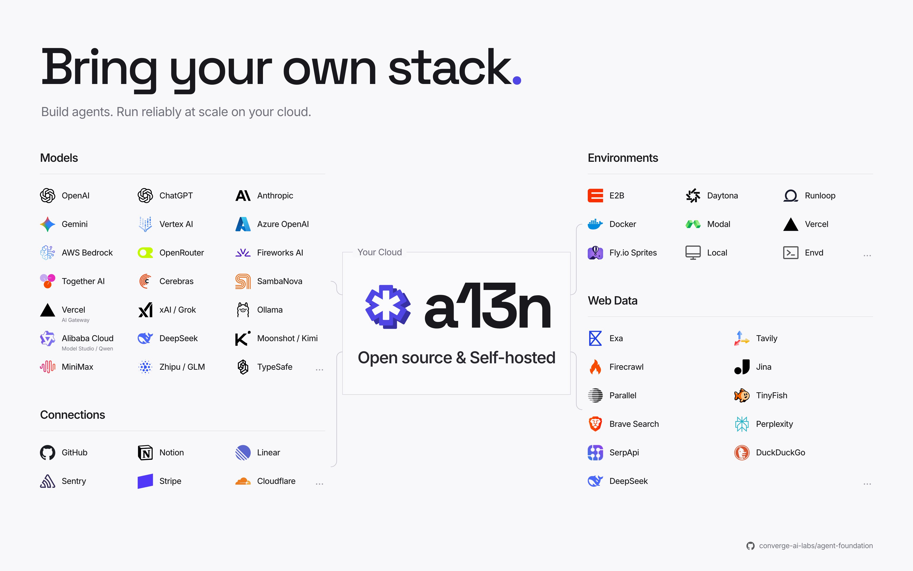
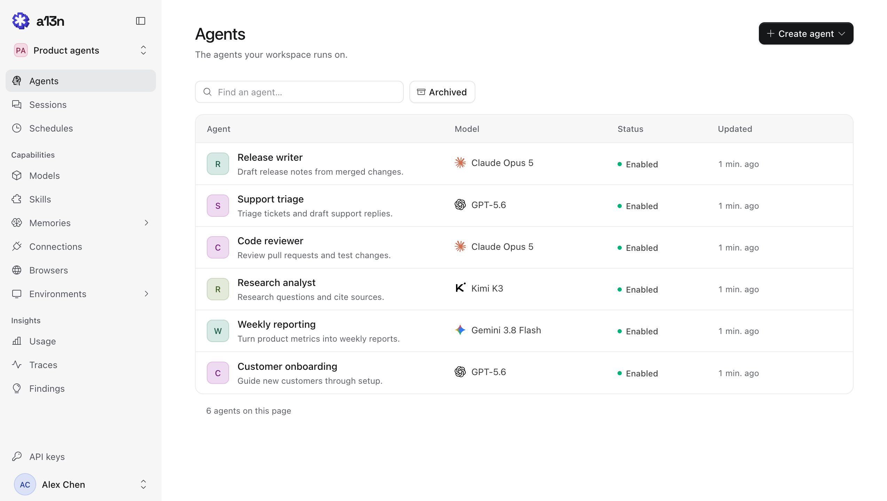

[](.github/assets/a13n-architecture.webp)

<h1 align="center">Agent Foundation (a13n)</h1>

[](https://github.com/converge-ai-labs/agent-foundation/actions/workflows/ci.yml) [](https://a13n.dev/docs/) [](https://www.python.org/) [](LICENSE) [](https://join.slack.com/t/a13n/shared_invite/zt-4embv13zr-JfXjmJQop4Y9y6K3NH0kDQ)

**Build and run cloud agents on your own infrastructure.**

a13n is an open-source managed agent service. It brings the harness, API, and Console together so you can build agent applications without building the serving infrastructure yourself.

- **Long-running tasks:** Agents keep working when clients disconnect.
- **Durable execution:** Interrupted runs can resume from saved checkpoints after worker failures.
- **Management and monitoring:** Configure agents, inspect runs, and track usage and cost in Console.

Choose your [model](docs/a13n-service/models.md), [sandbox](docs/a13n-service/environments.md), [search](docs/a13n-service/tools.md#web-search-and-scrape), and [memory](docs/a13n-service/memory.md) providers. Bring your own keys.

## Run Service

### Quickstart with Docker Compose

Install Docker and Docker Compose, then run:

```bash
mkdir a13n-service && cd a13n-service
curl -fL https://raw.githubusercontent.com/converge-ai-labs/agent-foundation/main/deploy/docker/compose/a13n-service.yaml -o a13n-service.yaml
docker compose -f a13n-service.yaml up -d --wait --pull always
```

Open <http://127.0.0.1:8080>:

1. Create your administrator account.
2. In **Models**, select **Add model** and configure a model using an API key or an eligible [ChatGPT subscription](docs/a13n-service/models.md#chatgpt-subscription-provider).
3. Create an agent with that model. Open **Connect to app** for its ID, Service URL, and an API key.

Call the agent from your application through the [HTTP API](docs/a13n-service/connect-application.md) or a [Python, TypeScript, Go, or Rust SDK](docs/a13n-service/sdks.md).

The stack runs Service, Console, PostgreSQL, and Redis. Agent environments use your host Docker Engine. See the [Compose guide](deploy/docker/compose/README.md) for configuration.

### Production on Kubernetes

Deploy to Kubernetes with our [Helm chart](deploy/kubernetes/README.md#other-clusters). Configure API and worker replicas and shared storage for [high availability](docs/a13n-service/operations.md#process-roles).

[](.github/assets/console-managed-agents.jpg)

Console with fictional demo data. See [run details from a scripted demo](.github/assets/console-run-details.jpg) and [workspace usage](.github/assets/console-usage.jpg).

## Use Harness directly

Service is built on Harness, which handles tool use, Skills, memory, and subagents. You can also use it without deploying Service:

- **In your application:** [Embed Harness](docs/a13n-harness/getting-started.md) in your Python code. Your application manages execution and storage.
- **On your machine:** Use [Harness UI](docs/a13n-harness-ui/index.md) to work with agents in a terminal or browser.

**Benchmarks:** Harness scored **58.06%** on 62 Terminal-Bench 4.0 tasks, compared with **58.77%** in published Codex results using the same model and reasoning effort. See the [methodology](https://github.com/converge-ai-labs/agent-foundation/discussions/1015) and [FrontierHarness evaluation](https://github.com/converge-ai-labs/agent-foundation/discussions/1064).

## Documentation

- [Service documentation](docs/a13n-service/index.md)
- [HTTP API and application integration](docs/a13n-service/connect-application.md)
- [Deployment and operations](docs/a13n-service/operations.md)
- [Examples](examples/README.md)

These guides track `main`. For an installed release, use its release notes and package metadata.

Ask questions on [Slack](https://join.slack.com/t/a13n/shared_invite/zt-4embv13zr-JfXjmJQop4Y9y6K3NH0kDQ) or [open an issue](https://github.com/converge-ai-labs/agent-foundation/issues) for bugs and feature requests. Read [CONTRIBUTING.md](CONTRIBUTING.md) before submitting changes.

You can self-host a13n under the [Apache 2.0 license](LICENSE). See [SECURITY.md](SECURITY.md) to report a vulnerability.
