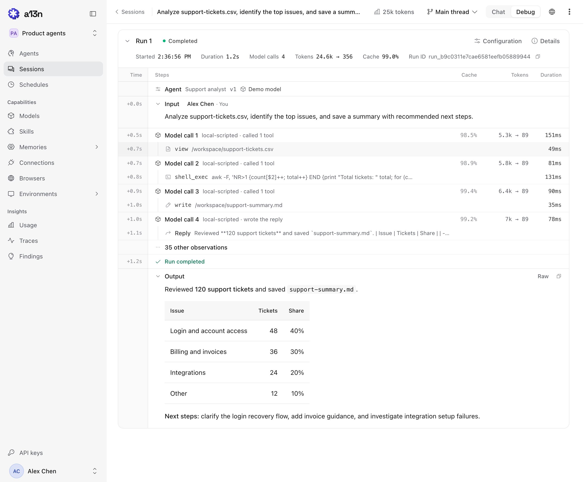

<h1 align="center">Agent Foundation (a13n)</h1>

[](https://github.com/converge-ai-labs/agent-foundation/actions/workflows/ci.yml) [](https://a13n.dev/docs/) [](https://www.python.org/) [](LICENSE) [](https://join.slack.com/t/a13n/shared_invite/zt-4embv13zr-JfXjmJQop4Y9y6K3NH0kDQ)

**Build, run, and manage AI agents at scale on your own infrastructure.**

a13n is an open-source service for long-running agents on your own infrastructure. Choose the model, give the agent instructions and tools, and send it work through an API. a13n runs the agent, saves its progress, and keeps working after your application disconnects.

[Run your first agent](docs/a13n-service/get-started.md) · [Connect your application](docs/a13n-service/connect-application.md) · [Embed Harness in Python](docs/a13n-harness/getting-started.md)

## Give an agent a task

A support team wants to know which issues account for the most tickets. Give an agent access to the ticket export and a sandbox. Your backend can submit the analysis with the [Python SDK](https://github.com/converge-ai-labs/a13n-sdk-python#quick-start):

```python
from a13n import Client


async def analyze_tickets(service_url, api_key, agent_id):
    async with Client(service_url, api_key) as client:
        analyst = client.agents(agent_id)
        task = await analyst.start(
            "Read support-tickets.csv, count tickets by issue, "
            "and save the findings and recommended next steps to support-summary.md."
        )
        outcome = await task.result()
        return outcome
```

In this scripted demo, the agent reads 120 tickets, counts them with a shell command, and writes the report. The largest category is login and account access, with 48 tickets. Console shows the tool calls behind that finding alongside the final answer.

[](.github/assets/console-run-details.jpg)

## What Service manages

- **Execution and recovery.** Your application can stream a run or return later for the result. If a worker fails, another worker can resume from a committed checkpoint.
- **Conversations and approvals.** Send follow-ups to the same thread. When a tool needs approval, the run waits for a decision from Console or your application.
- **Access and usage.** Give team members and applications access to agents in a workspace. Inspect individual runs in Console and track [workspace usage and cost](.github/assets/console-usage.jpg).

You operate Service and choose the [model](docs/a13n-service/models.md), [sandbox](docs/a13n-service/environments.md), [search](docs/a13n-service/tools.md#web-search-and-scrape), and [memory](docs/a13n-service/memory.md) providers.

## Get started

Start Service and its bundled Console locally with Docker Compose:

```bash
mkdir a13n-service && cd a13n-service
curl -fL https://raw.githubusercontent.com/converge-ai-labs/agent-foundation/main/deploy/docker/compose/a13n-service.yaml -o a13n-service.yaml
docker compose -f a13n-service.yaml up -d --wait --pull always
```

Open <http://127.0.0.1:8080>, connect a model, and [create your first agent](docs/a13n-service/get-started.md#create-and-try-an-agent). Test it in Console, then select **Connect to app** for the connection details. Call it through the [HTTP API](docs/a13n-service/connect-application.md) or a [Python, TypeScript, Go, or Rust SDK](docs/a13n-service/sdks.md).

For a shared deployment, see the [Compose guide](deploy/docker/compose/README.md) or [Kubernetes Helm chart](deploy/kubernetes/README.md#other-clusters).

## Use Harness directly

Service is built on Harness, which handles tool use, Skills, memory, and subagents. You can also use it without deploying Service:

- **In your application:** [Embed Harness](docs/a13n-harness/getting-started.md) in your Python code. Your application manages execution and storage.
- **On your machine:** Use [Harness UI](docs/a13n-harness-ui/index.md) to work with agents in a terminal or browser, on your own or with trusted collaborators.

[](.github/assets/a13n-architecture.webp)

**Benchmarks:** Harness scored **58.06%** on 62 Terminal-Bench 4.0 tasks, compared with **58.77%** in published Codex results using the same model and reasoning effort. See the [methodology](https://github.com/converge-ai-labs/agent-foundation/discussions/1015) and [FrontierHarness evaluation](https://github.com/converge-ai-labs/agent-foundation/discussions/1064).

## Documentation

- [Service documentation](docs/a13n-service/index.md)
- [HTTP API and application integration](docs/a13n-service/connect-application.md)
- [Deployment and operations](docs/a13n-service/operations.md)
- [Examples](examples/README.md)

These guides track `main`. For an installed release, use its release notes and package metadata.

Ask questions on [Slack](https://join.slack.com/t/a13n/shared_invite/zt-4embv13zr-JfXjmJQop4Y9y6K3NH0kDQ) or [open an issue](https://github.com/converge-ai-labs/agent-foundation/issues) for bugs and feature requests. Read [CONTRIBUTING.md](CONTRIBUTING.md) before submitting changes.

You can self-host a13n under the [Apache 2.0 license](LICENSE). See [SECURITY.md](SECURITY.md) to report a vulnerability.
