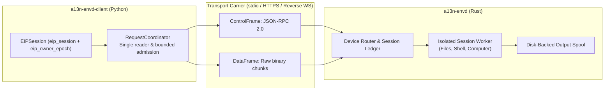

This page explains how `a13n-envd` (Rust daemon) and `a13n-envd-client` (Python client) execute files, processes, and desktop GUI actions across stdio, HTTPS, and reverse WebSocket tunnels with deterministic replay semantics, OS kernel isolation, and zero-secret-exposure HTTPS egress. For configuration and usage, see [Execution boundaries](isolation.md), [Session egress](egress.md), and the [Python client reference](python-client.md).

## Device vs. Session and dual-plane EIP 0.5 framing

EIP separates a **Device** (one running `a13n-envd` process identified by `device_id` and monotonic restart `generation`) from the independent **Sessions** (`session_id` + `owner_epoch`) multiplexed over it:



1. **Dual-plane multiplexing:** `ControlFrame` messages carry bounded JSON-RPC 2.0 requests and responses (no batches), while large file reads, uploads, and desktop screenshots flow over raw binary `DataFrame` streams—avoiding 33% Base64 inflation and giant JSON heap allocations.
2. **Generation & epoch fencing:** `session.open` verifies `expected_device_id` and `expected_generation` so a restarted daemon rejects stale state attachments. Reconnecting via `session.attach` increments `owner_epoch`, immediately fencing off any delayed packets from a superseded client connection.

## Operation ledger and the three replay classes

Every Session operation carries `EIPCallContext(operation_id, timeout_ms)`. Envd hashes `(protocol, method, canonical_params)` so reconnected callers can reconcile in-flight or completed mutations deterministically across three replay contracts:

| Replay class        | Representative methods                                                                                                             | Daemon behavior on duplicate `operation_id`                                                                                                                                  |
| ------------------- | ---------------------------------------------------------------------------------------------------------------------------------- | ---------------------------------------------------------------------------------------------------------------------------------------------------------------------------- |
| `ledger_external`   | `initialize`, `device.*`, `session.open`, `session.attach`, `session.close`, `egress.update`                                       | Managed by explicit `generation`, `owner_epoch`, or `expected_revision` CAS outside the Session ledger.                                                                      |
| `active_only`       | `file.read_text`, `file.list`, `file.search`, `process.wait`, `output.read`, `computer.observe`, `computer.a11y_*`                 | Deduplicates in-flight calls (`operation_in_progress`) and honors `operation.cancel`, without retaining completed response pages.                                            |
| `terminal_evidence` | `file.write_text`, `file.patch_text`, `shell.exec`, `process.start`, `process.kill`, `computer.click`, `computer.{ax,uia,atspi}_*` | Registers before dispatch and retains the terminal result/error receipt: same digest replays the stored receipt; a different digest returns `conflict` without re-executing. |

Command stdout and stderr spool to bounded disk buffers managed by the daemon, decoupled from any single network socket. `EIPOutputReader` pages bytes via `output.read` and verifies contiguous offsets, monotonic byte counters, and immutable preview prefixes—fencing the Session with `EIPProtocolError` if corrupt evidence is observed.

## Cross-platform OS sandboxes and microVM isolation

Each `session.open` prepares an immutable `ExecutionBoundary` (reported with a deterministic SHA-256 `policy_digest`) within the daemon's launch ceiling:

| Backend (`boundary.backend`) | OS / mode                     | Enforcement mechanism & privilege guarantee                                                                                                                                |
| ---------------------------- | ----------------------------- | -------------------------------------------------------------------------------------------------------------------------------------------------------------------------- |
| `linux_bubblewrap`           | Linux `sandbox: restricted`   | Mount/PID/IPC namespaces exposing only canonical `grants` + minimal read-only `/usr` runtime; drops capabilities and sets `no_new_privs` (`privilege_gain_blocked: true`). |
| `linux_managed`              | Linux `egress: controlled`    | Clones worker from pre-masked system tree into private mount/PID/IPC/net namespaces while keeping `seccomp` + capability restrictions across native `sudo`.                |
| `macos_seatbelt`             | macOS `sandbox: restricted`   | Applies canonical path rules via `sandbox-exec` (`privilege_gain_blocked: false`; requires stable grant ancestor paths).                                                   |
| `windows_mxc`                | Windows `sandbox: restricted` | Native Microsoft eXecution Container (MXC) Process Security Environments + kill-on-close Job object stabilizing grant handles.                                             |
| `boxlite` / `microsandbox`   | Linux `isolation: {mode: vm}` | Boots one dedicated Linux microVM per Session (`0:0` guest root) talking to the host daemon over a one-time loopback RPC token.                                            |

On Linux, when commands switch from root to a non-root UID, the Envd supervisor retains just enough signaling authority to terminate and reap the entire POSIX process group even if descendants invoked `sudo`. On Windows, Session close waits for kill-on-close Job emptiness before deleting worker state.

## Out-of-worker controlled egress broker

When `egress_mode: "controlled"` is active on Linux (6.1.2+ with `unshare`, `ip`, `nft`, `seccomp`, and `pidfds`), real API credentials stay exclusively inside the privileged out-of-worker broker:

```mermaid
sequenceDiagram
    participant Host as Trusted Caller
    participant Broker as Envd Root Broker (In-memory secrets & CA)
    participant Worker as Session Worker (Private netns + masked FS)
    participant Upstream as Allowed HTTPS Host (443)

    Host->>Broker: session.open (GH_TOKEN="<real-secret>", inject_hosts=["api.github.com"])
    Broker->>Broker: Mask .a13n/config/broker paths; mint sentinel a13n_7d4e9c2a_GH_TOKEN
    Broker->>Worker: Spawn worker with GH_TOKEN=a13n_7d4e9c2a_GH_TOKEN + Session CA bundle
    Worker->>Broker: curl https://api.github.com (routed transparently by kernel/nftables)
    Broker->>Broker: Reject private/loopback/metadata DNS IPs; verify allowlist & inject_hosts
    Broker->>Upstream: TLS 443 request with real Authorization header substituted
    Upstream-->>Broker: HTTP/1.1 response headers & body chunks
    Broker->>Broker: Redact exact secret bytes across chunk boundaries
    Broker-->>Worker: Sanitized response stream
```

1. **Pre-clone masking & immutable runtime:** Before accepting any Session, Envd snapshots its broker binaries and CA material into a private mount and masks daemon configs, transport tokens, and `.a13n` directories on the template tree so even root workloads inside `sandbox: disabled` cannot rename ancestors to uncover them. `raw`, `packet`, `VSOCK`, and `io_uring` socket bypasses are blocked by `seccomp`.
2. **Header-only HTTPS substitution & streaming redaction:** Kernel routing directs worker IPv4 traffic to the broker without relying on `HTTP_PROXY` variables. DNS resolution rejects private, loopback, link-local, and cloud-metadata IPs and pins the validated public IP. Only HTTPS (`443`) request **header values** matching `inject_hosts` substitute sentinels (`port 80` rejects sentinel-bearing headers outright), and response headers/bodies/trailers are scanned across chunk boundaries to redact literal secret reflections.
3. **Zero-downtime CAS rotation (`egress.update`):** Rotating a secret with `expected_revision` updates the broker's in-memory map while keeping the **same sentinel string**—so already-running processes in the Session immediately authenticate with the rotated token on their very next HTTPS call. Removing a secret retires its sentinel and rejects future headers carrying it.
