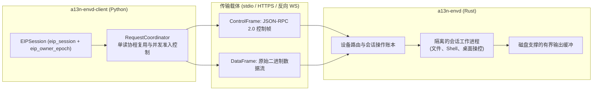
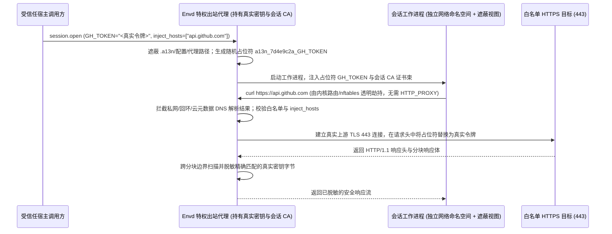

本文解析 `a13n-envd`（Rust 守护进程）与 `a13n-envd-client`（Python 客户端）如何在 stdio、HTTPS 与反向 WebSocket 隧道之上，实现确定性断线重放、跨平台操作系统内核隔离，以及工作进程零明文接触的受控 HTTPS 凭据注入。日常配置与接口查阅请先阅读[安全隔离边界](isolation.md)、[会话出站网络控制](egress.md)及 [Python 客户端参考](python-client.md)。

## 设备与会话分离及 EIP 0.5 双平面帧复用

EIP 0.5 将**设备（Device）**（由 `device_id` 与重启递增的 `generation` 标识的单台 `a13n-envd` 进程）与其承载的多个独立**会话（Session）**（由 `session_id` 与 `owner_epoch` 标识）彻底解耦：

1. **控制面与数据面双平面复用：** `ControlFrame` 承载有界 JSON-RPC 2.0 请求与响应（禁用批处理）；而大体积文件读写与桌面无损截图直接走原始二进制 `DataFrame` 通道，消除 33% 的 Base64 体积膨胀与大对象 JSON 解析开销。
2. **设备世代与所有者纪元栅栏（Epoch Fencing）：** `session.open` 强制校验 `expected_device_id` 与 `expected_generation`，杜绝守护进程重启后误连旧状态；断线重连调用 `session.attach` 时严格递增 `owner_epoch`，瞬间隔离旧连接残留在途的任何延迟请求。

## 会话操作账本与三类重放等级

每个会话内操作均携带 `EIPCallContext(operation_id, timeout_ms)`。为解决“网络超时无法判断远端写文件或启动命令是否已执行”的分布式难题，Envd 对 `(protocol, method, canonical_params)` 计算规范摘要，并将所有方法划分为三类重放契约：

| 重放等级            | 典型方法                                                                                                                           | 收到相同 `operation_id` 时的守护进程行为                                                                        |
| ------------------- | ---------------------------------------------------------------------------------------------------------------------------------- | --------------------------------------------------------------------------------------------------------------- |
| `ledger_external`   | `initialize`、`device.*`、`session.open`、`session.attach`、`session.close`、`egress.update`                                       | 由显式 `generation`、`owner_epoch` 或 `expected_revision` CAS 版本号保护，不占用会话内操作账本。                |
| `active_only`       | `file.read_text`、`file.list`、`file.search`、`process.wait`、`output.read`、`computer.observe`、`computer.a11y_*`                 | 对运行中请求去重（返回 `operation_in_progress`）并支持 `operation.cancel`，结束后不驻留分页响应体。             |
| `terminal_evidence` | `file.write_text`、`file.patch_text`、`shell.exec`、`process.start`、`process.kill`、`computer.click`、`computer.{ax,uia,atspi}_*` | 派发前先登记并保留终态结果/错误回执：参数摘要一致则原样重放已保存回执；摘要不同则直接返回 `conflict` 拒绝执行。 |

命令的 `stdout`/`stderr` 同样不绑定当前网络连接，而是写入守护进程管理的磁盘有界缓冲。Python 侧 `EIPOutputReader` 通过 `output.read` 分页拉取，并逐页校验偏移连续性、单调递增字节计数与不可变预览前缀——一旦发现异常证据立即熔断当前会话。

## 跨平台原生内核沙箱与轻量级虚拟机（MicroVM）

每次 `session.open` 都会在守护进程启动权限上限内准备不可变的 `ExecutionBoundary`（附带确定性 SHA-256 `policy_digest`）：

| 后端标识（`boundary.backend`） | 平台与模式                    | 内核隔离机制与提权防护保证                                                                                                                         |
| ------------------------------ | ----------------------------- | -------------------------------------------------------------------------------------------------------------------------------------------------- |
| `linux_bubblewrap`             | Linux `sandbox: restricted`   | 基于 Mount/PID/IPC 命名空间仅暴露显式 `grants` 目录与最小只读系统视图；剥离 Capabilities 并开启 `no_new_privs`（`privilege_gain_blocked: true`）。 |
| `linux_managed`                | Linux `egress: controlled`    | 从预先遮蔽敏感路径的系统树克隆私有 Mount/PID/IPC/Net 命名空间，在允许原生 `sudo` 的同时保持 `seccomp` 与网络边界不可突破。                         |
| `macos_seatbelt`               | macOS `sandbox: restricted`   | 通过 `sandbox-exec` 实施规范化路径白名单（`privilege_gain_blocked: false`，要求授权目录祖先路径在会话期内保持稳定）。                              |
| `windows_mxc`                  | Windows `sandbox: restricted` | 基于原生 Microsoft eXecution Container（MXC）进程安全环境与关闭即销毁（Kill-on-close）Job 对象锁定目录句柄。                                       |
| `boxlite` / `microsandbox`     | Linux `isolation: {mode: vm}` | 每个会话拉起独立的一次性 Linux MicroVM（客体机 `0:0` root 与宿主机账号完全隔离），经一次性回环令牌私有 RPC 驱动。                                  |

在进程清理方面：Linux 监管器在从 root 切换到普通 UID 执行前保留必要的信号发送与孤儿进程收割权限，确保即使子孙进程执行过 `sudo` 仍能按进程组完整清理；Windows 则在会话关闭时等待外层 Job 对象彻底清空并完成进程回收后，才释放私有状态目录。

## 工作进程外部的受控出站代理（Controlled Egress Broker）

在 Linux 6.1.2+ 开启 `egress_mode: "controlled"` 时，真实的外部 API 密钥**全程驻留在独立特权代理内存中，绝不进入会话工作进程的内存、环境变量或文件系统**：

1. **克隆前路径遮蔽与不可变代理快照：** 守护进程在受理任何会话前先将代理程序与证书快照锁定至私有挂载，并在工作进程克隆前预先遮蔽守护进程配置、传输密钥与 `.a13n` 目录（即使在 `sandbox: disabled` 下使用 `sudo` 重命名父目录也无法暴露被遮蔽文件）；同时通过 `seccomp` 封禁 `raw`/`packet`/`VSOCK` 套接字与 `io_uring` 网络绕过。
2. **仅限 HTTPS 443 请求头替换与跨分块响应脱敏：** 内核路由透明接管工作进程的 IPv4 流量，DNS 解析自动拒绝私网、回环、链路本地与云厂商元数据地址并锁定校验后的公网 IP。仅当目标域名匹配 `inject_hosts` 且走 HTTPS `443` 端口时才替换**请求头值**中的占位符（明文 `80` 端口一旦检测到占位符直接拒绝请求），并对响应头、流式响应体与 Trailer 执行跨 Chunk 边界的字面量密钥擦除。
3. **不中断进程的 CAS 在线轮换（`egress.update`）：** 携带 `expected_revision` 轮换密钥时，代理仅原子更新内存中的真实密钥映射，**保持原占位符字符串不变**——工作进程中已在运行的长期任务无需重启，在下一次发起 HTTPS 请求时即刻自动使用新令牌；彻底移除密钥时则作废旧占位符并拦截后续携带该占位符的请求。
