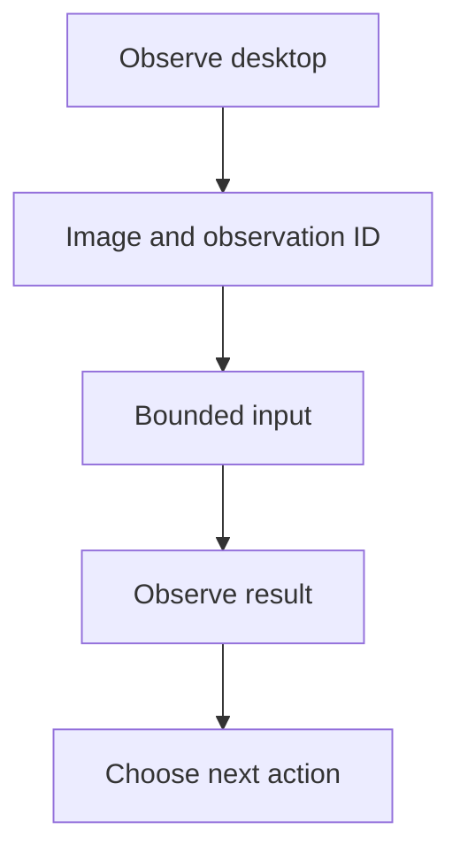

Use Envd to let a model view screenshots and operate a shared desktop. WebUI shows each screenshot with its tool result.

## Requirements and limits

| Platform | Required desktop                                                            | Input support                                                                |
| -------- | --------------------------------------------------------------------------- | ---------------------------------------------------------------------------- |
| macOS    | Logged-in graphical session; Screen Recording and Accessibility permissions | Pointer gestures, physical key chords, Unicode text, advertised scroll units |
| Linux    | Authenticated X11 with RandR 1.5, XKB, XTEST, and a TrueColor root visual   | Pointer gestures, physical key chords, wheel steps; no literal text entry    |
| Windows  | Signed-in, unlocked interactive user session                                | Pointer gestures, scan-code chords, Unicode text, wheel steps                |

Wayland/XWayland, Windows services, disconnected sessions, and login/UAC secure desktops are unsupported. Windows input cannot control higher-integrity targets.

Select an image-capable model and an Agent with `dynamic_environment` tools. Use disabled Sandbox and inherited egress. Actions use the logged-in user's authority across the shared desktop, not just the working directory.

## Connect the desktop

1. Open **Settings → Environments → Connect Device** in WebUI.
2. Run the displayed command in the desktop's graphical session, adding the opt-in:

```console
a13n-envd connect https://your-harness-ui.example.com --computer-use true
```

3. Compare the verification code and approve the connection in WebUI.
4. Complete the platform readiness step below and keep Envd running.

Use a reachable HTTPS WebUI origin, or loopback HTTP on the same machine. Restart with the same command to reuse a paired registration.

Computer use is off by default and independent of command `full_control`. For JSON, environment variables, and precedence, see [daemon configuration](configuration.md).

### Wait for macOS authorization

In **System Settings → Privacy & Security**, grant Screen Recording and Accessibility to the process or launcher named by macOS. Envd waits up to 120 seconds and connects once both are ready. Timeout or Ctrl+C exits with a nonzero status. Restart the launcher and Envd if macOS requests it.

For a longer wait, set `A13N_ENVD_COMPUTER_USE_PERMISSION_TIMEOUT_MS=300000`. A stdio parent must drain stderr and set `initialization_timeout` above the permission wait plus startup time: for example, 135 seconds for the default 120-second wait, or 315 seconds for the 300-second setting above. The Python client defaults to ten seconds.

### Restore macOS permissions after an upgrade

Replacing the Envd executable can invalidate an earlier macOS authorization even when the entry in System Settings still appears enabled. If computer use stops working or Envd keeps waiting for permissions after an upgrade, restore authorization manually:

1. Stop the affected Envd process. If a background service manages it, stop that service so it does not restart Envd during recovery.
2. Confirm the executable path used by your launch command or service. For a command resolved through PATH, use `command -v a13n-envd`; a service may use a different path.
3. Open **System Settings → Privacy & Security** and check both **Accessibility** and **Screen Recording** (called **Screen & System Audio Recording** on some macOS versions). Use the process or launcher named by macOS, as in the initial authorization.
4. If an existing entry is enabled but Envd still reports that permission as missing, remove the affected entry and add the current executable or launcher again where the pane provides add/remove controls. In a file picker, press **Command+Shift+G** to enter its full path. If the pane does not offer those controls, restart Envd through the same launcher to request access and follow macOS's instructions.
5. Enable the required permissions, then restart the launcher if requested and start a fresh Envd process. For a managed service, start that service again. Reuse the same connection command and saved registration.
6. Confirm that Envd finishes authorization and connects. Verify a screenshot before trying input in a disposable application.

Updating the binary does not restart an already-running daemon or grant desktop permissions. Complete authorization before expecting a computer-use-enabled daemon to connect. Avoid system-wide permission resets; only change the affected entry.

### Linux X11 readiness

Launch in the intended X11 session with `DISPLAY` and any `XAUTHORITY`. Keep X11 authentication enabled. A lost X server requires a new Session and screenshot.

Use `unit="steps"`, at most 100 steps per axis. Physical key chords follow the active layout; Linux has no literal text entry.

### Windows readiness and input

Launch from an ordinary terminal on the desktop to control. After a lock or disconnect, unlock or reconnect manually and capture again.

Use `unit="steps"` for scrolling. Display geometry uses physical pixels even with display scaling. Protected content may appear black. Some applications do not accept Unicode entry; verify after typing.

Release held keys or buttons before input. Keep Windows protections enabled rather than elevating Envd to work around a failure.

## Bind the desktop to a Thread

1. Open **Environments** in the composer, or **Conversation details → Configuration** for saved next-Run settings.
2. Add the connected Device and select an existing working directory.
3. Set the alias to `desktop`.
4. Select **Full control** under **Allowed actions**. This binding preset includes desktop actions advertised by the Device; it is distinct from daemon `full_control`.
5. Select the default environment, or ask the Agent to use alias `desktop`.
6. Save the selection and start a new Run.

The binding authorizes model access; **Read only** excludes desktop actions. Changes apply to the next Run.

For observation-only access, save an exact ceiling in Project or Thread configuration:

```yaml
environment_bindings:
  - device_id: device-your-mac
    alias: desktop
    working_directory: /Users/your-account
    permission_ceiling:
      operations:
        - environment.computer.describe
        - environment.computer.observe
        - environment.computer.zoom
default_environment: desktop
```

Replace the Device ID and path. Add input actions only when control is intended.

## Observe, act, verify

Begin with observation:

> Use the desktop environment. Describe its displays and capture a screenshot. Do not click or type yet.

Then use the returned `observation_id` and image pixel coordinates for pointer input. Click the intended field before keyboard or text input, which uses current foreground focus. Capture again to verify the application outcome.



| Tool                              | Purpose                                                                                  |
| --------------------------------- | ---------------------------------------------------------------------------------------- |
| `computer_describe`               | List displays and native readiness                                                       |
| `computer_observe`                | Capture the primary or selected display; maximum dimension 256–2048 pixels               |
| `computer_zoom`                   | Inspect fresh native detail in a region; keep using the original full-screen coordinates |
| `computer_click`, `computer_move` | Use a returned image position                                                            |
| `computer_drag`                   | Perform a bounded drag and release the button                                            |
| `computer_scroll`                 | Use an advertised unit; positive means right/down                                        |
| `computer_type_text`              | Enter literal Unicode text on macOS or Windows                                           |
| `computer_press_keys`             | Press and release a chord such as `["meta", "a"]`                                        |

Key names include `meta` (Command/Super/Windows), `alt` (Option/Alt), `enter`, `page_up`, and `page_down`. Expired references or display-layout changes require a fresh observation. Input results describe native effects and cleanup, not application success. Inspect the desktop before retrying partial or unknown input, incomplete release, or transport loss.

Use `computer_zoom` when text or a small control is unclear. Pass the original `observation_id` and a `region` with `left`, `top`, `right`, and `bottom` edges in the configured coordinate space. Right and bottom are exclusive; normalized 1000 reaches the full edge. Zoom captures fresh pixels and crops before downsizing. It returns `source_observation_id` and `region_pixels` in the original image's pixels, without creating a new input reference. Click using the original full-screen coordinates, never the zoom image's local coordinates. Zoom requires explicit Provider support and `environment.computer.zoom` permission; it does not extend the source reference's lifetime.

Expand **Observe desktop** or **Inspect desktop region** in WebUI to view the image. Temporary image copies can expire. Close screenshot readers promptly to release transfer capacity.

## Clipboard text

Enable `environment.computer.read_clipboard` and `environment.computer.write_clipboard` independently to expose `computer_read_clipboard` and `computer_write_clipboard`. Both work on macOS, Windows and Linux X11. Select the intended mount with `alias`; clipboard access does not require an observation.

Read returns `status: text` with the complete text, including an empty string, or `no_content` / `no_text` without text. `max_bytes` defaults to 16384 and can be lowered. An oversized read fails instead of truncating. Write requires `text`, accepts an empty string, rejects NUL, and allows at most 16384 original UTF-8 bytes. Both directions normalize CRLF to LF. Only plain Unicode text is exchanged.

To paste text, write the clipboard and then send the application's paste chord as a separate operation. To read an application's copied text, send its copy chord and then read. Check the application's state: a completed chord does not prove it published or inserted text, and another application can replace the clipboard between calls. Clipboard writes replace existing content without saving or restoring it.

Keep the workflow in the same live Session. X11 serves `CLIPBOARD` while that Session remains alive and leaves `PRIMARY` unchanged. macOS and Windows publish eager native data, but persistence across Session replacement, restart or human handoff is not guaranteed. macOS clipboard consent still applies; Windows requires a signed-in, unlocked input desktop. Partial/unknown write effects and incomplete `cleanup_complete` require reconciliation, not automatic retry. These methods do not synchronize clipboard text with a human desktop viewer.

## Python client

Given a ready `EIPSession`, use the verified screenshot reader:

```python
async with session.observe_computer(max_dimension=1280) as reader:
    screenshot = b"".join([chunk async for chunk in reader])
    observation = reader.opened.observation
# Closing the reader releases image bytes, not the Session's geometry reference.

from a13n_envd_client.eip.v1 import ComputerRegion

async with session.zoom_computer(
    observation_id=observation.observation_id,
    region=ComputerRegion(left=0, top=0, right=observation.width // 2, bottom=observation.height // 2),
) as reader:
    detail = b"".join([chunk async for chunk in reader])
# Pointer input still uses observation and its full-frame image coordinates.
```

Use a fresh operation context for each new input action. Reconcile uncertain effects with the original operation identity. Session setup and transfer limits are in [Python EIP client](python-client.md).

## Validation

The opt-in [Linux desktop fixture](https://github.com/converge-ai-labs/agent-foundation/tree/main/dev/fixtures/linux-desktop) checks real GUI input and changed screenshots in a disposable container. Portable scripted-peer tests check integration, not native desktop behavior.

On the target OS, try harmless input in a disposable application and verify the next screenshot. Also test permission/session loss and display-layout changes.

For clipboard validation, use a disposable desktop because writes replace its current clipboard. Read text copied from a native editor, then write `café 中文 🦀` with multiple lines and paste it back into the editor. Test empty text and a read limit smaller than the copied text. Keep the Session alive throughout copy/read and write/paste. On macOS, test clipboard consent denial; on Windows, test a locked desktop and clipboard contention. The opt-in native EIP regression can also run with `cargo test -p a13n-envd --lib clipboard_eip -- --ignored --test-threads=1`; it replaces clipboard content.
