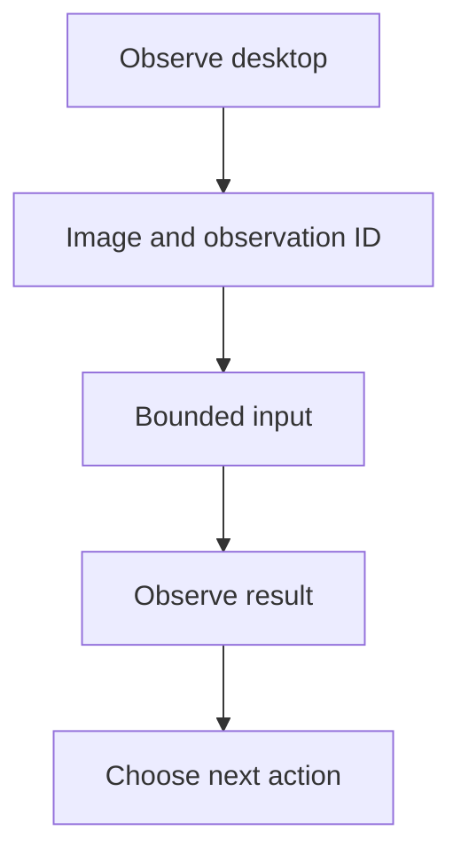

Envd lets an agent observe and operate a logged-in desktop. Pair the Device with Harness UI, authorize the desktop actions for a Thread, and start with a screenshot.

## Requirements and limits

Choose a supported desktop:

| Platform | Required desktop                                                            | Input support                                                                |
| -------- | --------------------------------------------------------------------------- | ---------------------------------------------------------------------------- |
| macOS    | Logged-in graphical session; Screen Recording and Accessibility permissions | Pointer gestures, physical key chords, Unicode text, advertised scroll units |
| Linux    | Authenticated X11 with RandR 1.5, XKB, XTEST, and a TrueColor root visual   | Pointer gestures, physical key chords, wheel steps; no literal text entry    |
| Windows  | Signed-in, unlocked interactive user session                                | Pointer gestures, scan-code chords, Unicode text, wheel steps                |

Use an image-capable model and an Agent with `dynamic_environment` tools. Envd requires disabled Sandbox and inherited egress for computer use. Actions run with the logged-in user's authority across the shared desktop. The working directory does not confine them, and other applications or people can change focus and content between calls.

Wayland/XWayland, Windows services, disconnected sessions and login/UAC secure desktops are unsupported. Windows input cannot control higher-integrity targets.

## Connect the desktop

1. In WebUI, open **Settings → Environments → Connect Device**.
2. Run the displayed command from the desktop's graphical session with `--computer-use true`:

```console
a13n-envd connect https://your-harness-ui.example.com --computer-use true
```

3. Compare the verification code and approve the connection in WebUI.
4. Complete the readiness steps for your platform below. Keep Envd running.

Use your reachable HTTPS WebUI origin, or loopback HTTP when both processes run on the same machine. The same command reuses the saved registration after restart. Computer use is an explicit opt-in, separate from command `full_control`; [daemon configuration](configuration.md) covers JSON, environment variables and precedence.

### Wait for macOS authorization

Open **System Settings → Privacy & Security**. Grant Screen Recording and Accessibility to the process or launcher that macOS identifies. Envd waits up to 120 seconds before opening its EIP connection. Both permissions must be ready; timeout or Ctrl+C exits unsuccessfully. Restart the launcher and Envd when macOS requests it.

Set `A13N_ENVD_COMPUTER_USE_PERMISSION_TIMEOUT_MS=300000` for a five-minute wait. If launching over stdio, drain stderr and set `initialization_timeout` beyond the permission wait plus startup time: 135 seconds for the default wait, or 315 seconds for five minutes. The Python client's ten-second default is too short for either full permission-wait window.

### Restore macOS permissions after an upgrade

A replaced executable can lose its authorization even while System Settings shows the old entry enabled. If Envd keeps waiting for permissions after an upgrade:

1. Stop Envd and any service that would restart it.
2. Confirm the executable used by the launcher. `command -v a13n-envd` resolves PATH; check a service's configured path separately.
3. Open **System Settings → Privacy & Security** and check **Accessibility** and **Screen Recording**. Some macOS versions call the latter **Screen & System Audio Recording**.
4. For an enabled entry whose permission Envd reports as missing, remove and re-add the current executable or launcher where the pane offers those controls. Use **Command+Shift+G** in the file picker to enter its path. Otherwise, restart through the same launcher and follow the native authorization prompt.
5. Enable both permissions, restart the launcher if requested, and start Envd or its service with the saved connection settings.
6. Verify that Envd connects and returns a screenshot before testing input in a disposable application.

Limit recovery to the affected entry. Updating the binary neither restarts a running daemon nor grants desktop permissions.

### Linux X11 readiness

Start Envd in the intended X11 session with `DISPLAY` and the required `XAUTHORITY`. Leave X11 authentication enabled. If the X server is lost, open a new Session and capture a new screenshot.

Scroll with `unit="steps"`, up to 100 steps per axis. Physical chords follow the active keyboard layout. For literal text, use the [clipboard workflow](#clipboard-text); X11 does not advertise `computer_type_text`.

### Windows readiness and input

Start Envd from an ordinary terminal on the signed-in desktop you want to control. After a lock or disconnect, unlock or reconnect manually, then capture a fresh screenshot. Keep Windows protections enabled; elevation is not a remedy for unavailable desktop access.

Scroll with `unit="steps"`. Display geometry uses physical pixels even when display scaling is enabled. Protected content can appear black. Release any held keys or buttons before input, and verify text entry: some applications do not accept Unicode events.

## Bind the desktop to a Thread

1. Open **Environments** in the composer, or **Conversation details → Configuration** for saved next-Run settings.
2. Add the connected Device and choose an existing working directory.
3. Set its alias to `desktop`.
4. Choose **Full control** under **Allowed actions** to include the desktop actions advertised by the Device. This binding preset is separate from daemon `full_control`.
5. Select it as the default environment, or ask the Agent to use alias `desktop`.
6. Save and start a new Run.

Bindings authorize model access for the next Run. The **Read only** preset excludes desktop actions, including observation. To allow observation without input, save an exact ceiling in Project or Thread configuration:

```yaml
environment_bindings:
  - device_id: device-your-mac
    alias: desktop
    working_directory: /Users/your-account
    permission_ceiling:
      operations:
        - environment.computer.describe
        - environment.computer.observe
        - environment.computer.zoom
default_environment: desktop
```

Replace the Device ID and path with your selection. Add individual input permissions when the workflow needs them.

## Observe, act, verify

Ask for an initial view:

> Use the desktop environment. Describe its displays and capture a screenshot. Do not click or type yet.

Use the returned `observation_id` and screenshot pixel coordinates for pointer input. Click a field before entering text or pressing keys, since keyboard input uses current foreground focus. Capture again after an action to check the application's result.



| Tool                              | Purpose                                                                                  |
| --------------------------------- | ---------------------------------------------------------------------------------------- |
| `computer_describe`               | List displays and native readiness                                                       |
| `computer_observe`                | Capture the primary or selected display; maximum dimension 256–2048 pixels               |
| `computer_zoom`                   | Inspect fresh native detail in a region; keep using the original full-screen coordinates |
| `computer_click`, `computer_move` | Use a returned image position                                                            |
| `computer_drag`                   | Perform a bounded drag and release the button                                            |
| `computer_scroll`                 | Use an advertised unit; positive means right/down                                        |
| `computer_type_text`              | Enter literal Unicode text on macOS or Windows                                           |
| `computer_press_keys`             | Press and release a chord such as `["meta", "a"]`                                        |

Key names include `meta` (Command/Super/Windows), `alt` (Option/Alt), `enter`, `page_up` and `page_down`. Capture a fresh observation after a reference expires or the display layout changes. Native input completion records event posting and cleanup; use the next screenshot to establish application success. Inspect state before retrying partial or unknown input, incomplete release or a lost response.

For small text or controls, call `computer_zoom` with the original `observation_id` and a `region` containing `left`, `top`, `right` and `bottom` in the configured coordinate space. Right and bottom are exclusive; normalized 1000 reaches the full edge. Zoom captures fresh native pixels and crops before downsizing.

The zoom result includes `source_observation_id` and `region_pixels` in original-image pixels. Continue to click in the original full-screen coordinates, not zoom-local coordinates. Zoom requires Provider support and `environment.computer.zoom` permission. It creates no input reference and does not extend the original reference's lifetime.

Expand **Observe desktop** or **Inspect desktop region** in WebUI to inspect the image. Temporary display copies can expire. Client integrations should close screenshot readers promptly to release transfer capacity.

## Clipboard text

Grant `environment.computer.read_clipboard` and `environment.computer.write_clipboard` separately for `computer_read_clipboard` and `computer_write_clipboard`. Both work on macOS, Windows and Linux X11. Select the mount by `alias`; these calls need no observation reference.

Read returns `status: text` and the complete text, including an empty string. `no_content` means an empty clipboard; `no_text` means content without supported text. Both omit `text`. Lower `max_bytes` from its 16384-byte default when needed; oversized reads fail rather than truncate.

Write requires `text`, permits an empty string, rejects NUL and accepts at most 16384 original UTF-8 bytes. Reads and writes normalize CRLF to LF and exchange plain Unicode text. A write replaces clipboard content without saving or restoring it.

To paste, write the clipboard, then send the application's paste chord. To read copied text, send the copy chord, then read the clipboard. Keep both calls in the same live Session and check the application result. These are separate operations: another application can change the clipboard between them, and successful key dispatch does not establish that text was copied or pasted.

X11 serves `CLIPBOARD` while the Session lives and leaves `PRIMARY` unchanged. macOS and Windows publish native data immediately; persistence across Session replacement, restart or human handoff is not guaranteed. macOS clipboard consent applies, and Windows needs an unlocked input desktop. Reconcile partial/unknown write effects or incomplete `cleanup_complete` before retrying. These calls operate the native clipboard, without synchronizing it to a human desktop viewer.

## Python client

With a ready `EIPSession`, read screenshots through the verified transfer helper. This example captures the display, then inspects its upper-left quarter:

```python
async with session.observe_computer(max_dimension=1280) as reader:
    screenshot = b"".join([chunk async for chunk in reader])
    observation = reader.opened.observation
# Closing the reader releases image bytes, not the Session's geometry reference.

from a13n_envd_client.eip.v1 import ComputerRegion

async with session.zoom_computer(
    observation_id=observation.observation_id,
    region=ComputerRegion(left=0, top=0, right=observation.width // 2, bottom=observation.height // 2),
) as reader:
    detail = b"".join([chunk async for chunk in reader])
# Pointer input still uses observation and its full-frame image coordinates.
```

Give each new input action a fresh operation context. Use the original operation identity to reconcile an uncertain effect. See [Python EIP client](python-client.md) for Session setup and transfer limits.

## Validation

Use a disposable desktop and application to test the full path on the target OS. Perform harmless input, inspect the next screenshot, then check permission/session loss and display-layout changes. The opt-in [Linux desktop fixture](https://github.com/converge-ai-labs/agent-foundation/tree/main/dev/fixtures/linux-desktop) exercises real GUI input and screenshot changes in a temporary container. Scripted-peer tests cover integration separately from native desktop behavior.

For clipboard validation:

1. Copy text from a native editor and read it through Envd.
2. Write multiline text such as `café 中文 𝄞`, paste it into the editor and inspect the result.
3. Check empty text and a read limit smaller than the copied content.
4. Keep the Session alive across each copy/read and write/paste pair. On macOS, test clipboard consent denial; on Windows, test lock-screen behavior and clipboard contention.

The opt-in native EIP regression is `cargo test -p a13n-envd --lib clipboard_eip -- --ignored --test-threads=1`. Like the manual checks, it replaces clipboard content.
