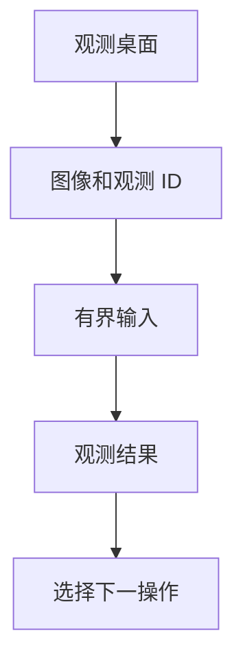

Envd 让 agent 观测并操作已登录的桌面。先将设备与 Harness UI 配对，为线程授权桌面操作，再从截图开始。

## 要求与限制

选择受支持的桌面：

| 平台    | 所需桌面                                                            | 输入支持                                           |
| ------- | ------------------------------------------------------------------- | -------------------------------------------------- |
| macOS   | 已登录的图形会话；屏幕录制和辅助功能权限                            | 指针手势、物理组合键、Unicode 文本、声明的滚动单位 |
| Linux   | 经身份验证的 X11，支持 RandR 1.5、XKB、XTEST 和 TrueColor 根 visual | 指针手势、物理组合键、滚轮步数；不支持字面文本输入 |
| Windows | 已登录、未锁定的交互用户会话                                        | 指针手势、扫描码组合键、Unicode 文本、滚轮步数     |

使用支持图像的模型，以及具备 `dynamic_environment` 工具的 agent。Envd 电脑操作要求禁用 Sandbox，并继承出站网络。操作以已登录用户的权限作用于共享桌面。工作目录不限制其范围，其他应用或人员也可能在两次调用之间改变焦点和内容。

不支持 Wayland/XWayland、Windows 服务、断开的会话及登录/UAC 安全桌面。Windows 输入不能控制更高完整性级别的目标。

## 连接桌面

1. 在 WebUI 打开**设置 → 环境 → 连接设备**。
2. 在桌面图形会话中运行显示的命令，添加 `--computer-use true`：

```console
a13n-envd connect https://your-harness-ui.example.com --computer-use true
```

3. 核对验证码，在 WebUI 批准连接。
4. 完成下方对应平台的就绪步骤，并保持 Envd 运行。

使用可访问的 HTTPS WebUI origin；两个进程位于同一台机器时，也可使用回环 HTTP。重启后，相同命令会复用已保存的注册。电脑操作需要显式启用，与命令 `full_control` 分开；JSON、环境变量和优先级见[守护进程配置](configuration.md)。

### 等待 macOS 授权

打开**系统设置 → 隐私与安全性**，为 macOS 指定的进程或启动者授予屏幕录制和辅助功能权限。Envd 在打开 EIP 连接前最多等待 120 秒。两项权限必须就绪；超时或 Ctrl+C 会以失败状态退出。按 macOS 要求重启启动者和 Envd。

设置 `A13N_ENVD_COMPUTER_USE_PERMISSION_TIMEOUT_MS=300000` 可等待五分钟。通过 stdio 启动时，应消费 stderr，并将 `initialization_timeout` 设为长于权限等待加启动时间：默认等待可设为 135 秒，五分钟等待可设为 315 秒。Python 客户端默认的十秒不足以覆盖这两个完整权限等待窗口。

### 升级后恢复 macOS 权限

替换可执行文件后，即使系统设置中的旧条目仍显示开启，授权也可能失效。如果升级后 Envd 持续等待权限：

1. 停止 Envd，以及会自动重启它的服务。
2. 确认启动者实际使用的可执行文件。`command -v a13n-envd` 解析 PATH；服务配置的路径应单独检查。
3. 打开**系统设置 → 隐私与安全性**，检查**辅助功能**和**屏幕录制**。部分 macOS 版本将后者称为**屏幕与系统音频录制**。
4. 如果条目已开启但 Envd 仍报告缺少权限，在提供相关控件的面板中移除并重新添加当前可执行文件或启动者。在文件选择窗口按 **Command+Shift+G** 输入路径。若没有这些控件，通过同一启动者重新启动，并按原生授权提示操作。
5. 开启两项权限，按要求重启启动者，再用已保存的连接设置启动 Envd 或其服务。
6. 确认 Envd 已连接并能返回截图，再在临时应用中测试输入。

只恢复受影响的条目。更新二进制文件不会重启已运行的守护进程，也不会授予桌面权限。

### Linux X11 就绪检查

在目标 X11 会话中启动 Envd，提供 `DISPLAY` 和所需的 `XAUTHORITY`。保持 X11 身份验证开启。若 X 服务器丢失，打开新的 Session 并重新截图。

滚动使用 `unit="steps"`，每轴最多 100 步。物理组合键遵循当前键盘布局。字面文本可通过[剪贴板流程](#clipboard-text)输入；X11 不声明 `computer_type_text`。

### Windows 就绪检查与输入

在要控制的已登录桌面上，从普通终端启动 Envd。锁定或断开后，手动解锁或重连，再截取新图。保持 Windows 保护开启；提权不能解决桌面访问不可用的问题。

滚动使用 `unit="steps"`。即使启用显示缩放，显示几何仍使用物理像素。受保护内容可能显示为黑色。输入前释放已按住的按键或按钮，并核对文本输入结果：部分应用不接受 Unicode 事件。

## 将桌面绑定到线程

1. 在输入区打开**环境**，或在**对话详情 → 配置**中保存下一次执行的设置。
2. 添加已连接的设备，选择已有工作目录。
3. 将别名设为 `desktop`。
4. 在**允许操作**中选择**完全控制**，纳入设备声明的桌面操作。此绑定预设与守护进程 `full_control` 分开。
5. 将其设为默认环境，或要求 agent 使用别名 `desktop`。
6. 保存并开始新的执行。

绑定为下一次执行授权模型访问。**只读**预设排除桌面操作，包括观测。如需允许观测但禁止输入，在项目或线程配置中保存精确上限：

```yaml
environment_bindings:
  - device_id: device-your-mac
    alias: desktop
    working_directory: /Users/your-account
    permission_ceiling:
      operations:
        - environment.computer.describe
        - environment.computer.observe
        - environment.computer.zoom
default_environment: desktop
```

将设备 ID 和路径替换为实际选择。流程需要输入时，再逐项添加输入权限。

## 观测、操作、验证

先请求查看桌面：

> 使用 desktop 环境。描述它的显示器并截取屏幕。暂时不要点击或输入。

使用返回的 `observation_id` 和截图像素坐标执行指针输入。键盘输入使用当前前台焦点，因此输入文本或按键前先点击目标字段。操作后再次截图，检查应用结果。



| 工具                              | 用途                                             |
| --------------------------------- | ------------------------------------------------ |
| `computer_describe`               | 列出显示器和原生就绪状态                         |
| `computer_observe`                | 截取主显示器或所选显示器；最大尺寸 256–2048 像素 |
| `computer_zoom`                   | 查看区域的新鲜原生细节；继续使用原全屏坐标       |
| `computer_click`, `computer_move` | 使用返回图像中的位置                             |
| `computer_drag`                   | 执行有界拖动并释放按钮                           |
| `computer_scroll`                 | 使用声明的单位；正值表示向右/向下                |
| `computer_type_text`              | 在 macOS 或 Windows 输入字面 Unicode 文本        |
| `computer_press_keys`             | 按下并释放组合键，如 `["meta", "a"]`             |

键名包含 `meta`（Command/Super/Windows）、`alt`（Option/Alt）、`enter`、`page_up` 和 `page_down`。引用过期或显示布局变化后，应重新观测。原生输入完成记录事件发送和清理情况；应用是否成功由下一张截图确认。部分执行、结果不明、释放不完整或响应丢失时，先检查状态再重试。

文字或控件太小时，用原 `observation_id` 调用 `computer_zoom`，并以配置的坐标空间提供含 `left`、`top`、`right`、`bottom` 的 `region`。右边界和下边界不包含在区域内；归一化值 1000 表示完整边缘。Zoom 捕获新的原生像素，先裁切再缩小。

Zoom 结果包含 `source_observation_id`，以及按原图像素表示的 `region_pixels`。点击继续使用原全屏坐标，而非局部放大图坐标。Zoom 要求 Provider 支持和 `environment.computer.zoom` 权限。它不创建输入引用，也不延长原引用的有效期。

在 WebUI 展开**观测桌面**或 **Inspect desktop region** 查看图像。临时显示副本可能过期。客户端集成应及时关闭截图 reader，释放传输容量。

## 剪贴板文本

分别授予 `environment.computer.read_clipboard` 和 `environment.computer.write_clipboard`，供 `computer_read_clipboard` 和 `computer_write_clipboard` 使用。两者均支持 macOS、Windows 和 Linux X11。通过 `alias` 选择挂载；调用不需要观测引用。

读取返回 `status: text` 及完整文本，包括空字符串。`no_content` 表示剪贴板为空；`no_text` 表示存在内容但没有受支持的文本。后两者省略 `text`。可按需降低默认 16384 字节的 `max_bytes`；超限读取报错而非截断。

写入必须提供 `text`，允许空字符串，拒绝 NUL，最多接受 16384 个原始 UTF-8 字节。读写将 CRLF 规范化为 LF，只交换 Unicode 纯文本。写入会替换剪贴板内容，不会保存或恢复旧内容。

粘贴时先写入剪贴板，再发送应用的粘贴组合键。读取复制文本时，先发送复制组合键，再读取剪贴板。两次调用应在同一存活 Session 内完成，并检查应用结果。这是两个独立操作：其他应用可能在其间更改剪贴板，成功发送按键也不表示文本已被复制或粘贴。

X11 在 Session 存活期间提供 `CLIPBOARD`，保持 `PRIMARY` 不变。macOS 和 Windows 立即发布原生数据；不保证内容跨 Session 更换、重启或人工接管保留。macOS 剪贴板同意机制仍适用，Windows 需要未锁定的输入桌面。写入效果为 partial/unknown 或 `cleanup_complete` 未完成时，先核对再重试。这些调用操作原生剪贴板，不会将其同步到人工桌面查看器。

## Python 客户端

已有就绪 `EIPSession` 时，通过带完整性验证的传输 helper 读取截图。此例先捕获显示器，再查看其左上四分之一区域：

```python
async with session.observe_computer(max_dimension=1280) as reader:
    screenshot = b"".join([chunk async for chunk in reader])
    observation = reader.opened.observation
# Closing the reader releases image bytes, not the Session's geometry reference.

from a13n_envd_client.eip.v1 import ComputerRegion

async with session.zoom_computer(
    observation_id=observation.observation_id,
    region=ComputerRegion(left=0, top=0, right=observation.width // 2, bottom=observation.height // 2),
) as reader:
    detail = b"".join([chunk async for chunk in reader])
# Pointer input still uses observation and its full-frame image coordinates.
```

每个新输入动作使用新的操作上下文。效果不确定时，用原操作身份核对。Session 设置和传输限制见 [Python EIP 客户端](python-client.md)。

## 验证

在目标 OS 上使用可丢弃的桌面和应用测试完整流程。执行无害输入、查看下一张截图，再检查权限/会话丢失及显示布局变化。可选 [Linux 桌面 fixture](https://github.com/converge-ai-labs/agent-foundation/tree/main/dev/fixtures/linux-desktop) 在临时容器中测试真实 GUI 输入和截图变化。脚本化对端测试另外覆盖集成，而非原生桌面行为。

验证剪贴板时：

1. 从原生编辑器复制文本，通过 Envd 读取。
2. 写入包含 `café 中文 𝄞` 等内容的多行文本，粘贴到编辑器并检查结果。
3. 检查空文本，以及小于复制内容的读取上限。
4. 在每组复制/读取和写入/粘贴期间保持 Session 存活。macOS 上测试剪贴板授权拒绝；Windows 上测试锁屏行为和剪贴板占用。

可选原生 EIP 回归命令为 `cargo test -p a13n-envd --lib clipboard_eip -- --ignored --test-threads=1`。与手动检查一样，它会替换剪贴板内容。
