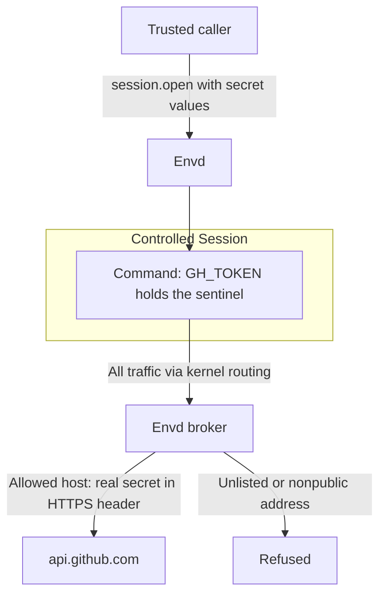

Controlled egress lets a Linux Session call approved upstream hosts while commands hold opaque sentinel placeholders instead of real secrets. Envd's out-of-worker broker checks destinations, injects real secrets into allowed HTTPS request headers on port `443`, and redacts exact secret matches from responses.

Enable controlled egress on the daemon (`A13N_ENVD_EGRESS_MODE=controlled`, `--egress-mode controlled`, or JSON config) inside a Linux 6.1.2+ environment with root namespace permissions, `seccomp`, `pidfds`, `/usr/bin/unshare`, `/usr/sbin/ip`, `/usr/sbin/nft`, and `/usr/bin/ldd` (preinstalled in the [Sandbox image](sandbox.md)):

```json
{
  "full_control": true,
  "default_working_directory": "/workspace",
  "egress": {"mode": "controlled"}
}
```

## Open a controlled Session and inject credentials

Pass `egress_mode: "controlled"` and an explicit `egress` policy in `session.open`:

```json
{
  "expected_device_id": "device-example",
  "expected_generation": 123,
  "required_methods": [],
  "configuration": {
    "working_directory": "/workspace",
    "egress_mode": "controlled",
    "egress": {
      "destinations": {"mode": "allowlist", "hosts": ["api.github.com"]},
      "secrets": [
        {
          "env": "GH_TOKEN",
          "value": "<real token supplied by the trusted caller>",
          "inject_hosts": ["api.github.com"]
        }
      ]
    }
  }
}
```

Commands receive a sentinel placeholder in `$GH_TOKEN` (`{"env": "GH_TOKEN", "sentinel": "a13n_...", "inject_hosts": ["api.github.com"]}`) and need no `HTTP_PROXY` variables—kernel routing steers all traffic through the broker:

```bash
curl https://api.github.com/user -H "Authorization: Bearer $GH_TOKEN"
# Under sudo, preserve Session CA bundle variables if needed:
sudo --preserve-env=SSL_CERT_FILE,CURL_CA_BUNDLE curl https://api.github.com/
```



Envd populates `SSL_CERT_FILE`, `REQUESTS_CA_BUNDLE`, `CURL_CA_BUNDLE`, and `NODE_EXTRA_CA_CERTS` with a system-plus-Session CA bundle. HTTP/1.1 is supported on intercepted HTTPS (`443`), while port `80` rejects sentinel-bearing headers without injecting secrets.

## Destination policies and live rotation

| `destinations` policy                                | Outbound behavior                                                                                                    |
| ---------------------------------------------------- | -------------------------------------------------------------------------------------------------------------------- |
| `{"mode": "public"}`                                 | Allow public DNS hostnames (`inject_hosts` still restricts where secrets are injected)                               |
| `{"mode": "allowlist", "hosts": []}`                 | Deny all external network access                                                                                     |
| `{"mode": "allowlist", "hosts": ["api.github.com"]}` | Allow only exact listed DNS hostnames or public IPs (no wildcards; private/loopback/metadata IPs are always blocked) |

Rotate secrets or update allowed hosts atomically without restarting the Session via `egress.update` (rotation keeps the existing sentinel so running processes pick up the new credential on their next HTTPS request):

```json
{
  "jsonrpc": "2.0",
  "id": 7,
  "eip_session": "session-example",
  "method": "egress.update",
  "params": {
    "expected_revision": 1,
    "destinations": {"mode": "allowlist", "hosts": ["api.github.com", "example.com"]},
    "set_secrets": [
      {"env": "GH_TOKEN", "value": "<replacement token>", "inject_hosts": ["api.github.com"]}
    ],
    "remove_secrets": []
  }
}
```

## Files, sockets, and lifetime

Commands and file operations share a dedicated worker with daemon configs, transport credentials, and broker state masked before cloning. Both `sandbox.mode: disabled` (with native `sudo`) and `sandbox.mode: restricted` block namespace/mount escapes, raw packet sockets, network-admin capabilities, and `io_uring` bypasses. Run controlled egress inside disposable sandboxes without foreign privileged daemons or mounted Docker/proxy sockets; closing or expiring the Session stops worker networking and wipes in-memory secrets.

## Verify a sandbox image

Validate custom Linux sandbox images in a disposable container using the repository's EIP integration suites (see [Historical cloud validation](egress-validation.md) for past provider test records):

```bash
python3 crates/a13n-envd/tests/egress_linux.py /path/to/a13n-envd
python3 crates/a13n-envd/tests/execution_linux.py /path/to/a13n-envd --controlled
```
