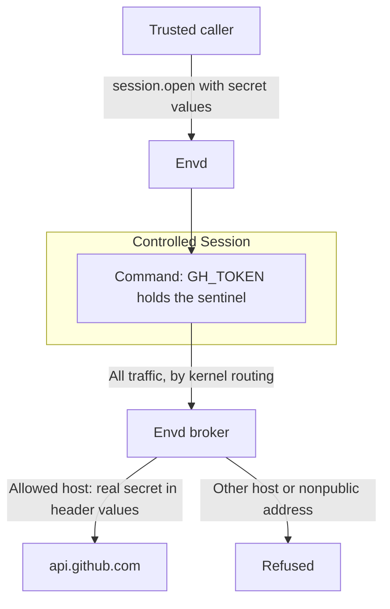

Controlled egress lets a Session call approved services while its commands hold credential placeholders instead of real secrets. The Envd broker checks destinations and inserts secrets into allowed HTTPS request headers. Start by preparing a Linux sandbox, then select controlled mode and give each Session its own policy.

Set `A13N_ENVD_EGRESS_MODE=controlled`, pass `--egress-mode controlled`, or use this daemon JSON outside the working directory:

```json
{
  "full_control": true,
  "default_working_directory": "/workspace",
  "egress": {"mode": "controlled"}
}
```

The daemon needs a root launcher with mount/PID/IPC/network namespace permissions. Prepare Linux 6.1.2 or newer, seccomp, pidfds, mount-tree cloning, a system CA bundle, and these tools: `/usr/bin/unshare`, `/usr/sbin/ip`, `/usr/sbin/nft`, `/usr/bin/ldd`. Missing facilities stop startup or Session preparation. The [sandbox image](sandbox.md) supplies the userspace tools and root launcher; its default remains `egress.mode: inherit`, and the outer runtime must grant the required permissions.

Sessions use native accounts. With no execution UID/GID configured, they retain the root launcher's identity. To use another account, provision it and configure [execution identity and sudo](configuration.md#native-identity-and-sudo). The egress boundary applies to either identity. Sandbox grants are a separate choice: `restricted` exposes granted directories and a minimal read-only system view; `disabled` retains native filesystem access.

## Create a controlled Session

1. Initialize the Device connection.
2. Add `egress` to `session.open.params`, using the Device identity and generation returned by initialization.
3. Send the request over the authenticated EIP carrier. Keep real secrets out of daemon configuration, command arguments and request logs.

```json
{
  "expected_device_id": "device-example",
  "expected_generation": 123,
  "protocol_version": "0.3",
  "working_directory": "/workspace",
  "egress": {
    "destinations": {"mode": "allowlist", "hosts": ["api.github.com"]},
    "secrets": [
      {
        "env": "GH_TOKEN",
        "value": "<real token supplied by the trusted caller>",
        "inject_hosts": ["api.github.com"]
      }
    ]
  }
}
```

Every controlled Session requires an explicit destination policy. Devices using `inherit` or `deny` reject Session egress policies. The returned Session descriptor contains a revision and secret metadata, such as `{"env":"GH_TOKEN","sentinel":"a13n_7d4e9c2a_GH_TOKEN","inject_hosts":["api.github.com"]}`; the secret's `value` is write-only.

Run commands with the placeholder supplied in `GH_TOKEN`:

```bash
curl https://api.github.com/user -H "Authorization: Bearer $GH_TOKEN"
```

Kernel routing sends Session traffic through the broker outside the worker, so clients need no `HTTP_PROXY` or `HTTPS_PROXY`. On HTTPS port 443, the broker replaces placeholders in request **header values** for that secret's `inject_hosts`. URLs and request bodies pass through unchanged. The broker validates upstream TLS.



Envd supplies a private system-plus-Session CA bundle through `SSL_CERT_FILE`, `REQUESTS_CA_BUNDLE`, `CURL_CA_BUNDLE` and `NODE_EXTRA_CA_CERTS`. Clients with certificate pinning or a separate trust store need explicit integration. The native system CA bundle remains available to `update-ca-certificates`.

Sudo commonly removes those variables. Preserve the ones your root HTTPS client needs under the existing sudoers policy, or configure that client's trust store:

```bash
sudo --preserve-env=SSL_CERT_FILE,CURL_CA_BUNDLE curl https://api.github.com/
```

Destination checks continue to apply when client TLS trust is misconfigured. Envd leaves sudoers and the global trust store unchanged.

The broker redacts exact secret values from response headers, body bytes and trailers, including matches across chunks. Encoded or transformed values are outside literal redaction. HTTP/1.1 is supported; protocol upgrades and compressed responses are rejected. Request compression passes through unchanged. HTTP port 80 rejects sentinel-bearing headers and injects no credentials. Other TCP ports and UDP carry allowed traffic without secret substitution.

## Destination policy

Choose one required `destinations` value:

| Required `destinations`                           | Behavior                                                            |
| ------------------------------------------------- | ------------------------------------------------------------------- |
| `{"mode":"public"}`                               | Permit public DNS names, not direct IP connections.                 |
| `{"mode":"allowlist","hosts":[]}`                 | Deny external access.                                               |
| `{"mode":"allowlist","hosts":["api.github.com"]}` | Permit only exact listed DNS names or explicitly listed public IPs. |

Use exact names: wildcards, suffix matching and URL patterns are invalid. A secret's `inject_hosts` must be nonempty and, with an allowlist, a subset of `hosts`. In public mode, `inject_hosts` still limits where that secret is sent. The Session policy is the Envd destination list; outer-platform restrictions apply independently.

The broker rejects private, loopback, link-local, metadata and other nonpublic upstream addresses. A DNS answer containing any nonpublic address is rejected. Direct IP connections require explicit allowlist entries and never receive injected credentials.

Session interception uses IPv4; the broker can connect to DNS-resolved IPv4 or IPv6 upstream addresses. Native IPv6 connections from commands have no external route. Local services remain reachable on the Session's own loopback, separate from the outer sandbox's loopback.

## Update without restarting

Read the current revision from Session metadata, then send `egress.update` with the Session selector. This example adds `example.com` and rotates `GH_TOKEN` together:

```json
{
  "jsonrpc": "2.0",
  "id": 7,
  "eip_session": "session-example",
  "method": "egress.update",
  "params": {
    "expected_revision": 1,
    "destinations": {"mode": "allowlist", "hosts": ["api.github.com", "example.com"]},
    "set_secrets": [
      {"env":"GH_TOKEN","value":"<replacement token>","inject_hosts":["api.github.com"]}
    ],
    "remove_secrets": []
  }
}
```

An update validates and publishes atomically, then increments `revision`. If it returns `conflict`, read current metadata through `environment.describe` or `session.attach` before choosing a new update. Omitted fields retain their values. An empty allowlist denies external access; public mode restores public-domain access. Device identity, Sandbox grants and network mode stay fixed.

`set_secrets` adds or replaces bindings. Rotation keeps the sentinel, so a process already using `$GH_TOKEN` uses the replacement value on its next HTTPS request. `remove_secrets` retires the binding; deleting and re-adding creates a new sentinel. Intercepted headers containing retired sentinels are rejected. When removing a permitted host, remove or change its injection bindings in the same update.

New commands receive current bindings. Running processes keep their existing environment: adding a binding does not add a variable to them, and deleting one leaves the old sentinel in their memory. Command environment settings cannot override or unset bound secret or CA variables. Retry matching uses the original command request, so changing policy does not create a new operation.

## Files, sockets and lifetime

Commands and file operations share the same native-identity worker. With `sandbox.mode: disabled`, package installs, service accounts, permissions, ACLs, linker/CA updates and system-file changes modify the outer sandbox's original writable tree. Those changes persist across Sessions. `/tmp`, `/run`, device/kernel views and shared memory use private mounts; a working directory under `/tmp` is rebound to its original backing directory.

Before accepting work, Envd prepares an immutable private runtime for the broker and bootstrap. Workers use the original system tree with Envd configuration, transport credentials, broker runtime and the launch account's `.a13n` directory masked. Masks precede worker cloning, so renaming an ancestor does not expose those files to later Sessions. Extra hardlinks to protected files or an overlapping working directory reject preparation. Store unrelated credentials outside the working directory and image.

Disabled Sandbox enables native sudo by default under existing sudoers. Restricted Linux Sandbox drops capabilities and blocks privilege gain, even for UID 0. Both retain the controlled-egress restrictions: namespace/mount changes, raw/packet/VSOCK networking, network-administration capabilities, unsafe device/kernel controls and io_uring bypasses remain unavailable after sudo. Session-local Unix sockets, socketpairs, PTYs and low-port services work. The Host supplies CPU/memory limits and owns the outer sandbox's lifetime.

### Deployment prerequisites

Use a dedicated disposable sandbox. Keep foreign privileged services, cron/systemd jobs that execute payload-writable files, and external privileged or network-proxy sockets out of its shared tree. A service outside the worker can otherwise execute a modified file or forward traffic beyond the policy. This includes Docker sockets and external SSH-agent or database proxies.

Supply trusted launcher artifacts on every daemon start. The management snapshot protects the running broker from later system changes; restore or rebuild trusted artifacts before restarting from a tree modified by root workloads. Use separate deployments for mutually hostile Sessions. Controlled egress constrains worker traffic, not every process on a shared machine.

Detach retains the worker and policy for the disconnect grace period; reattach returns current policy metadata. Close, expiry, broker failure or daemon death stops controlled execution and networking. Real secrets and the Session CA private key stay in broker memory.

Each Session reserves its configured budgets against Device totals at creation. If idle Sessions exhaust a Device total before reaching `max_sessions`, increase the relevant total. Worker death releases capacity once confirmed. Staging reservations remain charged until daemon teardown when file cleanup cannot be confirmed.

## Verify a sandbox image

1. Install the prerequisites above and provision the execution account.
2. Use a disposable sandbox with the same root launcher as deployment.
3. Run the repository's public EIP integration tests:

```bash
python3 crates/a13n-envd/tests/egress_linux.py /path/to/a13n-envd

# Additional native sudo, package, identity, file and cleanup checks.
# Requires a disposable Debian/Ubuntu sandbox, sudo, ACL tools and UID/GID 1000
# with a test-only NOPASSWD sudoers rule. This test changes the sandbox system.
python3 crates/a13n-envd/tests/execution_linux.py /path/to/a13n-envd --controlled
```

The egress fixture uses generated test credentials against `httpbin.org`; `--http-host httpbingo.org` selects a compatible alternative. It checks HTTPS authentication, response redaction, policy updates, replay, filesystem/socket behavior, capacity reuse and broker-death cleanup. For networks limited to development services, `--http-host api.github.com` checks header substitution and response-header redaction through media-type validation, replacing the Basic Auth/body-echo checks.

Add `--local-network-fixture` only in a disposable privileged Linux sandbox. It creates a temporary public-address alias in the outer test namespace for TCP/UDP echo checks.

## Cloud platform validation record

This historical record covers probes completed by **2026-09-22** using one Linux x86_64 binary on five cloud platforms. Tests used generated credentials; provider credentials stayed outside Sessions.

**The matrix predates the native identity and sudo changes introduced on 2026-09-22 and has not been rerun for that implementation.** Use the root-launcher requirements above for current deployments. Old non-root launches, read-only system-tree checks and named-socket denials describe the tested binary. Current behavior is explained in [files, sockets and lifetime](#files-sockets-and-lifetime). The record covers these Envd sandbox probes, not Provider/Service integration or platform-wide support.

### Cloud results for the tested binary

| Platform / runtime   | Observed kernel          | Tested Envd launch identity | Result and coverage                                                                                                         |
| -------------------- | ------------------------ | --------------------------- | --------------------------------------------------------------------------------------------------------------------------- |
| E2B                  | `6.1.158+`               | Default account, UID 1000   | Full HTTPS fixture and controlled Session lifecycle passed.                                                                 |
| Runloop              | `6.18.32`                | Default account, UID 1000   | Full HTTPS fixture and controlled Session lifecycle passed.                                                                 |
| Vercel Sandbox       | `6.18.49`                | Root through `sudo`         | Full HTTPS fixture and controlled Session lifecycle passed.                                                                 |
| Daytona              | `6.8.0-138-generic`      | Root through `sudo`         | GitHub header fixture and controlled Session lifecycle passed; external echo sites were blocked.                            |
| Modal default gVisor | Reported `4.19.0-gvisor` | Root                        | Ordinary Session/readiness, shell execution and file read/write passed. Controlled Session creation returned `unsupported`. |
| Modal VM Sandbox     | `7.2.6`                  | Root                        | Ordinary Envd flow, full HTTPS fixture, controlled Session lifecycle and in-VM TCP/UDP echo passed.                         |

The **full HTTPS fixture** checked substituted Basic Auth headers, exact secret redaction from echo responses and secret-free Session metadata. The **controlled Session lifecycle** checked policy updates, replay, that binary's filesystem/socket restrictions, quota reuse and cleanup of detached `setsid` descendants after broker death. Both Modal runtimes also ran ordinary Session shell/file smoke checks; the other platforms ran the controlled fixture.

TCP/UDP echo passed with `--local-network-fixture` in a privileged local Linux container and Modal VM. These were echo services inside the outer test environment. External Internet TCP/UDP and TCP/UDP on E2B, Runloop, Vercel or Daytona were not tested. Sprites and unlisted platforms were outside this campaign.

### Daytona network restrictions

Direct requests outside Envd reached `api.github.com` but failed for `httpbin.org`, `httpbingo.org` and `example.com`. An Envd allowlist cannot widen the outer platform's permitted destinations.

The GitHub fixture received HTTP 415 for an unsupported `Accept` value. Replacing its sentinel with `application/json` produced HTTP 200, then redacted that value from response `Content-Type`. This verified header substitution and header redaction; Basic Auth/body echo remained blocked.

### Modal runtime selection

The tested default gVisor runtime rejected controlled `session.open` with `unsupported` and `unshare: Operation not permitted`; a separate `nft list ruleset` returned `Protocol not supported`. Root launch did not provide the missing facilities.

The tested VM Sandbox runtime passed with this Modal SDK selection:

```python
sandbox = modal.Sandbox.create(
    app=app,
    image=image,
    experimental_options={"vm_runtime": True},
)
```

The SDK setting selected the outer runtime. It was neither an Envd field nor a new built-in Modal Provider option. For a new image or binary, prepare the current prerequisites and rerun [image verification](#verify-a-sandbox-image).

### Test preparation and limits

The probes installed missing networking tools and CA certificates. Vercel used an account-accepted timeout; Daytona omitted resource overrides incompatible with its default snapshot. Modal's host-side Python client used proxy-support dependencies and an explicit CA bundle. These were test setup changes; production Provider code was unchanged.

All temporary sandboxes were terminated. Native Provider instances were reconciled absent, and all five Modal instances, including diagnostic attempts, were confirmed stopped. Record the date, image, runtime, kernel, launch identity and fixture coverage together when repeating the campaign, including changed behavior still awaiting a test.
