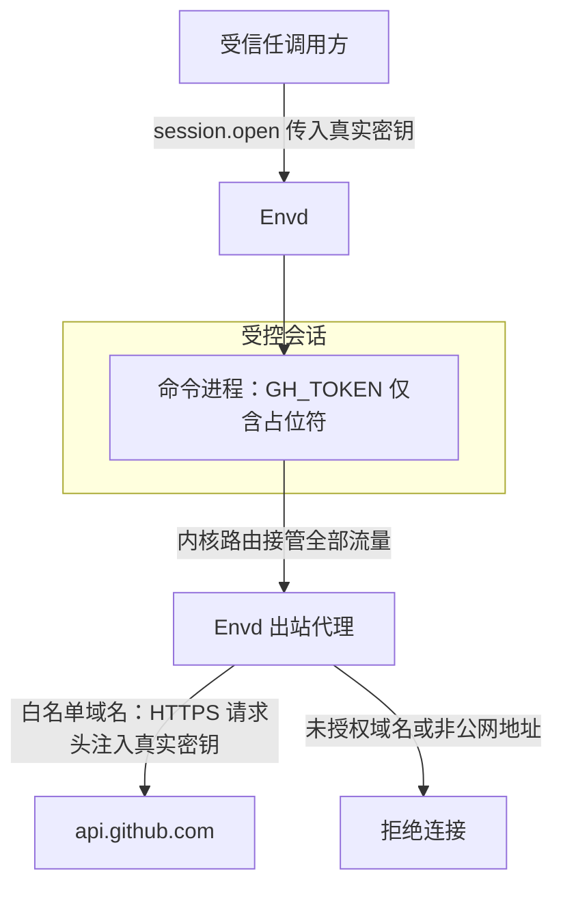

受控出站（Controlled Egress）允许 Linux 会话访问受批上游域名，同时仅向命令环境提供不透明占位符（Sentinel）。位于工作进程外部的 Envd 代理负责校验目标地址、在 `443` 端口允许的 HTTPS 请求头中替换为真实凭据，并从响应头与响应体中脱敏精确匹配的密钥字符串。

在具备 root 命名空间权限、`seccomp`、`pidfds` 以及 `/usr/bin/unshare`、`/usr/sbin/ip`、`/usr/sbin/nft`、`/usr/bin/ldd` 的 Linux 6.1.2+ 环境（[官方沙箱镜像](sandbox.md)已预装）中开启受控出站（`A13N_ENVD_EGRESS_MODE=controlled`、`--egress-mode controlled` 或 JSON 配置）：

```json
{
  "full_control": true,
  "default_working_directory": "/workspace",
  "egress": {"mode": "controlled"}
}
```

## 创建受控会话并注入凭据

在 `session.open` 中指定 `egress_mode: "controlled"` 及显式 `egress` 策略：

```json
{
  "expected_device_id": "device-example",
  "expected_generation": 123,
  "required_methods": [],
  "configuration": {
    "working_directory": "/workspace",
    "egress_mode": "controlled",
    "egress": {
      "destinations": {"mode": "allowlist", "hosts": ["api.github.com"]},
      "secrets": [
        {
          "env": "GH_TOKEN",
          "value": "<由受信任调用方传入的真实令牌>",
          "inject_hosts": ["api.github.com"]
        }
      ]
    }
  }
}
```

会话内命令在 `$GH_TOKEN` 中拿到的是占位符（`{"env": "GH_TOKEN", "sentinel": "a13n_...", "inject_hosts": ["api.github.com"]}`），且无需配置 `HTTP_PROXY`——内核路由会自动将全部流量导向代理：

```bash
curl https://api.github.com/user -H "Authorization: Bearer $GH_TOKEN"
# 使用 sudo 时如需信任会话 CA，可按需保留证书环境变量：
sudo --preserve-env=SSL_CERT_FILE,CURL_CA_BUNDLE curl https://api.github.com/
```



Envd 会通过 `SSL_CERT_FILE`、`REQUESTS_CA_BUNDLE`、`CURL_CA_BUNDLE` 与 `NODE_EXTRA_CA_CERTS` 注入合并后的系统与会话 CA 证书束。`443` 端口拦截支持 HTTP/1.1；明文 `80` 端口会直接拒绝携带占位符的请求头。

## 目标地址策略与在线轮换

| `destinations` 策略                                  | 出站行为                                                                             |
| ---------------------------------------------------- | ------------------------------------------------------------------------------------ |
| `{"mode": "public"}`                                 | 允许访问公网 DNS 域名（`inject_hosts` 仍严格限制凭据注入目标）                       |
| `{"mode": "allowlist", "hosts": []}`                 | 禁止一切外部网络访问                                                                 |
| `{"mode": "allowlist", "hosts": ["api.github.com"]}` | 仅允许精确列出的 DNS 域名或公网 IP（不支持通配符；私网、回环与云元数据地址始终拦截） |

无需重启会话即可通过 `egress.update` 原子更新白名单或轮换密钥（轮换密钥保持原占位符不变，已运行的进程在下次发起 HTTPS 请求时自动生效）：

```json
{
  "jsonrpc": "2.0",
  "id": 7,
  "eip_session": "session-example",
  "method": "egress.update",
  "params": {
    "expected_revision": 1,
    "destinations": {"mode": "allowlist", "hosts": ["api.github.com", "example.com"]},
    "set_secrets": [
      {"env": "GH_TOKEN", "value": "<轮换后的新令牌>", "inject_hosts": ["api.github.com"]}
    ],
    "remove_secrets": []
  }
}
```

## 文件系统、套接字与生命周期

命令与文件操作共享独立工作进程，守护进程配置、传输凭据与代理运行时在克隆前即被遮蔽隔离。无论 `sandbox.mode` 设为 `disabled`（支持原生 `sudo`）还是 `restricted`，均会封禁命名空间/挂载逃逸、原始套接字、网络管理能力与 `io_uring` 绕过路径。请在无外部特权守护进程、未挂载 Docker/代理套接字的一次性沙箱中运行受控出站；会话关闭或过期会立即终止网络并清除内存中的密钥。

## 验证自定义沙箱镜像

在一次性特权容器中运行仓库自带的 EIP 集成测试，验证自定义 Linux 沙箱镜像（历史云平台测试记录见[云平台验证归档](egress-validation.md)）：

```bash
python3 crates/a13n-envd/tests/egress_linux.py /path/to/a13n-envd
python3 crates/a13n-envd/tests/execution_linux.py /path/to/a13n-envd --controlled
```
