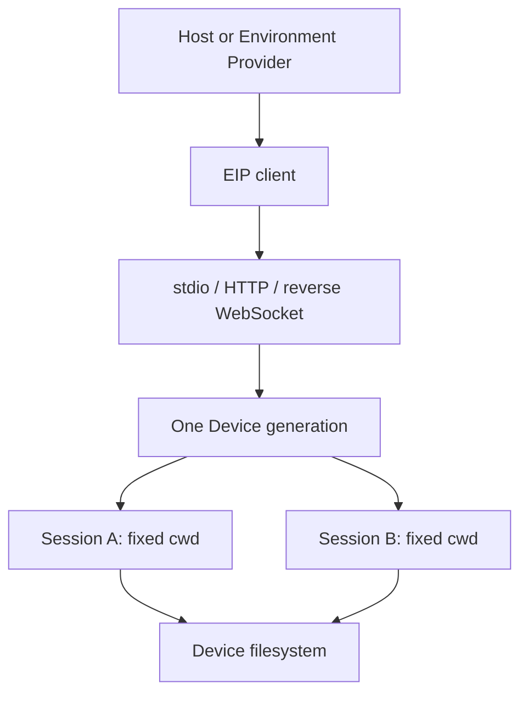

Envd runs file and command operations on a local computer, remote computer, or sandbox. It can also enforce OS sandbox and egress policies, operate a shared desktop, and collect Device metrics. Clients use the **Environment Interaction Protocol (EIP)** over stdio, HTTP(S), or an outbound reverse WebSocket connection.

For an Agent, connect through [Harness Environment Providers](../environments/index.md). For an application that calls EIP directly, use the [Python client](python-client.md). The Host chooses permissions and deployment boundaries; Envd enforces the selected execution policy. Environment Providers manage vendor resources and prepare the connection.

## Choose your path

| Situation                                                  | Start here                                                                          |
| ---------------------------------------------------------- | ----------------------------------------------------------------------------------- |
| Using Harness UI                                           | [Harness UI execution permissions](../a13n-harness-ui/environments-and-projects.md) |
| Trying a local EIP Environment without a model             | [Local Envd example](#try-local-envd)                                               |
| Installing a matching native executable                    | [Installation](installation.md)                                                     |
| Running an agent development container                     | [Sandbox image](sandbox.md)                                                         |
| Operating your own daemon or EIP transport                 | [Configuration and transports](configuration.md)                                    |
| Viewing and controlling a shared desktop                   | [Desktop computer use](computer-use.md)                                             |
| Restricting command destinations and injecting credentials | [Session egress](egress.md)                                                         |
| Diagnosing access or missing methods                       | [Execution boundaries and troubleshooting](isolation.md)                            |
| Connecting through an Environment Provider                 | [Remote Envd](../environments/remote-envd.md)                                       |
| Implementing an EIP client or Provider                     | [Python EIP client](python-client.md)                                               |
| Managing Sessions, retained output, and uncertain results  | [Sessions and output](operations.md)                                                |

## What it provides

Use the Device's advertised methods to find the operations available on its platform and configuration:

- Read, write, search, and transfer files.
- Run commands, send input, collect output, and stop processes.
- Inspect ports and wait for them to open.
- Observe and control an enabled [shared desktop](computer-use.md).
- Inspect operation results and failures, or cancel work.



One daemon serves a Device with multiple Sessions. Each Session has a fixed working directory and owns its operations, processes, output, transfers, and execution evidence. The Sessions share the Device filesystem: a working directory does not restrict file access. Put mutually untrusted workloads in separate Host-enforced boundaries.

## Try Local Envd

Run the repository's [Environment Provider example](../environments/examples.md#local-envd) to write and read a file through a private Envd Device. You need Rust and `uv` with Python 3.13; the example uses no model or cloud account.

1. From the repository root, build Envd from the same checkout as the Python client.
2. Enter the example project and install its locked dependencies.
3. Run the Local Envd example with the binary you built.

```bash
cargo build --locked --package a13n-envd
cd examples/environment-provider
uv sync --locked
uv run environment-provider-example local_envd \
  --executable ../../target/debug/a13n-envd
```

The example starts a private daemon over stdio and opens one Session. It writes and reads `provider-example.txt`, then reports whether the workspace survived closing the execution. `LocalEnvdProviderRuntime` closes the daemon when the example finishes.

To use the same path with an Agent, return a Local Envd connector from an `EnvironmentSource` and enable `DynamicEnvironmentCapability`; follow [Harness integration](../a13n-harness/environments.md). Configure identity, Sandbox grants, egress, executable roots, shell profiles, and limits through the runtime's `LocalEnvdLaunchConfiguration`. See [execution boundaries](isolation.md) and [Session credential references](../environments/remote-envd.md#session-egress-and-credential-references).

## Lifecycle and ownership

A Host can reuse one `LocalEnvdProviderRuntime` across executions. Each execution opens its own Session and checks its working directory, required methods, and readiness. Discovery alone opens no Session. Closing or cancelling one execution leaves a healthy shared Device available to the others; the runtime owner closes the Device. See [daemon lifecycle](configuration.md#lifecycle-and-ownership).

## Reference topics

| Topic                                                                               | Guide                                                                                 |
| ----------------------------------------------------------------------------------- | ------------------------------------------------------------------------------------- |
| <span id="build-the-matching-binary"></span>Build the matching binary               | [Build the matching binary](installation.md#build-the-matching-binary)                |
| <span id="install-a-published-binary"></span>Install a published binary             | [Install a published binary](installation.md#install-a-published-binary)              |
| <span id="isolation-behavior"></span>Isolation behavior                             | [Isolation behavior](isolation.md#isolation-behavior)                                 |
| <span id="minimal-standalone-configuration"></span>Minimal standalone configuration | [Minimal standalone configuration](configuration.md#minimal-standalone-configuration) |
| <span id="enable-commands"></span>Enable commands                                   | [Enable commands](configuration.md#enable-commands)                                   |
| <span id="carrier-profiles"></span>Carrier profiles                                 | [Carrier profiles](configuration.md#carrier-profiles)                                 |
| <span id="validate-from-this-repository"></span>Validate from this repository       | [Validate from this repository](isolation.md#validate-from-this-repository)           |
| <span id="troubleshooting"></span>Troubleshooting                                   | [Troubleshooting](isolation.md#troubleshooting)                                       |
| <span id="references"></span>References                                             | [References](isolation.md#references)                                                 |
