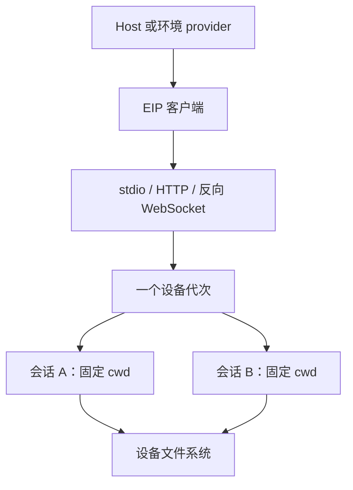

Envd 在本地计算机、远程计算机或沙箱中执行文件和命令操作。它还可以实施 OS sandbox 与出站网络策略、操作共享桌面，并采集 Device 指标。客户端通过 stdio、HTTP(S) 或向外建立的反向 WebSocket 连接使用**环境交互协议（EIP）**。

为 Agent 提供执行环境时，通过 [Harness Environment Provider](../environments/index.md) 连接。应用直接调用 EIP 时，使用 [Python 客户端](python-client.md)。Host 选择权限和部署边界，Envd 实施所选执行策略。Environment Provider 管理供应商资源并准备连接。

## 选择使用方式

| 使用场景                             | 从这里开始                                                             |
| ------------------------------------ | ---------------------------------------------------------------------- |
| 使用 Harness UI                      | [Harness UI 执行权限](../a13n-harness-ui/environments-and-projects.md) |
| 不连接模型，试用本地 EIP 环境        | [Local Envd 示例](#try-local-envd)                                     |
| 安装版本匹配的原生可执行文件         | [安装](installation.md)                                                |
| 运行 agent 开发容器                  | [沙箱镜像](sandbox.md)                                                 |
| 运维自己的守护进程或 EIP 传输        | [配置与传输](configuration.md)                                         |
| 查看和控制共享桌面                   | [电脑操作](computer-use.md)                                            |
| 限制命令访问目标并注入凭据           | [Session 出站网络](egress.md)                                          |
| 排查访问问题或缺失的方法             | [执行边界与故障排查](isolation.md)                                     |
| 通过环境 provider 连接               | [Remote Envd](../environments/remote-envd.md)                          |
| 实现 EIP 客户端或 provider           | [Python EIP 客户端](python-client.md)                                  |
| 管理会话、保留输出和结果不确定的操作 | [会话与输出](operations.md)                                            |

## 提供的功能

通过 Device 公布的方法，确认当前平台和配置提供哪些操作：

- 读取、写入、搜索和传输文件。
- 运行命令、发送输入、收集输出和停止进程。
- 检查端口并等待端口开放。
- 观测和控制已启用的[共享桌面](computer-use.md)。
- 查看操作结果和失败信息，或取消工作。



一个守护进程服务于一个 Device，其中可以有多个 Session。每个 Session 有固定工作目录，并拥有自己的操作、进程、输出、传输和执行证据。各 Session 共享 Device 文件系统：工作目录不限制文件访问。彼此不信任的工作负载应放在由 Host 实施的独立边界中。

## 试用 Local Envd

运行仓库中的 [Environment Provider 示例](../environments/examples.md#local-envd)，通过私有 Envd Device 写入并读取一个文件。需要 Rust，以及可使用 Python 3.13 的 `uv`；示例不使用模型或云账号。

1. 在仓库根目录，从 Python 客户端所在的同一份检出构建 Envd。
2. 进入示例项目，安装锁定的依赖。
3. 使用刚构建的二进制文件运行 Local Envd 示例。

```bash
cargo build --locked --package a13n-envd
cd examples/environment-provider
uv sync --locked
uv run environment-provider-example local_envd \
  --executable ../../target/debug/a13n-envd
```

示例通过 stdio 启动私有守护进程并打开一个 Session，写入和读取 `provider-example.txt`，然后报告执行关闭后工作目录是否仍然存在。示例结束时，`LocalEnvdProviderRuntime` 关闭守护进程。

要为 Agent 接入同一执行方式，从 `EnvironmentSource` 返回 Local Envd connector，并启用 `DynamicEnvironmentCapability`；按 [Harness 集成](../a13n-harness/environments.md)操作。通过运行时的 `LocalEnvdLaunchConfiguration` 设置身份、Sandbox 目录授权、出站网络、可执行文件根目录、shell 配置和限制。参见[执行边界](isolation.md)和 [Session 凭据引用](../environments/remote-envd.md#session-egress-and-credential-references)。

## 生命周期与归属

Host 可以在多次执行之间复用一个 `LocalEnvdProviderRuntime`。每次执行打开自己的 Session，并检查工作目录、必需方法和就绪状态。仅发现 Device 不会打开 Session。关闭或取消一次执行后，健康的共享 Device 仍可供其他执行使用；Device 由运行时所有者关闭。参见[守护进程生命周期](configuration.md#lifecycle-and-ownership)。

## 参考主题

| 主题                                                                  | 指南                                                                    |
| --------------------------------------------------------------------- | ----------------------------------------------------------------------- |
| <span id="build-the-matching-binary"></span>构建匹配版本的二进制文件  | [构建匹配版本的二进制文件](installation.md#build-the-matching-binary)   |
| <span id="install-a-published-binary"></span>安装已发布的二进制文件   | [安装已发布的二进制文件](installation.md#install-a-published-binary)    |
| <span id="isolation-behavior"></span>隔离行为                         | [隔离行为](isolation.md#isolation-behavior)                             |
| <span id="minimal-standalone-configuration"></span>独立运行的最小配置 | [独立运行的最小配置](configuration.md#minimal-standalone-configuration) |
| <span id="enable-commands"></span>启用命令                            | [启用命令](configuration.md#enable-commands)                            |
| <span id="carrier-profiles"></span>传输通道配置                       | [传输通道配置](configuration.md#carrier-profiles)                       |
| <span id="validate-from-this-repository"></span>在本仓库中验证        | [在本仓库中验证](isolation.md#validate-from-this-repository)            |
| <span id="troubleshooting"></span>故障排查                            | [故障排查](isolation.md#troubleshooting)                                |
| <span id="references"></span>参考资料                                 | [参考资料](isolation.md#references)                                     |
