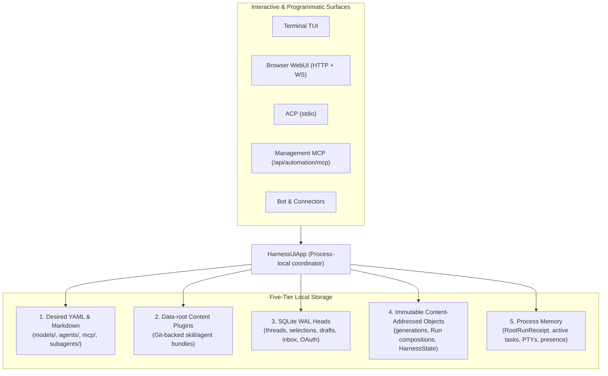

This page explains how `a13n-harness-ui` powers its Terminal Interface (TUI), browser WebUI, ACP stdio adapter, HTTP API, Management MCP, Bot, and Coordinator simultaneously on top of one local engine without requiring PostgreSQL, Redis, or background worker daemons. For everyday setup and embedding, see [Configuration reference](configuration.md) and [Embed the Python App](embedding.md).

## One `HarnessUiApp` core across all surfaces

Every interactive and automation surface calls the same in-process async `HarnessUiApp` boundary:

Unlike [Service](../a13n-service/architecture.md), Harness UI intentionally avoids distributed worker leases, PID probing, or cross-process task takeover. Separate TUI and WebUI processes can safely share one data root because mutable heads use optimistic expected-version / expected-reference checks in short SQLite WAL transactions, while active `RootRunReceipt` handles belong strictly to the process running them.

## Five-tier hybrid storage and generation snapshots

Splitting desired files, mutable pointers, and immutable snapshots solves two classic local-workbench hazards—corrupting an active Run when editing config files, and losing the last good conversation state when a turn fails or is cancelled:

| Tier & location                               | What lives here                                                                                                                              | Concurrency & durability rule                                                                                 |
| --------------------------------------------- | -------------------------------------------------------------------------------------------------------------------------------------------- | ------------------------------------------------------------------------------------------------------------- |
| **1. Desired config (`~/.a13n-harness-ui/`)** | `a13n-harness-ui.yaml`, `models/`, `agents/`, `projects/`, `devices/`, `mcp/`, `subagents/*.md`                                              | Validated into an immutable **accepted generation**; invalid YAML edits leave the previous generation active. |
| **2. Content Plugins (`<data>/plugins/`)**    | Cloned or local plugin trees (`SKILL.md`, Markdown subagents, MCP declarations)                                                              | Indexed into the accepted generation without mutating user-authored YAML.                                     |
| **3. SQLite WAL (`<data>/metadata.db`)**      | Mutable Thread metadata & sticky config heads, `last_execution`, `webui_draft`, `inbox_item`, `coordinator`, MCP OAuth grants, Web Push keys | Short non-blocking WAL transactions scoped outside model calls, tool I/O, and streams.                        |
| **4. Immutable objects (`<data>/objects/`)**  | Normalized config generations, per-Run **resolved compositions**, root/child `HarnessState` checkpoints                                      | Content-addressed and immutable; SQLite heads advance atomically only after object bytes flush to disk.       |
| **5. Credentials & memory**                   | Mode-`0600` local API keys, shared CLI subscription stores (`~/.codex`, `~/.copilot`), live `RootRunReceipt`s                                | Secrets stay in credential files and per-Run memory, separate from `HarnessState` and transcripts.            |

### POSIX SQLite WAL advisory-lock guard

On POSIX operating systems, opening *and closing* even a read-only file descriptor against an active SQLite database or its `-wal`, `-shm`, or `-journal` sidecars releases the process's `fcntl` advisory locks—allowing concurrent writers to corrupt or unlink live sidecars. Before running migrations, `HarnessUiApp` registers its exact database and sidecar paths (including symlinks and hardlinks) in a process-local native read guard consulted by Direct Local file tools, Host file previews, clipboard/attachment readers, and Thread forks.

## Sticky Thread heads vs. immutable Run compositions

Each Thread owns a mutable `thread_configuration` head (selected Agent, default Model override, Environment profile, Device bindings, MCP servers). When `submit_thread()` admits a Run:

1. The App resolves the Thread's current selections against the **accepted configuration generation** and writes an **immutable Run composition** object capturing the exact prompt, Model route, Capabilities, MCP set, and workspace roots.
2. `last_execution` records the admitted attempt in SQLite before model effects start.
3. If you edit `agents/*.yaml` or switch `/model` while the Run is streaming, the in-flight Run finishes on its captured composition; your edits apply cleanly on the next Run.
4. If a Run fails or is cancelled, `last_execution` records the terminal error for UI inspection, while the Thread's **selected continuation pointer** stays on the last valid checkpoint (including safely exported partial state when available).
5. Observed file edits are attached to tool-return metadata (`a13n.harness-ui.applied_edit` with exact `before`/`after` snapshots) inside the checkpoint so diff viewers render the exact historical edit regardless of later workspace changes.

Forward-only SQLite migrations allow multiple open TUI/WebUI processes across minor package upgrades to share the same database without schema-downgrade locks.

## Subagent segments, retained Shell supervision, and live sync

- **Delegated child segments:** Asynchronous subagents (`SubagentOperator`) execute as independent child Threads correlated by `execution_id` and monotonic segment index. Each `delegate` or `resume_subagent` opens a new immutable segment; failed follow-up segments preserve the latest completed final answer for UI pagination.
- **Coordinator topology:** Promoting a Project-bound Thread to Coordinator inserts a `coordinator` row (`auto_followup`) and `coordinator_worker` ownership edges in one atomic SQLite writer transaction without duplicating Thread history tables.
- **Retained Shell recovery across restarts:** When `tools.execution.mode: auto` (or background Shell) detaches a long-running command, SQLite persists the frozen execution record and exact Envd Session/process identity. If `HarnessUiApp` restarts while the external `a13n-envd` daemon and Session remain alive, the new App re-supervises the running command and collects its completion without re-executing it; in-process Python calls without an external daemon are marked `lost`.
- **Race-free `watch_thread` & CRDT drafts:** Entering `app.watch_thread()` registers the in-memory subscriber **before** reading the SQLite/checkpoint snapshot so zero transition events drop between initial render and live streaming (`LiveCursor` / `SummaryCursor` carry a process epoch to force clean refetch on server restart). Browser composer drafts synchronize separately via a bounded (`<= 512 KiB`) Yjs CRDT row in `webui_draft`—keeping collaborative typing and unsent attachments durable across reloads until a user clicks Send.
