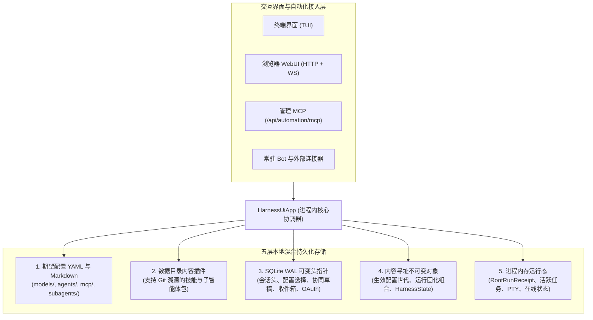

本文解析 `a13n-harness-ui` 如何在不依赖 PostgreSQL、Redis 或独立后台 Worker 集群的前提下，依靠单一进程内引擎同时驱动终端界面（TUI）、浏览器 WebUI、HTTP API、管理 MCP、常驻 Bot 与 Coordinator 多智能体协作。日常配置与嵌入开发请先参阅[配置参考](configuration.md)与[嵌入 Python 应用](embedding.md)。

## 统一驱动所有界面的 `HarnessUiApp` 内核

无论是交互式界面还是自动化接口，底层均直接调用同一个进程内异步 `HarnessUiApp` 核心边界：

与分布式 [Service](../a13n-service/architecture.md) 不同，Harness UI 刻意不引入跨进程租约心跳、PID 探测或任务抢占接管。多个独立的 TUI 与 WebUI 进程可以安全共用同一个数据目录：所有可变头更新均在毫秒级 SQLite WAL 短事务中校验期望版本号（`expected_version`）或期望引用摘要，而活跃运行句柄（`RootRunReceipt`）严格归属发起该运行的当前进程。

## 五层混合存储与配置世代快照

将“人类编辑的期望文件”、“可变头指针”与“不可变内容寻址对象”分层解耦，从根源上消除了本地工具常见的两类隐患——运行中途改配置导致在途任务错乱，以及运行失败覆盖上一轮完好历史：

| 存储层级与位置                             | 承载的核心数据                                                                                                 | 并发与持久化不变量                                                                                      |
| ------------------------------------------ | -------------------------------------------------------------------------------------------------------------- | ------------------------------------------------------------------------------------------------------- |
| **1. 期望配置树（`~/.a13n-harness-ui/`）** | `a13n-harness-ui.yaml`、`models/`、`agents/`、`projects/`、`devices/`、`mcp/`、`subagents/*.md`                | 经完整校验后编译为不可变的**生效配置世代（Accepted Generation）**；语法或字段错误不会污染当前生效世代。 |
| **2. 内容插件目录（`<data>/plugins/`）**   | 本地或 Git 克隆的插件目录（`SKILL.md`、Markdown 子智能体、MCP 声明）                                           | 随配置世代一同建立索引，不回写修改用户手写的 YAML 文件。                                                |
| **3. SQLite WAL（`<data>/metadata.db`）**  | 会话元数据与粘性配置头、`last_execution`、`webui_draft`、`inbox_item`、`coordinator`、MCP OAuth 授权、Web Push | 仅执行极短事务；**绝不**跨越模型调用、工具 I/O、文件操作或事件流持有数据库事务。                        |
| **4. 不可变对象库（`<data>/objects/`）**   | 规范化配置世代快照、单次运行**固化组合（Resolved Composition）**、根/子会话 `HarnessState` 检查点              | 内容寻址不可变文件；先完成磁盘落盘，再在 SQLite 中原子切换头指针。                                      |
| **5. 独立密钥与进程内存**                  | `0600` 权限本地密钥文件、共享订阅凭据库（`~/.codex`、`~/.copilot`）、活跃 `RootRunReceipt` 与原生终端 PTY      | 明文凭据绝不进入 `HarnessState`、聊天记录或运行固化组合对象。                                           |

### POSIX SQLite WAL 文件锁读取守卫

在 POSIX 系统（macOS / Linux）上，即便以只读方式打开再关闭正在使用的 SQLite 主文件或其 `-wal`、`-shm`、`-journal` 附属文件描述符，内核也会立即释放当前进程在该文件上的全部 `fcntl` 建议锁，导致并发连接误删活跃附属文件并损坏数据库。为此，`HarnessUiApp` 在启动迁移前会将数据库及全部软硬链接路径注册进进程内**原生读取守卫**，在 Direct Local 文件工具、宿主机文件预览、剪贴板/附件读取以及会话分支复制入口处提前拦截对元数据存储文件的直接打开操作。

## 粘性会话配置头与单次运行固化组合

每个会话在 SQLite 中维护可变的配置头 `thread_configuration`（所选智能体、默认模型覆盖、环境配置档、设备挂载与 MCP 列表）。当 `submit_thread()` 受理新运行时：

1. 应用结合当前**生效配置世代**解析会话选择，写入一份不可变的**运行固化组合对象**，完整锁定本次运行的提示词、模型路由、能力参数、MCP 集合与工作目录。
2. 在触发任何外部调用前，先向 SQLite 的 `last_execution` 写入受理记录。
3. 若用户在运行流式输出期间编辑了 `agents/*.yaml` 或执行 `/model` 切换模型，在途运行仍按其固化组合平稳跑完，新配置在下一轮运行中自动生效。
4. 若运行失败或被取消，错误摘要记录在 `last_execution` 中供界面查看，而会话的**续接检查点指针**始终保留在最近一次有效状态（含安全导出的半截进度），绝不会用损坏状态覆盖既有历史。
5. 文件编辑工具产生的真实修改前/修改后文本快照（`a13n.harness-ui.applied_edit`）随检查点中的工具返回元数据一并持久化，确保历史 Diff 视图永远反映当时的真实改动，而非事后读取磁盘上已被再次修改的当前文件。

SQLite 采用仅向前（Forward-only）增量迁移设计，新版本包完成表结构升级后，同机未关闭的旧版 TUI/WebUI 进程只要所需列仍兼容即可继续正常读写，无需强制停机锁库。

## 异步子智能体分段、驻留 Shell 跨重启监管与无竞争同步

- **子智能体不可变执行分段（Segments）：** 异步子智能体通过独立的子会话记录运行，每次 `delegate` 或 `resume_subagent` 都会开启递增编号的执行分段；即便后续追问分段失败，检查点中依然保留上一轮完整的最终回答供界面分页查阅。
- **Coordinator 角色拓扑：** 将绑定项目的根会话提升为 Coordinator 时，仅在单个 SQLite 写事务中插入 `coordinator` 行与 `coordinator_worker` 归属边，完全复用标准会话与检查点表结构。
- **后台 Envd Shell 跨重启接管：** 开启 `tools.execution.mode: auto` 或后台进程时，SQLite 会持久化冻结的执行记录及外部 `a13n-envd` 的精确 Session/进程标识。若 `HarnessUiApp` 重启时底层 Envd 守护进程与 Session 仍在运行，新实例会自动重新接管监控并在命令结束时回收结果，全程不重放命令；而无外部守护进程托管的纯进程内调用则明确标记为 `lost`。
- **无竞争 `watch_thread` 与 CRDT 协同草稿：** `app.watch_thread()` 严格遵循“先注册内存事件订阅、再抓取快照”的顺序，消除快照与增量流之间的丢帧窗口（`LiveCursor` 携带进程世代号，服务端重启后自动通知前端全量重拉）。WebUI 输入框草稿则通过 `webui_draft` 表中有界的（`<= 512 KiB`）Yjs CRDT 状态独立同步，既支持多标签页实时协同编辑与页面刷新恢复，又保证在用户显式点击发送前绝不自动触发运行。
