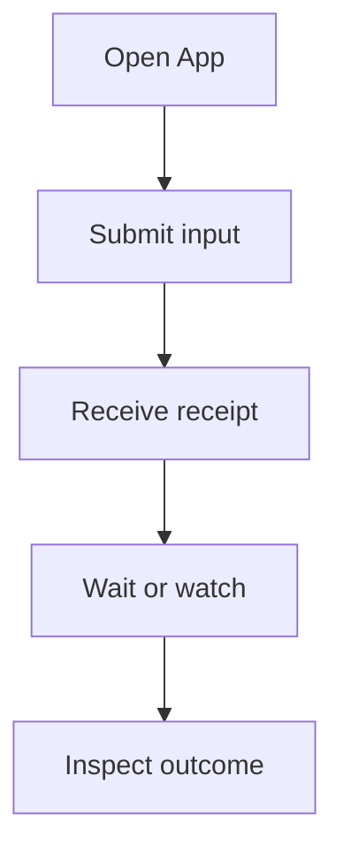

Use `HarnessUiApp` when your Python application needs Harness UI's configuration files, saved Threads, attachments, and Run controls.

Choose [Harness directly](../a13n-harness/hosting.md) if your application will own configuration and persistence. Choose [Service](../a13n-service/index.md) for managed execution that can recover on another worker.

## Open, submit, and wait

Before running the script:

1. Install `a13n-harness-ui` in the Python environment that will run your application. A separate `uv tool` installation provides the CLI, not imports for your application's interpreter.
2. Complete [setup](setup.md), including a working default Agent and Model.
3. Run `a13n-harness-ui config path` and copy the `configuration_path` value. This is the root YAML file, not the data directory.

Save this complete program as `embedded_chat.py`. It uses the selected configuration's data root and can either create a Thread or continue one you saved earlier.

```python title="embedded_chat.py"
import argparse
import asyncio
from pathlib import Path

from a13n_harness_ui.app import open_harness_ui_app
from a13n_harness_ui.settings_loader import load_harness_ui_settings


async def run_once(configuration_file: Path, prompt: str, thread_id: str | None):
    source = await load_harness_ui_settings(configuration_file)
    if source.candidate_error is not None:
        raise source.candidate_error

    async with open_harness_ui_app(
        source.settings,
        configuration_path=source.path,
    ) as app:
        if thread_id is None:
            thread = await app.create_thread(title="Embedded conversation")
            thread_id = thread.thread_id
        else:
            await app.get_thread(thread_id)

        print(f"Thread: {thread_id}")
        receipt = await app.submit_thread(thread_id=thread_id, prompt=prompt)
        operation = await app.wait_root_operation(receipt.receipt_id)
        print(operation.model_dump_json(indent=2))


if __name__ == "__main__":
    parser = argparse.ArgumentParser()
    parser.add_argument("--config", required=True, type=Path)
    parser.add_argument("--thread")
    parser.add_argument("prompt")
    args = parser.parse_args()
    asyncio.run(run_once(args.config, args.prompt, args.thread))
```

Run it with your actual configuration path:

```bash
python embedded_chat.py --config /path/to/a13n-harness-ui.yaml "Reply with one short sentence."
```

The program prints a Thread ID and a JSON operation view. For a successful saved answer, check `status: "completed"`, `outcome.execution.output`, and `outcome.continuation.status: "selected"`. The script invokes your configured Model and tools; it is not an offline simulation.

Copy the printed Thread ID into a second invocation:

```bash
python embedded_chat.py --config /path/to/a13n-harness-ui.yaml --thread THREAD_ID "Explain your previous answer."
```

Use the same configuration and data root to reopen the saved conversation. If the first operation suspended for a decision, answer that decision before submitting another prompt; see [pending decisions](#answer-the-complete-pending-set).

Pass loaded settings and the configuration path together. Constructing `HarnessUiSettings()` alone does not load resource files. To create a separate dataset, pass `data_root=Path(...)` to `load_harness_ui_settings()`.

The async context manager owns App startup and shutdown. Keep it open for your interface's lifetime. `host_mode="webui"` enables browser-mode collaboration features without starting a listener; [the HTTP adapter](http-api.md) owns the listener. Import APIs from their owning submodules: `a13n_harness_ui` itself exports only the version.

## Receipts are not saved continuation

A receipt gives you a handle for controlling admitted work. The operation outcome tells you what ran and what was saved.



`submit_thread()` returns `RootRunReceipt(receipt_id, thread_id, submitted_at)`. A second submission to an active Thread is rejected. Use these methods to follow the first submission:

| Task                             | App method                                             |
| -------------------------------- | ------------------------------------------------------ |
| Inspect current status           | `get_root_operation(receipt_id)`                       |
| Wait for the outcome             | `wait_root_operation(receipt_id, timeout_seconds=...)` |
| Find a Thread's active operation | `active_root_operation(thread_id)`                     |
| Add guidance to active work      | `steer_root_operation(receipt_id=..., message=...)`    |
| Request cancellation             | `cancel_root_operation(receipt_id)`                    |

Statuses are `preparing`, `running`, `completed`, `suspended`, `failed`, and `cancelled`. Preparation can fail before an `outcome` exists; inspect the operation's `failure` in that case. When an outcome exists, read its three parts separately:

| Outcome field  | What to check                                                |
| -------------- | ------------------------------------------------------------ |
| `execution`    | Status, answer or failure, usage, and `output_omitted`       |
| `continuation` | Whether a checkpoint was saved and selected for the next Run |
| `environment`  | Environment-state publication and cleanup failures           |

Execution, checkpoint saving, and cleanup can have different results. A completed answer alone is not proof that the next Run can restore it. Receipts belong to the current process; after a restart, use the Thread ID and saved history, as in the second script invocation above.

### Steering and retained tools

Root and child steering follow the current global `input.steering_mode`: `immediate` by default, or `queued` for delivery at the next safe boundary. Accepted steering means the input was queued for delivery, not that the Agent has already acted on it.

Generic tools run inline by default. Set `tools.execution.mode: auto` for timeout-based handoff. Process-backed top-level Shell calls can yield after the foreground wait in either mode; foreground-only mounts follow the generic mode. The App supplies the runtime needed for immediate steering and retained execution.

Use `app.tool_executions(thread_id, offset=0, limit=20)` for non-consuming, exact-Thread status and `app.cancel_tool_execution(thread_id, execution_id)` to request tool cancellation. Conversation cancellation and tool cancellation are separate. Cancelling a conversation also suppresses automatic completion wake until new user input. Retained execution records last until App shutdown and are lost on restart.

## Thread queries and mutations

Build Thread selection and history around these methods:

| Task                              | App methods                                                               |
| --------------------------------- | ------------------------------------------------------------------------- |
| Create or find a Thread           | `create_thread`, `get_thread`, `list_threads`                             |
| Read saved history                | `get_thread_transcript`                                                   |
| Change title or archive state     | `update_thread_metadata`                                                  |
| Change selections for later Runs  | `update_thread_configuration`, `patch_thread_configuration`               |
| Stage, read, or prune attachments | `stage_thread_attachment`, `read_thread_attachment`, `prune_thread_files` |
| Submit input                      | `submit_thread`                                                           |
| Answer deferred decisions         | `respond_thread`, `respond_decisions`                                     |

Pass `NewThreadDefaults` from `a13n_harness_ui.surfaces` to choose Project, Agent, Model, Environment, and integrations at creation. Omitted selections use configured defaults. Model precedence is the operation's `RunModelOverrides`, the Thread's `default_model_id`, then the Agent's Model.

For an editor, read the object before saving a change. Metadata and configuration each have their own `expected_version`; decisions use `expected_continuation_id`. A `ThreadConfigurationPatch` can set `default_model_id`, clear it with null, or omit it to keep the current choice. Metadata follows the same omission rule; null clears a title. Archive only when the root operation is inactive.

Thread lists default to 20 items and transcript pages to 50. Follow returned cursors with unchanged filters and continuation. Check the transcript's disclosure for clipped values before treating it as a complete export.

## Answer the complete pending set

When an operation suspends for questions, approvals, or external results:

1. Read `thread_decisions(thread_id=...)` and retain its continuation ID.
2. Display the requests and collect an answer for every pending request.
3. Build a `DecisionResponseBatch` from `a13n_harness_ui.surfaces`, using that ID as `expected_continuation_id`.
4. Submit it through `respond_decisions(thread_id=..., response=...)` and wait on the new receipt.

Use the response type for each request: `QuestionResponse`, `ApprovalDecision`, or `ExternalToolResult`. Approved decisions can override arguments; denied decisions can include a denial message. A denied external result requires a denial message in place of a successful result. Lower-level adapters can pass `ThreadDeferredResponse` to `respond_thread()`.

Authenticate the responder in your interface. Collecting the complete set avoids unintentionally skipping a request: omitted approvals are denied, and omitted external calls, including questions, fail. Submitting an ordinary prompt applies those same outcomes to all unanswered requests before continuing with the prompt. If the selected continuation changed while the user was answering, refetch the pending set before submitting.

## MCP input and integration control

MCP forms and URL confirmations can arrive while an operation is running. Enable them with `mcp_input_enabled=True` when opening a local App, then handle requests concurrently with operation waiting:

1. Read `mcp_input_requests(thread_id)` for the Thread and its descendants. A new watch also exposes pending requests in `ThreadWatch.snapshot.mcp_inputs`.
2. Display the form or URL request.
3. Pass an `McpInputResponse` from `a13n_harness_ui.mcp_runtime.inputs` to `respond_mcp_input(thread_id, request_id, response)`.
4. Choose `accept`, `decline`, or `cancel`. Accepted forms include `content`; URL confirmation has no form data.

Local Apps disable MCP input by default. Waiting for completion before displaying these requests can leave the server waiting for an answer. Identical repeated answers reconcile with the first answer; conflicting answers fail. Requests and answers are process-local.

Use `mcp_status(thread_id)` to inspect retained connections without opening one. `close_mcp_integration(thread_id, server_id)` closes the selected connection generation and keeps its configuration. See [MCP connection lifetime](mcp.md#connection-lifetime-and-protocol) for retention and in-flight calls.

## Attach files

Stage an upload on an existing Thread, then include its returned ID in the next submission. Inside the open App context, replace the script's `submit_thread()` call with this fragment:

```python
from a13n_harness_ui.thread_files import AttachmentUpload

attachment = await app.stage_thread_attachment(
    thread_id=thread_id,
    upload=AttachmentUpload(
        name="notes.txt",
        data=b"The release needs a setup guide and a smoke test.",
        media_type="text/plain",
    ),
)
receipt = await app.submit_thread(
    thread_id=thread_id,
    prompt="Summarize the attached notes.",
    attachment_ids=(attachment.attachment_id,),
)
```

Keep the script's wait and result inspection after this fragment. Staging stores an upload; submission starts the work. Each input supports eight attachments, 10 MiB per file, and 20 MiB combined. IDs belong to their Thread. The configured media policy determines whether the Model receives media directly or a file through the Environment.

## Watch without racing the initial query

Use `watch_thread(root_thread_id=...)` as an async context manager when building a live view:

1. Enter the watch. It subscribes before capturing the initial snapshot.
2. Render `ThreadWatch.snapshot` and consume `ThreadWatch.events` in a concurrent task.
3. Submit input and wait for the operation in another task.
4. Close the watch when the user leaves the view. Closing it stops delivery, not execution.

For reconnects, `live_events(..., after=LiveCursor(...))` resumes a focused subscription; `summary_events(after=SummaryCursor(...))` supplies invalidations. Cursors include a process epoch. Refetch after a gap or reset rather than appending events to an outdated snapshot.

For Subagents, use `query_child_executions`, `wait_child_executions`, `steer_child_execution`, and `cancel_child_execution` with the owning parent and execution ID. Saved child records remain readable after live control ends.

## Register trusted integrations

Pass `HarnessUiIntegrations` to `open_harness_ui_app()` to register Host Capabilities, Environment providers/adapters, Harness Plugin factories, Environment Run Extension factories, and Provider-runtime factories. Configuration selects the registered integrations for each Run.

Keep credentials, callbacks, clients, and operators in runtime collaborators. Reuse the existing [configuration](configuration.md), [extension](extensions-and-mcp.md), [Skill](skills-and-content-plugins.md), and [MCP](mcp.md) formats instead of introducing a second configuration system in your interface. Use [observation](observation.md) to connect tracing.

For isolated tests, select a temporary `data_root`, disable `pricing_auto_update`, set `A13N_OFFICIAL_MODELS_AUTO_UPDATE=0`, and supply test Model collaborators. This keeps tests separate from your saved conversations and provider accounts.
