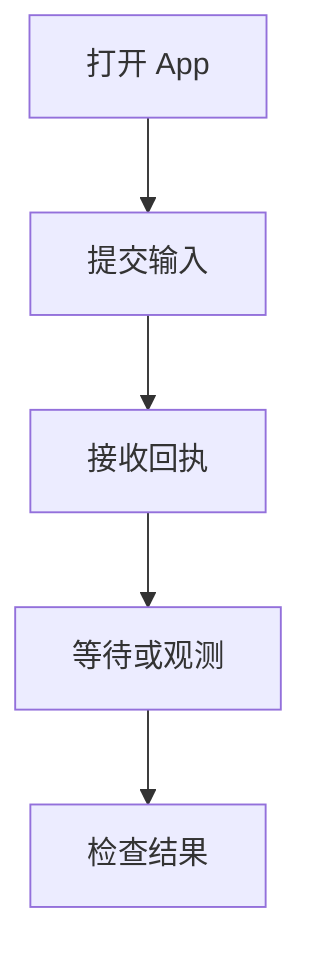

当 Python 应用需要复用 Harness UI 的配置文件、已保存的 Thread、附件和 Run 控制时，使用 `HarnessUiApp`。

如果应用自己负责配置和持久化，请[直接使用 Harness](../a13n-harness/hosting.md)。需要能由其他 worker 恢复的托管执行时，选择 [Service](../a13n-service/index.md)。

## 打开、提交与等待

运行脚本前：

1. 在运行应用的 Python 环境中安装 `a13n-harness-ui`。单独通过 `uv tool` 安装只提供 CLI，不会让应用的解释器能够导入这个包。
2. 完成[首次配置](setup.md)，确保默认 Agent 和 Model 可以正常使用。
3. 运行 `a13n-harness-ui config path`，复制 `configuration_path` 的值。它是根 YAML 文件，不是数据目录。

将下面的完整程序保存为 `embedded_chat.py`。程序使用所选配置对应的数据根目录，可以新建 Thread，也可以继续先前保存的 Thread。

```python title="embedded_chat.py"
import argparse
import asyncio
from pathlib import Path

from a13n_harness_ui.app import open_harness_ui_app
from a13n_harness_ui.settings_loader import load_harness_ui_settings


async def run_once(configuration_file: Path, prompt: str, thread_id: str | None):
    source = await load_harness_ui_settings(configuration_file)
    if source.candidate_error is not None:
        raise source.candidate_error

    async with open_harness_ui_app(
        source.settings,
        configuration_path=source.path,
    ) as app:
        if thread_id is None:
            thread = await app.create_thread(title="Embedded conversation")
            thread_id = thread.thread_id
        else:
            await app.get_thread(thread_id)

        print(f"Thread: {thread_id}")
        receipt = await app.submit_thread(thread_id=thread_id, prompt=prompt)
        operation = await app.wait_root_operation(receipt.receipt_id)
        print(operation.model_dump_json(indent=2))


if __name__ == "__main__":
    parser = argparse.ArgumentParser()
    parser.add_argument("--config", required=True, type=Path)
    parser.add_argument("--thread")
    parser.add_argument("prompt")
    args = parser.parse_args()
    asyncio.run(run_once(args.config, args.prompt, args.thread))
```

换成实际的配置路径后运行：

```bash
python embedded_chat.py --config /path/to/a13n-harness-ui.yaml "Reply with one short sentence."
```

程序打印 Thread ID 和 JSON 格式的操作视图。确认回答成功并已保存时，检查 `status: "completed"`、`outcome.execution.output` 和 `outcome.continuation.status: "selected"`。脚本会调用已配置的 Model 和工具，不是离线模拟。

复制打印出的 Thread ID，再运行一次：

```bash
python embedded_chat.py --config /path/to/a13n-harness-ui.yaml --thread THREAD_ID "Explain your previous answer."
```

使用相同的配置和数据根目录，才能重新打开已保存的对话。如果第一次操作因等待决策而挂起，先回答决策，再提交新提示；见[待处理决策](#answer-the-complete-pending-set)。

同时传入加载后的设置和配置路径。单独构造 `HarnessUiSettings()` 不会加载资源文件。需要独立的数据集时，向 `load_harness_ui_settings()` 传入 `data_root=Path(...)`。

异步上下文管理器负责 App 的启动和关闭。构建交互界面时，在界面的整个生命周期内保持 App 打开。`host_mode="webui"` 开启浏览器模式的协作功能，但不启动监听器；监听器由 [HTTP 适配器](http-api.md)负责。从各 API 所属的子模块导入：`a13n_harness_ui` 本身只导出版本。

## 回执与已保存续接不同

回执用于控制已受理的工作。操作结果则告诉你执行了什么、保存了什么。



`submit_thread()` 返回 `RootRunReceipt(receipt_id, thread_id, submitted_at)`。向活动 Thread 再次提交会被拒绝。用以下方法跟进第一次提交：

| 任务                     | App 方法                                               |
| ------------------------ | ------------------------------------------------------ |
| 查看当前状态             | `get_root_operation(receipt_id)`                       |
| 等待结果                 | `wait_root_operation(receipt_id, timeout_seconds=...)` |
| 查找 Thread 的活动操作   | `active_root_operation(thread_id)`                     |
| 为正在执行的工作补充指导 | `steer_root_operation(receipt_id=..., message=...)`    |
| 请求取消                 | `cancel_root_operation(receipt_id)`                    |

状态包括 `preparing`、`running`、`completed`、`suspended`、`failed` 和 `cancelled`。准备阶段可能在产生 `outcome` 前失败，此时查看操作的 `failure`。存在结果时，分别检查以下三部分：

| 结果字段       | 检查内容                                      |
| -------------- | --------------------------------------------- |
| `execution`    | 状态、回答或失败、用量，以及 `output_omitted` |
| `continuation` | 是否已保存并选中供下一次 Run 使用的检查点     |
| `environment`  | Environment 状态发布和清理失败                |

执行、检查点保存和清理可能有不同的结果。仅有完整回答，不代表下一次 Run 能恢复它。回执属于当前进程；重启后使用 Thread ID 和已保存历史，就像上面第二次运行脚本一样。

### 引导与保留的工具执行

根级和子级 steering 遵循当前全局 `input.steering_mode`：默认 `immediate`，选择 `queued` 则在下一个安全边界交付。接受 steering 表示输入已进入交付队列，不代表 Agent 已经按其执行。

通用工具默认内联执行。设置 `tools.execution.mode: auto` 可开启超时移交。支持进程的顶层 Shell 调用在两种模式下都可在前台等待到期后让出；仅支持前台执行的挂载遵循通用模式。App 提供即时 steering 和保留执行所需的运行时。

用 `app.tool_executions(thread_id, offset=0, limit=20)` 读取指定 Thread 的状态，不消耗结果；用 `app.cancel_tool_execution(thread_id, execution_id)` 请求取消工具。取消对话和取消工具是两件事。取消对话还会禁止完成事件自动唤醒，直到收到新的用户输入。保留的执行记录只在 App 生命周期内有效，重启后丢失。

## Thread 查询与修改

围绕以下方法构建 Thread 选择和历史查看功能：

| 任务                 | App 方法                                                                  |
| -------------------- | ------------------------------------------------------------------------- |
| 创建或查找 Thread    | `create_thread`、`get_thread`、`list_threads`                             |
| 读取已保存历史       | `get_thread_transcript`                                                   |
| 修改标题或归档状态   | `update_thread_metadata`                                                  |
| 修改后续 Run 的选择  | `update_thread_configuration`、`patch_thread_configuration`               |
| 暂存、读取或清理附件 | `stage_thread_attachment`、`read_thread_attachment`、`prune_thread_files` |
| 提交输入             | `submit_thread`                                                           |
| 回答延迟决策         | `respond_thread`、`respond_decisions`                                     |

传入 `a13n_harness_ui.surfaces` 中的 `NewThreadDefaults`，在创建时选择 Project、Agent、Model、Environment 和集成。省略的选择使用配置默认值。Model 优先级为本次操作的 `RunModelOverrides`、Thread 的 `default_model_id`、Agent 的 Model。

实现编辑器时，先读取对象，再保存修改。元数据和配置各有自己的 `expected_version`；决策使用 `expected_continuation_id`。`ThreadConfigurationPatch` 可设置 `default_model_id`，用 null 清除，或省略以保留当前选择。元数据也遵循省略即保留的规则；null 清除标题。仅在根操作非活动时归档。

Thread 列表默认每页 20 项，对话记录默认每页 50 项。后续游标请求应保持筛选条件和续接不变。将记录作为完整导出前，检查返回说明中是否有值被截断。

## 回答完整的待处理决策集

操作因问题、审批或外部结果而挂起时：

1. 读取 `thread_decisions(thread_id=...)`，保留其续接 ID。
2. 显示请求，为每个待处理请求收集答案。
3. 用 `a13n_harness_ui.surfaces` 中的 `DecisionResponseBatch` 构造批次，将该 ID 作为 `expected_continuation_id`。
4. 通过 `respond_decisions(thread_id=..., response=...)` 提交，并等待新回执对应的操作。

按请求类型使用 `QuestionResponse`、`ApprovalDecision` 或 `ExternalToolResult`。批准的决策可覆盖参数；拒绝的决策可包含拒绝消息。拒绝外部结果时，需要拒绝消息，不能传入成功结果。更底层的适配器可向 `respond_thread()` 传入 `ThreadDeferredResponse`。

在自己的界面中验证回答者身份。收齐回答可避免意外跳过请求：省略的审批会被拒绝，省略的外部调用（包括问题）会失败。提交普通提示时，所有未回答请求也会先按此方式处理，再继续执行提示。如果用户回答期间选中的续接发生变化，应重新读取待处理集合再提交。

## MCP 输入与集成控制

MCP 表单和 URL 确认可能在操作运行期间到达。打开本地 App 时设置 `mcp_input_enabled=True`，然后在等待操作的同时处理请求：

1. 用 `mcp_input_requests(thread_id)` 读取该 Thread 及其后代的请求。新建 watch 时，`ThreadWatch.snapshot.mcp_inputs` 也会提供待处理请求。
2. 显示表单或 URL 请求。
3. 将 `a13n_harness_ui.mcp_runtime.inputs` 中的 `McpInputResponse` 传给 `respond_mcp_input(thread_id, request_id, response)`。
4. 选择 `accept`、`decline` 或 `cancel`。接受表单时传入 `content`；URL 确认没有表单数据。

本地 App 默认关闭 MCP 输入。如果等操作完成才显示请求，服务器可能一直在等待回答。完全相同的重复回答会核实第一次回答的结果；冲突回答会失败。请求和答案只保留在当前进程。

用 `mcp_status(thread_id)` 查看保留的连接，不建立新连接。`close_mcp_integration(thread_id, server_id)` 关闭选中的连接代，但保留配置。连接保留和进行中的调用见 [MCP 连接生命周期](mcp.md#connection-lifetime-and-protocol)。

## 附加文件

先将上传暂存在已有 Thread，再在下一次提交中传入返回的 ID。在已打开 App 的上下文内，用下面的片段替换脚本中的 `submit_thread()` 调用：

```python
from a13n_harness_ui.thread_files import AttachmentUpload

attachment = await app.stage_thread_attachment(
    thread_id=thread_id,
    upload=AttachmentUpload(
        name="notes.txt",
        data=b"The release needs a setup guide and a smoke test.",
        media_type="text/plain",
    ),
)
receipt = await app.submit_thread(
    thread_id=thread_id,
    prompt="Summarize the attached notes.",
    attachment_ids=(attachment.attachment_id,),
)
```

保留片段之后的等待和结果检查。暂存负责保存上传，提交才会启动工作。每次输入最多八个附件，每个 10 MiB，合计 20 MiB。ID 属于其 Thread。媒体策略决定 Model 直接收到媒体，还是通过 Environment 使用文件。

## 订阅先于初始查询

构建实时视图时，将 `watch_thread(root_thread_id=...)` 用作异步上下文管理器：

1. 进入 watch。它先订阅，再捕获初始快照。
2. 渲染 `ThreadWatch.snapshot`，并在并发任务中消费 `ThreadWatch.events`。
3. 在另一个任务中提交输入并等待操作。
4. 用户离开视图时关闭 watch。关闭只停止交付，不停止执行。

重新连接时，`live_events(..., after=LiveCursor(...))` 恢复聚焦订阅；`summary_events(after=SummaryCursor(...))` 提供失效通知。游标包含进程 epoch。出现缺口或重置时重新获取数据，不要继续向过期快照追加事件。

对 Subagent 使用 `query_child_executions`、`wait_child_executions`、`steer_child_execution` 和 `cancel_child_execution`，指定所属父级和执行 ID。活动控制结束后，已保存的子级记录仍可读取。

## 注册可信集成

向 `open_harness_ui_app()` 传入 `HarnessUiIntegrations`，注册 Host Capability、Environment provider/适配器、Harness Plugin 工厂、Environment Run Extension 工厂和 Provider 运行时工厂。配置决定每次 Run 使用哪些已注册集成。

凭据、回调、客户端和 operator 保留在运行时协作者中。复用现有的[配置](configuration.md)、[扩展](extensions-and-mcp.md)、[Skill](skills-and-content-plugins.md) 和 [MCP](mcp.md) 格式，避免在界面中引入第二套配置体系。接入追踪见[观测](observation.md)。

隔离测试应使用临时 `data_root`，关闭 `pricing_auto_update`，设置 `A13N_OFFICIAL_MODELS_AUTO_UPDATE=0`，并提供测试 Model 协作者。这样测试不会使用你的已保存对话和 provider 账户。
