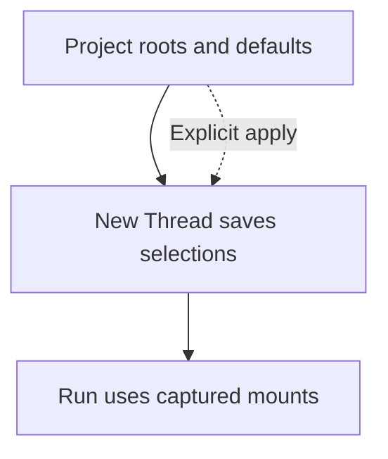

An Environment determines where the Agent reads files and runs commands. A Project groups conversations and supplies initial working directories and defaults. Each conversation saves its own selections, so editing a Project does not move an existing conversation's work.

Start with a local directory and a built-in execution mode. Add a Project file when you need several directories or reusable defaults. For another computer, follow [Add Device bindings](#add-device-bindings).

## Select an Environment

First complete [setup](setup.md) and select an Agent with `dynamic_environment` file tools. Commands also require its shell tools.

1. Open a terminal in the directory you want the Agent to use.

2. Choose one execution mode. **Full Control** runs as your Host account. **Sandbox** uses Envd's restricted worker and requires supported isolation on your computer. Read the platform differences below before choosing.

3. Start a new conversation with one of these commands:

   ```console tab="Full Control"
   a13n-harness-ui --environment-mode full-control
   ```

   ```console tab="Sandbox"
   a13n-harness-ui --environment-mode sandbox
   ```

4. Send a read-only test: `List the files in the working directory. Do not change anything.` Check that the tool result names the intended directory and its files.

For an existing TUI conversation, resume it first and use `/environment` to select the mode for later Runs. Launch Environment overrides cannot be combined with `--resume`. In WebUI, use **Conversation details → Configuration** for saved next-Run selections, or the composer's **Environments** editor for a temporary override.

List available profiles with `a13n-harness-ui environment list --format json`. Use `--environment-profile environment-team` for a configured custom profile; it is mutually exclusive with `--environment-mode`.

## Execution permissions

| Built-in profile      | Runtime and authority                                                    |
| --------------------- | ------------------------------------------------------------------------ |
| `environment-native`  | Direct execution as the Host account; no Envd download or daemon         |
| `environment-envd`    | Full Control through Envd; Computer Use off                              |
| `environment-desktop` | Full Control through Envd with Computer Use                              |
| `environment-sandbox` | Envd restricted filesystem/process worker with inherited Host networking |

Full Control can access the Host account's files, exported credentials, and network services. Project roots choose working directories; they do not sandbox a shell command.

Sandbox grants writes to Project roots and Thread scratch space. Its Thread-file worker exposes attachments read-only and `tmp/` read-write. Linux and macOS restrict reads to granted and runtime paths. **Windows permits broad disk reads, including account-accessible Host configuration and credentials**, while confining writes; Envd bootstrap/control files remain denied. Built-in Sandbox networking inherits Host routing and firewall policy, including access to Host localhost services.

Sandbox readiness checks verify the worker boundary. Failure is explicit: fix the prerequisite and retry, or deliberately select Full Control. Harness UI does not fall back, run `sudo`, change sysctls, or disable isolation on your behalf. See [Envd isolation](../a13n-envd/isolation.md) for the platform boundaries and [custom profiles](#custom-environment-profiles) for network restrictions.

### Manage local envd

Use **Settings → Environments → Local runtime** when you need Sandbox, Envd-backed Full Control, or local Computer Use. This screen is also reachable from the first setup step, before Model configuration.

1. Choose **Install & start** on first use, **Start** for an installed runtime, or **Update & start** when only an older release is cached. Harness UI installs the exact release matching its installed Envd client, not an arbitrary latest release.
2. Choose **Check** to check Full Control and Sandbox support. Setup checks filesystem/process isolation and Host localhost connectivity without depending on an external Internet service.
3. Select the execution default under **Settings → Environments** and save. Saving defaults alone does not start Envd and does not change existing conversations or Project overrides.
4. Start a new conversation with that selection and repeat the read-only file test above. Outside setup, runtime readiness is checked when execution needs it, not when the landing page opens.

The runtime actions have different effects:

- **Restart** closes local Envd Sessions, starts a fresh Full Control instance, and checks Sandbox. Desktop instances start again on demand.
- **Reinstall** downloads and verifies the same required release, then restarts. Failed acquisition keeps the old executable and leaves runtimes stopped. Update custom executables on the Host before restarting here.
- **Stop** interrupts active Sessions, including other conversations. It preserves files and saved defaults. After an unexpected exit, explicitly start again.

Restart, reinstall, and stop require confirmation. Compatible Full Control executions share an App-owned daemon but have separate Session working directories; Sandbox grants and desktop policies remain separate. Root configuration changes require restarting Harness UI, not only Envd.

Managed binaries live at `<data-root>/runtimes/managed/<version>/<target>/a13n-envd` (`a13n-envd.exe` on Windows). The default data root is `~/.a13n-harness-ui/data`; older cached releases remain available on disk. After upgrading Harness UI, restart it before using **Update & start**.

For local Computer Use, enable **Desktop capability**, save, and restart Harness UI. Run **Check permissions** on the Host, then explicitly select Computer Use for the desired execution default. The permission check neither captures the screen nor injects input. Managed/custom executable settings are in [root envd configuration](configuration.md#local-envd-runtime).

The CLI separates inspection, preparation, and default changes:

```console
a13n-harness-ui environment status
a13n-harness-ui environment check --profile environment-envd
a13n-harness-ui environment configure --profile environment-envd
```

`check` prepares without changing defaults. `configure` saves the default only after a successful check.

### Native command environment

Launch Harness UI from a terminal where the required tools and exported variables already work. Direct Full Control commands inherit the application's `PATH`, proxy settings, tool variables, and exported credentials. This applies to Project and Thread-file commands; TUI `!command` also inherits the Host process environment.

Per-command variable overrides and removals affect only that command and its descendants. They do not change Harness UI or later commands, and inherited values are not copied into configuration or Run snapshots. Changes in another terminal after launch do not update the running application. Aliases, unexported variables, and automatic sourcing of `.zshrc`/`.bashrc` are not part of process-environment inheritance. Sandbox has its own environment policy.

## Windows local execution

Direct uses native PowerShell (`pwsh`, then Windows PowerShell), UTF-8 streams, and a Job Object for the command's descendants. Cancellation, timeout, and exit clean up the owned process tree. Windows cancellation terminates that tree; portable interrupt signals are unavailable. WSL uses the Linux backend.

Windows Sandbox uses PowerShell and the experimental native Microsoft eXecution Container (MXC) backend with Job Object process ownership. The Host must pass actual create/close and production isolation probes. If unavailable, update Windows and retry or explicitly choose Full Control. Harness UI does not provision accounts, mutate ACLs, or elevate privileges.

The Sandbox command search path includes the selected PowerShell directory, System32, and existing absolute Host PATH directories in order. Explicit `launch.trusted_executable_roots` replaces those defaults without inheriting Host credential variables. Broad reads exclude mapped network drives. New local volumes or volume-root entries require a new Session. See [Windows boundary details](../a13n-envd/isolation.md#native-windows-mxc).

## Project file reference

For a two-directory Project, create this complete file as `projects/work.yaml` beside the selected root YAML. Replace both paths with existing absolute directories on the Harness UI Host:

```yaml title="projects/work.yaml"
schema_version: "1"
kind: project
id: project-work
name: Work
position: 0
roots:
  - path: /absolute/path/to/code
  - path: /absolute/path/to/notes
```

Run `a13n-harness-ui config validate` against that configuration tree. Then launch the TUI from the **first** directory, or choose **Work** when creating a WebUI conversation. Ask the Agent to list both directories and verify both tool results. Creating the Project does not copy files, create directories, or create a Git worktree.

The first root is the TUI entry point and default working directory unless another default is selected. Later roots are additional mounts, not extra TUI entry points. Local paths must be absolute after `~` expansion. An unavailable path can be saved, but execution that selects it fails until it is accessible. A remote-only Project has no local TUI entry point.

| Field            | Default            | Meaning                                                                                                  |
| ---------------- | ------------------ | -------------------------------------------------------------------------------------------------------- |
| `schema_version` | Required `"1"`     | Resource schema                                                                                          |
| `kind`           | Required `project` | Resource type                                                                                            |
| `id`             | Required           | Unique stable `project-` ID                                                                              |
| `name`           | Required           | Display name                                                                                             |
| `position`       | `0`                | Catalog ordering                                                                                         |
| `roots`          | `[]`               | Up to 64 ordered unique `{path: ...}` entries; a Project needs at least one local root or Device binding |
| `defaults`       | `{}`               | Initial selections for new conversations                                                                 |

### Defaults for new conversations

Merge this mapping beside `roots` in the Project file. Replace `agent-reviewer` with an existing Agent ID:

```yaml
defaults:
  agent: agent-reviewer
  environment_profile: environment-native
  harness_plugins: []
  environment_run_extensions: []
  mcp_servers: []
```

Validate, then create a **new** conversation in that Project and inspect its configuration. In WebUI, these fields are also editable under **Project menu → Project settings**.

Explicit creation choices win over Project defaults. The selected Agent's Plugin/MCP defaults then precede root YAML defaults. An omitted Environment ultimately uses `environment-native`; a projectless conversation skips Project defaults. Model and Capability configuration belong to the Agent.

Omitted or null default fields continue fallback. Empty lists select none; supplied lists replace lower-priority lists rather than merging. Device selections use the optional `environment_bindings` and `default_environment` fields shown below.

Existing conversations keep their saved selections. **Apply Project defaults** previews and applies only fields configured by the Project, preserving unspecified fields. Review the preview before applying; a changed Thread or relevant defaults requires a fresh preview. The [HTTP configuration workflow](http-api.md#configure-projects-and-threads) exposes the same operation.

### Thread Environments and composer overrides

Choose the editing surface according to how long the change should last:

- **Conversation details → Configuration:** save this Thread's local directories, local profile, Device bindings, and default Environment for later Runs. Captured Run configuration is shown separately from editable next-Run choices.
- **Apply Project environments:** review and replace exactly those four Environment selections from the Project. A local-only Project clears old Device bindings. Agent, Model, MCP, Plugins, and Run Extensions stay unchanged.
- **Composer → Environments:** apply a tab-local override. It continues across subsequent Runs until **Use conversation defaults** resets it; it is not a one-send setting and does not change the saved Thread.

The editor groups local directories under **Local · Harness server**. Remote directories sharing a Device and execution policy form one group. Choose **Default working directory** below the groups, then apply the whole draft. Closing without applying discards edits. Local mode never changes remote shell permissions.

Changing a Thread's Project in WebUI changes grouping, not its Environment selections. A projectless Thread can retain local directories. Steering uses the active Run's captured Environment; deferred replies keep the suspended Run's Environment unless explicitly changed. New children begin with the parent's captured choices and subsequently own their selections independently.

## Files, Projects, and recovery



For ordinary TUI use, launch from the Project's first directory. On the first prompt, Harness UI reuses an exact first-root match or creates a single-root Project if none matches. It does not adopt a parent directory's Project or rewrite an existing Project. Multiple matches require a specific saved conversation or corrected Project roots.

When explicitly resuming from **another** directory, the TUI selects that launch directory's Project and local roots and sets `workspace` as default. History, Device bindings, and local execution mode remain. Resuming within the same Project preserves the Thread's saved roots, even after the Project file changes. Resume first, then change Agent, Environment, or title; those launch overrides cannot accompany `--resume`.

If the process stops, resume uses the last saved checkpoint, potentially including retained partial progress. Active operations and unsaved input do not survive. Recorded tool results are not replayed; unanswered calls follow the [declared-retryable recovery policy](../a13n-harness/state-and-resume.md#resume-unanswered-tool-calls) with fresh permission and approval checks. Live output can be incomplete; the TUI marks stream recovery and prints the authoritative final answer. Configuration publication failures use [setup recovery](setup.md#cancel-or-recover-setup).

## Add Device bindings

Use a Device to work on another computer. Connecting registers its Envd daemon; adding a binding selects an existing directory and allowed actions for a Project or Thread. Neither action creates that directory or starts an Agent Run.

### Connect and approve Envd

You need Envd installed on the other computer and a WebUI address reachable from it. Use HTTPS for a remote connection. `http://127.0.0.1:8765` is suitable only when the daemon and WebUI are on the same computer.

1. Open WebUI at that reachable address. Choose **Settings → Environments → Connect Device**, or **Add environment → Connect new Device**.

2. Select POSIX shell or PowerShell in the wizard. Enable shell execution only if the Agent needs commands; desktop access is a separate advanced option.

3. Copy the generated command and run it on the computer whose files you want. A file-only connection has this form; replace the example origin:

   ```console
   a13n-envd connect https://your-harness-ui.example.com
   ```

4. Keep the terminal open. Match its verification code and Device name in the browser, then choose **Approve Device**. Reject requests you do not recognize; pending requests expire after ten minutes.

5. Wait for **Device online**, then [choose working directories](#choose-working-directories). A wizard opened from Settings finishes at **Done** without adding a binding.

The daemon connects outward, so its computer needs no inbound port. The command is a foreground process, not an installed service. Approval saves the Device configuration and credentials without copying a browser login key. Closing before approval does not reject the request; closing afterward keeps the registration but discards unsaved binding edits. A disappearing request is not proof of approval.

To allow commands with the daemon account's authority, use the wizard's shell-enabled command. Its POSIX form is:

```bash
A13N_ENVD_FULL_CONTROL=1 a13n-envd connect https://your-harness-ui.example.com
```

The PowerShell equivalent is:

```powershell
$env:A13N_ENVD_FULL_CONTROL = "1"
a13n-envd connect https://your-harness-ui.example.com
```

This is remote host-account execution, independently of the Harness UI server's local mode. Without full-control opt-in, shell requires explicit daemon `trusted_executable_roots` or `shell_profiles`; file operations remain available.

Reconnect by rerunning the same command and environment. Preserve the original shell/desktop flags: saved Host connections do not retain every launch setting. Optionally add `--host personal` on first connection and later use `a13n-envd connect personal`. Keep the state directory containing identity and credentials. One Envd process connects to one Host; use another process with a different `--instance` for another Host. See [daemon configuration](../a13n-envd/configuration.md).

### Choose working directories

Open **Project menu → Project settings → Environments** or **Conversation details → Configuration → Change next Run selections**:

1. Choose **Add environment**, select the Device, and choose its allowed actions.
2. Enter an existing absolute path, choose **Use Device default**, or browse and explicitly select a directory. Add more paths with **Add another directory**.
3. Apply the environment draft, choose **Default working directory**, and save the enclosing settings.
4. Start a new Run. Ask the Agent to list the selected remote directory without changing files. Check the Device/path in the tool result, not only the Device's online status.

Browsing opens no Session and works before a Run exists. If the Device is unavailable or discovery is disabled, enter a known path; execution still needs the Device and directory to be accessible. Windows Device paths use `/C:/work` or `/UNC/server/share/work`, not the Harness UI server's paths.

**Add directory** extends an existing group's Device and access policy. Different access, network, or boundary policies remain separate groups. **Advanced routing** exposes generated aliases. Each execution gets its own Session; two aliases for the same Device do not share process handles or retained output.

For a remote-only Project, choose **Add project**, add Device directories without local roots, and select a default. The equivalent complete `projects/build.yaml` follows. Replace `device-build` with a configured Device ID and `/work/project` with its existing directory:

```yaml title="projects/build.yaml"
schema_version: "1"
kind: project
id: project-build
name: Remote build
roots: []
defaults:
  environment_bindings:
    - device_id: device-build
      working_directory: /work/project
      alias: build
  default_environment: build
```

Validate this file in the selected tree and create a new conversation in **Remote build**. A mixed Project keeps local `roots` alongside these defaults. Device bindings require an explicit default from the resulting mounts. Local aliases `workspace`, `workspace-2`, and Host auxiliary names such as `thread-files` are reserved.

A Device directory is a working-directory default, not a filesystem boundary. Local mode controls local mounts and Thread files; it does not sandbox the Device. Use separate Host-managed security boundaries for mutually untrusted workloads. For controlled egress, add destination and secret-source references plus `expected_boundary` using the [remote Provider recipe](../environments/remote-envd.md#session-egress-and-credential-references). Values resolve during preparation; keep token values out of Project YAML.

When applying Project defaults, an omitted binding collection preserves the Thread's collection; an explicit empty list removes it. Editing only the default does not create an empty override. Active and historical Runs retain captured choices.

### Manual connections

For an existing HTTP daemon or operator-managed credential, choose **Connect Device → Manual HTTP or WebSocket connection → Configure manually**. Alternatively save this complete file beside the root YAML:

```yaml title="devices/build.yaml"
schema_version: "1"
kind: device
id: device-build
name: Build machine
device_id: native-build
transport:
  kind: http
  configuration:
    endpoint: https://build.example.com
authentication:
  kind: api_key
  env: BUILD_DEVICE_TOKEN
```

Replace the endpoint and daemon identity. `id` is the Harness UI resource ID; `device_id` is the daemon's stable identity. Export `BUILD_DEVICE_TOKEN` before launching Harness UI, validate the tree, and check the Device connection before adding directories. YAML stores the environment-variable name, not the credential.

A manually configured reverse connection instead uses `transport: {kind: websocket, configuration: {}}`. Point Envd at the WebUI listener's `/api/devices/device-build/connect` with the Device credential, not the WebUI instance key. See [daemon transports](../a13n-envd/configuration.md#carrier-profiles).

### Revoke a Device

Choose **Settings → Environments → Revoke** to withdraw access. Revocation disconnects the Device and blocks its saved credential across restarts, including access from Runs using the connection. Remote files and captured history remain. A revoked registration stays visible; authentication rejection stops the daemon rather than silently replacing credentials.

### Remove an unavailable environment

To stop using one directory, choose **Remove** beside its path. Select a replacement if it was the default, then save. A Project must keep at least one local root or Device binding; a Thread can use Thread files after removing all Device bindings.

To delete local connection configuration or a custom profile, use **Settings → Environments → Forget**. Repair referencing General/Project defaults first; the dialog links known Project references. Forget works offline and preserves remote files, the Device process, active Runs, and history. Built-in profiles cannot be deleted. Use **Revoke**, not Forget, to withdraw paired trust.

Existing Threads keep their choices. A missing Device appears as **Not configured** in next-Run selections; replace or remove it and choose a valid default before continuing. Earlier Runs still show their original configuration.

WebUI's native Files, Git Changes, and Terminal panels access the Harness UI server. Selecting a remote Device does not make those panels remote clients.

## Monitor Environment resources

Start an Envd runtime or connect a Device, then open **Environment monitor** from the WebUI conversation toolbar. Select the Device and use **Overview**, **Network**, **Storage**, or **Envd**. Direct and other non-Envd Providers supply no Envd metrics; opening this panel does not install or start a daemon.

Charts show Device-visible system usage and the operator-selected Linux cgroup, not per-Run usage. Choose an interface or disk for rates, expand static information/counters as needed, and inspect missing values as **—**, not zero. The App-wide panel keeps the same observed Device when you change conversations.

The initial view covers 15 minutes and refreshes every 60 seconds. Change the range, pause refresh, or refresh manually. Drag a chart or use zoom controls to select a shared historical window; **Back to live** restores the rolling window. Hover or left/right arrows inspect the same minute across charts. History retains up to one hour of minute averages/peaks, including gaps; zoom does not add finer samples.

Built-in local Sandbox, Envd, and Desktop enable sampling when started. For remote daemons, enable `monitoring` in their startup configuration. Static system information remains available with sampling off. Set **Settings → Environments → Local runtime → Metrics collection** to 10, 30, or 60 seconds (default 60), then restart the App. Root `envd.monitoring_interval_seconds` accepts integers 10–60 for App collection and built-in local sampling. Custom launch recipes and external daemons retain their own sampler settings; browser refresh remains one minute. This overview requires EIP 0.3; keep remote daemon/client versions compatible.

History lives in App memory and clears on restart, Device changes, or revocation. Waiting, disabled, stale, offline, and collection-limit states are explicit. Counter resets break rate baselines; missing/stalled samples leave gaps or show the previous value with its age.

## Custom Environment profiles

Create a custom profile only when the built-in modes do not fit. Built-in IDs are reserved. A profile selects an installed Provider and a compatible Project adapter; it does not create a vendor resource or prove isolation.

1. Save this complete native profile as `extensions/team.yaml` beside the root YAML:

   ```yaml title="extensions/team.yaml"
   schema_version: "1"
   kind: environment_profile
   id: environment-team
   name: Team native environment
   provider_key: direct_local
   provider_configuration: {}
   adapter_key: a13n.native-project-root
   adapter_configuration: {}
   ```

2. Run `config validate` and `doctor` against the selected tree.

3. Launch a new conversation with `a13n-harness-ui --environment-profile environment-team` and repeat the read-only file test. This native example still uses Host authority.

To make it a creation default, set `defaults.environment_profile: environment-team` in the root YAML or Project. The Provider owns `provider_configuration`; the adapter owns `adapter_configuration` and Project-to-Environment mapping. Empty mappings are not universal settings for every Provider.

For restricted files with inherited networking, use this complete alternative profile:

```yaml title="extensions/restricted-network.yaml"
schema_version: "1"
kind: environment_profile
id: environment-restricted-network
name: Restricted files with native networking
provider_key: local_envd
provider_configuration:
  launch:
    sandbox: {mode: restricted, grants: []}
    egress: {mode: inherit}
  session: {}
adapter_key: a13n.local-envd-project-root
adapter_configuration:
  project_access: read_write
```

Select `environment-restricted-network` using the same validate/select/test steps. The adapter grants each captured Project root according to `project_access`; extra grants belong in `launch.sandbox.grants`.

An explicit `launch` that omits `sandbox.full_disk_read` uses Envd's false default. On Windows, set it to true for the built-in broad-read policy; a profile omitting `launch` uses that Windows UI default. Linux and macOS reject true. To block networking, set `launch.egress.mode: deny` while keeping `sandbox.mode: restricted`. Controlled egress requires the privileged Linux backend plus `session.egress` destination/credential references. Compatible Session-policy changes reuse the daemon; launch-boundary changes prepare a different one.

For adapter authors, `EnvironmentProjectAdapter.bind()` returns a Harness execution connector. If preparation observes new state before failing, raise `EnvironmentBindingError(message, state)` or `EnvironmentBindingCancelled(state)` from `a13n_harness_ui.extensions`; the Host publishes that state before propagating failure. Target management belongs to the adapter, not to lifecycle methods on the Harness execution definition.

## Use a Mac desktop from WebUI

Use an image-capable Model and an Agent with Dynamic Environment tools. On the Mac, run `a13n-envd connect <your-WebUI-origin> --computer-use true`, approve the Device, and grant the required OS permissions.

Add its binding with **Full control** under **Allowed actions**, then start a new Run and request a screenshot before asking for input actions. That binding permission includes enabled file, command, and computer operations; **Read only** allows file reading/browsing only. It is separate from the Harness UI server's local Full Control mode. New bindings default to Full control; older bindings keep their permissions until explicitly changed.

Approval alone does not enable desktop tools: daemon computer-use and OS permissions are both required. Follow [desktop computer use](../a13n-envd/computer-use.md) for native setup, observation-only access, screenshot preview, and shared-desktop limits.
