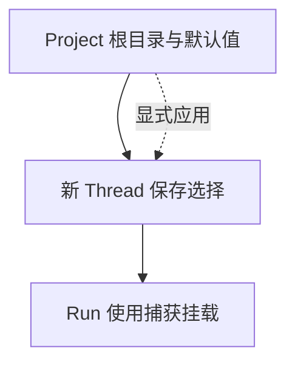

Environment 决定 Agent 在哪里读取文件和运行命令。Project 对对话分组，并提供初始工作目录和默认值。每个对话保存自己的选择，因此编辑 Project 不会改变已有对话的工作位置。

先使用本地目录和内置执行模式。需要多个目录或可复用默认值时，再添加 Project 文件。要使用另一台计算机，按[添加 Device 绑定](#add-device-bindings)操作。

## 选择 Environment

先完成[设置](setup.md)，并选择带有 `dynamic_environment` 文件工具的 Agent。运行命令还需要该 Capability 的 shell 工具。

1. 在希望 Agent 使用的目录中打开终端。

2. 选择执行模式。**Full Control** 使用 Host 账户运行。**Sandbox** 使用 Envd 受限 worker，要求计算机支持相应隔离。选择前先阅读下面的平台差异。

3. 用以下一个命令开始新对话：

   ```console tab="Full Control"
   a13n-harness-ui --environment-mode full-control
   ```

   ```console tab="Sandbox"
   a13n-harness-ui --environment-mode sandbox
   ```

4. 发送只读测试：“列出工作目录中的文件，不要修改任何内容。”检查工具结果中的目录和文件是否符合预期。

已有 TUI 对话应先恢复，再用 `/environment` 选择后续 Run 的模式。启动时的 Environment 覆盖不能与 `--resume` 同用。WebUI 的 **Conversation details → Configuration** 用于保存下一 Run 的选择；输入框的 **Environments** 编辑器用于临时覆盖。

用 `a13n-harness-ui environment list --format json` 列出可用 profile。已配置的自定义 profile 使用 `--environment-profile environment-team`，它与 `--environment-mode` 互斥。

## 执行权限

| 内置 profile          | 运行时与权限                                   |
| --------------------- | ---------------------------------------------- |
| `environment-native`  | 以 Host 账户直接执行，无须下载或启动 Envd      |
| `environment-envd`    | 通过 Envd 执行 Full Control，关闭 Computer Use |
| `environment-desktop` | 通过 Envd 执行 Full Control，启用 Computer Use |
| `environment-sandbox` | Envd 文件系统/进程受限 worker，继承 Host 网络  |

Full Control 可以访问 Host 账户的文件、已导出凭据和网络服务。Project 根目录选择工作位置，不会限制 shell 命令的权限。

Sandbox 允许写入 Project 根目录和 Thread 临时空间。Thread 文件 worker 将附件设为只读，`tmp/` 设为可读写。Linux 和 macOS 将读取限制在授权及运行时路径内。**Windows 允许广泛磁盘读取，包括账户可访问的 Host 配置和凭据**，同时限制写入；Envd 启动/控制文件仍拒绝访问。内置 Sandbox 继承 Host 的路由和防火墙网络策略，包括访问 Host localhost 服务。

Sandbox 就绪检查验证 worker 边界。失败会明确报告：修复前置条件后重试，或有意选择 Full Control。Harness UI 不会代你自动降级、运行 `sudo`、修改 sysctl 或关闭隔离。平台边界见 [Envd 隔离](../a13n-envd/isolation.md)，网络限制见[自定义 profile](#custom-environment-profiles)。

### 管理本地 envd

需要 Sandbox、Envd 版 Full Control 或本地 Computer Use 时，打开 **Settings → Environments → Local runtime**。也可从设置向导第一步进入，无须先配置 Model。

1. 首次使用选择 **Install & start**；已安装运行时选择 **Start**；仅缓存了旧版本时选择 **Update & start**。Harness UI 安装与其已安装 Envd 客户端匹配的精确版本，不任意选择最新版本。
2. 选择 **Check**，检查 Full Control 与 Sandbox 支持。设置向导验证文件系统/进程隔离和 Host localhost 连通性，不依赖外部互联网服务。
3. 在 **Settings → Environments** 选择执行默认值并保存。仅保存默认值不会启动 Envd，也不会改变已有对话或 Project 覆盖。
4. 使用该选择开始新对话，重复上面的只读文件测试。向导之外，就绪检查发生在执行需要时，而不是打开欢迎页时。

各运行时动作的效果不同：

- **Restart** 关闭本地 Envd Session，启动新的 Full Control 实例并检查 Sandbox。桌面实例在需要时重新启动。
- **Reinstall** 下载并验证同一要求版本，然后重启。获取失败会保留旧可执行文件，运行时保持停止。自定义可执行文件需先在 Host 上更新，再从这里重启。
- **Stop** 中断活动 Session，包括其他对话使用的 Session。文件和已保存默认值保留。意外退出后需显式再次启动。

重启、重装和停止都需要确认。兼容的 Full Control 执行共享 App 管理的 daemon，但各有独立 Session 工作目录；Sandbox 授权和桌面策略分别管理。根配置变化需重启 Harness UI，仅重启 Envd 不够。

托管 binary 位于 `<data-root>/runtimes/managed/<version>/<target>/a13n-envd`，Windows 文件名为 `a13n-envd.exe`。默认数据根是 `~/.a13n-harness-ui/data`，旧版本缓存保留在磁盘。升级 Harness UI 后，先重启，再使用 **Update & start**。

本地 Computer Use 需开启 **Desktop capability**，保存并重启 Harness UI。然后在 Host 上运行 **Check permissions**，再为目标执行默认值显式选择 Computer Use。权限检查不截屏、不注入输入。托管和自定义可执行文件设置见[根级 envd 配置](configuration.md#local-envd-runtime)。

CLI 将查看、准备和默认值修改分开：

```console
a13n-harness-ui environment status
a13n-harness-ui environment check --profile environment-envd
a13n-harness-ui environment configure --profile environment-envd
```

`check` 准备环境但不改默认值。`configure` 只在检查成功后保存默认值。

### 原生命令环境

从所需工具和已导出变量都能正常使用的终端启动 Harness UI。Direct Full Control 命令继承应用的 `PATH`、代理设置、工具变量和已导出凭据。Project 与 Thread 文件命令均如此；TUI 的 `!command` 也继承 Host 进程环境。

单次命令的变量覆盖或移除只影响该命令及其子进程，不改变 Harness UI 或后续命令。继承值不会复制到配置或 Run 快照。启动后在其他终端中的修改不会更新运行中的应用。进程环境继承不包含 alias、未导出变量，也不会自动加载 `.zshrc`/`.bashrc`。Sandbox 使用自己的环境策略。

## Windows 本地执行

Direct 使用原生 PowerShell（先 `pwsh`，再 Windows PowerShell）、UTF-8 流和管理命令后代进程的 Job Object。取消、超时和退出会清理所管理的进程树。Windows 取消会终止该树，不提供可移植的中断信号。WSL 使用 Linux 后端。

Windows Sandbox 使用 PowerShell 和实验性的原生 Microsoft eXecution Container（MXC）后端，进程由 Job Object 管理。Host 必须通过实际创建/关闭及生产隔离探测。不可用时，更新 Windows 后重试，或显式选择 Full Control。Harness UI 不会创建账户、修改 ACL 或提权。

Sandbox 命令搜索路径依次包括选定的 PowerShell 目录、System32 和已有绝对 Host PATH 目录。显式 `launch.trusted_executable_roots` 替换这些默认值，不继承 Host 凭据变量。广泛读取排除映射网络驱动器。新增本地卷或卷根条目需要新 Session。见 [Windows 边界细节](../a13n-envd/isolation.md#native-windows-mxc)。

## Project 文件参考

要配置双目录 Project，在所选根 YAML 旁创建完整的 `projects/work.yaml`。将两个路径替换为 Harness UI Host 上已有的绝对目录：

```yaml title="projects/work.yaml"
schema_version: "1"
kind: project
id: project-work
name: Work
position: 0
roots:
  - path: /absolute/path/to/code
  - path: /absolute/path/to/notes
```

针对该配置树运行 `a13n-harness-ui config validate`。然后从**第一个**目录启动 TUI，或创建 WebUI 对话时选择 **Work**。要求 Agent 列出两个目录，并核对两次工具结果。创建 Project 不会复制文件、创建目录或创建 Git worktree。

第一个根目录是 TUI 入口和默认工作目录，除非显式选择其他默认值。后续根目录是额外挂载，不是额外的 TUI 入口。本地路径展开 `~` 后须为绝对路径。不可用路径可以保存，但执行选择它时会失败，直到路径可访问。纯远程 Project 没有本地 TUI 入口。

| 字段             | 默认值          | 含义                                                                            |
| ---------------- | --------------- | ------------------------------------------------------------------------------- |
| `schema_version` | 必需，`"1"`     | 资源 schema                                                                     |
| `kind`           | 必需，`project` | 资源类型                                                                        |
| `id`             | 必需            | 唯一稳定的 `project-` ID                                                        |
| `name`           | 必需            | 显示名称                                                                        |
| `position`       | `0`             | 目录排序                                                                        |
| `roots`          | `[]`            | 最多 64 个有序唯一的 `{path: ...}` 条目；Project 至少需一个本地根或 Device 绑定 |
| `defaults`       | `{}`            | 新对话的初始选择                                                                |

### 新对话默认值

将此映射与 `roots` 合并到 Project 文件，将 `agent-reviewer` 替换为已有 Agent ID：

```yaml
defaults:
  agent: agent-reviewer
  environment_profile: environment-native
  harness_plugins: []
  environment_run_extensions: []
  mcp_servers: []
```

验证后，在该 Project 中创建**新**对话并检查其配置。WebUI 也可通过 **Project menu → Project settings** 编辑这些字段。

显式创建选择优先于 Project 默认值。之后，所选 Agent 的 Plugin/MCP 默认值优先于根 YAML 默认值。Environment 省略时最终使用 `environment-native`；无 Project 对话跳过 Project 默认值。Model 与 Capability 配置属于 Agent。

默认字段省略或为 null 时继续回退。空列表不选任何项；提供列表会整体替换低优先级列表，不合并。Device 选择使用下文的可选 `environment_bindings` 和 `default_environment`。

已有对话保留已保存选择。**Apply Project defaults** 先预览，再仅应用 Project 配置过的字段，保留未指定字段。应用前检查预览；Thread 或相关默认值变化后，需要重新预览。[HTTP 配置流程](http-api.md#configure-projects-and-threads)提供同一操作。

### Thread Environment 与输入框覆盖

根据变更应持续多久，选择编辑入口：

- **Conversation details → Configuration：** 保存该 Thread 的本地目录、本地 profile、Device 绑定和默认 Environment，供后续 Run 使用。已捕获 Run 配置与可编辑下一 Run 选择分开显示。
- **Apply Project environments：** 先检查，再从 Project 替换上述四项 Environment 选择。纯本地 Project 会清除旧 Device 绑定。Agent、Model、MCP、Plugin 和 Run Extension 不变。
- **Composer → Environments：** 应用本标签页的临时覆盖。它持续作用于后续 Run，直到 **Use conversation defaults** 重置；不是只生效一次，也不会改变已保存 Thread。

编辑器将本地目录放在 **Local · Harness server** 下。同一 Device 且执行策略相同的远程目录组成一组。在分组下方选择 **Default working directory**，然后应用整个草稿。关闭而不应用会丢弃修改。本地模式不会改变远程 shell 权限。

在 WebUI 中改变 Thread 的 Project 只改变分组，不改变 Environment 选择。无 Project 的 Thread 可以保留本地目录。引导使用活动 Run 捕获的 Environment；延迟回复保留挂起 Run 的 Environment，除非显式修改。新子级从父级捕获选择开始，之后独立拥有自己的选择。

## 文件、Project 与恢复



普通 TUI 使用应从 Project 第一个目录启动。首次发送提示时，Harness UI 复用首根目录完全匹配的 Project；没有匹配则创建单根 Project。它不会采用父目录的 Project，也不会改写已有 Project。多个匹配需要选择特定已保存对话，或修正 Project 根目录。

显式从**其他**目录恢复时，TUI 会选择启动目录的 Project 和本地根，并将 `workspace` 设为默认。历史、Device 绑定和本地执行模式保留。在同一 Project 中恢复时，Thread 保留已保存根目录，即使 Project 文件已变化。先恢复，再改变 Agent、Environment 或标题；这些启动覆盖不能与 `--resume` 同用。

进程停止后，恢复使用最后保存的检查点，其中可能包含已保留的部分进度。活动操作和未保存输入不保留。已记录工具结果不会重放；未回答调用遵循[声明可重试恢复策略](../a13n-harness/state-and-resume.md#resume-unanswered-tool-calls)，重新检查权限和审批。实时输出可能不完整；TUI 会标记流恢复并显示权威最终回答。配置发布失败按[设置恢复](setup.md#cancel-or-recover-setup)处理。

## 添加 Device 绑定

使用 Device 在另一台计算机上工作。连接会注册其 Envd daemon；添加绑定则为 Project 或 Thread 选择已有目录和允许操作。两者都不会创建该目录或开始 Agent Run。

### 连接并批准 Envd

另一台计算机须已安装 Envd，并能访问 WebUI 地址。远程连接使用 HTTPS。`http://127.0.0.1:8765` 只适用于 daemon 和 WebUI 在同一计算机上的情况。

1. 从该可达地址打开 WebUI。选择 **Settings → Environments → Connect Device**，或 **Add environment → Connect new Device**。

2. 在向导中选择 POSIX shell 或 PowerShell。Agent 需要运行命令时才启用 shell；桌面访问是独立高级选项。

3. 复制生成的命令，在希望访问文件的计算机上运行。仅文件连接的形式如下，替换示例 origin：

   ```console
   a13n-envd connect https://your-harness-ui.example.com
   ```

4. 保持终端打开。在浏览器中核对验证码和 Device 名称，选择 **Approve Device**。拒绝不认识的请求；待处理请求十分钟后过期。

5. 等待 **Device online**，再[选择工作目录](#choose-working-directories)。从 Settings 打开的向导在 **Done** 结束，不添加绑定。

daemon 向外连接，因此其计算机不需要入站端口。命令是前台进程，不是已安装服务。审批保存 Device 配置和凭据，无须复制浏览器登录密钥。审批前关闭不会拒绝请求；审批后关闭保留注册，但丢弃未保存绑定编辑。请求消失不代表已经批准。

要以 daemon 账户权限运行命令，使用向导中启用 shell 的命令。POSIX 形式为：

```bash
A13N_ENVD_FULL_CONTROL=1 a13n-envd connect https://your-harness-ui.example.com
```

PowerShell 等价命令：

```powershell
$env:A13N_ENVD_FULL_CONTROL = "1"
a13n-envd connect https://your-harness-ui.example.com
```

这是远程宿主账户执行，与 Harness UI 服务器的本地模式独立。未启用 full-control 时，shell 需要显式 daemon `trusted_executable_roots` 或 `shell_profiles`；文件操作仍可用。

用同样的命令和环境重新运行即可重连。保留原 shell/桌面参数：已保存 Host 连接不会保留全部启动设置。可在首次连接加 `--host personal`，之后使用 `a13n-envd connect personal`。保留存储身份和凭据的状态目录。一个 Envd 进程连接一个 Host；连接另一 Host 时，使用不同 `--instance` 的另一进程。见[daemon 配置](../a13n-envd/configuration.md)。

### 选择工作目录

打开 **Project menu → Project settings → Environments**，或 **Conversation details → Configuration → Change next Run selections**：

1. 选择 **Add environment**，选中 Device 并选择允许操作。
2. 输入已有绝对路径，选择 **Use Device default**，或浏览并显式选择目录。用 **Add another directory** 添加更多路径。
3. 应用环境草稿，选择 **Default working directory**，再保存所在设置。
4. 开始新 Run，要求 Agent 列出选定远程目录且不修改文件。检查工具结果中的 Device/路径，不只看 Device 在线状态。

浏览不打开 Session，在尚无 Run 时也可用。Device 不可用或发现功能关闭时，可以输入已知路径；执行仍要求 Device 和目录可访问。Windows Device 路径使用 `/C:/work` 或 `/UNC/server/share/work`，不是 Harness UI 服务器路径。

**Add directory** 沿用已有分组的 Device 和访问策略。不同访问、网络或边界策略保留为不同组。**Advanced routing** 显示生成的别名。每次执行都有自己的 Session；同一 Device 的两个别名不共享进程句柄或保留输出。

纯远程 Project 使用 **Add project**，只添加 Device 目录，不添加本地根，再选择默认值。等价的完整 `projects/build.yaml` 如下。将 `device-build` 替换为已配置 Device ID，将 `/work/project` 替换为该 Device 上的已有目录：

```yaml title="projects/build.yaml"
schema_version: "1"
kind: project
id: project-build
name: Remote build
roots: []
defaults:
  environment_bindings:
    - device_id: device-build
      working_directory: /work/project
      alias: build
  default_environment: build
```

在所选配置树验证此文件，再在 **Remote build** 中创建新对话。混合 Project 在这些默认值旁保留本地 `roots`。Device 绑定要求从最终挂载中显式选择默认值。本地别名 `workspace`、`workspace-2` 和 `thread-files` 等 Host 辅助名称为保留值。

Device 目录是工作目录默认值，不是文件系统边界。本地模式控制本地挂载和 Thread 文件，不会隔离 Device。互不信任的工作负载应使用独立、由 Host 管理的安全边界。受控出站按[远程 Provider 用法](../environments/remote-envd.md#session-egress-and-credential-references)添加目标和密钥来源引用，以及 `expected_boundary`。值在准备时解析；Project YAML 中不要写 token 值。

应用 Project 默认值时，省略绑定集合会保留 Thread 集合；显式空列表会移除它。仅编辑默认值不会创建空覆盖。活动和历史 Run 保留捕获选择。

### 手动连接

已有 HTTP daemon 或由操作员管理凭据时，选择 **Connect Device → Manual HTTP or WebSocket connection → Configure manually**。也可在根 YAML 旁保存此完整文件：

```yaml title="devices/build.yaml"
schema_version: "1"
kind: device
id: device-build
name: Build machine
device_id: native-build
transport:
  kind: http
  configuration:
    endpoint: https://build.example.com
authentication:
  kind: api_key
  env: BUILD_DEVICE_TOKEN
```

替换端点和 daemon 身份。`id` 是 Harness UI 资源 ID，`device_id` 是 daemon 稳定身份。启动 Harness UI 前导出 `BUILD_DEVICE_TOKEN`，验证配置树，并在添加目录前检查 Device 连接。YAML 存变量名，不存凭据。

手动反向连接改用 `transport: {kind: websocket, configuration: {}}`。让 Envd 使用 Device 凭据连接 WebUI 监听器的 `/api/devices/device-build/connect`，不要使用 WebUI 实例密钥。见[daemon 传输](../a13n-envd/configuration.md#carrier-profiles)。

### 撤销 Device

选择 **Settings → Environments → Revoke** 收回访问权。撤销会断开 Device，并在重启后继续阻止其已保存凭据，包括使用该连接的 Run 访问。远程文件和捕获历史保留。已撤销注册仍可见；认证拒绝会停止 daemon，不会静默替换凭据。

### 移除不可用环境

要停止使用一个目录，选择路径旁的 **Remove**。如果它是默认项，选择替代项后保存。Project 至少保留一个本地根或 Device 绑定；Thread 移除全部 Device 绑定后可使用 Thread 文件。

要删除本地连接配置或自定义 profile，使用 **Settings → Environments → Forget**。先修复引用它的 General/Project 默认值；对话框提供已知 Project 引用链接。Forget 可离线操作，保留远程文件、Device 进程、活动 Run 和历史。内置 profile 不能删除。收回配对信任应使用 **Revoke**，不是 Forget。

已有 Thread 保留选择。缺失 Device 会在下一 Run 选择中显示 **Not configured**；继续前替换或移除它，并选择有效默认值。先前 Run 仍显示原配置。

WebUI 原生 Files、Git Changes 和 Terminal 面板访问 Harness UI 服务器。选择远程 Device 不会让这些面板成为远程客户端。

## 监控 Environment 资源

先启动 Envd 运行时或连接 Device，再从 WebUI 对话工具栏打开 **Environment monitor**。选择 Device，使用 **Overview**、**Network**、**Storage** 或 **Envd**。Direct 和其他非 Envd Provider 不提供 Envd 指标；打开面板不会安装或启动 daemon。

图表显示 Device 可见的系统用量和操作员选中的 Linux cgroup，不是单次 Run 用量。选择接口或磁盘查看速率，按需展开静态信息和计数器。缺失值显示 **—**，不是零。此面板覆盖整个 App；切换对话不改变观测 Device。

初始视图覆盖 15 分钟，每 60 秒刷新。可以改变范围、暂停刷新或手动刷新。拖拽图表或使用缩放控件选择共享历史时段，**Back to live** 恢复滚动窗口。悬停或左右方向键可检查各图表同一分钟。历史最多保留一小时的分钟平均值/峰值，包括缺口；缩放不会增加采样精度。

内置本地 Sandbox、Envd 和 Desktop 启动时启用采样。远程 daemon 需在启动配置开启 `monitoring`。关闭采样时仍可查看静态系统信息。在 **Settings → Environments → Local runtime → Metrics collection** 选择 10、30 或 60 秒（默认 60），然后重启 App。根字段 `envd.monitoring_interval_seconds` 接受 10–60 的整数，用于 App 采集和内置本地采样。自定义启动配置及外部 daemon 保留自己的采样设置，浏览器刷新仍为一分钟。此概览要求 EIP 0.3；保持远程 daemon 与客户端版本兼容。

历史保存在 App 内存，重启、Device 变更或撤销时清空。等待、禁用、过期、离线和采集上限状态会明确显示。计数器重置会中断速率基线；缺失或停滞样本留空，或显示上次值及其年龄。

## 自定义 Environment 配置

内置模式不满足需求时再创建自定义 profile。内置 ID 为保留值。profile 选择已安装 Provider 和兼容的 Project adapter；它不会创建供应商资源，也不能证明隔离。

1. 在根 YAML 旁将以下完整原生 profile 保存为 `extensions/team.yaml`：

   ```yaml title="extensions/team.yaml"
   schema_version: "1"
   kind: environment_profile
   id: environment-team
   name: Team native environment
   provider_key: direct_local
   provider_configuration: {}
   adapter_key: a13n.native-project-root
   adapter_configuration: {}
   ```

2. 针对所选配置树运行 `config validate` 和 `doctor`。

3. 用 `a13n-harness-ui --environment-profile environment-team` 启动新对话，并重复只读文件测试。这个原生示例仍使用 Host 权限。

要作为创建默认值，在根 YAML 或 Project 中设置 `defaults.environment_profile: environment-team`。Provider 负责 `provider_configuration`；adapter 负责 `adapter_configuration` 和 Project 到 Environment 的映射。空映射不是所有 Provider 通用设置。

若需限制文件并继承网络，使用此完整替代 profile：

```yaml title="extensions/restricted-network.yaml"
schema_version: "1"
kind: environment_profile
id: environment-restricted-network
name: Restricted files with native networking
provider_key: local_envd
provider_configuration:
  launch:
    sandbox: {mode: restricted, grants: []}
    egress: {mode: inherit}
  session: {}
adapter_key: a13n.local-envd-project-root
adapter_configuration:
  project_access: read_write
```

按同样的验证、选择、测试步骤使用 `environment-restricted-network`。adapter 按 `project_access` 授权各个捕获的 Project 根；额外授权写在 `launch.sandbox.grants`。

显式 `launch` 省略 `sandbox.full_disk_read` 时，使用 Envd 的 false 默认值。Windows 上设为 true 可使用内置广泛读取策略；省略整个 `launch` 的 profile 使用该 Windows UI 默认值。Linux 和 macOS 拒绝 true。禁止网络时，设置 `launch.egress.mode: deny`，同时保留 `sandbox.mode: restricted`。受控出站要求特权 Linux 后端，以及 `session.egress` 目标/凭据引用。兼容的 Session 策略变化复用 daemon；启动边界变化会准备不同 daemon。

adapter 作者需注意：`EnvironmentProjectAdapter.bind()` 返回 Harness 执行连接配置。准备在观察到新状态后失败时，抛出 `a13n_harness_ui.extensions` 中的 `EnvironmentBindingError(message, state)` 或 `EnvironmentBindingCancelled(state)`；Host 先发布状态，再传播失败。目标管理属于 adapter，不属于 Harness 执行定义上的生命周期方法。

## 从 WebUI 使用 Mac 桌面

使用支持图像输入的 Model 和带 Dynamic Environment 工具的 Agent。在 Mac 上运行 `a13n-envd connect <your-WebUI-origin> --computer-use true`，批准 Device，并授予所需 OS 权限。

添加绑定时，在 **Allowed actions** 选择 **Full control**，然后开始新 Run，先请求截图，再要求输入操作。该绑定权限包含 Device 已启用的文件、命令和计算机操作；**Read only** 只允许文件读取/浏览。它与 Harness UI 服务器的本地 Full Control 模式不同。新绑定默认 Full control；旧绑定保留权限，直到显式修改。

仅审批不会启用桌面工具：daemon computer-use 和 OS 权限都必需。原生设置、仅观测访问、截图预览和共享桌面限制见[桌面计算机操作](../a13n-envd/computer-use.md)。
