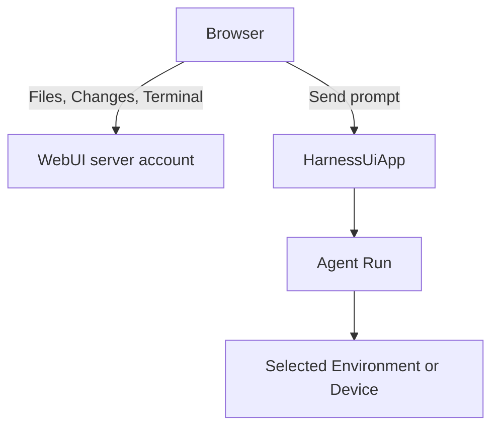

WebUI is the browser workbench for Harness UI. It shares the same App and saved conversations as the TUI, and adds Projects, file/diff review, integrated terminals, host browser control, and collaboration.

| I want to…                                      | Start here                                                                                                                     |
| ----------------------------------------------- | ------------------------------------------------------------------------------------------------------------------------------ |
| Get a first answer                              | [Start the server](#start-the-server)                                                                                          |
| Change the Agent, Model, or working directories | [Agent and Model settings](#agent-and-model-settings)                                                                          |
| Steer active work or answer a decision          | [Steering](#tool-executions-and-immediate-steering) and [pending decisions](#pending-questions-approvals-and-external-results) |
| Review a file or diff with the Agent            | [Files and Changes](#read-and-capture-host-files-and-git-changes)                                                              |
| Let the Agent browse, or annotate a page        | [Host browser](host-browser.md#browse-on-the-host)                                                                             |
| Invite a collaborator or coordinate workers     | [Sharing](#share-a-thread-or-project) and [Coordinator](#work-with-a-coordinator)                                              |
| Run WebUI remotely or behind a proxy            | [Run and restart WebUI](running-webui.md)                                                                                      |

## Start the server

Install Harness UI using the [installation guide](installation.md), then run:

```bash
a13n-harness-ui webui
```

1. Wait for **WebUI ready** (default `http://127.0.0.1:8765`) and open the printed login link.
2. On first run, connect a Model in the setup wizard, choose **Full Control** or **Sandbox**, and click **Save and start chatting**.
3. Send a short test prompt to verify end-to-end model connectivity.

To change the port or disable native Host surfaces (**Files**, **Changes**, **Terminal**, **Browser**):

```bash
a13n-harness-ui webui --host 127.0.0.1 --port 9000
a13n-harness-ui webui --no-share-computer
```



The instance login key grants full workbench and Host access. Give guests a [sharing link](#share-a-thread-or-project) instead, or use [Service](../a13n-service/index.md) for managed identities and RBAC.

## Organize Projects and work in a conversation

Use the sidebar menu to switch between **Projects** (grouped by directory) and **Conversations** (**Recent** flat list across Projects).

1. Click **Add project** to name a Project and attach one or more server directories.
2. Click **Home** or a Project's **+** button to start a new chat (projectless chats are also supported).
3. Check **Agent & Model settings**, write your prompt, and press **Send**.

### Everyday conversation actions

| Action                        | How to do it                                                                                  |
| ----------------------------- | --------------------------------------------------------------------------------------------- |
| Send / line break             | `Enter` sends by default; `Shift+Enter` inserts a new line                                    |
| Attach files                  | Attach, paste, or drop files into the composer                                                |
| Search chats                  | Click **Search** or press `Cmd/Ctrl+F`                                                        |
| Rename, star, archive, delete | Open a conversation's **…** menu (**Delete chat** is permanent; stop active work first)       |
| Fork or branch                | Choose **… → Fork conversation**, or hover a reply and select **Branch in new chat**          |
| Edit a sent message           | Hover the input and choose **Edit message**. Select the checkmark to send again in this chat. |
| Navigate history              | Use the left input rail to jump to earlier turns; expand **Execution details** for tool calls |
| Inspect usage & cost          | Open conversation usage to see token totals and estimated USD cost by model                   |

Editing replaces the selected message and everything after it. Keep or remove its existing attachments as you edit. If a Run is active, **Stop & send** stops it before sending the replacement. Press `Escape` to cancel the edit and leave the Run alone.

To require `Ctrl+Enter` (`⌘+Enter` on Apple devices), go to **Settings → Chats → Chat input**, change **Send messages with**, and save changes. The setting is stored as `webui.send_shortcut` in the instance configuration and applies across browsers. In that mode, `Enter` and `Shift+Enter` both insert a new line. On touch-first devices, the on-screen Enter key inserts a new line in either mode.

To customize workbench keys, open **Settings → Chats → Keyboard shortcuts**, choose a binding for each action, and save changes. By default, `Ctrl+F` (`⌘F` on Apple devices) opens chat search, and the terminal uses `` Ctrl+` `` to open or close and `` Ctrl+Shift+` `` to create a session. The other actions start off. Choose **Off** to disable a shortcut without hiding its control. The owner workbench reads these choices from `webui.shortcuts` in the instance configuration. If you edit the YAML directly, quote the value `"off"`.

New chat offers `Ctrl+Shift+O` (`⌘⇧O`) for browser tabs. Browsers normally reserve `Ctrl+N` (`⌘N`) for a new window; choose it for an installed app window or desktop shell. Similarly, use an installed app window or desktop shell for `⌘,` on macOS, where browsers use the chord for their own settings. Editors keep local find, and the Host Browser and terminal retain their own keyboard input.

Messages and Markdown previews render LaTeX math (`$inline$` and `$$display$$`). Shared drafts persist across reloads and show a pencil indicator on the sidebar row until sent or cleared.

## Agent and Model settings

Click the current Model in the composer footer to change the **Agent**, **Model**, **Thinking** level, or **Fast** mode for upcoming turns. Open **Chat options** for **Goal**, **Coordinate agents**, **Environment**, and **Clear context** (starts a fresh model context while keeping chat history and files).

- **Thread default vs. composer override:** Set a conversation's saved **Default model** in conversation settings; selecting a different Model in the composer overrides it for that chat until cleared.
- **Thinking & Fast mode:** Choose **Default** to inherit Model settings, or pick a supported effort level / speed tier (`Fast`, `Ultrafast`). Changing the Agent or Model clears temporary overrides.
- **Environments:** Open **Environments** in the composer to switch between **Sandbox**, **Full Control**, or a configured profile/Device for subsequent runs.

## Tool executions and immediate steering

- **Steer:** Send guidance while the Agent is running. By default (`input.steering_mode: immediate`), steering interrupts model generation or releases supported tool waits; set `queued` in [configuration](configuration.md#built-in-tools-and-subagents) to wait for the next safe boundary.
- **Background work:** Open **Background work → View all** to inspect or cancel active retained tool executions.
- **Stop:** Cancels the active run and pauses automatic completion wake until your next message.

## Pending questions, approvals, and external results

When an Agent pauses for input, respond in the decision card:

| Request           | What to do                                                            |
| ----------------- | --------------------------------------------------------------------- |
| Question          | Select an option or enter custom text                                 |
| Tool approval     | Review the command/arguments, then click **Approve once** or **Deny** |
| External result   | Enter the JSON result under **Provide a result**                      |
| Multiple requests | Complete every item in the batch and click **Submit responses**       |

### Questions and approval timeouts

Each decision batch shares one server-side countdown (`tools.interaction_timeout_seconds`, default 120 seconds). If the timer expires, approvals are denied and unanswered questions instruct the Agent to proceed with reasonable assumptions.

## Read and capture Host files and Git changes

With a Project attached and computer sharing enabled:

- **Files:** Browse directories, preview Markdown, search (`Cmd/Ctrl+F`), rename/upload/delete files, or select lines and click **Add to chat** to attach a snapshot.
- **Changes:** Inspect Git diffs and attach selected hunks directly to the composer.
- **Terminal:** Open a shared native terminal running under the server account.
- **Host browser:** Let the Agent browse or annotate screenshots together—see [Host browser](host-browser.md#browse-on-the-host).
- **Interactive MCP Apps:** Opted-in [MCP Apps](mcp-apps.md) render inline beside tool results; click **Open App** and **Activate interactions** to use them.

### Work in a separate Git worktree

For a Git project in **Full Control** with computer sharing enabled, open the composer's **Chat options**, turn on **Worktree**, and send your task. The Agent uses the project's conventions to create and register an isolated Git worktree. You can also ask it to link a worktree, pull request, issue, or any HTTP(S) URL during an existing chat.

Open **Activity** in the chat header (which displays compact worktree and link icons when references exist) to see **Worktrees** and **Links** alongside **Tasks** and **Notes**, or click **View all** to open a dedicated supporting tab. Use **Changes**, **Files**, or **Terminal** to open a worktree at its path. **Unlink** removes the bookmark and leaves the files on disk. Links follow chat forks and branches; scoped guests don't see worktrees or links.

## Voice input

1. Open **Settings → Chats → Dictation**, choose **Codex subscription** (or an audio-input Model), and enable **Voice input**.
2. Click the microphone in the composer or an **Add to chat** comment, speak, and click **Stop**.
3. The final transcript is inserted at your cursor without auto-sending (microphone capture requires `localhost` or HTTPS).

## Read your Inbox

Agents post final results, milestones, and items needing your decision to **Inbox** (via `post_to_inbox`).

1. Open **Inbox** below conversation search. **Needs you** items appear first, followed by **Updates**.
2. Click a row to read it in place, **Open in chat** to jump to the originating turn, or **Mark as done** to clear it.
3. Use the two icons beside **Needs you** or **Updates**: **Mark all as read** clears unread marks and leaves items in **Open**; **Mark all as done** moves the entire section to **Done**. Both include items you have not loaded.
4. In a chat, use the **Sent to Inbox** card’s envelope and checkmark to change its read or Done state without leaving the conversation. On a Done card, use **Move back to Open** to reopen it.

By default, viewing the latest saved output in a focused chat, sending a message, or responding to a decision marks earlier Inbox items read. Turn off **Settings → Chats → Inbox → Automatically mark Inbox items as read in chats** (`inbox.auto_mark_read: false`) to keep automatic reading off. Opening an item directly still reads that item. The separate **Let agents post to Inbox** switch controls posting for new runs (`inbox.enabled`).

## Share a Thread or Project

1. Click **Share** on a Thread or from a Project's menu and choose **Thread** or **Project** scope.
2. Pick **View only** or **Send messages** and set an expiration (1 hour, 1 day, or 7 days).
3. Click **Create link** and **Copy link** (the secret is shown once). Manage or revoke links under **Manage links**.

> [!IMPORTANT]
> Only give **Send messages** links to trusted collaborators—their prompts run with the Agent's configured tools and Environment authority. Guests cannot change settings, approve tools, or use native Files/Terminal.

## Work with a Coordinator

A Coordinator focuses on planning, delegation, and review while delegating substantive work to independent worker conversations.

1. Select a Project, enable **Coordinate agents** in **Chat options**, and send your objective (or convert an idle Project chat via **Make Coordinator**).
2. Expand the Coordinator in the sidebar to inspect its workers, or click **New worker** to assign a task directly.
3. Toggle **Pause/Enable automatic follow-up** in the Coordinator menu to control whether worker completion events automatically wake the Coordinator.

To preselect **Coordinate agents** in new Project chats, turn on **Settings → Chats → New chats → Coordinate agents by default** and save. The instance setting is `webui.coordinator_by_default` (off by default). You can still turn **Coordinate agents** off before the first message.

## Agent collaboration

Agents can inspect related chats, spin up new work, and message existing conversations within their role:

| Tool                  | Creates / targets                                         | Who can call it                           |
| --------------------- | --------------------------------------------------------- | ----------------------------------------- |
| `create_thread`       | A new independent root chat                               | Ordinary roots and Bot                    |
| `create_worker`       | A managed worker chat in the Coordinator's Project        | Coordinators only                         |
| `spawn_subagent`      | A child execution inside the current conversation         | Root chats with dynamic subagents enabled |
| `send_thread_message` | Sends a follow-up or steering message to an existing chat | Allowed roots within collaboration scope  |

Configure which Agents and Models agents may use for new chats, Coordinator workers, and subagents under **Settings → Agents → Agent creation** (`agent_creation.allowed_agents`, `agent_creation.default_agent`, `agent_creation.allowed_models`, and `agent_creation.default_model`). Subagents can always use the current conversation’s Model. With **Default model** set to **None**, dynamic subagents use that Model when no Model is requested.

## Observe Memory and configure the workbench

- **Memory:** Open **Memory** in the bottom-left navigation to view Global or Project memory files and automatic organization runs. Manage settings under **Settings → Memory**.
- **Settings:** Use **Settings** to configure **Agents**, **Models**, **Accounts & API keys**, **Connections** (MCP and plugins), **Environments**, **General** (Live, notifications, diagnostics), and raw **Configuration files**. See [configuration recipes](configuration-recipes.md) for file-based setups.
- **Notifications & PWA:** Enable browser/task notifications under **Settings → Preferences → Notifications**, and choose **Entire workspace** or **My runs only** for in-app and background alerts. My runs includes work started from this browser profile across its tabs. Another device has its own setting. You can also install WebUI as a desktop/mobile app from your browser's install menu.
- **Remote operations:** See [Run and restart WebUI](running-webui.md) for authentication keys, reverse proxies, restarts, and server logs.
