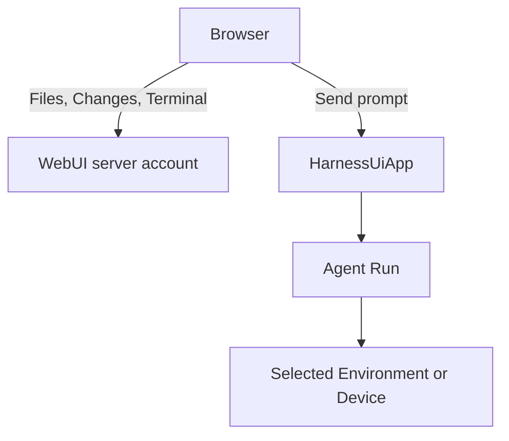

WebUI is the browser workbench for Harness UI. It uses the same App and saved conversations as the TUI. Start with one conversation; add Projects, file review, browser control, and collaboration as your work needs them.

| I want to…                                      | Start here                                                                                                                                              |
| ----------------------------------------------- | ------------------------------------------------------------------------------------------------------------------------------------------------------- |
| Get a first answer                              | [Start the server](#start-the-server)                                                                                                                   |
| Change the Agent, Model, or working directories | [Agent and Model settings](#agent-and-model-settings)                                                                                                   |
| Give more guidance or answer a question         | [Steering](#tool-executions-and-immediate-steering) and [pending decisions](#pending-questions-approvals-and-external-results)                          |
| Review a file or diff with the Agent            | [Files and Changes](#read-edit-and-capture-host-files-and-git-changes)                                                                                  |
| Let the Agent browse, or annotate what I see    | [Host browser](#browse-on-the-host)                                                                                                                     |
| Invite a person or coordinate other Agents      | [Sharing](#share-a-thread-or-project) and [Coordinator](#work-with-a-coordinator)                                                                       |
| Keep the workbench available remotely           | [Authentication](#authentication-and-key-retention), [proxy setup](#reverse-proxies-and-public-addresses), and [restart](#restart-or-update-the-server) |

## Start the server

Install Harness UI using the [installation guide](installation.md), then run this on the computer that will own your work:

```bash
a13n-harness-ui webui
```

1. Wait for **WebUI ready**. The default address is `http://127.0.0.1:8765`.
2. Open the printed login link. With a supplied instance key, open the ordinary address and enter that key instead.
3. On a fresh installation, connect a Model in the setup wizard. Choose Full Control or prepare Sandbox, then select **Save and start chatting**. The [setup guide](setup.md) explains both choices.
4. In the opened conversation, send `Reply with one short sentence confirming that you received this message.`
5. Wait for the answer and the saved result. Reopen the conversation from the sidebar to continue it.

Keep the server process running. A printed login link precedes listener startup; **WebUI ready** confirms it can accept connections. Saving setup creates an empty conversation, so the first prompt is also your first model-request check.

For a different port, or a chat-only workbench:

```bash
a13n-harness-ui webui --host 127.0.0.1 --port 9000
a13n-harness-ui webui --no-share-computer
```

Computer sharing is enabled by default. **Files**, **Changes**, **Terminal**, and **Browser** use the server account and its container mounts. They are separate from the Agent's selected Environment. `--no-share-computer` disables these native surfaces while keeping chat, shared drafts, and presence available.



The instance login key grants full workbench and Host access. Give guests a [sharing link](#share-a-thread-or-project), not that key. Use [Service](../a13n-service/index.md) when you need managed identities and permissions.

## Organize Projects and work in a conversation

1. Use **Add project** beside **Projects** to name a Project and select an existing server directory. Add more roots when needed. Creating the Project does not create a conversation.
2. Open **Home** or the Project's **+** to prepare a new conversation. A Project supplies working directories and creation defaults; a projectless conversation is also supported.
3. Open **Agent & Model settings**, check your selections, write the task, and press **Send**.
4. Follow the live answer, respond to any decision cards, and inspect the saved result before starting dependent work.

### Projects and saved conversations

Expand a Project for its five most recently updated root conversations. **Show more** loads another page for that Project; collapsing it preserves loaded pages. Search covers all saved roots, including unloaded pages. **Without a project**, **Unavailable projects**, and **Archived** keep unassigned, removed-Project, and archived conversations reachable.

Use a conversation's **…** menu to rename, star, share, inspect, archive, or delete it. Restore archived conversations from **Archived**. **Project settings** edits the Project instead. Conversations cannot be dragged between Projects.

**Delete chat** is also available in chat details and in **Archived**. Confirming permanently removes the chat and its subagent history for everyone. Stop active work first. Delete a Coordinator's worker chats before deleting the Coordinator. Live and Memory chats cannot be deleted, and shared-link guests cannot delete chats. Project files and independent forks are kept. Thread files are cleaned up on a best-effort basis; shared immutable history objects remain on disk. This operation has no undo and is not secure disk erasure.

Drag a Project's handle to reorder it, or use the menu's Move and Reset actions. With the keyboard, focus the handle, press Space, use Up/Down, and press Enter to save or Escape to cancel. Project order and expansion are browser-local; renaming changes only the display name. Active work appears first, and completion updates navigation time.

**Home** and Project **+** buttons share one browser-local new-conversation draft. Changing Project preserves its text and explicit selections. Reload preserves text and settings, but local file bytes must be reattached. **Send** creates the Thread and clears the draft after acceptance. An uncertain submission retains recovery information and locks Project selection until reviewed.

### Send, steer and inspect

| Action                        | Result                                             |
| ----------------------------- | -------------------------------------------------- |
| Enter or Ctrl/Cmd+Enter       | Send; input-method composition stays in the editor |
| Shift+Enter                   | Insert a line break                                |
| Attach, paste, or drop a file | Insert an attachment at the chosen text position   |
| **Steer** during a Run        | Send guidance to the current operation             |
| **Stop**                      | Cancel the displayed operation                     |
| Close the page                | Stop viewing; the server continues working         |

Wait for attachment uploads before sending. Click an attachment to inspect it; retry failed uploads in the originating tab or remove them. The submitted message preserves text/attachment order. Typing a filename is not an attachment, and remote media URLs do not load automatically.

**Send** waits for synchronized edits. Acceptance consumes only the submitted snapshot; concurrent edits remain. If acknowledgement is lost, inspect the reported operation before sending again. While a Run is active, **Next message** is an editable draft, not a queued turn.

Live output is provisional until saved history arrives. Existing saved history stays visible during replacement loading. A failure shows a short reason and expandable details. **Retry** starts a new turn with `Continue completing the previous task.` followed by the current draft text and attachments. Inspect that draft before retrying. Acceptance removes the submitted snapshot and retains concurrent edits; it does not restore the failed Run. It is unavailable during pending or uncertain submission.

Expand **Execution details**, **Explored**, Shell, browsing, or **File changes** to inspect arguments, results, and observed edits. **Awaiting result** identifies a missing result; **Requested replacement** identifies a requested edit rather than an applied diff. Omitted historical content remains unavailable. **Open on host** opens an absolute server/container path and preserves dirty buffers; current disk content can differ from the recorded result.

Open **Details** for operation status, child executions, tasks, notes, usage, and configuration. Execution, continuation saving, and Environment cleanup have separate outcomes. Child controls address the exact parent execution. Applying Project defaults requires a before/after review; competing changes retain your edits for renewed review.

### Shared drafts

People viewing the same saved conversation edit one shared draft in the running App. Reconnect to the same instance to synchronize again. Server restart creates a replacement draft: explicitly rejoin it and choose whether to restore this browser's text.

Unsynchronized edits can be lost on reload or browser crash. Synchronized text remains while the server runs. Undo belongs to the local editor; accepted Send starts a new undo boundary. Participant display names identify collaborators visually, not as authenticated identities.

### Skills and work inspection

Type `$` and a Skill name to find available Skills. Up/Down selects; Enter or Tab inserts; Escape dismisses. Insertion does not send. `$name` remains editable text and works for new conversations, saved conversations, and steering. Recognized names are checked against the relevant catalog; unknown names remain text. See [Skills](skills-and-content-plugins.md) to install or author one.

Use **Tasks**, **Notes**, **Subagents**, **Processes**, and **Tools** above the composer to open the corresponding activity view without replacing your draft. Counts show completed/total tasks, notes, active subagent executions, and observed running processes. In narrow chat columns, **More** contains Notes, Processes, and Tools. Closing the inspector returns focus to the entry that opened it. The process view shows observed background handles, Run IDs, and exit codes; output stays in tool details. It is an observation panel, not a process-control console.

Process counts cover observed running handles, excluding foreground calls. The panel shows up to 16 entries from 128 retained observations. Run completion or lost observation marks unfinished handles unavailable, not exited. Reload does not reconstruct them from saved messages.

### Review token usage and estimated cost

1. Open **Usage** using the chart icon beside the sidebar collapse button. **Project → View usage** or **Details → Usage → Open analytics** opens a preselected scope.
2. Choose 7, 30, or 90 UTC days, or a custom range up to 366 days. Filter by Project, root Thread, or actual provider/model.
3. Compare daily totals and the Project, Thread, or model breakdown. Sort by tokens or cost and select a row to narrow the scope.
4. Use **Refresh** for newly saved usage. Filters remain in the URL; the page does not update continuously.

Totals include retained archived conversations, Memory, Live, child agents, auxiliary calls, and Coordinator workers. Project attribution follows the root Thread's current Project. Provider receipts remain in Thread details.

Costs are recorded USD model estimates: **—** means unknown, **$0** is a known zero, and **+** marks a partial known subtotal. Cache tokens are subsets of input/output, not extra tokens. Unrecorded historical consumption is unavailable. Guest links do not grant analytics access.

## Agent and Model settings

Open the current Model in the composer footer to choose an Agent, Model, Reasoning mode, Thinking level, or Speed. Each choice opens inside the same panel; Default restores inherited settings. Chat options contains Goal, Coordinate agents, Environment, and Clear context on desktop and phones.

For a persistent Model choice, open conversation configuration and set **Default model**. **Follow Agent model** clears it. The composer shows **Thread default** when following that saved value; a different composer Model changes the Run draft. Configuration inspection distinguishes next-Run selections from the captured selections of active or saved work.

Use **Chat options → Clear context** to start the next message without prior model messages, notes, tasks, or saved Agent working state. It also discards pending questions and approvals. Chat history, files, settings, and unsent input remain.

### Thinking for the next Run

1. Open **Agent & Model settings → Thinking**.
2. Keep **Default** to inherit the Model's configured settings, or choose a supported effort level or token-budget preset.
3. Send the next message, then inspect **Configuration** for the captured request.

Choices depend on the Model and installed adapter. Off appears only where supported; minimal effort need not mean Off. Unknown models retain Default with an explanation. Resolve disabled budgets or custom-setting conflicts in Model configuration. Thinking does not change the output-token limit.

The override is private to this tab, applies to subsequent Runs until changed, and clears when you change Agent or Model. It does not edit the Model resource or affect steering and already-running work.

### Environments for subsequent Runs

1. Open **Environments** in the composer.
2. Under **Local · Harness server → Local mode**, choose **Sandbox**, **Full Control**, a configured profile, or **Follow conversation local mode**.
3. Review local directories, Device bindings, and the default working location together. Apply the draft, then send.
4. Use **Use conversation defaults** to clear temporary overrides. Closing without applying discards the draft.

Full Control uses the server account. Sandbox requires a supported Host isolation launcher and native runtime; a failed preparation stays an error rather than switching to Full Control. Device working directories route operations but do not confine the daemon's filesystem authority.

A tab's explicit Environment selection accompanies later Sends until reset. It leaves saved Thread defaults, other participants, and the active Run unchanged. **Steer** and deferred answers retain the active or suspended Run's Environment. New subagents inherit the captured Environment; resumed subagents retain their own conversation configuration.

Use **Configuration** to compare saved defaults with a Run's captured Environment. Replace unavailable profiles explicitly. New-conversation drafts retain choices across reload; existing-conversation overrides are tab-local. Changing modes does not copy or isolate existing Project files or history.

## Fast mode

Choose **Fast** in **Agent & Model settings**, or **Ultrafast** where the selected Codex connection supports it. Click the selected button again to request Off. **Use model setting** inherits Model settings; **Provider default** is distinct from Off.

The choice applies to later Sends in this tab and clears on Agent/Model change. It does not affect steering, Thinking, or saved Model configuration. The Context / Cost / Cache / Time row displays the active or saved Run's captured **On**, **Off**, **Ultrafast**, or **Default**; a dash means unavailable.

The server exposes supported native speed controls for OpenAI/Codex, direct Anthropic, and Gemini connections. Disabled choices explain their limitation. Provider eligibility and charges determine the outcome; requesting a speed mode does not guarantee faster execution.

## Tool executions and immediate steering

Use **Steer** to correct direction while the Agent is working. By default, immediate steering interrupts primary model generation or releases supported tool waits. Tool review and validation finish first; the batch returns results or retained-execution receipts, or suspends for approval, before the Agent continues. Supported tools keep running once under their original ownership.

Acceptance means the guidance was queued. Unsupported tools use best-effort delivery at a normal execution boundary. Startup or recovery can wait up to five seconds for native steering readiness; a timeout or completed Run rejects the request. Root and child steering share `input.steering_mode`; choose `queued` in [configuration](configuration.md#built-in-tools-and-subagents) to wait for the next safe boundary.

Open **Work → Tools** to inspect an execution's originating Run/call, status, or records, and cancel active retained work. Reading status does not consume results. The Agent retrieves results with `tool_execution_result` or `tool_execution_wait`.

Generic [automatic background execution](configuration.md#built-in-tools-and-subagents) is opt-in. Process-backed Shell yields after its configured foreground wait in either mode; immediate steering can release that wait sooner. Shell handles also have their own process view.

**Stop** cancels the conversation and suppresses automatic completion wake until new user input. Cancel retained tools separately with their **Cancel** action. Cancellation does not promise remote rollback. Retained records/results expire and are process-local; App restart makes old references unavailable.

## Pending questions, approvals, and external results

Respond in the pending-decision card:

| Request                   | What to do                                                                                   |
| ------------------------- | -------------------------------------------------------------------------------------------- |
| Structured question       | Select answers or enter the permitted custom text                                            |
| Single approval           | Review the action, then choose **Approve once** or **Deny**; add a denial reason when useful |
| Editable approval         | Use **Edit arguments** only when offered                                                     |
| External result           | Enter the real result as JSON under **Provide a result**                                     |
| Several or mixed requests | Complete every item and choose **Submit responses**                                          |

Shell approvals show the risk assessment, reason, command, cwd, and mount; environment-variable values are hidden. Bound Shell arguments cannot be replaced. Deny an unsuitable command with an explanation so the Agent can propose a new one. Server-omitted arguments cannot be approved; a missing risk assessment alone does not block a decision.

External-result entry does not execute a tool in your browser. Enter `null` explicitly when that is the result; an empty editor is unanswered. Approval authorizes execution, not its success. On lost acknowledgement, inspect the current request before retrying. Stale or competing responses refresh the card.

After an answer, the question's short title and recorded choices remain visible. Expand **Questions & details** to revisit options and custom text.

### Questions and approval timeouts

New root requests share one server-owned response window per batch, controlled by `tools.interaction_timeout_seconds` (default 120 seconds). Submit the complete form before the countdown expires; unsubmitted selections are not answers.

Timeout continues with explicit failed results. Unanswered questions ask the Agent to proceed with reasonable assumptions where possible; approvals are denied. Switching pages, refreshing, or closing the browser does not stop the timer. Another participant can answer first.

Server shutdown or archiving cancels the timer. After restart, retained requests remain manually answerable without a replayed countdown. If timeout handling fails to start or save, inspect the operation before retrying. TUI uses its separate per-question countdown.

## Navigate conversation inputs

Use the left input rail, or **Input history** on narrow screens, to revisit ordinary inputs. Selecting an old input loads its saved history window. **Load later messages** and **Back to latest** return toward current work without resubmitting anything; steering stays in its original turn.

Inputs, applied steering, and Agent text remain chronological. **Execution details** groups the intervening activity and starts collapsed; mobile opens a full-screen reader. Counts cover the section's loaded calls. Missing content loads automatically, with **Retry loading turn** on failure. Pending decisions remain actionable outside collapsed details.

## Saved output

Reopen a conversation to read saved history and retained attachments. Child results are available through the inspection panel; historical feedback captures remain ordinary attachments. Viewing and expanding history changes only your view, not Agent context or execution.

## Interactive MCP tool results

Opted-in [MCP Apps](mcp-apps.md) appear beside actual tool results. In saved history, choose **Open App** before any App HTML runs, then **Activate interactions** for server operations checked against current policy.

Approvals, selected context, message confirmation, and external-link confirmation stay in the trusted card outside the iframe. Opening does not repeat the original tool call; closing the View retains its server connection. Follow the [MCP Apps guide](mcp-apps.md) for setup and the separate sandbox origin required by remote deployments.

## Read, edit and capture Host files and Git changes

Use a Project with a server directory and leave computer sharing enabled. Git viewing also requires Git. These panels operate on the listener Host, even when the Agent works on a remote Device.

1. Open **Files**, select a root, browse folders, and choose a file. Resize or **Expand drawer** for more space.
2. Markdown opens in **Preview**; choose **Text** to edit. Preview includes your unsaved edits. Ctrl/Cmd+G goes to a line; Ctrl/Cmd+S saves.
3. Select source lines and choose **Add to chat**, or select nothing to capture the complete file.
4. Review the attachment in the shared draft, add a question, and send or steer. The captured bytes stay fixed after later Host edits.

Files also supports uploads, downloads, creation, rename/move, and confirmed deletion. Filters cover loaded paths, not recursive search. **Back to files** returns to the list. Tabs and dirty text survive file switches and drawer closure; save before reloading or closing the browser tab.

| Content                                   | Limit or behavior                          |
| ----------------------------------------- | ------------------------------------------ |
| Editable text                             | Complete NUL-free UTF-8, up to 512 KiB     |
| Upload, whole-file capture, image preview | Up to 10 MiB                               |
| Larger download or audio/video            | Streamed; playback starts only on request  |
| Byte-access link                          | Expires after 30 minutes; refresh to renew |

On disk conflict, compare the latest file and choose **Use disk version** or **Keep local text** before saving. Refresh preserves dirty text. Uncertain writes require inspection rather than automatic retry. CRLF/LF are retained; mixed endings normalize to the first style with a notice.

To review a change:

1. Open **Changes** and select staged, unstaged, or untracked content.
2. Read the unified diff, including headers and no-newline notices. Old/new file gutters help navigation; selected patch lines define the capture range.
3. Choose **Add to message** to capture the reviewed diff, then inspect the draft before sending.

Staged compares HEAD/index, unstaged compares index/worktree, and untracked compares a new file. New-side unstaged/untracked lines can open the current working file; staged and deleted-side lines are not assumed to match it. Rename, conflict, binary, unborn-HEAD, and repository identities remain inspectable. Git errors stay errors; Files also works outside repositories.

Changes is read-only: perform stage, commit, discard, or worktree operations deliberately in a shell. Return to the panel or refresh afterward. Observations are not a recursive watcher or a record of which Run caused each change.

Agent links shaped as `/threads/{root_thread_id}?native=files&native_path={URL-encoded absolute Host path}` open Files. Bare paths and API URLs do not. **Share explorer view** copies an instance-key-free same-instance link. The participant directory's **Open page** opens a peer's selected view once; it does not follow them continuously. These links still require instance access.

## Share a native terminal

Native terminals require a POSIX Host and computer sharing. Windows reports PTY unavailable; Files and Git remain independently usable.

1. Open a Project with a configured root. Use **+ → Terminal** to open the Terminal tab, then choose **New terminal**, or use **Files → Open terminal here** for a folder.
2. Wait for the creator's control request to be confirmed before typing. Other viewers use **Take control** or **Take over input**.
3. Use **Release control** to let others type while keeping the shell running. Only the controller resizes it.
4. Choose **End session** and confirm when you intend to stop the shared shell and its jobs for everyone.

Terminal shares the resource-tab strip with Files, Changes, and Browser. It appears beside Chat in Side by side layout and fills the content area in Tabs layout. Opening its tab alone starts no shell. New terminal creates a session rather than inserting `cd` into another one. The displayed initial directory does not track later shell `cd`. Project switching hides/detaches old views without stopping sessions; unassociated sessions remain available through the native API.

**Disconnect**, switching away, closing the Terminal tab, panel collapse, Settings, and page closure detach without ending the process. Reopen read-only; after explicit Disconnect, use **Reconnect**. Reconnection repeats no keystrokes. Input is UTF-8 with a 16 KiB paste limit; legacy binary mouse reports are unsupported.

Output retains up to 1 MiB of server bytes and 2,000 local lines, with gaps disclosed. Slow rendering pauses the connection. Use Ctrl/Cmd+F for **Find in output**, **Copy selection**, or **Add selection to message** for an attributed excerpt. The latter only adds to the draft; **Return to conversation** focuses it. HTTP links open separately, and unambiguous absolute `path:line` links open Host files.

Exited sessions remain inspectable until closed. After uncertain creation or closure, refresh the session list before acting again. App restart does not restore terminals. File/Changes refreshes preserve selected paths and dirty text after native actions, focus return, or Run completion.

## Browse on the Host

**Browser** lets the Agent browse with Chromium on the server while you watch its native window. Linux shows a shared private desktop; macOS shows only the conversation's owned browser window. Browsing requires a Linux or macOS Host, computer sharing, and a Full Control Run. Windows browsers can view a supported Host; Windows cannot host this desktop.

### First-time setup

1. [Install Host components](#install-host-components) on the server, not on the device displaying WebUI. Leave computer sharing enabled when starting WebUI.
2. Start WebUI with the default `browser.mode: auto`. Harness UI detects installed components and prepares the shared browser. If startup fails, open **Browser**, resolve the displayed required components, and choose **Try again**.
3. Start a **Full Control** conversation and ask the Agent to browse. Tools are available automatically; first navigation or tab creation opens the conversation's window. You can also choose **Browser → Open browser**, including during a Run.
4. First live browser use reveals the viewer without moving keyboard focus. If Files/Changes is open or the screen is narrow, choose **View browser**. Closing the viewer keeps the browser running and prevents another automatic reveal in that Run.
5. For login or manual correction on Linux, choose **Take control**, finish the action, then **Hand back to Agent**. On macOS, choose **Pause automation**, operate the browser locally on the Mac, then **Resume automation**.

Browsing needs no per-conversation switch or manual Capability entry. Use **Advanced browser settings** for the global Auto/Disabled mode and executable overrides; save and restart after changing them. Ordinary chat, Files and Shell do not allocate conversation browser pages.

### Install Host components

**Linux:** install Chrome, Chromium, or Edge using your distribution or vendor instructions. On Debian/Ubuntu, prepare TigerVNC with:

```bash
sudo apt-get update
sudo apt-get install --no-install-recommends tigervnc-standalone-server
```

Optional window controls and TigerVNC resizing:

```bash
sudo apt-get install --no-install-recommends openbox x11-xserver-utils
```

These commands install desktop components, not Chromium. Harness includes cdp-use and generates VNC passwords/X11 authentication; no separate Node.js, `vncpasswd`, `xauth`, or websockify setup is required. In Docker, install components inside the server image/container. **Manual installation commands** are instructions for you to run, not UI-executed installation.

Run as non-root with Chromium's sandbox enabled. Root requires an explicit `--browser-no-sandbox` or `A13N_HARNESS_UI_BROWSER_NO_SANDBOX=1`; this removes Chromium's sandbox protection. `--browser-sandbox` overrides that environment opt-out. WayVNC/Sway independently requires a non-root account.

**macOS:**

1. Install Chrome, Chromium, or Edge and run Harness UI as the logged-in desktop user.
2. Choose **Browser → Open browser** to open a window; Chromium is the only required browser component.
3. For optional preview on macOS 14 or later, grant Screen Recording permission to the application running Harness UI. **Open Mac Screen Recording settings** opens the Host settings; you grant permission there.
4. Keep the Mac unlocked and the browser window visible. After granting permission or unlocking, choose **Reconnect**. Restart the Host application if macOS asks you to.

Preview captures only the exact conversation window created by Harness UI, including the real address bar. Missing permission or capture failure leaves automation available. The viewer stays read-only: it forwards no keyboard, mouse, or clipboard input. Screen Sharing and VNC passwords are unnecessary; old saved VNC credentials and the former password environment variable are unused.

Capture never falls back to the desktop, a personal browser, or another conversation's window. Separate popup windows and native dialogs are outside the preview. A closed or unidentified bound window needs **Reset browser** to establish a new preview. Use local zoom; Viewport presets are disabled and the physical display resolution stays unchanged.

### Detect and select executables

Automatic selection uses installed browsers, preferring Chrome, Chromium, then Edge. Linux searches the server's `PATH`; macOS checks `/Applications` and `~/Applications`. Install missing programs before **Scan** or **Try again**. Restart the server after changing its `PATH`.

| Linux display choice | Required components                                | Resizing                      |
| -------------------- | -------------------------------------------------- | ----------------------------- |
| TigerVNC, preferred  | `Xtigervnc` or `Xvnc`                              | Optional RandR/xrandr support |
| x11vnc               | x11vnc and Xvfb                                    | Fixed desktop                 |
| WayVNC               | Compatible WayVNC, headless Sway, non-root account | Fixed desktop                 |

Automatic discovery prefers a complete adapter in that order. WayVNC needs private Unix sockets and input-disabled viewing support. Linux desktops use private display/runtime resources, not the user's existing desktop. An X11 window manager such as Openbox, Fluxbox, IceWM, or twm supplies window dragging and close controls; basic browsing works without it.

To override a path, open **Settings → General → Host browser**, choose a detected executable or **Other** with an absolute path, then save and restart. **Automatic** clears an override. Invalid explicit paths fail instead of falling back. **Scan** checks the current draft and refreshes required/optional component results without saving or launching. Successful detection can still be followed by a startup error, such as missing shared libraries or display permissions.

On macOS, settings show optional **Window preview** instead of a VNC executable selector or password.

The shared profile lives at `<data_root>/browsers/profile`, normally `~/.a13n-harness-ui/data/browsers/profile`. It has no separate location setting. Conversations and Projects share one Chromium instance and profile, with separate windows/Agent tabs. Personal profiles are not imported, and existing profile directories are not moved or merged.

On Linux, the managed browser uses basic password storage to avoid waiting for a locked desktop keyring. Saved passwords and cookies are **not protected by the OS keyring**; protect the profile and its backups as credentials. The system keyring and macOS credential storage are unchanged. Restart Harness UI after upgrading to apply this behavior. The profile is retained, but sites whose login data used keyring encryption may require another sign-in.

### Start and control the browser

Viewing starts read-only. On Linux, **Take control** pauses browser tools and page collection across all conversations and focuses this conversation's window. Only one viewer controls input. **Hand back to Agent** revokes human input and requires fresh page observation. You can hand back from another conversation, including one with no open tabs. Taking control from another conversation transfers input and focuses its window while all Agent browser tools stay paused.

An Agent that attempts a browser tool during takeover receives an immediate blocked result and a registered handback notice. It can finish independent work or end its turn instead of polling. Handback notifies only these conversations, including those whose turn has ended, so the Agent can observe afresh and continue relevant work. Pending approvals still require your decision. Stop, archive, and clearing context cancel pending notices. Notices are kept only while this server and browser runtime remain running; a previous Goal is not resumed.

To change devices, open the same Thread in another browser and choose **Take control here**. The previous controller loses input while the Agent stays paused; opening the Thread alone remains read-only. After a disconnection, choose **Reconnect control** to reconnect while keeping the Agent paused, or **Hand back to Agent** to resume automation.

The toolbar shows **Taking control…** while current operations finish, then **Connecting control…** and **Waiting for the first frame…**. Wait for **You have control** before typing or clicking. Connection can retain the previous picture with a pending message; a timeout offers retry, and you can hand back while connection is pending or failed.

On macOS, choose **Pause automation** before interacting with the real browser locally on the Mac. This also pauses browser tools and page collection across conversations. Choose **Resume automation** when done; the Agent must observe the updated page before continuing. Closing the viewer leaves automation paused. The WebUI preview remains read-only throughout.

On Linux, click the remote desktop before typing. Local input methods compose on your device and paste committed text into the remote field. The field must accept paste and the Host needs suitable fonts. Linux Unicode transfer requires an extended-clipboard server such as TigerVNC or WayVNC; the tested x11vnc server lacks it.

During Linux human control, focused desktop text clipboards synchronize up to 65,536 characters. HTTPS or localhost and browser clipboard permission are required. Client Command shortcuts map to Linux Ctrl shortcuts. Handback, disconnection, and closing the viewer stop synchronization. The remote bridge transfers text, not images/files; file dialogs use Host files.

On Linux with supported resizing, take control and choose a Viewport preset for responsive layout checks. The dimensions describe the page's CSS viewport; other viewers see the same size. Resizing preserves login and avoids reload. It does not emulate a mobile OS, user agent, or touch device. Close conversation tabs and Reset retain the selection until server restart.

| Action                                           | What remains                                                                 |
| ------------------------------------------------ | ---------------------------------------------------------------------------- |
| Close drawer, switch conversation, finish Run    | Browser continues running                                                    |
| **Browser options → Close conversation tabs**    | Close current windows; keep the Run binding so the same Run can reopen pages |
| **Reset browser**                                | Recreate this conversation's window at a visible position                    |
| **Reconnect**                                    | Reconnect the viewer without restarting Chromium                             |
| Close last conversation tab                      | Binding stays enabled; Agent navigation or Open browser can create another   |
| Exit Chromium or lose a required display process | Shared runtime and all windows stop                                          |

Reset or recovery after failure creates a new read-only session. Choose **Try again** after the shared runtime stops. Send a new prompt for the affected conversation to use its replacement window; old actions are not replayed, and waiting tools fail rather than remaining paused indefinitely. Other conversations retain their windows on a single-conversation Reset. Unsaved page data can be lost on a crash. After server restart, Auto mode prepares the shared browser again. Closing individual tabs during human control leaves automation paused until handback. **Close conversation tabs** also releases human control when that conversation is the controller.

Linux human controllers can see and operate other windows on the shared private desktop. macOS preview is limited to one window, while website logins, saved passwords, and preferences still share the Chromium profile across conversations. Browser authority and networking belong to the Host, outside Sandbox isolation. Linux uses noVNC; its source/license notice is served at `/assets/LICENSE.noVNC`, with other bundled notices at `/third-party-licenses.txt`.

### Capture and annotate a screenshot

1. In a connected Browser drawer, click the camera, **Capture and annotate screenshot**. It freezes the currently rendered Linux desktop or macOS window preview locally, including browser controls, while the live browser continues.
2. Crop or add arrows, shapes, freehand marks, text, or mosaic with a mouse, pen, or touch pointer. Use **Opaque redaction** for private details; mosaic is only a visual effect.
3. Use **Select** or the **Annotations** picker to choose a mark. Move/resize it, Delete it, or nudge with arrows (Shift for larger steps). Ctrl/Cmd+Z undoes; Ctrl/Cmd+Shift+Z redoes. Shift constrains shapes/arrow angles.
4. Finish text with Ctrl/Cmd+Enter or cancel it with Escape. Outside text input, **Copy PNG** or Ctrl/Cmd+Enter copies the result and returns focus to chat.
5. Paste explicitly into the composer, inspect the attachment, add your instruction, and send.

Capture needs no takeover and does not pause the Agent. The editor suspends only this viewer's remote input and text synchronization. Copy waits for previously issued text clipboard writes. Capture/copy never upload, attach, or send automatically.

PNG dimensions follow the source-pixel crop, independent of preview zoom or screen density. Keyboard controls support editing existing marks; creating marks/crops requires a pointer. Copy/export failure preserves edits. Retry or use **Download PNG**, which leaves the editor open. Closing asks for confirmation when text or undo/redo history would be discarded. Pasting into chat follows ordinary attachment limits.

## Share a Thread or Project

1. Choose **Share** beside the Thread microphone, or **Share** from the Project menu.
2. Select **Thread** or **Project**. Project access covers current/future Threads and ends for a Thread moved out.
3. Choose **View only** for history, attachments, and live output, or **Send messages** for shared editing, uploads, sending, and steering. Prompt guests can create Threads in a shared Project using its defaults.
4. Select one hour, one day, or seven days, then **Create link**.
5. **Copy link** before closing; its secret appears once. Use **Open shared view** to inspect the guest view.
6. Under **Manage links**, edit permission and **Save**, or **Revoke** access.

Only give prompt links to trusted people. Their prompts use the Agent's existing tools and Environment authority, including cross-conversation tools. Link scope limits browser/API access, not Agent execution.

Guests cannot configure the instance, answer approvals, manage links, or use native Files/Terminal. The instance owner handles approvals. Tasks, notes, and subagent output remain inspectable. Guest access is separate from owner login in the same browser. Revocation/expiry prevents further access but does not cancel work already started.

## Work with a Coordinator

1. Select a Project and enable **Coordinate agents** in **Chat options**.
2. Send the objective. The conversation becomes a Coordinator; **Goal** remains a separate [option](everyday-use.md#work-toward-a-goal).
3. Expand the Coordinator's sidebar row to inspect its workers and their independent histories.
4. To assign work directly, choose **New worker** in its actions and send the assignment in that worker conversation.

The Coordinator delegates substantive investigation, implementation, and testing to workers by default. It focuses on communication with you, planning, coordination, and review of results. Simple questions, lightweight checks, and review stay in the Coordinator conversation. Tightly coupled work can stay with one worker; delegation does not require parallel execution. If you ask the Coordinator to do the work itself, it follows your choice without delegating or asking you to confirm that choice again. This is an Agent instruction, not a restriction on its tools.

Each Project can have several Coordinators. The role is permanent, including if sending subsequently fails. An existing conversation can use **Make Coordinator** when idle, unarchived, Project-bound, and free of pending decisions. Conversion keeps its URL/history/settings. Workers cannot be promoted; old conversations and Sidekicks are not adopted.

A worker is a root conversation with human controls, not a Subagent. **Managed by · name** fixes its owner and Project. Before creation, remove that label to make an independent draft without losing text, attachments, or choices. After creation it stays fixed; uncertain creation must be inspected before retrying. Workers appear under their owner, and search labels them **Coordinator worker**.

Use **Pause automatic follow-up** or **Enable automatic follow-up** in the Coordinator menu. It controls lifecycle notifications, not worker execution. New Coordinators enable it; migrated ones retain their setting. Agent-created workers use Sidekick defaults, while manual workers use composer choices. Disabling Sidekick does not disable Coordinators.

Automatic follow-up attempts delivery on first direct worker assignment and when owned work finishes, fails, is cancelled, or waits for input. The Coordinator inspects saved results before accepting completion. Notifications have no retry/restart replay. Closing the browser leaves work running; stopping the Coordinator neither stops workers nor pauses later notifications. Decision deadlines still apply.

## Agent collaboration and Sidekick

Use inline conversation links from collaboration tools to inspect other root work. Agents receive their Thread ID and captured Project/roots; a newly created root receives the task and return address, not the requester's full conversation history.

| Root role     | Agent's collaboration scope                                                  |
| ------------- | ---------------------------------------------------------------------------- |
| Ordinary root | Other roots, excluding managed workers                                       |
| Coordinator   | Its owned workers; new roots stay in its Project                             |
| Worker        | Inspect itself/owner, message owner, use Subagents for task-local delegation |

These limits apply to model tools, not human WebUI access. Workers cannot create roots, control their owner, or access siblings.

An ordinary root's `create_thread` can retain the Project, select another ID, or choose null. `agent_id` selects an Agent; absent Sidekick or explicit Agent/Project changes, source selections are inherited. `model_id` overrides the first Run only; `run_thread` can override a later Run. `send_thread_message` steers an active target or starts an idle turn. Acceptance is not proof of processing or saved delivery. Inspect failed/uncertain sends before retrying; archived/Subagent Threads and unresolved pending decisions cannot receive a new turn.

Configure **Settings → General → Sidekick** for default Agent, Model, and reporting instructions. It is enabled by default. **Inherit current agent**, **Use agent model**, and **Disabled** express distinct choices. The selected Model becomes a new Thread's default for later turns. Saving affects future captures and roots, not active Runs/existing Threads, and starts no work by itself. See [Sidekick configuration](configuration.md#webui-sidekick).

## Fork a conversation

1. Open an independent conversation's **…** menu and choose **Fork conversation**.
2. Inspect the newly opened copy, then send your next instruction there.

Forking makes no Model request. It copies saved history, notes, tasks, settings, and Thread-owned files. An active source contributes its last saved checkpoint. External Project directories, remote targets, and sandboxes remain shared resources.

Coordinators, workers, Subagent Threads, and internal Memory/Live Threads cannot be forked. After uncertain creation, inspect the conversation list before retrying.

## Star important conversations

Choose **… → Star conversation** on a hovered/focused row; touch screens expose the menu directly. A filled star stays visible. **Unstar conversation** removes it. Stars are shared instance state and survive browser changes/restarts.

Starred roots precede the five ordinary **Recent** rows; running and unread **New results** take priority without duplicates. Stars do not change visit time. Archive hides a conversation while retaining its star, and workers stay nested under their Coordinator.

## Find unfinished input

Open **Drafts** below conversation search for saved conversations with unfinished shared input, including collapsed Projects and older roots. Each row identifies its Project; ordinary navigation also shows a **Draft** marker alongside running/unread state.

Opening a conversation does not clear the marker. Send successfully or remove its text/attachments; concurrent additions keep it marked. Pending/failed uploads count, whitespace and settings changes do not. Archive removes the entry without discarding the draft.

Synchronized shared drafts can be rediscovered while the same server runs; restart drops them. For a not-yet-created conversation, return to the separate browser-local draft through **Home**.

## Observe Memory

Open **Memory** in the bottom-left navigation to inspect enabled Global or Project memory. The center shows organization history, live tool activity, and **Inspect & usage**. Each automatic organization Run starts fresh model context; prior history and usage remain available after restart.

The right panel displays current scope files, including before any organization Run. Opening it starts no work. The viewer is read-only and independent of computer sharing. To edit, use server Host access to `memory/` beside the selected root configuration.

In **Settings → General**, disabling automatic organization retains the viewer; disabling Memory hides it. Neither deletes files or history.

## Configure the workbench

Use the two-step wizard for first use and **General → Setup & diagnostics** for repair. Model connection saves server credentials; Workspace selects Full Control or a checked Sandbox and an optional server Project. **Set up later** retains nonsecret choices. Secrets are not browser-persisted. After a lost save response, use **Check saved setup and open conversation** before retrying.

For later changes:

| Settings area           | Configure                                                                   |
| ----------------------- | --------------------------------------------------------------------------- |
| **Agents**              | Instructions, Model, Capabilities, subagents; browse installed capabilities |
| **Models**              | Provider/model settings                                                     |
| **Accounts & API keys** | Server credentials                                                          |
| **Connections**         | MCP, reusable agent plugins, conversation connection defaults               |
| **Environments**        | Local defaults, Devices, profiles/extensions, runtime preparation           |
| **General**             | Live, Memory, Sidekick, notifications, setup/diagnostics                    |
| **Configuration files** | Inspect or edit the underlying files                                        |

Forms/YAML share one draft. **Save changes** validates and replaces the complete file. Tab navigation preserves unsaved edits; reload does not. Detected external changes retain your dirty draft, while file saves remain last-write-wins. Hidden MCP source text means a replacement also replaces unseen fields and all resources in that file. Active Runs keep captured configuration. Follow [configuration recipes](configuration-recipes.md) for complete file-based setups.

Open **Project settings** to edit server directories and creation defaults. **Browse → Use this directory** changes only the draft; save to apply. With computer sharing off, enter Host paths manually. New Threads use saved defaults; existing Threads retain selections unless explicitly changed. Default, None, and Custom differ; previews show saved values/sources rather than testing a Model.

Click the generated collaboration name in the top-right header and **Save name** to change this browser's label. The online indicator opens the per-tab participant directory. Names and presence are live collaboration metadata, not provider identities. Background tabs are distinguishable from foreground attention.

### Add or forget a working Environment

1. In **Settings → Environments**, add a Device identity, HTTP or reverse WebSocket transport, and credential reference. **Check connection** reads its live descriptor; saving can work offline.
2. In **Project settings → Environments** or **Conversation details → Configuration → Change next Run selections**, choose **Add environment** and the Device.
3. Enter a known absolute directory or browse the online Device, then **Use this directory**. **Add directory** adds more paths to that environment.
4. Select **Default working directory** and save. Replace the default before removing its directory.

Projects can combine local and remote directories or use only remote ones; at least one working directory remains required. Device browsing works independently of computer sharing. Selecting a Device does not redirect the Host Files/Changes/Terminal panels.

To remove an unused Device/custom profile, choose **Forget**. Follow the dialog's reference links and repair current defaults first. Forget removes local configuration even when the Device is offline/provider unavailable; remote files and saved history remain. Built-ins cannot be forgotten.

Existing Threads retain old choices. A removed selection appears **Not configured**. Repair it explicitly in **Change next Run selections**, including a replacement default when needed. Earlier Run captures/continuations remain unchanged. See [Device configuration](environments-and-projects.md#add-device-bindings) for YAML.

## New results in this browser

Opening or starting a conversation follows it in this browser. An unread saved success gains a **New result** dot, including outside the five recent Project rows. Later running/failed work does not erase it.

Read the saved result at the bottom of history in a focused, visible tab to clear the dot. Selecting the conversation or seeing live text alone is insufficient. An old snapshot cannot clear a newer result. Archived dots stay in **Archived**.

Follow/read state belongs to this browser/site address and synchronizes across tabs. Reopening refreshes followed results saved while closed; first visits treat existing results as historical. Clearing site data removes that state. These dots require no notification permission and are separate from system push.

## Task notifications

1. On the receiving device, open **Settings → General → Notifications** at a stable HTTPS address.
2. Choose **Allow notifications** or **Enable background notifications** and accept the browser prompt.
3. Check **Enabled on this device**, then choose **Send test notification**.
4. Keep a WebUI page visible to renew device activity, send a task, and check the system alert after leaving WebUI.

The server must stay running and reach the browser's push service. No separate push account or manual VAPID setup is required. Enable each device separately; existing browser permission alone does not enable background delivery after an upgrade. A test confirms push-service acceptance, not screen display.

System notices cover completion, failure, and requests for input across all root conversations, including unvisited ones; archived roots are excluded. Actual answer/question/error previews can appear on the lock screen. Opted-in devices are eligible for six hours after activity; any visible WebUI page renews this about every minute without requiring focus or typing.

Open pages also show in-app notices without that six-hour or visit-history limit. Web Push is the sole system-notification path; unsupported or unreachable push leaves in-app notices. Push delivery is best effort and missed banners are not replayed. Reopen the conversation for authoritative results.

For Android Chrome, check both site and system permissions, battery/Do Not Disturb restrictions, and push-service connectivity. On iPhone/iPad, use a supported Home Screen web app and enable notifications inside it; an ordinary browser tab is insufficient. Remote plain HTTP is unsupported; local loopback works for development. Browser installation/menu details depend on the device.

| Symptom                                          | Next check                                                                                                                |
| ------------------------------------------------ | ------------------------------------------------------------------------------------------------------------------------- |
| **Browser push registration failed**             | Browser could not obtain a subscription; inspect its error, push connectivity, VPN/firewall, and Wi-Fi/mobile differences |
| Test accepted but no alert                       | Site/system permission, Focus/Do Not Disturb, device network and power policy                                             |
| **Checking subscription…**                       | Wait for stored subscription synchronization                                                                              |
| **Subscription needs attention**                 | Refresh/test failed; return to foreground or reconnect, then inspect the result                                           |
| Rejected/expired endpoint or changed signing key | Use **Reconnect background notifications**                                                                                |

After upgrade, reload and leave the updated page visible. Subscriptions/signing keys survive server restart; registrations expire after 90 days without refresh/activity, independently of six-hour eligibility. Back up the data root securely to retain that identity.

Turn off **Enable browser notifications** before clearing site data when possible. It removes this browser's subscription without affecting other devices or in-app notices. Logout also attempts cleanup. If cleanup fails on both sides, block the site's notification permission; clearing storage alone is not a server unsubscribe.

## Install as an app

Open **Settings → General → Install Harness UI**, then use the offered **Install app** prompt or your browser's installation/Add to Home Screen action. Safari also provides **Share → Add to Home Screen** on iPhone/iPad and **File → Add to Dock** on Mac where supported.

Use HTTPS or loopback and keep scheme, hostname, and port stable. A phone's plain-HTTP LAN connection does not have the same installation support. Changing origin can require installation and login again. The installed window still needs the server; it adds no offline execution or unsaved-editor recovery. Enable background notifications separately.

## Authentication and key retention

Startup prints the ordinary address. With a generated key, it also prints the key and fragment login link. The browser removes the fragment and retains a successfully used key in same-origin localStorage for authenticated API requests. **Log out** removes it and closes protected views. Static assets contain no key.

Key precedence is `--apikey`, `A13N_HARNESS_UI_API_KEY`, then a fresh process key. Supplied keys are not echoed, though command-line arguments can be visible to the OS. Empty keys and conflicting repeated values are rejected.

`--dangerous-skip-permissions` disables Web authentication only; Agent permissions and sharing gates still apply. It cannot be combined with a supplied key. `--api-key` and `--dangerously-bypass-permission` remain compatibility aliases. Review [CLI options](command-reference.md#webui) before exposing the listener.

## Reverse proxies and public addresses

1. Add your external address to the selected root YAML. Replace the example with your actual scheme, host, and port:

   ```yaml
   webui:
     allowed_origins:
       - "https://workbench.example.com:8090"
   ```

2. Configure TLS termination and WebSocket upgrades. Preserve the external `Host` (including port) and browser `Origin`; forward the HTTPS scheme as `X-Forwarded-Proto: https`.

3. If the proxy peer is not trusted loopback `127.0.0.1`, set `FORWARDED_ALLOW_IPS` in the WebUI process environment to the proxy IPs/networks as seen by that process/container. Have the proxy overwrite client-supplied forwarding headers.

4. Restart WebUI, open the external address, log in, and check a conversation and interactive connection.

Origin admission matches scheme, domain, and port. The example does not also allow HTTP or port 443. Default `[]` keeps listener-address restrictions; `allowed_origins: ["*"]` permits any address. Neither disables authentication or enables cross-origin API access. Trust only actual proxy peers; do not rewrite headers to loopback or use unrestricted forwarded-header trust to evade admission. See [allowed origins](configuration.md#webui-allowed-origins).

Device pairing returns root-relative paths resolved against the paired Host URL, retaining public HTTPS and port. Approval alone does not establish Device connection or desktop permission.

## Restart or update the server

1. Save private editor changes.
2. Press Ctrl+C once or send SIGTERM. Wait for **WebUI stopped** and process exit.
3. For an update, install the new package after exit using the [installation workflow](installation.md).
4. Start the replacement with the same data directory. Inspect interrupted conversations and any recovery errors.

Graceful shutdown saves root/child checkpoints, finalizes Environments, and records a restart handoff. The next start consumes it once and continues compatible interrupted work in new Runs, without resending prompts or replaying the saved tool batch.

`shutdown_timeout_seconds` (default 60 seconds) bounds waiting for a safe boundary, not total process exit. If a batch cannot finish, or checkpoint/finalization fails, that batch is not armed for automatic recovery. Cancellation and cleanup still take time. Let the old process finish before starting its replacement.

After forced termination or failed reconstruction, inspect saved history/logs before retrying uncertain work. Pending decisions remain unanswered. Native terminals, old Shell handles, shared drafts, and unsaved editors are not restored.

## Server logs and shutdown

Use `process.log_level` and `process.log_format` to control logs. INFO reports normal API activity; DEBUG adds assets, health probes, and cleanup stages. API entries record route templates, status, elapsed time, codes, and generated IDs, excluding bodies, keys, query values, and native paths.

| Observation                                                            | Action                                                                                   |
| ---------------------------------------------------------------------- | ---------------------------------------------------------------------------------------- |
| **Stopping WebUI**                                                     | Wait for cleanup; **WebUI stopped** confirms completion                                  |
| Slow shutdown                                                          | Inspect DEBUG stages; connection-drain timeout is not an App cleanup deadline            |
| **Connection interrupted**                                             | Let reconnect run or choose **Retry now**; restart the server first if stopped           |
| `thread_history_continuation_changed` / `thread_continuation_conflict` | Refresh the conversation                                                                 |
| `object_payload_incompatible`                                          | Inspect object/version/validation details in storage warnings; retain the data directory |

Reconnect refreshes observations, not failed saves or submissions. Browser disconnection does not stop Runs or terminals. WARNING log level hides normal progress.

## Listener and application lifetime

The running server owns the App even without browser clients. Non-loopback listening shares instance authority with a trusted network; use TLS and suitable access controls. It does not provide tenant isolation. Unauthenticated `/healthz` and `/readyz` expose bounded liveness/readiness; readiness can mean ready for setup before a Model exists.

Compatible TUI/WebUI processes can use one local database across package upgrades. An older compatible reader preserves unknown migration history and checks its required tables/columns; a newer migration number alone does not reject it or block an active save. Real storage, continuation/version, and payload incompatibilities still fail. Database compatibility does not share live execution ownership, and released binaries retain their own checks.

## Container and installed assets

Install the Python distribution on the workbench Host. Its wheel/sdist includes WebUI assets, so end users need no Node.js or frontend checkout. Harness UI publishes no official container image; a custom deployment must pin the distribution and configure listener, authentication, and persistent mounts. `a13n-sandbox` is an Agent execution image, not the WebUI server.

For repository development, `make webui` builds/installs assets and starts a foreground server with isolated config/data in `var/harness-ui/`. It prints a generated-key login link when no key was supplied. Use `WEBUI_ARGS` for server options and `CLI_ARGS` for global options:

```bash
make webui WEBUI_ARGS='--port 9000 --no-share-computer'
```

See the [development guide](https://github.com/converge-ai-labs/agent-foundation/blob/main/dev/harness-ui/README.md) for seeding and environment overrides.

## Options and ownership

Listener address, port, authentication, and native sharing are process options. Additional admitted origins live in root YAML. Use the [command reference](command-reference.md#webui) for the complete option list.

For your own client, continue with the [HTTP workflow](http-api.md). For in-process integration, use the [Python App](embedding.md). For scripts that need no listener, use [one-shot execution](automation-and-troubleshooting.md#automation-and-diagnostics).
