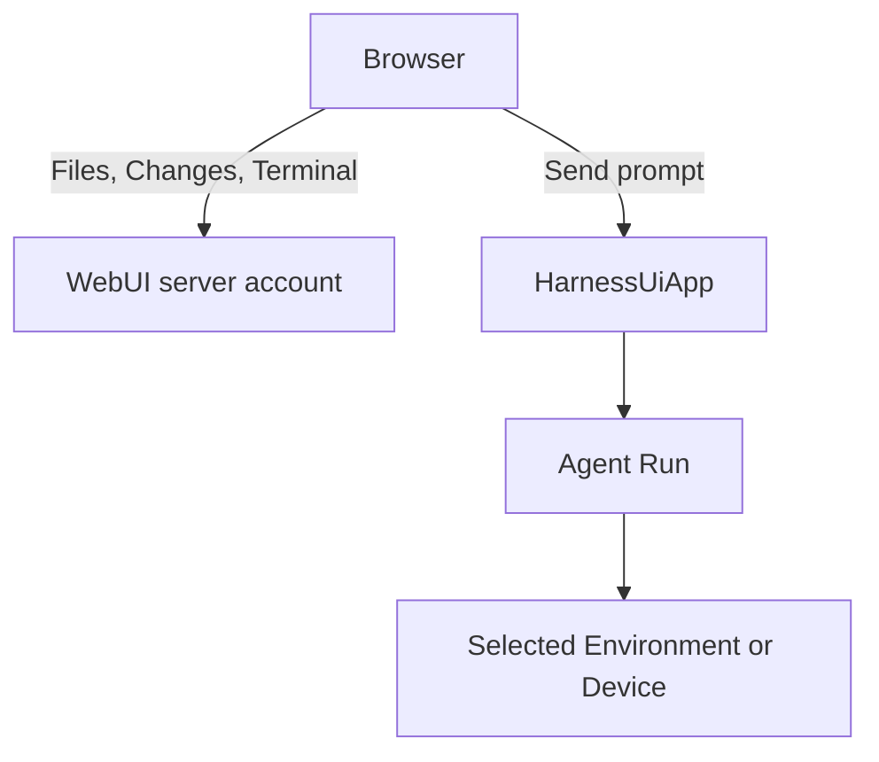

WebUI is the browser workbench for Harness UI. It uses the same App and saved conversations as the TUI. Start with one conversation; add Projects, file review, browser control, and collaboration as your work needs them.

| I want to…                                      | Start here                                                                                                                                                                                              |
| ----------------------------------------------- | ------------------------------------------------------------------------------------------------------------------------------------------------------------------------------------------------------- |
| Get a first answer                              | [Start the server](#start-the-server)                                                                                                                                                                   |
| Change the Agent, Model, or working directories | [Agent and Model settings](#agent-and-model-settings)                                                                                                                                                   |
| Give more guidance or answer a question         | [Steering](#tool-executions-and-immediate-steering) and [pending decisions](#pending-questions-approvals-and-external-results)                                                                          |
| Review a file or diff with the Agent            | [Files and Changes](#read-and-capture-host-files-and-git-changes)                                                                                                                                       |
| Let the Agent browse, or annotate what I see    | [Host browser](host-browser.md#browse-on-the-host)                                                                                                                                                      |
| Invite a person or coordinate other Agents      | [Sharing](#share-a-thread-or-project) and [Coordinator](#work-with-a-coordinator)                                                                                                                       |
| Keep the workbench available remotely           | [Authentication](running-webui.md#authentication-and-key-retention), [proxy setup](running-webui.md#reverse-proxies-and-public-addresses), and [restart](running-webui.md#restart-or-update-the-server) |

## Start the server

Install Harness UI using the [installation guide](installation.md), then run this on the computer that will own your work:

```bash
a13n-harness-ui webui
```

1. Wait for **WebUI ready**. The default address is `http://127.0.0.1:8765`.
2. Open the printed login link. With a supplied instance key, open the ordinary address and enter that key instead.
3. On a fresh installation, connect a Model in the setup wizard. Choose Full Control or prepare Sandbox, then select **Save and start chatting**. The [setup guide](setup.md) explains both choices.
4. In the opened conversation, send `Reply with one short sentence confirming that you received this message.`
5. Wait for the answer and the saved result. Reopen the conversation from the sidebar to continue it.

Keep the server process running. A printed login link precedes listener startup; **WebUI ready** confirms it can accept connections. Saving setup creates an empty conversation, so the first prompt is also your first model-request check.

For a different port, or a chat-only workbench:

```bash
a13n-harness-ui webui --host 127.0.0.1 --port 9000
a13n-harness-ui webui --no-share-computer
```

Computer sharing is enabled by default. **Files**, **Changes**, **Terminal**, and **Browser** use the server account and its container mounts. They are separate from the Agent's selected Environment. `--no-share-computer` disables these native surfaces while keeping chat, shared drafts, and presence available.



The instance login key grants full workbench and Host access. Give guests a [sharing link](#share-a-thread-or-project), not that key. Use [Service](../a13n-service/index.md) when you need managed identities and permissions.

## Organize Projects and work in a conversation

Open the three-dot menu immediately left of the sidebar heading’s plus button to choose **Projects** or **Conversations**. **Conversations** changes the heading to **Recent** and lists chats across Projects, newest interaction first, in compact rows without Project subtitles. Sending input and completing a reply move the chat up; streamed progress does not. Running, unread and starred chats keep their indicators without overriding time order. Coordinator workers stay under their owner. The plus button opens **New chat**. **Projects** restores the grouped view and **Add project**. Your display choice is remembered in this browser.

1. Use **Add project** beside **Projects** to name a Project and select an existing server directory. Add more roots when needed. Creating the Project does not create a conversation.
2. Open **Home** or the Project's **+** to prepare a new conversation. A Project supplies working directories and creation defaults; a projectless conversation is also supported.
3. Open **Agent & Model settings**, check your selections, write the task, and press **Send**.
4. Follow the live answer, respond to any decision cards, and inspect the saved result before starting dependent work.

### Projects and saved conversations

Expand a Project for its five most recently updated root conversations. **Show more** loads another page for that Project; collapsing it preserves loaded pages. Search covers all saved roots, including unloaded pages. **Without a project**, **Unavailable projects**, and **Archived** keep unassigned, removed-Project, and archived conversations reachable.

Use a conversation's **…** menu to rename, star, share, inspect, archive, or delete it. Restore archived conversations from **Archived**. **Project settings** edits the Project instead. Conversations cannot be dragged between Projects.

**Delete chat** is also available in chat details and in **Archived**. Confirming permanently removes the chat and its subagent history for everyone. Stop active work first. Delete a Coordinator's worker chats before deleting the Coordinator. Live and Memory chats cannot be deleted, and shared-link guests cannot delete chats. Project files and independent forks are kept. Thread files are cleaned up on a best-effort basis. Automatic background maintenance runs at startup and hourly to reclaim root checkpoints and their exclusive payloads for Threads with recorded permanent deletions. Cleanup is best-effort and failures do not stop the App. Existing Threads' saved checkpoint history, shared immutable history objects, incomplete payloads, and objects without a deletion record remain on disk. This operation has no undo and is not secure disk erasure.

Drag a Project's handle to reorder it, or use the menu's Move and Reset actions. With the keyboard, focus the handle, press Space, use Up/Down, and press Enter to save or Escape to cancel. Project order and expansion are browser-local; renaming changes only the display name. Active work appears first, and completion updates navigation time.

**Home** and Project **+** buttons share one browser-local new-conversation draft. Changing Project preserves its text and explicit selections. Reload preserves text and settings, but local file bytes must be reattached. **Send** creates the Thread and clears the draft after acceptance. An uncertain submission retains recovery information and locks Project selection until reviewed.

Use **Search** or Command+F on Apple platforms (Ctrl+F elsewhere) to search saved chats, even with the sidebar collapsed. Repeating the shortcut selects the current query; Escape closes search and restores focus to where you opened it. Focused file editors and terminal output keep their own Find controls. Files, Changes, Browser, and other open dialogs keep local or browser-native search rather than opening chat search.

### Send, steer and inspect

| Action                        | Result                                             |
| ----------------------------- | -------------------------------------------------- |
| Enter or Ctrl/Cmd+Enter       | Send; input-method composition stays in the editor |
| Shift+Enter                   | Insert a line break                                |
| Attach, paste, or drop a file | Insert an attachment at the chosen text position   |
| **Steer** during a Run        | Send guidance to the current operation             |
| **Stop**                      | Cancel the displayed operation                     |
| Close the page                | Stop viewing; the server continues working         |

Wait for attachment uploads before sending. Click an attachment to inspect it; retry failed uploads in the originating tab or remove them. The submitted message preserves text/attachment order. Typing a filename is not an attachment, and remote media URLs do not load automatically.

**Send** waits for synchronized edits. Acceptance consumes only the submitted snapshot; concurrent edits remain. If acknowledgement is lost, inspect the reported operation before sending again. While a Run is active, **Next message** is an editable draft, not a queued turn.

Live output is provisional until saved history arrives. Existing saved history stays visible during replacement loading. A failure shows a short reason and expandable details. **Retry** starts a new turn with `Continue completing the previous task.` followed by the current draft text and attachments. Inspect that draft before retrying. Acceptance removes the submitted snapshot and retains concurrent edits; it does not restore the failed Run. It is unavailable during pending or uncertain submission.

Expand **Execution details**, **Explored**, Shell, browsing, or **File changes** to inspect arguments, results, and observed edits. **Awaiting result** identifies a missing result; **Requested replacement** identifies a requested edit rather than an applied diff. Omitted historical content remains unavailable. **Open on host** opens an absolute server/container path in a read-only preview; current disk content can differ from the recorded result.

Open **Details** for operation status, child executions, tasks, notes, usage, and configuration. Execution, continuation saving, and Environment cleanup have separate outcomes. Child controls address the exact parent execution. Applying Project defaults requires a before/after review; competing changes retain your edits for renewed review.

### Shared drafts

People viewing the same saved conversation share its input, uploaded attachment references, Model/Thinking/Speed/Reasoning mode, Environment, and Goal choices. Acknowledged edits are saved on the server and restored across browsers, devices, and server restarts. Prompt guests share text and attachments but cannot read or change owner Run choices.

When upgrading, your browser's previous Model/control choices initialize an untouched shared composer if they still match its Agent and effective Model. Existing shared choices or an explicit reset take precedence. The old browser record is removed only after synchronization confirms the saved state.

Each composer retains at most 512 KiB of current editing state and expires after 30 days without input or option changes, even when nonempty; attached editors are skipped. Deleting the conversation deletes its saved composer. Referenced unsubmitted attachments remain protected from ordinary scratch cleanup while the nonempty draft is retained. After expiry or replacement, explicitly rejoin before restoring browser input.

Unsynchronized edits can be lost on reload or browser crash. Undo belongs to the local editor; accepted Send starts a new undo boundary. Participant display names identify collaborators visually, not as authenticated identities.

### Skills and work inspection

Type `$` or `/` followed by a Skill name to find available Skills. Up/Down selects; Enter or Tab inserts; Escape or the close button dismisses suggestions for the current word and leaves the typed text in place. Insertion does not send. A recognized Skill shows a puzzle icon and name; Backspace removes it as one item. The underlying `$name` text is preserved and works for new conversations, saved conversations, and steering. Recognized names are checked against the relevant catalog; unknown names remain text. See [Skills](skills-and-content-plugins.md) to install or author one.

**Tasks** and **Notes** stay above the composer. The **Background work** icon immediately after the icon-only **Share** button opens a compact card: **Subagents** and **Tool calls** each show up to three rows. Task and argument previews are in row tooltips. Each section's **View all** opens its own history tab in the supporting strip, with **Show more** for older pages. Selecting a row opens its resource tab; narrow layouts close the card first.

Child tabs show the saved/live conversation without a composer. The header's **Stop** action becomes **Stopping…** until the item ends. Tool tabs retain input, supported live output and completion output. Observed Shell processes stay read-only; reloading does not reconstruct observations. Closing a tab does not stop work.

### Review token usage and estimated cost

Select the context ring above the composer to inspect the latest main Agent request. The bar shows input, output and remaining capacity. Expand Skills to see the injected Skill names and their usage. Expand Tool calls to inspect argument and result sizes. On requests with source details, expand Environment context to see mount lists and project guidance, Working state to see notes and tool execution status, or Conversation to compare user input, Agent output and summaries. The mount-list row shows how many copies and distinct versions this request contains. Category token counts use the character proportions of this input. Media tokens without a separate count are distributed using the same proportions. Each percentage uses the full context window as its denominator.

1. Open **Usage** using the chart icon beside the sidebar collapse button. **Project → View usage** or **Details → Usage → Open analytics** opens a preselected scope.
2. Choose 7, 30, or 90 UTC days, or a custom range up to 366 days. Filter by Project, root Thread, or the configured Model used for the request.
3. Compare daily totals and the Project, Thread, or model breakdown. Sort by tokens or cost and select a row to narrow the scope.
4. Use **Refresh** for newly saved usage. Filters remain in the URL; the page does not update continuously.

Totals include retained archived conversations, Memory, Live, child agents, auxiliary calls, and Coordinator workers. Project attribution follows the root Thread's current Project. Provider receipts remain in Thread details.

New Runs look up prices using the selected Model’s configured route. In chat usage, **By model** shows the provider and model from the configured route (for example, `anthropic/claude-opus-5-5`). Expand a model to inspect the names reported by the provider. Costs are recorded USD model estimates: **—** means unknown, **$0** is a known zero, and **+** marks a partial known subtotal. Cache tokens are subsets of input/output, not extra tokens. Unrecorded historical consumption is unavailable. Guest links do not grant analytics access.

## Voice input

In **Settings → General → Dictation**, select **Codex subscription**, then choose a signed-in Codex account or subscription group. Speech recognition and Luna correction are preset; no API key or Model resource is required. Both steps select independently from the chosen group; selecting an individual account pins both steps to it. Login alone does not enable dictation. **Advanced dictation settings** lets you change the correction LLM from the supported Codex models and adjust the context budget (default 2,000 words on each side). You can also select an existing audio-input Model for single-call transcription.

Click the microphone in the composer or an **Add to chat** comment, then click Stop. The backend generates the final text, using the draft, chat title and nearby authored conversation as context. Codex subscription dictation runs ASR followed by text correction; intermediate text is not shown. The final fragment is inserted once at the current input selection without a preview or confirmation step. Nothing is sent automatically. If correction fails, the original transcript is inserted with a warning. After a recognition error, Retry uses the same recording and captured context. Cancel discards it. Microphone capture requires localhost or HTTPS.

## Agent and Model settings

Open the current Model in the composer footer to choose an Agent, Model, Reasoning mode, Thinking level, or Speed. Each choice opens inside the same panel; Default restores inherited settings. Chat options contains Goal, Coordinate agents, Environment, and Clear context on desktop and phones.

To change the Thread's default Model, including for the terminal UI, open conversation configuration and set **Default model**. **Follow Agent model** clears it. The composer shows **Thread default** when following that saved value; a different composer Model changes the Run draft. Configuration inspection distinguishes next-Run selections from the captured selections of active or saved work.

A fresh chat starts with its creation defaults. The unfinished New draft remembers choices in this browser; existing chats restore their shared composer choices from the server. For the same Agent, an explicit composer Model takes precedence even if the conversation’s default model changes. Clear the composer Model override to follow the current conversation default, falling back to the Agent’s Model. Runs that start without your message, such as background results, approvals, or messages from other chats, keep the Model and settings of the previous Run.

Use **Chat options → Clear context** to start the next message without prior model messages, notes, tasks, or saved Agent working state. It also discards pending questions and approvals. Chat history, files, settings, and unsent input remain.

### Thinking for the next Run

1. Open **Agent & Model settings → Thinking**.
2. Keep **Default** to inherit the Model's configured settings, or choose a supported effort level or token-budget preset.
3. Send the next message, then inspect **Configuration** for the captured request.

Choices depend on the Model and installed adapter. Off appears only where supported; minimal effort need not mean Off. Unknown models retain Default with an explanation. Resolve disabled budgets or custom-setting conflicts in Model configuration. Thinking does not change the output-token limit.

The shared composer remembers the selected effort for this conversation across browsers and server restarts. Refresh the page or reopen the chat to use it on the next Send. Changing the Agent or effective Model clears the override. It does not edit the Model resource or affect steering and already-running work.

### Environments for subsequent Runs

1. Open **Environments** in the composer.
2. Under **Local · Harness server → Local mode**, choose **Sandbox**, **Full Control**, a configured profile, or **Follow conversation local mode**.
3. Review local directories, Device bindings, and the default working location together. Apply the draft, then send.
4. Use **Use conversation defaults** to clear temporary overrides. Closing without applying discards the draft.

Full Control uses the server account. Sandbox requires a supported Host isolation launcher and native runtime; a failed preparation stays an error rather than switching to Full Control. Device working directories route operations but do not confine the daemon's filesystem authority.

The shared composer's applied Environment selection accompanies later Sends until reset or draft expiry. Other instance-key participants see the same choice; saved Thread defaults and the active Run stay unchanged. **Steer** and deferred answers retain the active or suspended Run's Environment. New subagents inherit the captured Environment; resumed subagents retain their own conversation configuration.

Use **Configuration** to compare saved defaults with a Run's captured Environment. Replace unavailable profiles explicitly. New-conversation drafts retain choices locally across reload; existing-conversation choices are saved and shared. Changing modes does not copy or isolate existing Project files or history.

## Fast mode

Choose **Fast** in **Agent & Model settings**, or **Ultrafast** where the selected Codex connection supports it. Click the selected button again to request Off. **Use model setting** inherits Model settings; **Provider default** is distinct from Off.

The shared composer remembers the choice for later Sends in this conversation. Changing the Agent or effective Model clears it. It does not affect steering, Thinking, or saved Model configuration. The Context / Cost / Cache / Time row displays the active or saved Run's captured **On**, **Off**, **Ultrafast**, or **Default**; a dash means unavailable.

The server exposes supported native speed controls for OpenAI/Codex, direct Anthropic, and Gemini connections. Disabled choices explain their limitation. Provider eligibility and charges determine the outcome; requesting a speed mode does not guarantee faster execution.

## Tool executions and immediate steering

Use **Steer** to correct direction while the Agent is working. By default, immediate steering interrupts primary model generation or releases supported tool waits. Tool review and validation finish first; the batch returns results or retained-execution receipts, or suspends for approval, before the Agent continues. Supported tools keep running once under their original ownership.

Acceptance means the guidance was queued. Unsupported tools use best-effort delivery at a normal execution boundary. Startup or recovery can wait up to five seconds for native steering readiness; a timeout or completed Run rejects the request. Root and child steering share `input.steering_mode`; choose `queued` in [configuration](configuration.md#built-in-tools-and-subagents) to wait for the next safe boundary.

Open **Background work**, then **View all** under **Tool calls**, to inspect an execution's originating Run/call, status, or records, and cancel active retained work. Reading status does not consume results. The Agent retrieves results with `tool_execution_result` or `tool_execution_wait`.

Generic [automatic background execution](configuration.md#built-in-tools-and-subagents) is opt-in. Process-backed Shell yields after its configured foreground wait in either mode; immediate steering can release that wait sooner. Shell handles also have their own process view.

**Stop** cancels the conversation and suppresses automatic completion wake until new user input. Cancel retained tools separately with their **Cancel** action. Cancellation does not promise remote rollback. Retained records and results survive App restart. Results expire one hour after first consumption, bounded by one day after completion. Envd Shell work recovers when its original external daemon and Session survive; other unfinished in-process calls become `lost` without replay.

## Pending questions, approvals, and external results

Respond in the pending-decision card:

| Request                   | What to do                                                                                   |
| ------------------------- | -------------------------------------------------------------------------------------------- |
| Structured question       | Select answers or enter the permitted custom text                                            |
| Single approval           | Review the action, then choose **Approve once** or **Deny**; add a denial reason when useful |
| Editable approval         | Use **Edit arguments** only when offered                                                     |
| External result           | Enter the real result as JSON under **Provide a result**                                     |
| Several or mixed requests | Complete every item and choose **Submit responses**                                          |

Shell approvals show the risk assessment, reason, command, cwd, and mount; environment-variable values are hidden. Bound Shell arguments cannot be replaced. Deny an unsuitable command with an explanation so the Agent can propose a new one. Server-omitted arguments cannot be approved; a missing risk assessment alone does not block a decision.

External-result entry does not execute a tool in your browser. Enter `null` explicitly when that is the result; an empty editor is unanswered. Approval authorizes execution, not its success. On lost acknowledgement, inspect the current request before retrying. Stale or competing responses refresh the card.

After an answer, the question's short title and recorded choices remain visible. Expand **Questions & details** to revisit options and custom text.

### Questions and approval timeouts

New root requests share one server-owned response window per batch, controlled by `tools.interaction_timeout_seconds` (default 120 seconds). Submit the complete form before the countdown expires; unsubmitted selections are not answers.

Timeout continues with explicit failed results. Unanswered questions ask the Agent to proceed with reasonable assumptions where possible; approvals are denied. Switching pages, refreshing, or closing the browser does not stop the timer. Another participant can answer first.

Server shutdown or archiving cancels the timer. After restart, retained requests remain manually answerable without a replayed countdown. If timeout handling fails to start or save, inspect the operation before retrying. TUI uses its separate per-question countdown.

## Navigate conversation inputs

Use the left input rail, or **Input history** on narrow screens, to revisit ordinary inputs. Selecting an old input loads its saved history window. **Load later messages** and **Back to latest** return toward current work without resubmitting anything; steering stays in its original turn.

Inputs, applied steering, and Agent text remain chronological. **Execution details** groups the intervening activity and starts collapsed; mobile opens a full-screen reader. Counts cover the section's loaded calls. Missing content loads automatically, with **Retry loading turn** on failure. Pending decisions remain actionable outside collapsed details.

## Saved output

Reopen a conversation to read saved history and retained attachments. Child results are available through the inspection panel; historical feedback captures remain ordinary attachments. Viewing and expanding history changes only your view, not Agent context or execution.

### Math formulas

Messages and Markdown file previews render LaTeX math. Use `$E = mc^2$` for an inline formula. For a display formula, put `$$` on separate lines:

```text
$$
\frac{1}{2} + \sqrt{x}
$$
```

A fenced `math` block also renders a display formula. Long display formulas scroll horizontally with keyboard access. Invalid formulas keep readable source, and copying a message preserves its original Markdown. Escape a literal dollar sign as `\$`; ordinary code spans and fences remain source text.

## Interactive MCP tool results

Opted-in [MCP Apps](mcp-apps.md) appear beside actual tool results. In saved history, choose **Open App** before any App HTML runs, then **Activate interactions** for server operations checked against current policy.

Approvals, selected context, message confirmation, and external-link confirmation stay in the trusted card outside the iframe. Opening does not repeat the original tool call; closing the View retains its server connection. Follow the [MCP Apps guide](mcp-apps.md) for setup and the separate sandbox origin required by remote deployments.

## Read and capture Host files and Git changes

Use a Project with a server directory and leave computer sharing enabled. Git viewing also requires Git. These panels operate on the listener Host, even when the Agent works on a remote Device.

1. Open **Files**, select a root, browse folders, and choose a file. Resize or **Expand drawer** for more space.
2. Markdown opens in **Preview**; choose **Text** to inspect the source. Ctrl/Cmd+F finds text; Ctrl/Cmd+G goes to a line.
3. Select source lines and choose **Add to chat**, or select nothing to capture the complete file.
4. Review the attachment in the shared draft, add a question, and send or steer. The captured bytes stay fixed after later Host edits.

The entry menu supports rename/move, upload replacement, and confirmed deletion. Open a file to download it. Filters cover loaded paths, not recursive search. **Back to files** returns to the list.

| Content                                   | Limit or behavior                          |
| ----------------------------------------- | ------------------------------------------ |
| Text preview                              | Complete NUL-free UTF-8, up to 512 KiB     |
| Upload, whole-file capture, image preview | Up to 10 MiB                               |
| Larger download or audio/video            | Streamed; playback starts only on request  |
| Byte-access link                          | Expires after 30 minutes; refresh to renew |

PDF and PPTX previews show one page or slide at a time. XLSX, XLS and ODS previews show cell values by worksheet (up to 200 rows and 40 columns). Document previews accept files up to 16 MiB. SVG opens as an image with a read-only Text view for its source. Code previews share the documentation syntax colors. Unsupported files, including ZIP, TAR and legacy PPT, open a detail page with a preview notice and a download action.

Refresh to read the latest disk revision.

To review a change:

1. Open **Changes** and select staged, unstaged, or untracked content.
2. Read the unified diff, including headers and no-newline notices. Old/new file gutters help navigation; selected patch lines define the capture range.
3. Choose **Add to message** to capture the reviewed diff, then inspect the draft before sending.

Staged compares HEAD/index, unstaged compares index/worktree, and untracked compares a new file. New-side unstaged/untracked lines can open the current working file; staged and deleted-side lines are not assumed to match it. Rename, conflict, binary, unborn-HEAD, and repository identities remain inspectable. Git errors stay errors; Files also works outside repositories.

Changes is read-only: perform stage, commit, discard, or worktree operations deliberately in a shell. Return to the panel or refresh afterward. Observations are not a recursive watcher or a record of which Run caused each change.

Agent links shaped as `/threads/{root_thread_id}?native=files&native_path={URL-encoded absolute Host path}` open Files. Bare paths and API URLs do not. **Share explorer view** copies an instance-key-free same-instance link. The participant directory's **Open page** opens a peer's selected view once; it does not follow them continuously. These links still require instance access.

## Share a native terminal

Native terminals require a POSIX Host and computer sharing. Windows reports PTY unavailable; Files and Git remain independently usable.

1. Open a Project with a configured root. Use **+ → Terminal** to open the Terminal tab, then choose **New terminal**, or use **Files → Open terminal here** for a folder.
2. Wait for the creator's control request to be confirmed before typing. Other viewers use **Take control** or **Take over input**.
3. Use **Release control** to let others type while keeping the shell running. Only the controller resizes it.
4. Choose **End session** and confirm when you intend to stop the shared shell and its jobs for everyone.

Terminal shares the resource-tab strip with Files, Changes, and Browser. It appears beside Chat in Side by side layout and fills the content area in Tabs layout. Opening its tab alone starts no shell. New terminal creates a session rather than inserting `cd` into another one. The displayed initial directory does not track later shell `cd`. Project switching hides/detaches old views without stopping sessions; unassociated sessions remain available through the native API.

**Disconnect**, switching away, closing the Terminal tab, panel collapse, Settings, and page closure detach without ending the process. Reopen read-only; after explicit Disconnect, use **Reconnect**. Reconnection repeats no keystrokes. Input is UTF-8 with a 16 KiB paste limit; legacy binary mouse reports are unsupported.

Output retains up to 1 MiB of server bytes and 2,000 local lines, with gaps disclosed. Slow rendering pauses the connection. Use Ctrl/Cmd+F for **Find in output**, **Copy selection**, or **Add selection to message** for an attributed excerpt. The latter only adds to the draft; **Return to conversation** focuses it. HTTP links open separately, and unambiguous absolute `path:line` links open Host files.

Exited sessions remain inspectable until closed. After uncertain creation or closure, refresh the session list before acting again. App restart does not restore terminals. File/Changes refreshes preserve selected paths and dirty text after native actions, focus return, or Run completion.

## Browse on the Host

Follow [Use the Host browser](host-browser.md#browse-on-the-host) for this procedure.

### First-time setup

Follow [Use the Host browser](host-browser.md#first-time-setup) for this procedure.

### Install Host components

Follow [Use the Host browser](host-browser.md#install-host-components) for this procedure.

### Detect and select executables

Follow [Use the Host browser](host-browser.md#detect-and-select-executables) for this procedure.

### Start and control the browser

Follow [Use the Host browser](host-browser.md#start-and-control-the-browser) for this procedure.

### Capture and annotate a screenshot

Follow [Use the Host browser](host-browser.md#capture-and-annotate-a-screenshot) for this procedure.

## Share a Thread or Project

1. Choose **Share** beside the Thread microphone, or **Share** from the Project menu.
2. Select **Thread** or **Project**. Project access covers current/future Threads and ends for a Thread moved out.
3. Choose **View only** for history, attachments, and live output, or **Send messages** for shared editing, uploads, sending, and steering. Prompt guests can create Threads in a shared Project using its defaults.
4. Select one hour, one day, or seven days, then **Create link**.
5. **Copy link** before closing; its secret appears once. Use **Open shared view** to inspect the guest view.
6. Under **Manage links**, edit permission and **Save**, or **Revoke** access.

Only give prompt links to trusted people. Their prompts use the Agent's existing tools and Environment authority, including cross-conversation tools. Link scope limits browser/API access, not Agent execution.

Guests cannot configure the instance, answer approvals, manage links, or use native Files/Terminal. The instance owner handles approvals. Tasks, notes, and subagent output remain inspectable. Guest access is separate from owner login in the same browser. Revocation/expiry prevents further access but does not cancel work already started.

## Work with a Coordinator

1. Select a Project and enable **Coordinate agents** in **Chat options**.
2. Send the objective. The conversation becomes a Coordinator; **Goal** remains a separate [option](everyday-use.md#work-toward-a-goal).
3. Expand the Coordinator's sidebar row to inspect its workers and their independent histories.
4. To assign work directly, choose **New worker** in its actions and send the assignment in that worker conversation.

The Coordinator delegates substantive investigation, implementation, and testing to workers by default. It focuses on communication with you, planning, coordination, and review of results. Simple questions, lightweight checks, and review stay in the Coordinator conversation. Tightly coupled work can stay with one worker; delegation does not require parallel execution. If you ask the Coordinator to do the work itself, it follows your choice without delegating or asking you to confirm that choice again. This is an Agent instruction, not a restriction on its tools.

Each Project can have several Coordinators. The role is permanent, including if sending subsequently fails. An existing conversation can use **Make Coordinator** when idle, unarchived, Project-bound, and free of pending decisions. Conversion keeps its URL/history/settings. Workers cannot be promoted; old conversations and Sidekicks are not adopted.

A worker is a root conversation with human controls, not a Subagent. **Managed by · name** fixes its owner and Project. Before creation, remove that label to make an independent draft without losing text, attachments, or choices. After creation it stays fixed; uncertain creation must be inspected before retrying. Workers appear under their owner, and search labels them **Coordinator worker**.

Use **Pause automatic follow-up** or **Enable automatic follow-up** in the Coordinator menu. It controls lifecycle notifications, not worker execution. New Coordinators enable it; migrated ones retain their setting. Agent-created workers use Sidekick defaults, while manual workers use composer choices. Sidekick defaults do not control Coordinator identity or automatic follow-up.

Automatic follow-up attempts delivery on first direct worker assignment and when owned work finishes, fails, is cancelled, or waits for input. The Coordinator inspects saved results before accepting completion. Notifications have no retry/restart replay. Closing the browser leaves work running; stopping the Coordinator neither stops workers nor pauses later notifications. Decision deadlines still apply.

## Agent collaboration and Sidekick

Use inline conversation links from collaboration tools to inspect other root work. Agents receive their Thread ID and captured Project/roots; a newly created root receives the task and return address, not the requester's full conversation history.

| Root role     | Agent's collaboration scope                                                  |
| ------------- | ---------------------------------------------------------------------------- |
| Ordinary root | Other roots, excluding managed workers                                       |
| Coordinator   | Its owned workers; new roots stay in its Project                             |
| Worker        | Inspect itself/owner, message owner, use Subagents for task-local delegation |

These limits apply to model tools, not human WebUI access. Workers cannot create roots, control their owner, or access siblings.

An ordinary root's `create_thread` can retain the Project, select another ID, or choose null. `agent_id` selects an Agent; absent Sidekick or explicit Agent/Project changes, source selections are inherited. `model_id` selects the first Run's Model; `run_thread` can select another for a later Run. A Run started without a selection, such as a message or background result, keeps the previous Run's Model. `send_thread_message` steers an active target or starts an idle turn. Acceptance is not proof of processing or saved delivery. Inspect failed/uncertain sends before retrying; archived/Subagent Threads and unresolved pending decisions cannot receive a new turn.

Configure **Settings → General → Subagent defaults** for the Sidekick Agent and Model. Sidekick is always available in WebUI. **Inherit current agent** and **Use agent model** select inheritance; legacy `sidekick: null` now uses those defaults. The selected Model becomes a new Thread's default for later turns. Saving affects future captures and roots, not active Runs/existing Threads, and starts no work by itself. See [Sidekick configuration](configuration.md#webui-sidekick).

## Fork a conversation

1. Open an independent conversation's **…** menu and choose **Fork conversation**.
2. Inspect the newly opened copy, then send your next instruction there.

Forking makes no Model request. It copies saved history, notes, tasks, settings, and Thread-owned files. An active source contributes its last saved checkpoint. External Project directories, remote targets, and sandboxes remain shared resources.

To start from an earlier reply, hover over it and select **Branch in new chat**. You can branch from a finished reply while a later Run is active. To revise an ordinary text message in an idle chat, select **Edit message**, then **Send**. The edited message runs in the new chat. Copies use numbered titles such as `Coffee brief (2)` and `Coffee brief (3)`.

Coordinators, workers, Subagent Threads, and internal Memory/Live Threads cannot be forked. After uncertain creation, inspect the conversation list before retrying.

## Star important conversations

Choose **… → Star conversation** on a hovered/focused row; touch screens expose the menu directly. A filled star stays visible. **Unstar conversation** removes it. Stars are shared instance state and survive browser changes/restarts.

Starred roots precede the five ordinary **Recent** rows; running and unread **New results** take priority without duplicates. Stars do not change visit time. Archive hides a conversation while retaining its star, and workers stay nested under their Coordinator.

## Find unfinished input

Open **Drafts** below conversation search for saved conversations with unfinished shared input, including collapsed Projects and older roots. Each row identifies its Project; ordinary navigation also shows a **Draft** marker alongside running/unread state.

Opening a conversation does not clear the marker. Send successfully or remove its text/attachments; concurrent additions keep it marked. Pending/failed uploads count, whitespace and settings changes do not. Archive removes the entry without discarding the draft.

Synchronized shared drafts can be rediscovered while the same server runs; restart drops them. For a not-yet-created conversation, return to the separate browser-local draft through **Home**.

## Observe Memory

Open **Memory** in the bottom-left navigation to inspect enabled Global or Project memory. The center shows organization history, live tool activity, and **Inspect & usage**. Each automatic organization Run starts fresh model context; prior history and usage remain available after restart.

The right panel displays current scope files, including before any organization Run. Opening it starts no work. The viewer is read-only and independent of computer sharing. To edit, use server Host access to `memory/` beside the selected root configuration.

In **Settings → General**, disabling automatic organization retains the viewer; disabling Memory hides it. Neither deletes files or history.

## Configure the workbench

Use the two-step wizard for first use and **General → Setup & diagnostics** for repair. Model connection saves server credentials; Workspace selects Full Control or a checked Sandbox and an optional server Project. **Set up later** retains nonsecret choices. Secrets are not browser-persisted. After a lost save response, use **Check saved setup and open conversation** before retrying.

For later changes:

| Settings area           | Configure                                                                   |
| ----------------------- | --------------------------------------------------------------------------- |
| **Agents**              | Instructions, Model, Capabilities, subagents; browse installed capabilities |
| **Models**              | Provider/model settings                                                     |
| **Accounts & API keys** | Server credentials                                                          |
| **Connections**         | MCP, reusable agent plugins, conversation connection defaults               |
| **Environments**        | Local defaults, Devices, profiles/extensions, runtime preparation           |
| **General**             | Live, Memory, Sidekick, notifications, setup/diagnostics                    |
| **Configuration files** | Inspect or edit the underlying files                                        |

Forms/YAML share one draft. **Save changes** validates and replaces the complete file. Tab navigation preserves unsaved edits; reload does not. Detected external changes retain your dirty draft, while file saves remain last-write-wins. Hidden MCP source text means a replacement also replaces unseen fields and all resources in that file. Active Runs keep captured configuration. Follow [configuration recipes](configuration-recipes.md) for complete file-based setups.

Open **Project settings** to edit server directories and creation defaults. With computer sharing enabled, **Add folder** opens a system folder picker on a directly connected local Mac or Windows desktop. Other connections can browse directories on the server. With sharing off, enter a server path. Save to apply your selection. New Threads use saved defaults; existing Threads retain selections unless explicitly changed. Default, None, and Custom differ; previews show saved values/sources rather than testing a Model.

Click the generated collaboration name in the top-right header and **Save name** to change this browser's label. The online indicator opens the per-tab participant directory. Names and presence are live collaboration metadata, not provider identities. Background tabs are distinguishable from foreground attention.

### Add or forget a working Environment

1. In **Settings → Environments**, add a Device identity, HTTP or reverse WebSocket transport, and credential reference. **Check connection** reads its live descriptor; saving can work offline.
2. In **Project settings → Environments** or **Conversation details → Configuration → Change next Run selections**, choose **Add environment** and the Device.
3. Enter a known absolute directory or browse the online Device, then **Use this directory**. **Add directory** adds more paths to that environment.
4. Select **Default working directory** and save. Replace the default before removing its directory.

Projects can combine local and remote directories or use only remote ones; at least one working directory remains required. Device browsing works independently of computer sharing. Selecting a Device does not redirect the Host Files/Changes/Terminal panels.

To remove an unused Device/custom profile, choose **Forget**. Follow the dialog's reference links and repair current defaults first. Forget removes local configuration even when the Device is offline/provider unavailable; remote files and saved history remain. Built-ins cannot be forgotten.

Existing Threads retain old choices. A removed selection appears **Not configured**. Repair it explicitly in **Change next Run selections**, including a replacement default when needed. Earlier Run captures/continuations remain unchanged. See [Device configuration](environments-and-projects.md#add-device-bindings) for YAML.

## New results in this browser

Opening or starting a conversation follows it in this browser. An unread saved success gains a **New result** dot, including outside the five recent Project rows. Later running/failed work does not erase it.

Read the saved result at the bottom of history in a focused, visible tab to clear the dot. Selecting the conversation or seeing live text alone is insufficient. An old snapshot cannot clear a newer result. Archived dots stay in **Archived**.

Follow/read state belongs to this browser/site address and synchronizes across tabs. Reopening refreshes followed results saved while closed; first visits treat existing results as historical. Clearing site data removes that state. These dots require no notification permission and are separate from system push.

## Task notifications

Choose **All** or **Bot only** under **Notify me about** in Notifications settings. The default is All. This browser-local choice filters both in-app notices and background notifications without affecting other devices, unread markers, or the explicit delivery test. Bot only includes Bot messages and requests for your input, while excluding ordinary Chat results.

Bot publications show **New message from Bot** and a preview of the actual message. Choose **View message**, or click the system notification, to open Bot. Different messages from the same Run remain distinct. Bot input requests use **Bot needs your response** and open the decision in Activity. System notification titles follow the display language last synchronized by that browser; authored message text stays unchanged.

1. On the receiving device, open **Settings → General → Notifications** at a stable HTTPS address.
2. Choose **Allow notifications** or **Enable background notifications** and accept the browser prompt.
3. Check **Enabled on this device**, then choose **Send test notification**.
4. Keep a WebUI page visible to renew device activity, send a task, and check the system alert after leaving WebUI.

The server must stay running and reach the browser's push service. No separate push account or manual VAPID setup is required. Enable each device separately; existing browser permission alone does not enable background delivery after an upgrade. A test confirms push-service acceptance, not screen display.

System notices cover completion, failure, and requests for input across all root conversations, including unvisited ones; archived roots are excluded. Actual answer/question/error previews can appear on the lock screen. Opted-in devices are eligible for six hours after activity; any visible WebUI page renews this about every minute without requiring focus or typing.

Open pages also show in-app notices without that six-hour or visit-history limit. A conversation you are currently viewing stays quiet, including Bot: its completion, message, failure and input-needed notices do not create in-app popups. Other conversations still notify. This does not change unread markers or system Push delivery, and suppressed notices do not replay after navigation. Web Push is the sole system-notification path; unsupported or unreachable push leaves in-app notices. Push delivery is best effort and missed banners are not replayed. Reopen the conversation for authoritative results.

For Android Chrome, check both site and system permissions, battery/Do Not Disturb restrictions, and push-service connectivity. On iPhone/iPad, use a supported Home Screen web app and enable notifications inside it; an ordinary browser tab is insufficient. Remote plain HTTP is unsupported; local loopback works for development. Browser installation/menu details depend on the device.

| Symptom                                          | Next check                                                                                                                |
| ------------------------------------------------ | ------------------------------------------------------------------------------------------------------------------------- |
| **Browser push registration failed**             | Browser could not obtain a subscription; inspect its error, push connectivity, VPN/firewall, and Wi-Fi/mobile differences |
| Test accepted but no alert                       | Site/system permission, Focus/Do Not Disturb, device network and power policy                                             |
| **Checking subscription…**                       | Wait for stored subscription synchronization                                                                              |
| **Subscription needs attention**                 | Refresh/test failed; return to foreground or reconnect, then inspect the result                                           |
| Rejected/expired endpoint or changed signing key | Use **Reconnect background notifications**                                                                                |

After upgrade, reload and leave the updated page visible. Subscriptions/signing keys survive server restart; registrations expire after 90 days without refresh/activity, independently of six-hour eligibility. Back up the data root securely to retain that identity.

Turn off **Enable browser notifications** before clearing site data when possible. It removes this browser's subscription without affecting other devices or in-app notices. Logout also attempts cleanup. If cleanup fails on both sides, block the site's notification permission; clearing storage alone is not a server unsubscribe.

## Install as an app

Open **Settings → General → Install Harness UI**, then use the offered **Install app** prompt or your browser's installation/Add to Home Screen action. Safari also provides **Share → Add to Home Screen** on iPhone/iPad and **File → Add to Dock** on Mac where supported.

Use HTTPS or loopback and keep scheme, hostname, and port stable. A phone's plain-HTTP LAN connection does not have the same installation support. Changing origin can require installation and login again. The installed window still needs the server; it adds no offline execution or unsaved-editor recovery. Enable background notifications separately.

## Authentication and key retention

Follow [Run and restart WebUI](running-webui.md#authentication-and-key-retention) for this procedure.

## Reverse proxies and public addresses

Follow [Run and restart WebUI](running-webui.md#reverse-proxies-and-public-addresses) for this procedure.

## Restart or update the server

Follow [Run and restart WebUI](running-webui.md#restart-or-update-the-server) for this procedure.

## Server logs and shutdown

Follow [Run and restart WebUI](running-webui.md#server-logs-and-shutdown) for this procedure.

## Listener and application lifetime

Follow [Run and restart WebUI](running-webui.md#listener-and-application-lifetime) for this procedure.

## Container and installed assets

Follow [Run and restart WebUI](running-webui.md#container-and-installed-assets) for this procedure.

## Options and ownership

Follow [Run and restart WebUI](running-webui.md#options-and-ownership) for this procedure.
