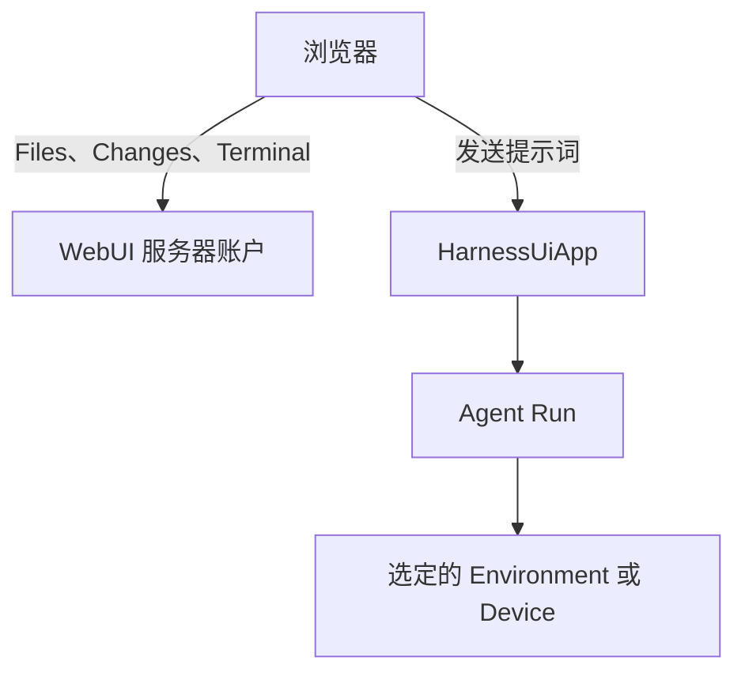

WebUI 是 Harness UI 的浏览器工作台，与 TUI 使用相同的 App 和已保存对话。先完成一次对话，再按工作需要加入 Project、文件审阅、浏览器控制和协作。

| 我想……                              | 从这里开始                                                                                                                          |
| ----------------------------------- | ----------------------------------------------------------------------------------------------------------------------------------- |
| 得到第一个回答                      | [启动服务器](#start-the-server)                                                                                                     |
| 更换 Agent、Model 或工作目录        | [Agent 与 Model 设置](#agent-and-model-settings)                                                                                    |
| 补充指引或回答问题                  | [Steering](#tool-executions-and-immediate-steering) 与[待处理决策](#pending-questions-approvals-and-external-results)               |
| 与 Agent 一起审阅文件或 diff        | [Files 与 Changes](#read-edit-and-capture-host-files-and-git-changes)                                                               |
| 让 Agent 浏览网页，或标注看到的画面 | [Host 浏览器](#browse-on-the-host)                                                                                                  |
| 邀请他人或协调其他 Agent            | [分享](#share-a-thread-or-project)与 [Coordinator](#work-with-a-coordinator)                                                        |
| 从远程持续使用工作台                | [认证](#authentication-and-key-retention)、[代理设置](#reverse-proxies-and-public-addresses)与[重启](#restart-or-update-the-server) |

## 启动服务器

按照[安装指南](installation.md)安装 Harness UI，再在承载工作的计算机上运行：

```bash
a13n-harness-ui webui
```

1. 等待 **WebUI ready**。默认地址为 `http://127.0.0.1:8765`。
2. 打开输出中的登录链接。如果提供了自己的实例密钥，则打开普通地址并输入该密钥。
3. 全新安装会进入设置向导，先连接 Model。选择 Full Control 或准备 Sandbox，再点击 **Save and start chatting**。[设置指南](setup.md)解释了两种选择。
4. 在打开的对话中发送 `Reply with one short sentence confirming that you received this message.`。
5. 等待回答和保存的结果。之后从侧栏重新打开该对话即可继续。

使用期间保持服务器进程运行。登录链接会在监听器启动前输出；**WebUI ready** 才表示可以接受连接。保存设置只创建空对话，因此第一条提示词也是首次模型请求检查。

需要更换端口或只使用聊天工作台时：

```bash
a13n-harness-ui webui --host 127.0.0.1 --port 9000
a13n-harness-ui webui --no-share-computer
```

计算机共享默认开启。**Files**、**Changes**、**Terminal** 和 **Browser** 使用服务器账户及其容器挂载，与 Agent 选定的 Environment 分开。`--no-share-computer` 关闭这些原生界面，保留聊天、共享草稿和在线状态。



实例登录密钥授予完整工作台与 Host 访问权限。给访客[分享链接](#share-a-thread-or-project)，不要给实例密钥。需要托管身份与权限时，使用 [Service](../a13n-service/index.md)。

## 整理 Project 并在对话中工作

1. 点击 **Projects** 旁的 **Add project**，填写名称并选择已有的服务器目录，按需添加其他根目录。创建 Project 不会创建对话。
2. 通过 **Home** 或 Project 的 **+** 准备新对话。Project 提供工作目录和创建默认值，也可以不绑定 Project。
3. 打开 **Agent & Model settings**，检查选择，写下任务并点击 **Send**。
4. 查看实时回答、处理决策卡片，并在开展后续工作前检查保存的结果。

### Project 与已保存的对话

展开 Project 可查看最近更新的五个根对话。**Show more** 加载该 Project 的下一页，折叠后保留已加载页面。搜索覆盖全部保存的根对话，包括未加载页面。**Without a project**、**Unavailable projects** 和 **Archived** 分别保留无 Project、Project 已移除和已归档对话的入口。

使用对话 **…** 菜单改名、加星、分享、检查、归档或删除。在 **Archived** 恢复归档对话。**Project settings** 则修改 Project。对话不能拖到其他 Project。

对话详情和 **Archived** 中也提供 **Delete chat**。确认后，会为所有参与者永久删除该对话及其子 agent 历史。请先停止运行中的任务。删除 Coordinator 前，需要先删除其 worker 对话。Live 和 Memory 对话不可删除，分享链接访客也无权删除对话。Project 文件和独立 fork 会保留。系统会尽力清理 Thread 文件，共享的不可变历史对象仍保留在磁盘上。此操作无法撤销，也不属于安全擦除磁盘。

拖动 Project 手柄排序，或使用菜单的 Move 和 Reset。键盘操作为聚焦手柄、按 Space、用上下箭头移动，再按 Enter 保存或 Escape 取消。Project 顺序和展开状态只属于当前浏览器；改名只改变显示名称。活动工作优先显示，完成时更新导航时间。

**Home** 和 Project 的 **+** 共用一个浏览器本地新对话草稿。切换 Project 保留文字和显式选择。重载保留文字及设置，但需重新附加本地文件字节。**Send** 创建 Thread，接受成功后清除草稿。提交结果不确定时保留恢复信息，并锁定 Project 选择直到完成检查。

### 发送、引导与检查

| 操作                    | 结果                               |
| ----------------------- | ---------------------------------- |
| Enter 或 Ctrl/Cmd+Enter | 发送；输入法组合输入仍留在编辑器中 |
| Shift+Enter             | 换行                               |
| 附加、粘贴或拖入文件    | 在选定文字位置插入附件             |
| Run 期间点击 **Steer**  | 向当前操作补充指引                 |
| **Stop**                | 取消当前显示的操作                 |
| 关闭页面                | 停止查看；服务器继续工作           |

附件上传完成后再发送。点击附件可检查；上传失败时在原标签页重试或移除。提交保留文字和附件顺序。输入文件名不会成为附件，远程媒体 URL 也不会自动加载。

**Send** 会等待编辑同步。接受后只消耗提交时的快照，并发编辑仍保留。确认丢失时，先检查报告的操作再决定是否重发。Run 活动期间，**Next message** 是可编辑草稿，不是已入队的轮次。

实时输出在保存历史到达前属于临时显示。加载替代历史时，原有保存历史仍可见。失败显示简短原因和可展开详情。**Retry** 开始新轮次，发送 `Continue completing the previous task.`，后接当前草稿文字和附件。重试前先检查草稿。接受后移除已提交快照，保留并发编辑；不会恢复失败 Run。提交待处理或结果不确定时不可使用。

展开 **Execution details**、**Explored**、Shell、浏览或 **File changes**，检查参数、结果和观测到的编辑。**Awaiting result** 表示缺少结果；**Requested replacement** 表示请求的修改，而非已应用 diff。已省略的历史内容仍不可用。**Open on host** 打开服务器或容器的绝对路径并保留未保存缓冲区；当前磁盘内容可能不同于记录结果。

打开 **Details** 查看操作状态、子执行、任务、笔记、用量和配置。执行、续接保存和 Environment 清理各自报告结果。子控件对应准确的父执行。应用 Project 默认值需要审阅前后差异；发生竞争修改时保留编辑，重新审阅。

### 共享草稿

查看同一保存对话的人在运行中的 App 内编辑同一份共享草稿。重新连接同一实例即可再次同步。服务器重启会产生替代草稿：明确重新加入，再选择是否恢复本浏览器的文字。

未同步编辑可能因重载或浏览器崩溃丢失；已同步文字在服务器运行期间保留。撤销属于本地编辑器，接受的 Send 建立新的撤销边界。参与者显示名用于辨认协作者，不是认证身份。

### Skill 与工作检查

输入 `$` 和 Skill 名称查找可用 Skill。上下箭头选择，Enter 或 Tab 插入，Escape 关闭。插入不会发送。`$name` 保持为可编辑文字，可用于新对话、保存对话和 steering。已识别名称按对应目录校验；未知名称仍是普通文字。安装或编写方法见 [Skills](skills-and-content-plugins.md)。

输入框上方的 **Tasks**、**Notes**、**Subagents**、**Processes** 和 **Tools** 可直接打开对应的活动视图，不替换草稿。计数分别显示已完成/总任务数、笔记数、活跃子代理执行数和观测到的运行中进程数。聊天栏较窄时，Notes、Processes 和 Tools 收入 **More** 菜单。关闭检查面板后，焦点回到打开它的入口。进程视图显示观测到的后台 handle、Run ID 和退出码；输出留在工具详情中。它是观测面板，不是进程控制台。

进程数量只统计观测到的运行中 handle，不含前台调用。面板从 128 条保留观测中最多展示 16 条。Run 完成或观测中断时，未完成 handle 标为不可用，不认定已退出。重载不会从保存消息重建它们。

### 查看 token 用量和估算费用

1. 点击侧栏折叠按钮旁的图表图标打开 **Usage**。**Project → View usage** 或 **Details → Usage → Open analytics** 会预选对应范围。
2. 选择 7、30、90 个 UTC 日，或最多 366 天的自定义范围。按 Project、根 Thread 或实际 provider/model 筛选。
3. 对比每日汇总和 Project、Thread、模型明细。按 token 或费用排序，点击行缩小范围。
4. 用 **Refresh** 获取新保存的用量。筛选保留在 URL 中；页面不会持续更新。

总量包含保留的归档对话、Memory、Live、子 agent、辅助调用和 Coordinator worker。Project 归属跟随根 Thread 当前的 Project。Provider 回执仍可在 Thread 详情查看。

费用是记录的模型美元估算值：**—** 表示未知，**$0** 表示已知为零，**+** 标记只含已知部分的小计。缓存 token 属于输入/输出的子集，不额外计数。未记录的历史消耗无法补回。访客链接不授予用量分析访问权限。

## Agent 与 Model 设置

点击输入框底部当前 Model，选择 Agent、Model、Reasoning mode、Thinking 等级或 Speed。每项在同一弹层内展开，Default 恢复继承设置。桌面和手机均通过 Chat options 使用 Goal、Coordinate agents、Environment 和 Clear context。

需要持久 Model 选择时，打开对话配置并设置 **Default model**。**Follow Agent model** 清除它。跟随该保存值时输入框显示 **Thread default**；改选输入框 Model 则改变 Run 草稿。配置检查会区分下次 Run 选择与当前或已保存工作的捕获选择。

**Chat options → Clear context** 让下一条消息不带先前模型消息、笔记、任务或保存的 Agent 工作状态开始，同时丢弃待处理问题和审批。聊天历史、文件、设置和未发送输入保留。

### 下次 Run 的 Thinking 设置

1. 打开 **Agent & Model settings → Thinking**。
2. 保留 **Default** 以继承 Model 配置，或选择支持的 effort 等级、token 预算预设。
3. 发送下一条消息，再在 **Configuration** 检查捕获的请求。

选项取决于 Model 和安装的适配器。仅支持时显示 Off；最低 effort 不一定表示 Off。未知模型保留 Default 并说明原因。禁用预算或自定义设置冲突应在 Model 配置中解决。Thinking 不改变输出 token 上限。

覆盖值只属于当前标签页，在修改前应用于后续 Run；更换 Agent 或 Model 会清除它。它不编辑 Model 资源，也不影响 steering 或正在运行的工作。

### 后续 Run 使用的环境

1. 打开输入框中的 **Environments**。
2. 在 **Local · Harness server → Local mode** 选择 **Sandbox**、**Full Control**、已配置 profile 或 **Follow conversation local mode**。
3. 一起检查本地目录、Device 绑定和默认工作位置。应用草稿后再发送。
4. 用 **Use conversation defaults** 清除临时覆盖。关闭而不应用会丢弃草稿。

Full Control 使用服务器账户。Sandbox 需要 Host 支持的隔离启动器和原生运行时；准备失败会保留为错误，不会切换到 Full Control。Device 工作目录用于路由操作，不限制 daemon 的文件系统权限。

标签页的显式 Environment 选择会随之后的 Send 发送，直到重置。它不改变保存的 Thread 默认值、其他参与者或活动 Run。**Steer** 和延后回答保留活动或挂起 Run 的 Environment。新 subagent 继承捕获的 Environment；恢复的 subagent 保留各自对话配置。

用 **Configuration** 对比保存默认值和 Run 捕获的 Environment。不可用 profile 必须明确替换。新对话草稿在重载后保留选择；已有对话的覆盖只属于标签页。切换模式不会复制或隔离现有 Project 文件或历史。

## Fast 模式

在 **Agent & Model settings** 选择 **Fast**，或在支持的 Codex 连接上选择 **Ultrafast**。再次点击选中的按钮请求 Off。**Use model setting** 继承 Model 设置；**Provider default** 与 Off 不同。

选择应用于当前标签页之后的 Send，更换 Agent/Model 时清除。它不影响 steering、Thinking 或保存的 Model 配置。Context / Cost / Cache / Time 一行显示当前或已保存 Run 捕获的 **On**、**Off**、**Ultrafast** 或 **Default**；短横线表示不可用。

服务器为支持的 OpenAI/Codex、直连 Anthropic 和 Gemini 连接提供原生速度控件。被禁用的选项会说明限制。实际效果取决于 provider 资格和收费；请求速度模式不保证更快执行。

## 工具执行与即时 steering

Agent 工作时，用 **Steer** 修正方向。默认即时 steering 会中断主模型生成，或释放支持工具的等待。工具审查和校验先完成；批次返回结果、保留执行回执，或挂起等待审批后，Agent 才继续。支持的工具仍由原有执行方继续运行一次。

接受成功表示指引已入队。不支持的工具会在正常执行边界尽力交付。启动或恢复期间可能等待最多五秒以准备原生 steering；超时或 Run 已完成时拒绝请求。根和子 steering 共用 `input.steering_mode`；在[配置](configuration.md#built-in-tools-and-subagents)中选择 `queued`，即可等到下一个安全边界。

打开 **Work → Tools** 检查执行来源 Run/调用、状态和记录，或取消活动的保留执行。读取状态不消耗结果。Agent 通过 `tool_execution_result` 或 `tool_execution_wait` 获取结果。

通用工具的[自动后台执行](configuration.md#built-in-tools-and-subagents)需显式开启。支持进程的 Shell 在两种模式下都会在前台等待到期后让出；即时 steering 可以提前释放等待。Shell handle 也有独立进程视图。

**Stop** 取消对话，并在新用户输入前禁止完成事件自动唤醒。保留工具需通过各自 **Cancel** 单独取消。取消不保证远端回滚。保留记录和结果有过期限制且属于当前进程；App 重启后旧引用不可用。

## 待处理问题、审批和外部结果

在待决策卡片中回答：

| 请求           | 操作                                                          |
| -------------- | ------------------------------------------------------------- |
| 结构化问题     | 选择答案，或输入允许的自定义文字                              |
| 单项审批       | 审阅动作后选择 **Approve once** 或 **Deny**；按需填写拒绝原因 |
| 可编辑审批     | 仅在提供 **Edit arguments** 时修改参数                        |
| 外部结果       | 在 **Provide a result** 中以 JSON 输入真实结果                |
| 多项或混合请求 | 完成每项，再点击 **Submit responses**                         |

Shell 审批展示风险评估、原因、命令、cwd 和挂载点；环境变量值隐藏。绑定的 Shell 参数不能替换。对不合适的命令应拒绝并说明，让 Agent 提出新命令。服务器省略参数的请求无法批准；仅缺少风险评估不阻止决策。

填写外部结果不会在浏览器执行工具。结果是 `null` 时明确输入；空编辑器表示未回答。审批授权执行，不表示执行成功。确认丢失时先检查当前请求再重试。过时或竞争响应会刷新卡片。

回答后，问题短标题和记录的选项继续显示。展开 **Questions & details** 可重看选项和自定义文字。

### 问题与审批超时

每批新根请求共用一个服务器管理的响应窗口，由 `tools.interaction_timeout_seconds` 控制，默认 120 秒。倒计时结束前提交完整表单；未提交的选择不算回答。

超时后以明确失败结果继续。未回答的问题会让 Agent 尽可能作合理假设继续；审批会被拒绝。切换页面、刷新或关闭浏览器不停止计时，其他参与者也可能先回答。

服务器关闭或归档会取消计时器。重启后保留请求仍可手动回答，但不重放倒计时。超时处理未能启动或保存时，先检查操作再重试。TUI 使用独立的逐题倒计时。

## 浏览对话输入

通过左侧输入导航条，或窄屏上的 **Input history**，重看普通输入。选择旧输入加载对应保存历史。**Load later messages** 和 **Back to latest** 返回较新工作，不重新提交；steering 留在原轮次。

输入、已应用 steering 和 Agent 文字按时间排列。**Execution details** 将其间活动分组并默认折叠；移动端打开全屏阅读器。计数只包含该段已加载调用。缺失内容自动加载，失败时可用 **Retry loading turn**。待处理决策仍可在折叠详情外操作。

## 保存的输出

重新打开对话可读取保存历史和保留附件。子结果位于检查面板，历史反馈捕获仍是普通附件。查看或展开历史只影响视图，不改变 Agent 上下文或执行。

## 交互式 MCP 工具结果

已选择启用的 [MCP Apps](mcp-apps.md) 显示在真实工具结果旁。保存历史中先点击 **Open App** 才执行 App HTML，再通过 **Activate interactions** 启用按当前策略检查的服务器操作。

审批、选定上下文、消息确认和外部链接确认均留在 iframe 外的可信卡片中。打开不会重复原工具调用，关闭 View 会保留服务器连接。设置及远程部署所需独立沙箱 origin，见 [MCP Apps 指南](mcp-apps.md)。

## 读取、编辑与捕获 Host 文件和 Git 变更

使用具有服务器目录的 Project，并保持计算机共享开启。查看 Git 还需要 Git。这些面板操作监听器 Host，即使 Agent 正在远程 Device 工作。

1. 打开 **Files**，选择根目录、浏览文件夹并打开文件。调整大小或 **Expand drawer** 获得更多空间。
2. Markdown 默认打开 **Preview**，选择 **Text** 编辑。预览包含未保存修改。Ctrl/Cmd+G 跳行，Ctrl/Cmd+S 保存。
3. 选择源码行后点击 **Add to chat**；不选择行则捕获完整文件。
4. 审阅共享草稿中的附件，加上问题，再发送或 steer。之后的 Host 编辑不会改变已捕获字节。

Files 还支持上传、下载、创建、重命名/移动和确认删除。筛选只覆盖已加载路径，不递归搜索。**Back to files** 返回列表。切换文件或关闭抽屉保留标签页和未保存文字；重载或关闭浏览器标签页前请保存。

| 内容                       | 限制或行为                          |
| -------------------------- | ----------------------------------- |
| 可编辑文本                 | 完整、无 NUL 的 UTF-8，最多 512 KiB |
| 上传、整文件捕获、图片预览 | 最多 10 MiB                         |
| 更大下载或音视频           | 流式传输；按需开始播放              |
| 字节访问链接               | 30 分钟过期，刷新后续期             |

发生磁盘冲突时，对比最新文件，选择 **Use disk version** 或 **Keep local text** 后再保存。刷新保留未保存文字。结果不确定的写入应先检查，不自动重试。CRLF/LF 保留，混合换行统一为首次风格并提示。

审阅变更的步骤：

1. 打开 **Changes**，选择已暂存、未暂存或未跟踪内容。
2. 阅读 unified diff，包括标题和无末尾换行提示。新旧文件行号栏辅助导航；选中的 patch 行决定捕获范围。
3. 点击 **Add to message** 捕获已审阅 diff，发送前检查草稿。

已暂存比较 HEAD/index，未暂存比较 index/worktree，未跟踪按新文件比较。未暂存/未跟踪的新侧行可打开当前工作文件；暂存和删除侧不假定匹配当前内容。重命名、冲突、二进制、无首个 HEAD 及仓库身份仍可检查。Git 错误保持为错误；Files 也可用于仓库外。

Changes 只读：stage、commit、discard 或 worktree 操作需在 shell 中明确执行。之后返回面板或刷新。观测不是递归 watcher，也不记录各变更由哪次 Run 造成。

Agent 的 `/threads/{root_thread_id}?native=files&native_path={URL-encoded absolute Host path}` 链接打开 Files；普通路径和 API URL 不会。**Share explorer view** 复制不含实例密钥的同实例链接。参与者目录的 **Open page** 只打开一次对方选定视图，不持续跟随。这些链接仍要求实例访问权限。

## 共享原生终端

原生终端需要 POSIX Host 和计算机共享。Windows 会报告 PTY 不可用；Files 和 Git 仍可独立使用。

1. 打开具有配置根目录的 Project。用 **+ → Terminal** 打开终端标签页，再选择 **New terminal**，或对文件夹使用 **Files → Open terminal here**。
2. 等待创建者的控制请求被确认再输入。其他查看者使用 **Take control** 或 **Take over input**。
3. 用 **Release control** 让其他人输入，同时保留 shell 运行。只有控制者可以调整尺寸。
4. 需要为所有人停止共享 shell 及其作业时，选择 **End session** 并确认。

Terminal 与 Files、Changes 和 Browser 共用资源标签栏。在 Side by side 布局中显示在 Chat 旁边，在 Tabs 布局中占满内容区域。只打开标签页不会启动 shell。New terminal 创建会话，不向其他会话插入 `cd`。显示的初始目录不追踪后续 shell `cd`。切换 Project 隐藏并断开旧视图，不停止会话；无 Project 关联的会话仍可通过原生 API 使用。

**Disconnect**、切换到其他标签页、关闭 Terminal 标签页、折叠面板、Settings 和关闭页面都只断开连接，不结束进程。重新打开时只读连接；明确 Disconnect 后使用 **Reconnect**。重连不重复按键。输入为 UTF-8，粘贴上限 16 KiB，不支持旧式二进制鼠标报告。

输出最多保留服务器 1 MiB 字节和本地 2,000 行，缺口会说明。渲染缓慢时暂停连接。Ctrl/Cmd+F 打开 **Find in output**，也可使用 **Copy selection**，或用 **Add selection to message** 添加带来源的片段。后者只加入草稿；**Return to conversation** 聚焦草稿。HTTP 链接单独打开，明确的绝对 `path:line` 链接打开 Host 文件。

已退出会话在关闭前仍可检查。创建或关闭结果不确定时，先刷新会话列表再操作。App 重启不恢复终端。原生操作、焦点返回或 Run 完成后的 Files/Changes 刷新会保留选定路径和未保存文字。

## 使用 Host 浏览器

**Browser** 让 Agent 在服务器上使用 Chromium，你可以观看原生窗口。Linux 显示共享的专用桌面，macOS 只显示当前对话拥有的浏览器窗口。浏览器需要 Linux 或 macOS Host、计算机共享和 Full Control Run。Windows 浏览器可以查看支持的 Host，但 Windows 不能承载此桌面。

### 首次设置

1. 在服务器[安装 Host 组件](#install-host-components)，不是在显示 WebUI 的设备上安装。启动 WebUI 时保持计算机共享开启。
2. 使用默认的 `browser.mode: auto` 启动 WebUI。Harness UI 自动探测已安装组件并准备共享浏览器。启动失败时，打开 **Browser**，解决显示的必需组件，再点击 **Try again**。
3. 开始 **Full Control** 对话，让 Agent 浏览。工具自动可用，首次导航或创建标签页时打开对话窗口。也可在 Run 运行期间选择 **Browser → Open browser** 手动打开。
4. 首次实时浏览会展示查看器，不移动键盘焦点。已打开 Files/Changes 或使用窄屏时，选择 **View browser**。关闭查看器保留浏览器运行，同一 Run 不再自动展示。
5. Linux 上登录或手动修正时，选择 **Take control**，完成后 **Hand back to Agent**。macOS 上选择 **Pause automation**，在 Mac 本机操作浏览器，再选择 **Resume automation**。

浏览器无需对话级开关或手动添加 Capability。**Advanced browser settings** 提供全局 Auto/Disabled 模式和程序路径覆盖；修改后保存并重启。普通聊天、Files 和 Shell 不创建对话浏览器页面。

### 安装 Host 组件

**Linux**：按发行版或供应商说明安装 Chrome、Chromium 或 Edge。Debian/Ubuntu 可这样准备 TigerVNC：

```bash
sudo apt-get update
sudo apt-get install --no-install-recommends tigervnc-standalone-server
```

可选的窗口控制和 TigerVNC 尺寸调整组件：

```bash
sudo apt-get install --no-install-recommends openbox x11-xserver-utils
```

这些命令安装桌面组件，不安装 Chromium。Harness 包含 cdp-use，并生成 VNC 密码和 X11 认证，无需另行设置 Node.js、`vncpasswd`、`xauth` 或 websockify。Docker 部署应在服务器镜像/容器中安装。**Manual installation commands** 是供你执行的说明，不由 UI 自动安装。

以非 root 账户运行并保持 Chromium 沙箱开启。root 需要显式 `--browser-no-sandbox` 或 `A13N_HARNESS_UI_BROWSER_NO_SANDBOX=1`，这会移除 Chromium 沙箱保护。`--browser-sandbox` 覆盖该环境变量选择。WayVNC/Sway 本身仍要求非 root 账户。

**macOS：**

1. 安装 Chrome、Chromium 或 Edge，以已登录桌面的用户运行 Harness UI。
2. 选择 **Browser → Open browser** 打开窗口；Chromium 是唯一必需的浏览器组件。
3. 要在 macOS 14 或更高版本使用可选预览，给运行 Harness UI 的应用授予屏幕录制权限。**Open Mac Screen Recording settings** 打开 Host 设置，由你在那里授权。
4. 保持 Mac 解锁且浏览器窗口可见。授权或解锁后选择 **Reconnect**；如 macOS 要求重启 Host 应用，按提示操作。

预览只捕获 Harness UI 为当前对话创建的那个窗口，包括真实地址栏。缺少权限或捕获失败时，自动化仍可使用。查看器始终只读，不转发键盘、鼠标或剪贴板输入。无需屏幕共享或 VNC 密码；以前保存的 VNC 凭据和旧密码环境变量已不再使用。

捕获不会回退到桌面、个人浏览器或其他对话窗口。独立弹出窗口和原生对话框不在预览中。如果绑定窗口已关闭或无法识别，使用 **Reset browser** 建立新预览。可用本地缩放；Viewport 预设禁用，物理显示分辨率保持不变。

### 探测并选择可执行文件

自动选择已安装浏览器，优先 Chrome，再 Chromium，最后 Edge。Linux 搜索服务器 `PATH`，macOS 检查 `/Applications` 和 `~/Applications`。安装缺失程序后点击 **Scan** 或 **Try again**。更改服务器 `PATH` 后重启服务器。

| Linux 显示方案 | 必需组件                             | 尺寸调整               |
| -------------- | ------------------------------------ | ---------------------- |
| TigerVNC，优先 | `Xtigervnc` 或 `Xvnc`                | 可选 RandR/xrandr 支持 |
| x11vnc         | x11vnc 和 Xvfb                       | 固定桌面               |
| WayVNC         | 兼容 WayVNC、无头 Sway、非 root 账户 | 固定桌面               |

自动探测按此顺序优先选择完整适配器。WayVNC 需要私有 Unix socket 和禁用输入的只读支持。Linux 桌面使用专用显示/运行目录，不连接用户当前桌面。Openbox、Fluxbox、IceWM 或 twm 等 X11 窗口管理器提供拖动和关闭控件；没有也能基本浏览。

覆盖路径时，打开 **Settings → General → Host browser**，选择探测到的程序，或在 **Other** 输入绝对路径，再保存并重启。**Automatic** 清除覆盖。无效显式路径直接失败，不回退。**Scan** 检查当前草稿并刷新必需/可选组件结果，不保存也不启动。探测成功后仍可能因缺少共享库或显示权限而启动失败。

macOS 设置显示可选的 **Window preview**，不提供 VNC 程序选择器或密码。

共享 profile 位于 `<data_root>/browsers/profile`，默认是 `~/.a13n-harness-ui/data/browsers/profile`，没有独立位置设置。各对话和 Project 共用一个 Chromium 实例及 profile，并有各自窗口/Agent 标签页。不导入个人 profile，也不移动或合并已有 profile 目录。

Linux 受管浏览器使用基础密码存储，避免等待锁定的桌面钥匙环。保存的密码和 Cookie **不受操作系统钥匙环保护**；请像保护凭据一样保护 profile 及备份。系统钥匙环和 macOS 凭据存储不变。升级后重启 Harness UI 应用此行为；profile 会保留，但原先依赖钥匙环加密登录数据的网站可能需要重新登录。

### 启动与控制浏览器

初始只读观看。Linux 上的 **Take control** 暂停所有对话的浏览器工具和页面采集，并聚焦当前对话窗口。一次只有一个查看者控制输入。**Hand back to Agent** 撤销人类输入，并要求重新观察页面。你可以从其他对话交还，包括没有打开标签页的对话。从其他对话接管会转移输入权限并聚焦其窗口，同时保持所有 Agent 浏览器工具暂停。

Agent 在接管期间调用浏览器工具，会立即收到阻塞结果，并登记交还通知。它可以先完成独立工作，或结束当前轮次，无需轮询。交还只通知这些对话，包括已经结束轮次的对话，让 Agent 重新观察并继续仍相关的工作。待审批操作仍需你的决定。停止、归档或清空上下文会取消待发通知。通知只保留在当前服务器和浏览器运行时中；不会恢复已经结束的 Goal。

要更换设备，在另一个浏览器打开同一 Thread，选择 **Take control here**。原控制端失去输入权限，Agent 全程保持暂停；仅打开 Thread 仍为只读。控制端断线后，选择 **Reconnect control** 可在保持 Agent 暂停的同时重连，或选择 **Hand back to Agent** 恢复自动化。

工具栏先显示 **Taking control…**，等待当前操作结束，再显示 **Connecting control…** 和 **Waiting for the first frame…**。出现 **You have control** 后再输入或点击。连接期间可能保留旧画面并显示等待提示；连接超时可重试，等待或失败期间也可交还控制。

macOS 上，在 Mac 本机操作真实浏览器前，先选择 **Pause automation**。这同样会暂停各对话的浏览器工具和页面采集。完成后选择 **Resume automation**；Agent 必须先观察更新后的页面，再继续操作。关闭查看器不会解除暂停。WebUI 预览始终只读。

Linux 上输入前点击远端桌面。本地输入法在你的设备上组合文字，再把确定文字粘贴到远端字段。字段需支持粘贴，Host 也需有相应字体。Linux Unicode 传输需要 TigerVNC 或 WayVNC 等扩展剪贴板服务；已测试的 x11vnc 不支持。

Linux 人工控制期间，聚焦桌面的文本剪贴板同步最多 65,536 字符，需要 HTTPS 或 localhost 及浏览器剪贴板权限。客户端 Command 快捷键映射为 Linux Ctrl 快捷键。交还、断线或关闭查看器停止同步。远端桥接只传文字，不传图片/文件；文件对话框使用 Host 文件。

Linux 支持尺寸调整时，接管后选择 Viewport 预设检查响应式布局。尺寸表示页面 CSS 视口，其他查看者也看到相同大小。调整保持登录且不重载，不模拟手机操作系统、user agent 或触摸设备。Close conversation tabs 和 Reset 保留选择直到服务器重启。

| 操作                                          | 保留状态                                         |
| --------------------------------------------- | ------------------------------------------------ |
| 关闭抽屉、切换对话、结束 Run                  | 浏览器继续运行                                   |
| **Browser options → Close conversation tabs** | 关闭当前窗口，保留 Run 绑定；同一 Run 可再次打开 |
| **Reset browser**                             | 在可见位置重建当前对话窗口                       |
| **Reconnect**                                 | 重连查看器，不重启 Chromium                      |
| 关闭对话最后一个标签页                        | 绑定仍启用；Agent 导航或 Open browser 可新建     |
| 退出 Chromium 或必需显示进程退出              | 停止共享运行时和全部窗口                         |

Reset 或故障恢复创建新的只读会话。共享运行时停止后，选择 **Try again** 重试。发送新提示让受影响对话使用替代窗口；不重放旧动作，等待中的工具会失败而非无限暂停。单对话 Reset 保留其他对话窗口。崩溃可能丢失未保存页面数据。服务器重启后，Auto 模式重新准备共享浏览器。人工控制期间关闭单个标签页后，自动化仍暂停，直到交还。如果当前对话持有控制权，**Close conversation tabs** 也会释放人工控制。

Linux 人工控制者可以查看和操作共享专用桌面的其他窗口。macOS 预览只显示一个窗口，但各对话仍通过 Chromium profile 共享网站登录状态、保存的密码及偏好。浏览器权限和网络属于 Host，不受 Sandbox 隔离。Linux 查看器使用 noVNC，源码/许可证说明位于 `/assets/LICENSE.noVNC`，其他打包依赖说明位于 `/third-party-licenses.txt`。

### 截图与标注

1. 在已连接 Browser 抽屉中点击相机 **Capture and annotate screenshot**。它在本机冻结当前渲染的 Linux 桌面或 macOS 窗口预览，包括浏览器控件；实时浏览器继续运行。
2. 用鼠标、触控笔或触摸裁剪，添加箭头、形状、自由笔迹、文字或马赛克。隐私内容用 **Opaque redaction**；马赛克只是视觉效果。
3. 用 **Select** 或 **Annotations** 选择标注。移动/调整尺寸、Delete 删除，或方向键微调（Shift 增大步长）。Ctrl/Cmd+Z 撤销，Ctrl/Cmd+Shift+Z 重做。Shift 约束形状/箭头角度。
4. Ctrl/Cmd+Enter 完成文字，Escape 取消。文字输入之外，点击 **Copy PNG** 或 Ctrl/Cmd+Enter 复制结果，焦点返回聊天。
5. 明确粘贴到输入框，检查附件，补充指令后发送。

截图无需接管，也不暂停 Agent。编辑器只暂停当前查看器的远端输入和文字同步。复制会等待已发出的文字剪贴板写入完成。截图/复制不会自动上传、附加或发送。

PNG 尺寸取决于原图像素裁剪，不受预览缩放或屏幕密度影响。键盘可编辑已有标注，创建标注/裁剪需要指针。复制/导出失败保留编辑，可重试或使用 **Download PNG**；下载保留编辑器打开。关闭时如会丢弃文字或撤销/重做历史，会先确认。粘贴到聊天沿用普通附件限制。

## 分享 Thread 或 Project

1. 点击 Thread 麦克风旁的 **Share**，或 Project 菜单的 **Share**。
2. 选择 **Thread** 或 **Project**。Project 访问包含当前/未来 Thread；Thread 移出后访问结束。
3. **View only** 可阅读历史、附件和实时输出；**Send messages** 可共享编辑、上传、发送和 steering。可发送访客能按 Project 默认值创建 Thread。
4. 选择一小时、一天或七天，再点击 **Create link**。
5. 关闭前 **Copy link**，秘密只显示一次。用 **Open shared view** 检查访客视图。
6. 在 **Manage links** 修改权限并 **Save**，或 **Revoke** 撤销。

只给信任的人可发送链接。其提示使用 Agent 现有工具和 Environment 权限，包括跨对话工具。链接范围限制浏览器/API 访问，不隔离 Agent 执行。

访客不能配置实例、回答审批、管理链接或使用原生 Files/Terminal。实例 owner 负责审批。任务、笔记和 subagent 输出仍可检查。同一浏览器内访客访问与 owner 登录分开。撤销/过期阻止后续访问，但不取消已开始工作。

## 与 Coordinator 协作

1. 选择 Project，在输入框开启 **Coordinator**。
2. 发送目标。对话成为 Coordinator；**Goal** 仍是独立[选项](everyday-use.md#work-toward-a-goal)。
3. 展开 Coordinator 侧栏行，检查 worker 及其独立历史。
4. 直接分配工作时，在操作菜单选择 **New worker**，在该 worker 对话发送任务。

Coordinator 默认把实质性的调查、实现和测试委派给 worker，自己侧重与你交流、规划、协调和审查结果。简单问题、轻量检查和审查仍在 Coordinator 对话中完成。紧密关联的工作可以持续交给同一个 worker；委派不要求并行执行。如果你要求 Coordinator 亲自执行，它会遵循你的选择，不委派，也不要求你再次确认这一选择。这是 Agent 指令，不是工具权限限制。

每个 Project 可有多个 Coordinator。角色永久保留，包括之后发送失败的情况。已有对话空闲、未归档、绑定 Project 且无待决策时可用 **Make Coordinator**。转换保留 URL/历史/设置。Worker 不能升级，旧对话和 Sidekick 不会被收编。

Worker 是有人类控件的根对话，不是 Subagent。**Managed by · name** 固定 owner 和 Project。创建前移除此标签可变为独立草稿，不丢文字、附件或选择；创建后固定。创建结果不确定时先检查再重试。Worker 位于 owner 下，搜索标为 **Coordinator worker**。

在 Coordinator 菜单使用 **Pause automatic follow-up** 或 **Enable automatic follow-up**。它控制生命周期通知，不控制 worker 执行。新 Coordinator 默认开启，迁移保留原设置。Agent 创建的 worker 使用 Sidekick 默认值，手动创建使用输入框选择。关闭 Sidekick 不关闭 Coordinator。

自动跟进会在首次直接分配 worker 任务，以及所属工作完成、失败、取消或等待输入时尝试交付。Coordinator 先检查保存结果再接受完成。通知没有重试/重启重放。关闭浏览器保留工作；停止 Coordinator 不停止 worker，也不暂停之后通知。决策截止时间仍生效。

## Agent 协作与 Sidekick

通过协作工具的内联对话链接检查其他根工作。Agent 会收到 Thread ID 和捕获的 Project/根目录；新根收到任务和回信地址，不继承请求方完整历史。

| 根角色      | Agent 协作范围                                            |
| ----------- | --------------------------------------------------------- |
| 普通根      | 其他根，不含托管 worker                                   |
| Coordinator | 自己的 worker；新根保持在其 Project                       |
| Worker      | 查看自己/owner、向 owner 发消息、用 Subagent 做任务内委派 |

限制应用于模型工具，不限制人类 WebUI 访问。Worker 不能创建根、控制 owner 或访问兄弟 worker。

普通根的 `create_thread` 可以保留 Project、选其他 ID 或用 null。`agent_id` 选择 Agent；没有 Sidekick 或显式 Agent/Project 变化时继承来源选择。`model_id` 只覆盖首个 Run，`run_thread` 可覆盖后续 Run。`send_thread_message` 对活动目标发送 steering，对空闲目标开始一轮。接受不证明已处理或保存交付。失败/不确定发送先检查再重试；归档/Subagent Thread 和待决策未解决的 Thread 不能接收新轮次。

在 **Settings → General → Sidekick** 配置默认 Agent、Model 和汇报指令，默认开启。**Inherit current agent**、**Use agent model** 和 **Disabled** 含义不同。选定 Model 成为新 Thread 后续默认值。保存影响未来捕获和根，不影响活动 Run/现有 Thread，也不会自行开始工作。见 [Sidekick 配置](configuration.md#webui-sidekick)。

## 创建对话副本

1. 打开独立对话 **…** 菜单，选择 **Fork conversation**。
2. 检查打开的副本，再发送下一条指令。

Fork 不发起 Model 请求，复制保存历史、笔记、任务、设置和 Thread 自有文件。活动来源提供最后保存检查点。外部 Project 目录、远程目标和沙箱仍是共享资源。

Coordinator、worker、Subagent Thread 和内部 Memory/Live Thread 不能 fork。创建结果不确定时，先检查对话列表再重试。

## 为重要对话加星标

在悬停/聚焦行选择 **… → Star conversation**；触屏直接显示菜单。实心星保持可见，**Unstar conversation** 移除。星标是实例共享状态，更换浏览器/重启后保留。

星标根排在五个普通 **Recent** 行前；运行中和未读 **New results** 优先且不重复。星标不改变访问时间。归档隐藏对话但保留星标，worker 仍嵌套于 Coordinator。

## 找回尚未发送的输入

点击搜索下的 **Drafts**，查找留有未完成共享输入的保存对话，包括折叠 Project 和较旧根。每行显示 Project；普通导航也会在运行/未读状态旁标记 **Draft**。

打开对话不清除标记。成功发送或移除文字/附件后才清除；并发新增仍保留标记。待上传/失败上传计入，空白和设置变化不计。归档移除入口而不丢草稿。

同一服务器运行期间，可重新找到已同步共享草稿；重启会丢弃它们。尚未创建的对话则从 **Home** 回到独立浏览器本地草稿。

## 查看 Memory

通过左下角 **Memory** 查看启用的 Global 或 Project memory。中间显示整理历史、实时工具活动和 **Inspect & usage**。每次自动整理 Run 使用新的模型上下文；历史和用量在重启后保留。

右侧显示作用域当前文件，即使还没有整理 Run。打开不开始工作。查看器只读且独立于计算机共享。编辑时通过服务器 Host 访问修改所选根配置旁的 `memory/`。

在 **Settings → General** 关闭自动整理保留查看器，关闭 Memory 隐藏它。两者都不删除文件或历史。

## 配置工作台

首次使用两步向导，修复使用 **General → Setup & diagnostics**。Model 连接保存服务器凭据；Workspace 选择 Full Control 或通过检查的 Sandbox，以及可选服务器 Project。**Set up later** 保留非秘密选择，秘密不持久保存在浏览器中。保存响应丢失后先用 **Check saved setup and open conversation**，再决定是否重试。

后续修改入口：

| 设置区域                | 配置内容                                            |
| ----------------------- | --------------------------------------------------- |
| **Agents**              | 指令、Model、Capabilities、subagent；浏览已安装能力 |
| **Models**              | Provider/model 设置                                 |
| **Accounts & API keys** | 服务器凭据                                          |
| **Connections**         | MCP、可复用 agent 插件、对话连接默认值              |
| **Environments**        | 本地默认值、Device、profile/extension、运行时准备   |
| **General**             | Live、Memory、Sidekick、通知、设置/诊断             |
| **Configuration files** | 查看或编辑底层文件                                  |

表单/YAML 共用草稿。**Save changes** 校验并替换整个文件。标签页内导航保留未保存编辑，重载不保留。检测到外部变化会保留未保存草稿，文件保存仍以后写覆盖前写。MCP 源文本隐藏，替换也会覆盖不可见字段和文件中全部资源。活动 Run 保留捕获配置。完整文件设置见[配置配方](configuration-recipes.md)。

打开 **Project settings** 编辑服务器目录和创建默认值。**Browse → Use this directory** 只改草稿，保存后应用。关闭计算机共享时手动输入 Host 路径。新 Thread 使用保存默认值；已有 Thread 保留选择，除非明确修改。Default、None、Custom 不同，预览展示保存值/来源，不测试 Model。

点击右上角生成的协作名称并 **Save name**，修改当前浏览器标签。在线指示打开按标签页区分的参与者目录。名称和 presence 是实时协作元数据，不是 provider 身份。后台标签页与前台关注可区分。

### 添加或移除工作环境

1. 在 **Settings → Environments** 添加 Device 身份、HTTP 或反向 WebSocket 传输及凭据引用。**Check connection** 读取实时描述；保存可离线完成。
2. 在 **Project settings → Environments** 或 **Conversation details → Configuration → Change next Run selections** 选择 **Add environment** 和 Device。
3. 输入已知绝对目录或浏览在线 Device，再 **Use this directory**。**Add directory** 向该环境增加路径。
4. 选择 **Default working directory** 并保存。移除默认目录前先替换默认值。

Project 可混用本地/远程目录，也可只有远程目录；始终至少需要一个工作目录。Device 浏览不依赖计算机共享。选择 Device 不会重定向 Host Files/Changes/Terminal 面板。

移除未使用的 Device/自定义 profile 时选择 **Forget**。先沿对话框引用链接修复当前默认值。Forget 删除本地配置，即使 Device 离线或 provider 不可用；远程文件和保存历史保留。内置资源不能 forget。

已有 Thread 保留旧选择。删除的选项显示 **Not configured**，需在 **Change next Run selections** 明确修复，必要时替换默认值。此前 Run 捕获/续接不变。YAML 方法见 [Device 配置](environments-and-projects.md#add-device-bindings)。

## 当前浏览器中的新结果

打开或启动对话会在当前浏览器关注它。未读的保存成功结果出现 **New result** 圆点，包括最近五行之外的 Project 对话。后续运行/失败不会清除。

在聚焦、可见的标签页滚到历史底部阅读保存结果，才清除圆点。只选择对话或看到实时文字不够。旧快照不能清除新结果。归档圆点留在 **Archived**。

关注/已读状态属于此浏览器和站点地址，并在标签页间同步。重新打开刷新关闭期间保存的关注结果；首次访问把已有结果视为历史。清除站点数据移除此状态。这些圆点不需通知权限，与系统推送独立。

## 任务通知

1. 在接收设备上，通过稳定 HTTPS 地址打开 **Settings → General → Notifications**。
2. 选择 **Allow notifications** 或 **Enable background notifications**，接受浏览器提示。
3. 确认 **Enabled on this device**，再点击 **Send test notification**。
4. 保持 WebUI 页面可见以更新设备活动，发送任务，并在离开 WebUI 后检查系统提醒。

服务器必须保持运行并能连接浏览器推送服务。无需独立推送账户或手动 VAPID 设置。每台设备单独启用；升级后仅有旧浏览器权限不会开启后台交付。测试确认推送服务接受，不确认屏幕显示。

系统通知覆盖全部根对话的完成、失败和输入请求，包括未访问对话，但不含归档根。真实回答/问题/错误预览可能出现在锁屏。主动启用的设备在活动后六小时内有接收资格；任意可见 WebUI 页面大约每分钟续期，不要求聚焦或输入。

打开的页面还显示应用内通知，不受六小时或访问历史限制。Web Push 是唯一系统通知路径；不支持或推送不可达时仍有应用内通知。推送尽力交付，丢失横幅不重放。重新打开对话查看权威结果。

Android Chrome 需检查站点和系统权限、省电/勿扰限制以及推送服务连通性。iPhone/iPad 使用受支持的主屏幕 Web App，并在其中启用通知；普通浏览器标签页不够。远程普通 HTTP 不受支持，本地回环可用于开发。安装和菜单细节取决于设备。

| 症状                                 | 下一步检查                                                                  |
| ------------------------------------ | --------------------------------------------------------------------------- |
| **Browser push registration failed** | 浏览器无法取得订阅；检查原错误、推送连通性、VPN/防火墙及 Wi-Fi/移动网络差异 |
| 测试接受但无提醒                     | 站点/系统权限、Focus/勿扰、设备网络与电源策略                               |
| **Checking subscription…**           | 等待已保存订阅同步                                                          |
| **Subscription needs attention**     | 刷新/测试失败；回到前台或重连，再检查结果                                   |
| endpoint 被拒绝/过期，或签名密钥变化 | 使用 **Reconnect background notifications**                                 |

升级后重载并保持更新页面可见。订阅/签名密钥在服务器重启后保留；90 天无刷新/活动的注册过期，与六小时资格独立。安全备份数据根目录保留此身份。

可行时先关闭 **Enable browser notifications** 再清除站点数据。它移除本浏览器订阅，不影响其他设备和应用内通知。退出登录也尝试清理；两端都清理失败时阻止站点通知权限。只清除存储不等于服务器退订。

## 安装为应用

打开 **Settings → General → Install Harness UI**，使用提供的 **Install app** 或浏览器安装/添加到主屏幕操作。支持时，Safari 在 iPhone/iPad 提供 **Share → Add to Home Screen**，在 Mac 提供 **File → Add to Dock**。

使用 HTTPS 或回环，并保持协议、主机名、端口稳定。手机通过局域网普通 HTTP 访问不具有相同安装支持。更改 origin 可能需要重新安装和登录。安装窗口仍需要服务器，不增加离线执行或未保存编辑器恢复。后台通知需另行开启。

## 认证与密钥保存

启动输出普通地址。使用生成密钥时还输出密钥和 fragment 登录链接。浏览器移除 fragment，把成功使用的密钥保存在同 origin localStorage，用于认证 API 请求。**Log out** 移除密钥并关闭受保护视图。静态资源不含密钥。

密钥优先级为 `--apikey`、`A13N_HARNESS_UI_API_KEY`、新生成的进程密钥。提供的密钥不回显，但命令行参数可能对操作系统可见。空密钥和重复的冲突值会被拒绝。

`--dangerous-skip-permissions` 只关闭 Web 认证；Agent 权限和共享检查仍生效，且不能与提供的密钥并用。`--api-key` 和 `--dangerously-bypass-permission` 保留为兼容别名。开放监听器前检查 [CLI 选项](command-reference.md#webui)。

## 反向代理与公开地址

1. 在选定根 YAML 添加外部地址。将示例替换为实际协议、主机和端口：

   ```yaml
   webui:
     allowed_origins:
       - "https://workbench.example.com:8090"
   ```

2. 配置 TLS 终止和 WebSocket 升级。保留外部 `Host`（含端口）及浏览器 `Origin`，通过 `X-Forwarded-Proto: https` 转发 HTTPS 协议。

3. 如果代理对端不是可信回环 `127.0.0.1`，在 WebUI 进程环境用 `FORWARDED_ALLOW_IPS` 设置该进程/容器实际看到的代理 IP/网段。让代理覆盖客户端传入的转发头。

4. 重启 WebUI，打开外部地址登录，并检查对话和交互式连接。

Origin 准入匹配协议、域名、端口，示例不同时允许 HTTP 或 443。默认 `[]` 保留监听地址限制，`allowed_origins: ["*"]` 允许任意地址。两者都不关闭认证或开启跨 origin API 访问。只信任实际代理对端，不要改头为回环或无限制信任转发头来绕过准入。见[允许的 origin](configuration.md#webui-allowed-origins)。

Device 配对返回相对根路径，按配对的 Host URL 解析并保留公开 HTTPS 和端口。批准本身不代表 Device 已连接或有桌面权限。

## 重启或更新服务器

1. 保存私人编辑器修改。
2. 按一次 Ctrl+C 或发送 SIGTERM，等待 **WebUI stopped** 和进程退出。
3. 更新时，在退出后按[安装流程](installation.md)安装新包。
4. 使用相同数据目录启动替代进程。检查中断对话及恢复错误。

优雅关闭保存根/子检查点、完成 Environment 收尾，再记录重启交接。下次启动只消费一次，并在新 Run 中继续兼容的中断工作，不重发提示词或重放保存的工具批次。

`shutdown_timeout_seconds` 默认 60 秒，限制等待安全边界，不限制整个进程退出时间。批次无法完成或检查点/收尾失败时，不登记该批次自动恢复。取消和清理仍需要时间；旧进程结束后再启动替代进程。

强制终止或重建失败后，先检查保存历史/日志，再重试不确定工作。待决策仍未回答。原生终端、旧 Shell handle、共享草稿和未保存编辑器不恢复。

## 服务器日志与关闭

用 `process.log_level` 和 `process.log_format` 控制日志。INFO 报告普通 API 活动，DEBUG 增加资源、健康探测和清理阶段。API 记录路由模板、状态、耗时、错误码及生成 ID，不含请求体、密钥、查询值或原生路径。

| 观测                                                                   | 操作                                               |
| ---------------------------------------------------------------------- | -------------------------------------------------- |
| **Stopping WebUI**                                                     | 等待清理；**WebUI stopped** 确认完成               |
| 关闭缓慢                                                               | 检查 DEBUG 阶段；连接排空超时不是 App 清理截止时间 |
| **Connection interrupted**                                             | 等待重连或 **Retry now**；服务器已停则先重启       |
| `thread_history_continuation_changed` / `thread_continuation_conflict` | 刷新对话                                           |
| `object_payload_incompatible`                                          | 检查存储警告的对象/版本/校验详情，保留数据目录     |

重连刷新观测，不重放失败保存或提交。浏览器断线不停止 Run 或终端。WARNING 隐藏普通进度。

## 监听器与应用生命周期

即使没有浏览器，运行的服务器也拥有 App。非回环监听向可信网络共享实例权限，应配合 TLS 和合适访问控制；不提供租户隔离。无需认证的 `/healthz`、`/readyz` 暴露有界存活/就绪状态；没有 Model 时也可表示已就绪、可开始设置。

兼容的 TUI/WebUI 进程可跨包升级使用同一本地数据库。较旧兼容读取方保留未知迁移历史并检查所需表/列；更高迁移号本身不会拒绝读取或阻止活动保存。真实存储、续接/版本和 payload 不兼容仍失败。数据库兼容不共享实时执行所有权，已发布二进制仍有各自检查。

## 容器与安装资源

在工作台 Host 安装 Python 分发包。wheel/sdist 包含 WebUI 资源，用户不需 Node.js 或前端 checkout。Harness UI 不发布官方容器镜像；自建部署应固定分发版本并配置监听器、认证和持久挂载。`a13n-sandbox` 是 Agent 执行镜像，不是 WebUI 服务器。

仓库开发用 `make webui` 构建/安装资源，在 `var/harness-ui/` 下以隔离配置/数据启动前台服务器。未提供密钥时输出生成密钥登录链接。`WEBUI_ARGS` 传服务器选项，`CLI_ARGS` 传全局选项：

```bash
make webui WEBUI_ARGS='--port 9000 --no-share-computer'
```

初始化与环境覆盖见[开发指南](https://github.com/converge-ai-labs/agent-foundation/blob/main/dev/harness-ui/README.md)。

## 选项与职责

监听地址、端口、认证和原生共享是进程选项，额外准入 origin 位于根 YAML。完整选项见[命令参考](command-reference.md#webui)。

自己的客户端接入见 [HTTP 流程](http-api.md)，进程内集成使用 [Python App](embedding.md)，不需监听器的脚本使用[单次执行](automation-and-troubleshooting.md#automation-and-diagnostics)。
