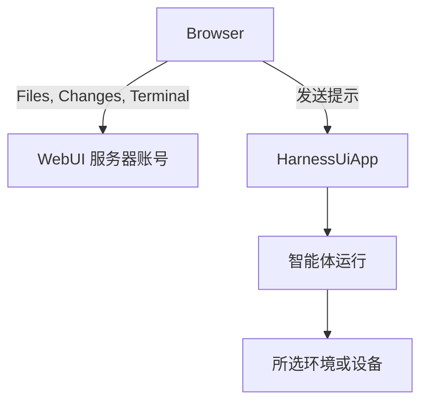

WebUI 是 Harness UI 的浏览器工作台，与 TUI 共享同一应用和已保存对话，并提供项目目录、文件与 Git 差异审查、集成终端、宿主机浏览器控制和多人协作能力。

| 我想……                       | 从这里开始                                                                                                             |
| ---------------------------- | ---------------------------------------------------------------------------------------------------------------------- |
| 快速发出第一条消息           | [启动服务器](#start-the-server)                                                                                        |
| 切换智能体、模型或工作目录   | [智能体与模型设置](#agent-and-model-settings)                                                                          |
| 实时引导运行或处理审批       | [实时引导](#tool-executions-and-immediate-steering) 与 [待处理决策](#pending-questions-approvals-and-external-results) |
| 与智能体一起审查文件或 Diff  | [文件与变更](#read-and-capture-host-files-and-git-changes)                                                             |
| 让智能体操作浏览器或标注截图 | [宿主机浏览器](host-browser.md#browse-on-the-host)                                                                     |
| 邀请协作者或调度多智能体     | [分享链接](#share-a-thread-or-project) 与 [协调器](#work-with-a-coordinator)                                           |
| 远程部署或配置反向代理       | [运行与重启 WebUI](running-webui.md)                                                                                   |

## 启动服务器

按[安装指南](installation.md)完成安装后，执行：

```bash
a13n-harness-ui webui
```

1. 等待输出 **WebUI ready**（默认地址 `http://127.0.0.1:8765`），打开终端打印的登录链接。
2. 首次启动时，在向导中连接模型，选择 **Full Control** 或 **Sandbox**，点击 **Save and start chatting**。
3. 发送一条简短测试消息，确认端到端模型连通。

如需更换端口或关闭宿主机本地能力（**Files**、**Changes**、**Terminal**、**Browser**）：

```bash
a13n-harness-ui webui --host 127.0.0.1 --port 9000
a13n-harness-ui webui --no-share-computer
```



实例登录密钥拥有完整的工作台与宿主机权限。邀请访客请使用[分享链接](#share-a-thread-or-project)；需要多用户身份和权限隔离时，请使用 [Service](../a13n-service/index.md)。

## 组织项目与日常对话

通过侧边栏菜单可在 **Projects**（按项目分组）与 **Conversations**（跨项目 **Recent** 列表）之间切换。

1. 点击 **Add project** 为项目命名并关联一个或多个服务器目录。
2. 点击 **Home** 或项目旁的 **+** 创建新对话（也支持无项目对话）。
3. 确认 **Agent & Model settings**，输入任务并点击 **Send**。

### 常用对话操作

右键点击侧边栏会话可打开与三点按钮相同的菜单。归档列表在支持相应操作的会话旁显示「恢复」和「删除」。

| 操作                  | 使用方式                                                                      |
| --------------------- | ----------------------------------------------------------------------------- |
| 发送 / 换行           | 默认按 `Enter` 发送，按 `Shift+Enter` 换行                                    |
| 添加附件              | 通过按钮选择、粘贴或拖拽文件到输入框                                          |
| 搜索对话              | 点击 **Search** 或按 `Cmd/Ctrl+F`                                             |
| 重命名/星标/归档/删除 | 打开对话的 **…** 菜单（**Delete chat** 为永久删除，请先停止活动运行）         |
| 分叉或从历史分支      | 选择 **… → Fork conversation**，或悬停某条回复点击 **Branch in new chat**     |
| 编辑已发送的消息      | 悬停在输入消息上，选择 **编辑消息**，修改后点击勾号即可在当前对话中重新发送。 |
| 浏览输入历史          | 通过左侧输入导轨跳转到历史轮次；展开 **Execution details** 查看工具调用细节   |
| 查看用量与费用        | 打开对话用量面板查看按模型汇总的 Token 与预估 USD 费用                        |

重新发送后，所选消息及其后的内容会被替换。编辑时可以保留或移除原有附件。如果对话正在运行，点击 **停止并发送** 会先停止当前运行，再发送修改后的消息。按 `Esc` 可取消编辑，当前运行不受影响。

如需仅用 `Ctrl+Enter`（Apple 设备上为 `⌘+Enter`）发送，请在 **设置 → 聊天 → 聊天输入** 中修改发送快捷键并保存。设置以 `webui.send_shortcut` 写入实例配置，连接同一实例的浏览器共用此设置。切换后，`Enter` 和 `Shift+Enter` 都会换行。在以触屏为主要输入方式的设备上，无论选择哪种模式，软键盘的 Enter 键都用于换行。

如需自定义工作台快捷键，请打开 **设置 → 聊天 → 键盘快捷键**，为各个操作选择按键并保存。默认按 `Ctrl+F`（Apple 设备上为 `⌘F`）搜索聊天，按 `` Ctrl+` `` 打开或关闭终端，按 `` Ctrl+Shift+` `` 新建终端会话。其余快捷键默认关闭。选择 **关闭** 只会禁用快捷键，对应按钮仍可使用。实例所有者的工作台从实例配置的 `webui.shortcuts` 读取这些设置。直接编辑 YAML 时，请给值 `"off"` 加上引号。

在浏览器标签页中，可用 `Ctrl+Shift+O`（`⌘⇧O`）新建聊天。浏览器通常将 `Ctrl+N`（`⌘N`）用于新建窗口，请在已安装的应用窗口或桌面客户端中选用这一组合键。macOS 浏览器也会用 `⌘,` 打开自己的设置；如需用它打开工作台设置，请切换到应用窗口或桌面客户端。编辑器保留就地查找，宿主机浏览器和终端继续接收各自的键盘输入。

消息与 Markdown 预览支持 LaTeX 数学公式（`$行内$` 与 `$$块级$$`）。共享草稿在刷新后保留，并在侧边栏显示铅笔标记直至发送或清空。

## 智能体与模型设置

点击输入框底部的当前模型，可为后续轮次切换 **Agent**、**Model**、**Thinking** 级别或 **Fast** 模式。打开 **Chat options** 可配置 **Goal**、**Coordinate agents**、**Environment** 以及 **Clear context**（清空模型上下文同时保留聊天记录与文件）。

- **线程默认模型与输入框覆盖：** 可在对话设置中指定 **Default model**；在输入框切换模型会临时覆盖当前对话的模型直至清除。
- **思考深度与快速模式：** 保持 **Default** 继承模型配置，或选择支持的思考档位与速度模式（`Fast`、`Ultrafast`）。切换智能体或模型会重置临时覆盖。
- **运行环境：** 在输入框打开 **Environments**，可在 **Sandbox**、**Full Control** 或已配置的设备/配置集间切换。

## 工具执行与实时引导

- **Steer（实时引导）：** 在智能体运行期间补充指令。默认（`input.steering_mode: immediate`）会立即中断模型生成或释放受支持的工具等待；可在[配置](configuration.md#built-in-tools-and-subagents)中改为 `queued`，等待下一个安全边界送达。
- **后台任务：** 打开 **Background work → View all** 查看或取消仍在运行的保留工具执行。
- **Stop：** 取消当前运行，并暂停自动完成唤醒直至你发送新消息。

## 待处理问题、审批与外部结果

当智能体暂停等待你的决策时，在决策卡片中处理：

| 请求类型   | 操作方式                                            |
| ---------- | --------------------------------------------------- |
| 结构化问题 | 选择选项或输入自定义文本                            |
| 工具审批   | 核对命令与参数后，点击 **Approve once** 或 **Deny** |
| 外部结果   | 在 **Provide a result** 中填入 JSON 结果            |
| 批量请求   | 完成批次中的全部条目后点击 **Submit responses**     |

### 问题与审批超时

同一批决策共享服务端倒计时（`tools.interaction_timeout_seconds`，默认 120 秒）。超时后审批自动拒绝，未回答的问题会指示智能体基于合理假设继续执行。

## 查看并捕获宿主机文件与 Git 变更

在关联项目目录且开启计算机共享时：

- **Files：** 浏览目录、预览 Markdown、搜索（`Cmd/Ctrl+F`）、重命名/上传/删除文件，或选中代码行点击 **Add to chat** 附加快照。
- **Changes：** 查看 Git Diff，并将选中的变更块直接添加到输入框。
- **Terminal：** 打开以服务器账号运行的共享终端。
- **宿主机浏览器：** 让智能体操作网页或共同标注截图，详见[宿主机浏览器](host-browser.md#browse-on-the-host)。
- **交互式 MCP 应用：** 启用的 [MCP Apps](mcp-apps.md) 会直接呈现在工具结果旁，点击 **Open App** 与 **Activate interactions** 即可交互。

## 语音输入

1. 在 **Settings → Chats → Dictation** 中选择 **Codex subscription**（或支持音频输入的模型）并开启 **Voice input**。
2. 点击输入框或 **Add to chat** 评论框中的麦克风图标开始录音，完成后点击 **Stop**。
3. 最终文本会直接插入当前光标处，不会自动发送（录音需要 `localhost` 或 HTTPS）。

## 查看收件箱

智能体通过 `post_to_inbox` 将最终结果、关键里程碑和需要你决策的事项发送到 **Inbox**。

1. 打开搜索栏下方的 **Inbox**，**Needs you** 置顶显示，其后为 **Updates**。
2. 点击条目即可原地阅读，点击 **Open in chat** 跳转到来源轮次，处理完毕后点击 **Mark as done**。
3. **需要你处理**和**更新**栏各有两个图标：**全部标为已读**清除未读标记，条目仍留在**待处理**；**全部标为已完成**将该栏条目移到**已完成**。两项操作都包含尚未加载的条目。
4. 在聊天中，可用**已发送到收件箱**卡片上的信封和勾选图标切换已读和完成状态。要重新处理已完成的条目，点击**移回待处理**。

默认情况下，在当前聊天中查看最新保存的输出、发送消息或回应决策时，之前的收件箱条目会自动标为已读。要关闭此行为，请在**设置 → 聊天 → 收件箱**中关闭**在聊天中自动将收件箱条目标为已读**（`inbox.auto_mark_read: false`）。直接打开条目仍会将该条目标为已读。**允许智能体发送到收件箱**（`inbox.enabled`）独立控制后续运行能否发送条目。

## 分享线程或项目

1. 点击线程或项目菜单中的 **Share**，选择 **Thread** 或 **Project** 范围。
2. 选择 **View only** 或 **Send messages**，并设置有效期（1 小时、1 天或 7 天）。
3. 点击 **Create link** 并 **Copy link**（密钥仅显示一次）。可在 **Manage links** 中修改权限或撤销链接。

> [!IMPORTANT]
> 仅向可信协作者提供 **Send messages** 链接——访客发送的提示会使用智能体已配置的工具和环境权限。访客无法修改设置、处理工具审批或使用本地文件/终端。

## 使用协调器

协调器专注于沟通、规划、拆解任务与结果审查，并将具体调研、实现和测试委派给独立的工作对话。

1. 选择项目后，在 **Chat options** 中开启 **Coordinate agents** 并发送目标（或通过 **Make Coordinator** 将空闲项目对话转为协调器）。
2. 在侧边栏展开协调器查看其工作对话，或点击 **New worker** 直接指派任务。
3. 通过协调器菜单中的 **Pause/Enable automatic follow-up** 控制工作对话完成后是否自动唤醒协调器。

如需在新的项目聊天中预先开启「协调智能体」，请在 **设置 → 聊天 → 新聊天 → 默认协调智能体** 中开启并保存。对应的实例配置项是 `webui.coordinator_by_default`，默认关闭。发送首条消息前，仍可在聊天选项中关闭「协调智能体」。

## 智能体协作

智能体可在各自角色范围内查看相关对话、创建新任务或向已有对话发消息：

| 工具                  | 作用                                 | 允许调用的角色           |
| --------------------- | ------------------------------------ | ------------------------ |
| `create_thread`       | 创建新的独立根对话                   | 普通根对话与 Bot         |
| `create_worker`       | 在协调器所属项目下创建受管工作对话   | 仅限协调器               |
| `spawn_subagent`      | 在当前对话树中启动子智能体           | 启用动态子智能体的根对话 |
| `send_thread_message` | 向范围内的已有对话发送后续指令或引导 | 协作范围内的根对话       |

在 **Settings → Agents → Agent creation**（`agent_creation.allowed_agents`、`agent_creation.default_agent`、`agent_creation.allowed_models` 与 `agent_creation.default_model`）中统一配置智能体创建新对话、Coordinator Worker 与子智能体时可用的智能体和模型。子智能体始终可以使用当前对话的模型。将 **Default model** 设为 **None** 后，动态子智能体未指定模型时会使用当前对话的模型。

## 观察记忆与配置工作台

- **Memory：** 在左下角导航打开 **Memory**，查看全局或项目记忆文件及自动整理记录，在 **Settings → Memory** 中调整策略。
- **Settings：** 在 **Settings** 中管理 **Agents**、**Models**、**Accounts & API keys**、**Connections**（MCP 与插件）、**Environments**、**General**（Live、通知、诊断）以及原始 **Configuration files**。文件化配置示例见[配置配方](configuration-recipes.md)。
- **通知与 PWA：** 在 **设置 → 偏好设置 → 通知** 中开启任务通知，接收范围可选 **整个工作区** 或 **仅我的运行**，同时适用于站内提醒和后台推送。“我的运行”包括同一浏览器配置中各个标签页发起的运行。其他设备可单独设置。也可以通过浏览器菜单将 WebUI 安装为桌面/移动应用。
- **远程运维：** 密钥管理、反向代理、重启与日志请参见[运行与重启 WebUI](running-webui.md)。
