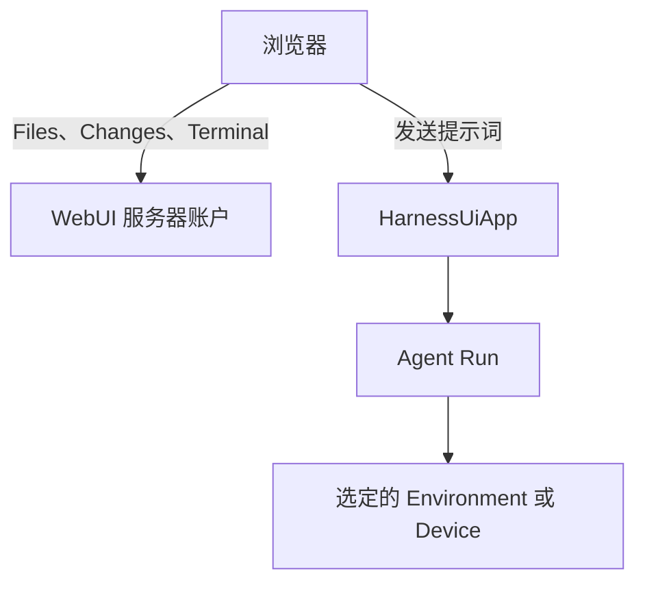

WebUI 是 Harness UI 的浏览器工作台，与 TUI 使用相同的 App 和已保存对话。先完成一次对话，再按工作需要加入 Project、文件审阅、浏览器控制和协作。

| 我想……                              | 从这里开始                                                                                                                                                                          |
| ----------------------------------- | ----------------------------------------------------------------------------------------------------------------------------------------------------------------------------------- |
| 得到第一个回答                      | [启动服务器](#start-the-server)                                                                                                                                                     |
| 更换 Agent、Model 或工作目录        | [Agent 与 Model 设置](#agent-and-model-settings)                                                                                                                                    |
| 补充指引或回答问题                  | [Steering](#tool-executions-and-immediate-steering) 与[待处理决策](#pending-questions-approvals-and-external-results)                                                               |
| 与 Agent 一起审阅文件或 diff        | [Files 与 Changes](#read-and-capture-host-files-and-git-changes)                                                                                                                    |
| 让 Agent 浏览网页，或标注看到的画面 | [Host 浏览器](host-browser.md#browse-on-the-host)                                                                                                                                   |
| 邀请他人或协调其他 Agent            | [分享](#share-a-thread-or-project)与 [Coordinator](#work-with-a-coordinator)                                                                                                        |
| 从远程持续使用工作台                | [认证](running-webui.md#authentication-and-key-retention)、[代理设置](running-webui.md#reverse-proxies-and-public-addresses)与[重启](running-webui.md#restart-or-update-the-server) |

## 启动服务器

按照[安装指南](installation.md)安装 Harness UI，再在承载工作的计算机上运行：

```bash
a13n-harness-ui webui
```

1. 等待 **WebUI ready**。默认地址为 `http://127.0.0.1:8765`。
2. 打开输出中的登录链接。如果提供了自己的实例密钥，则打开普通地址并输入该密钥。
3. 全新安装会进入设置向导，先连接 Model。选择 Full Control 或准备 Sandbox，再点击 **Save and start chatting**。[设置指南](setup.md)解释了两种选择。
4. 在打开的对话中发送 `Reply with one short sentence confirming that you received this message.`。
5. 等待回答和保存的结果。之后从侧栏重新打开该对话即可继续。

使用期间保持服务器进程运行。登录链接会在监听器启动前输出；**WebUI ready** 才表示可以接受连接。保存设置只创建空对话，因此第一条提示词也是首次模型请求检查。

需要更换端口或只使用聊天工作台时：

```bash
a13n-harness-ui webui --host 127.0.0.1 --port 9000
a13n-harness-ui webui --no-share-computer
```

计算机共享默认开启。**Files**、**Changes**、**Terminal** 和 **Browser** 使用服务器账户及其容器挂载，与 Agent 选定的 Environment 分开。`--no-share-computer` 关闭这些原生界面，保留聊天、共享草稿和在线状态。



实例登录密钥授予完整工作台与 Host 访问权限。给访客[分享链接](#share-a-thread-or-project)，不要给实例密钥。需要托管身份与权限时，使用 [Service](../a13n-service/index.md)。

## 整理 Project 并在对话中工作

点击侧边栏标题右侧、加号左边的三点菜单，可以选择 **Projects** 或 **Conversations**。选择 **Conversations** 后，标题变为 **Recent**，跨项目按最近交互时间排列会话，使用紧凑行且不显示项目副标题。发送输入和回复完成后，会话会向上移动；流式输出过程不改变排序。运行中、未读和星标继续显示，但不优先置顶。Coordinator 的 worker 仍收在所属会话下。加号变为 **New chat**。切回 **Projects** 后恢复项目分组和 **Add project**。浏览器会记住显示方式。

1. 点击 **Projects** 旁的 **Add project**，填写名称并选择已有的服务器目录，按需添加其他根目录。创建 Project 不会创建对话。
2. 通过 **Home** 或 Project 的 **+** 准备新对话。Project 提供工作目录和创建默认值，也可以不绑定 Project。
3. 打开 **Agent & Model settings**，检查选择，写下任务并点击 **Send**。
4. 查看实时回答、处理决策卡片，并在开展后续工作前检查保存的结果。

### Project 与已保存的对话

展开 Project 可查看最近更新的五个根对话。**Show more** 加载该 Project 的下一页，折叠后保留已加载页面。搜索覆盖全部保存的根对话，包括未加载页面。**Without a project**、**Unavailable projects** 和 **Archived** 分别保留无 Project、Project 已移除和已归档对话的入口。

使用对话 **…** 菜单改名、加星、分享、检查、归档或删除。在 **Archived** 恢复归档对话。**Project settings** 则修改 Project。对话不能拖到其他 Project。

对话详情和 **Archived** 中也提供 **Delete chat**。确认后，会为所有参与者永久删除该对话及其子 agent 历史。请先停止运行中的任务。删除 Coordinator 前，需要先删除其 worker 对话。Live 和 Memory 对话不可删除，分享链接访客也无权删除对话。Project 文件和独立 fork 会保留。系统会尽力清理 Thread 文件。自动后台维护在启动时和每小时运行，仅回收有明确永久删除记录的 Thread 的根检查点及其独占载荷。清理会尽力完成，失败不会停止 App。现存 Thread 的已保存检查点历史、共享的不可变历史对象、未完成的载荷，以及没有删除记录的对象仍保留在磁盘上。此操作无法撤销，也不属于安全擦除磁盘。

拖动 Project 手柄排序，或使用菜单的 Move 和 Reset。键盘操作为聚焦手柄、按 Space、用上下箭头移动，再按 Enter 保存或 Escape 取消。Project 顺序和展开状态只属于当前浏览器；改名只改变显示名称。活动工作优先显示，完成时更新导航时间。

**Home** 和 Project 的 **+** 共用一个浏览器本地新对话草稿。切换 Project 保留文字和显式选择。重载保留文字及设置，但需重新附加本地文件字节。**Send** 创建 Thread，接受成功后清除草稿。提交结果不确定时保留恢复信息，并锁定 Project 选择直到完成检查。

### 发送、引导与检查

| 操作                    | 结果                               |
| ----------------------- | ---------------------------------- |
| Enter 或 Ctrl/Cmd+Enter | 发送；输入法组合输入仍留在编辑器中 |
| Shift+Enter             | 换行                               |
| 附加、粘贴或拖入文件    | 在选定文字位置插入附件             |
| Run 期间点击 **Steer**  | 向当前操作补充指引                 |
| **Stop**                | 取消当前显示的操作                 |
| 关闭页面                | 停止查看；服务器继续工作           |

附件上传完成后再发送。点击附件可检查；上传失败时在原标签页重试或移除。提交保留文字和附件顺序。输入文件名不会成为附件，远程媒体 URL 也不会自动加载。

**Send** 会等待编辑同步。接受后只消耗提交时的快照，并发编辑仍保留。确认丢失时，先检查报告的操作再决定是否重发。Run 活动期间，**Next message** 是可编辑草稿，不是已入队的轮次。

实时输出在保存历史到达前属于临时显示。加载替代历史时，原有保存历史仍可见。失败显示简短原因和可展开详情。**Retry** 开始新轮次，发送 `Continue completing the previous task.`，后接当前草稿文字和附件。重试前先检查草稿。接受后移除已提交快照，保留并发编辑；不会恢复失败 Run。提交待处理或结果不确定时不可使用。

展开 **Execution details**、**Explored**、Shell、浏览或 **File changes**，检查参数、结果和观测到的编辑。**Awaiting result** 表示缺少结果；**Requested replacement** 表示请求的修改，而非已应用 diff。已省略的历史内容仍不可用。**Open on host** 打开服务器或容器的绝对路径并保留未保存缓冲区；当前磁盘内容可能不同于记录结果。

打开 **Details** 查看操作状态、子执行、任务、笔记、用量和配置。执行、续接保存和 Environment 清理各自报告结果。子控件对应准确的父执行。应用 Project 默认值需要审阅前后差异；发生竞争修改时保留编辑，重新审阅。

### 共享草稿

查看同一保存对话的人共享输入、已上传附件引用、Model/Thinking/Speed/Reasoning mode、Environment 和 Goal 选择。已确认同步的编辑保存在服务器上，可跨浏览器、设备和服务器重启恢复。Prompt 访客共享文字和附件，但不能读取或修改所有者的 Run 选项。

升级时，如果浏览器原有的 Model/控制选项仍匹配当前 Agent 和有效 Model，会用它们初始化尚未设置选项的共享输入框。已有共享选择或明确的重置优先。旧浏览器记录只会在同步确认状态已保存后移除。

每个输入框最多保留 512 KiB 当前编辑状态；输入和选项连续 30 天未改变后会过期，即使仍有内容，当前连接的编辑者除外。删除对话会删除保存的输入框。非空草稿保留期间，引用的未提交附件不会被普通临时文件清理删除。过期或被替换后，需要明确重新加入，再恢复浏览器输入。

未同步编辑可能因重载或浏览器崩溃丢失。撤销属于本地编辑器，接受的 Send 建立新的撤销边界。参与者显示名用于辨认协作者，不是认证身份。

### Skill 与工作检查

在输入框中键入 `$` 或 `/`，再输入名称即可查找 Skill。上下箭头选择，Enter 或 Tab 插入，按 Esc 或点关闭按钮即可收起当前词的建议，继续编辑原文。插入不会发送。已识别的 Skill 显示为拼图图标和名称，退格可整体删除。底层保留原文 `$name`，可用于新对话、保存对话和 steering。已识别名称按对应目录校验；未知名称仍是普通文字。安装或编写方法见 [Skills](skills-and-content-plugins.md)。

输入框上方的 **Tasks**、**Notes**、**Subagents**、**Processes** 和 **Tools** 可直接打开对应的活动视图，不替换草稿。计数分别显示已完成/总任务数、笔记数、活跃子代理执行数和观测到的运行中进程数。聊天栏较窄时，Notes、Processes 和 Tools 收入 **More** 菜单。关闭检查面板后，焦点回到打开它的入口。进程视图显示观测到的后台 handle、Run ID 和退出码；输出留在工具详情中。它是观测面板，不是进程控制台。

进程数量只统计观测到的运行中 handle，不含前台调用。面板从 128 条保留观测中最多展示 16 条。Run 完成或观测中断时，未完成 handle 标为不可用，不认定已退出。重载不会从保存消息重建它们。

### 查看 token 用量和估算费用

点击输入框上方的上下文用量圆环，可查看最近一次主 Agent 请求。横条显示输入、本轮输出和剩余窗口。展开技能可查看实际注入的技能名称和用量。展开工具调用可分别查看参数和返回内容的估算 token 数。如果请求记录了来源明细，展开环境上下文可查看挂载清单和项目指引，展开工作状态可查看笔记和工具执行状态，展开对话可比较用户输入、Agent 输出和摘要。挂载清单还显示它在本次请求中出现了几次、有几种不同的内容。各项按本次输入的字符占比分摊 token，包括未单独计量的媒体用量。百分比表示各项占整个上下文窗口的比例。

1. 点击侧栏折叠按钮旁的图表图标打开 **Usage**。**Project → View usage** 或 **Details → Usage → Open analytics** 会预选对应范围。
2. 选择 7、30、90 个 UTC 日，或最多 366 天的自定义范围。按 Project、根 Thread 或请求选用的模型配置筛选。
3. 对比每日汇总和 Project、Thread、模型明细。按 token 或费用排序，点击行缩小范围。
4. 用 **Refresh** 获取新保存的用量。筛选保留在 URL 中；页面不会持续更新。

总量包含保留的归档对话、Memory、Live、子 agent、辅助调用和 Coordinator worker。Project 归属跟随根 Thread 当前的 Project。Provider 回执仍可在 Thread 详情查看。

新 Run 按所选模型配置的 route 查价。聊天用量中的**按模型**显示配置路由对应的供应商和模型（例如 `anthropic/claude-opus-5-5`）。展开模型可以查看供应商返回的名称。费用是记录的模型美元估算值：**—** 表示未知，**$0** 表示已知为零，**+** 标记只含已知部分的小计。缓存 token 属于输入/输出的子集，不额外计数。未记录的历史消耗无法补回。访客链接不授予用量分析访问权限。

## 语音输入

在**设置 → 通用 → 听写**中选择 **Codex 订阅**，再选择已登录的 Codex 账号或订阅组。语音识别和 Luna 文本校正均有预设，无需 API 密钥或 Model 资源。两步从所选订阅组中独立选择账号；选择单个账号时，两步都固定使用该账号。仅登录账号不会启用听写。展开**高级语音转写设置**，可以从受支持的 Codex 模型中更换校正 LLM，并调整上下文预算（默认前后各 2,000 词）。也可以选择已有的音频输入 Model，使用单次请求完成转写。

在聊天输入框或「添加到聊天」批注中点击麦克风，再点击停止。后端结合草稿、聊天标题及附近对话正文生成最终文本。Codex 订阅听写先执行 ASR，再进行文本校正，中间文本不显示。最终片段会一次性插入输入框当前选区，无需预览或确认，也不会自动发送消息。文本校正失败时，插入原始转写并显示提示。语音识别失败后，重试会使用同一段录音和已捕获的上下文；取消则丢弃结果。浏览器录音需要 localhost 或 HTTPS。

## Agent 与 Model 设置

点击输入框底部当前 Model，选择 Agent、Model、Reasoning mode、Thinking 等级或 Speed。每项在同一弹层内展开，Default 恢复继承设置。桌面和手机均通过 Chat options 使用 Goal、Coordinate agents、Environment 和 Clear context。

需要修改 Thread 默认 Model（包括终端 UI 使用的默认值）时，打开对话配置并设置 **Default model**。**Follow Agent model** 清除它。跟随该保存值时输入框显示 **Thread default**；改选输入框 Model 则改变 Run 草稿。配置检查会区分下次 Run 选择与当前或已保存工作的捕获选择。

新聊天从创建时的默认设置开始。未完成的新对话草稿在当前浏览器保留选择；已有聊天从服务器恢复共享输入框设置。同一 Agent 下，手动选择的 Model 优先于对话默认模型，即使之后修改了对话默认模型也是如此。清除输入框里的模型选择后，会跟随当前对话默认模型；如果对话没有指定模型，则跟随 Agent 的模型。

**Chat options → Clear context** 让下一条消息不带先前模型消息、笔记、任务或保存的 Agent 工作状态开始，同时丢弃待处理问题和审批。聊天历史、文件、设置和未发送输入保留。

### 下次 Run 的 Thinking 设置

1. 打开 **Agent & Model settings → Thinking**。
2. 保留 **Default** 以继承 Model 配置，或选择支持的 effort 等级、token 预算预设。
3. 发送下一条消息，再在 **Configuration** 检查捕获的请求。

选项取决于 Model 和安装的适配器。仅支持时显示 Off；最低 effort 不一定表示 Off。未知模型保留 Default 并说明原因。禁用预算或自定义设置冲突应在 Model 配置中解决。Thinking 不改变输出 token 上限。

共享输入框按会话保存思考强度，可跨浏览器和服务器重启恢复。刷新页面或重新打开聊天后，下次发送仍会使用所选强度。更换 Agent 或实际使用的 Model 后，强度会恢复为默认值。它不编辑 Model 资源，也不影响 steering 或正在运行的工作。

### 后续 Run 使用的环境

1. 打开输入框中的 **Environments**。
2. 在 **Local · Harness server → Local mode** 选择 **Sandbox**、**Full Control**、已配置 profile 或 **Follow conversation local mode**。
3. 一起检查本地目录、Device 绑定和默认工作位置。应用草稿后再发送。
4. 用 **Use conversation defaults** 清除临时覆盖。关闭而不应用会丢弃草稿。

Full Control 使用服务器账户。Sandbox 需要 Host 支持的隔离启动器和原生运行时；准备失败会保留为错误，不会切换到 Full Control。Device 工作目录用于路由操作，不限制 daemon 的文件系统权限。

共享输入框已应用的 Environment 选择会随之后的 Send 发送，直到重置或草稿过期。其他持有实例密钥的参与者看到同一选择；保存的 Thread 默认值和活动 Run 保持不变。**Steer** 和延后回答保留活动或挂起 Run 的 Environment。新 subagent 继承捕获的 Environment；恢复的 subagent 保留各自对话配置。

用 **Configuration** 对比保存默认值和 Run 捕获的 Environment。不可用 profile 必须明确替换。新对话草稿在浏览器本地保留选择；已有对话的选择由服务器保存并共享。切换模式不会复制或隔离现有 Project 文件或历史。

## Fast 模式

在 **Agent & Model settings** 选择 **Fast**，或在支持的 Codex 连接上选择 **Ultrafast**。再次点击选中的按钮请求 Off。**Use model setting** 继承 Model 设置；**Provider default** 与 Off 不同。

共享输入框会为这个会话保存所选速度。更换 Agent 或实际使用的 Model 后，速度会恢复为默认值。它不影响 steering、Thinking 或保存的 Model 配置。Context / Cost / Cache / Time 一行显示当前或已保存 Run 捕获的 **On**、**Off**、**Ultrafast** 或 **Default**；短横线表示不可用。

服务器为支持的 OpenAI/Codex、直连 Anthropic 和 Gemini 连接提供原生速度控件。被禁用的选项会说明限制。实际效果取决于 provider 资格和收费；请求速度模式不保证更快执行。

## 工具执行与即时 steering

Agent 工作时，用 **Steer** 修正方向。默认即时 steering 会中断主模型生成，或释放支持工具的等待。工具审查和校验先完成；批次返回结果、保留执行回执，或挂起等待审批后，Agent 才继续。支持的工具仍由原有执行方继续运行一次。

接受成功表示指引已入队。不支持的工具会在正常执行边界尽力交付。启动或恢复期间可能等待最多五秒以准备原生 steering；超时或 Run 已完成时拒绝请求。根和子 steering 共用 `input.steering_mode`；在[配置](configuration.md#built-in-tools-and-subagents)中选择 `queued`，即可等到下一个安全边界。

打开 **Work → Tools** 检查执行来源 Run/调用、状态和记录，或取消活动的保留执行。读取状态不消耗结果。Agent 通过 `tool_execution_result` 或 `tool_execution_wait` 获取结果。

通用工具的[自动后台执行](configuration.md#built-in-tools-and-subagents)需显式开启。支持进程的 Shell 在两种模式下都会在前台等待到期后让出；即时 steering 可以提前释放等待。Shell handle 也有独立进程视图。

**Stop** 取消对话，并在新用户输入前禁止完成事件自动唤醒。保留工具需通过各自 **Cancel** 单独取消。取消不保证远端回滚。保留记录和结果跨 App 重启存续。结果在首次消费后一小时过期，且不超过完成后一天。原外部 daemon 和 Session 存活时，Envd Shell 工作可以恢复；其他未完成的进程内调用标为 `lost`，不重放。

## 待处理问题、审批和外部结果

在待决策卡片中回答：

| 请求           | 操作                                                          |
| -------------- | ------------------------------------------------------------- |
| 结构化问题     | 选择答案，或输入允许的自定义文字                              |
| 单项审批       | 审阅动作后选择 **Approve once** 或 **Deny**；按需填写拒绝原因 |
| 可编辑审批     | 仅在提供 **Edit arguments** 时修改参数                        |
| 外部结果       | 在 **Provide a result** 中以 JSON 输入真实结果                |
| 多项或混合请求 | 完成每项，再点击 **Submit responses**                         |

Shell 审批展示风险评估、原因、命令、cwd 和挂载点；环境变量值隐藏。绑定的 Shell 参数不能替换。对不合适的命令应拒绝并说明，让 Agent 提出新命令。服务器省略参数的请求无法批准；仅缺少风险评估不阻止决策。

填写外部结果不会在浏览器执行工具。结果是 `null` 时明确输入；空编辑器表示未回答。审批授权执行，不表示执行成功。确认丢失时先检查当前请求再重试。过时或竞争响应会刷新卡片。

回答后，问题短标题和记录的选项继续显示。展开 **Questions & details** 可重看选项和自定义文字。

### 问题与审批超时

每批新根请求共用一个服务器管理的响应窗口，由 `tools.interaction_timeout_seconds` 控制，默认 120 秒。倒计时结束前提交完整表单；未提交的选择不算回答。

超时后以明确失败结果继续。未回答的问题会让 Agent 尽可能作合理假设继续；审批会被拒绝。切换页面、刷新或关闭浏览器不停止计时，其他参与者也可能先回答。

服务器关闭或归档会取消计时器。重启后保留请求仍可手动回答，但不重放倒计时。超时处理未能启动或保存时，先检查操作再重试。TUI 使用独立的逐题倒计时。

## 浏览对话输入

通过左侧输入导航条，或窄屏上的 **Input history**，重看普通输入。选择旧输入加载对应保存历史。**Load later messages** 和 **Back to latest** 返回较新工作，不重新提交；steering 留在原轮次。

输入、已应用 steering 和 Agent 文字按时间排列。**Execution details** 将其间活动分组并默认折叠；移动端打开全屏阅读器。计数只包含该段已加载调用。缺失内容自动加载，失败时可用 **Retry loading turn**。待处理决策仍可在折叠详情外操作。

## 保存的输出

重新打开对话可读取保存历史和保留附件。子结果位于检查面板，历史反馈捕获仍是普通附件。查看或展开历史只影响视图，不改变 Agent 上下文或执行。

### 数学公式

消息和 Markdown 文件预览支持 LaTeX 数学公式。行内公式使用 `$E = mc^2$`。块公式的 `$$` 分别独占一行：

```text
$$
\frac{1}{2} + \sqrt{x}
$$
```

标记为 `math` 的代码围栏也会渲染为块公式。较长的块公式可横向滚动，并支持键盘操作。无效公式保留可读源码，复制消息时保留原始 Markdown。字面美元符号可写为 `\$`；普通行内代码和代码围栏仍显示源码。

## 交互式 MCP 工具结果

已选择启用的 [MCP Apps](mcp-apps.md) 显示在真实工具结果旁。保存历史中先点击 **Open App** 才执行 App HTML，再通过 **Activate interactions** 启用按当前策略检查的服务器操作。

审批、选定上下文、消息确认和外部链接确认均留在 iframe 外的可信卡片中。打开不会重复原工具调用，关闭 View 会保留服务器连接。设置及远程部署所需独立沙箱 origin，见 [MCP Apps 指南](mcp-apps.md)。

## 读取和捕获 Host 文件和 Git 变更

使用具有服务器目录的 Project，并保持计算机共享开启。查看 Git 还需要 Git。这些面板操作监听器 Host，即使 Agent 正在远程 Device 工作。

1. 打开 **Files**，选择根目录、浏览文件夹并打开文件。调整大小或 **Expand drawer** 获得更多空间。
2. Markdown 默认打开 **Preview**，选择 **Text** 查看只读源码。Ctrl/Cmd+F 查找文字，Ctrl/Cmd+G 跳行。
3. 选择源码行后点击 **Add to chat**；不选择行则捕获完整文件。
4. 审阅共享草稿中的附件，加上问题，再发送或 steer。之后的 Host 编辑不会改变已捕获字节。

通过条目菜单可重命名、移动、上传替换文件或确认删除。打开文件后可下载。筛选只覆盖已加载路径，不递归搜索。**Back to files** 返回列表。

| 内容                       | 限制或行为                          |
| -------------------------- | ----------------------------------- |
| 文本预览                   | 完整、无 NUL 的 UTF-8，最多 512 KiB |
| 上传、整文件捕获、图片预览 | 最多 10 MiB                         |
| 更大下载或音视频           | 流式传输；按需开始播放              |
| 字节访问链接               | 30 分钟过期，刷新后续期             |

PDF 和 PPTX 可逐页预览。XLSX、XLS 和 ODS 可切换工作表，每张表最多显示 200 行、40 列的单元格值。文档预览上限为 16 MiB。SVG 默认显示图形，可切换到只读源码。代码预览沿用文档站的语法配色。ZIP、TAR 等压缩包及旧版 PPT 会进入内容页，提示不支持预览，可下载原文件。

刷新可查看磁盘上的最新版本。

审阅变更的步骤：

1. 打开 **Changes**，选择已暂存、未暂存或未跟踪内容。
2. 阅读 unified diff，包括标题和无末尾换行提示。新旧文件行号栏辅助导航；选中的 patch 行决定捕获范围。
3. 点击 **Add to message** 捕获已审阅 diff，发送前检查草稿。

已暂存比较 HEAD/index，未暂存比较 index/worktree，未跟踪按新文件比较。未暂存/未跟踪的新侧行可打开当前工作文件；暂存和删除侧不假定匹配当前内容。重命名、冲突、二进制、无首个 HEAD 及仓库身份仍可检查。Git 错误保持为错误；Files 也可用于仓库外。

Changes 只读：stage、commit、discard 或 worktree 操作需在 shell 中明确执行。之后返回面板或刷新。观测不是递归 watcher，也不记录各变更由哪次 Run 造成。

Agent 的 `/threads/{root_thread_id}?native=files&native_path={URL-encoded absolute Host path}` 链接打开 Files；普通路径和 API URL 不会。**Share explorer view** 复制不含实例密钥的同实例链接。参与者目录的 **Open page** 只打开一次对方选定视图，不持续跟随。这些链接仍要求实例访问权限。

## 共享原生终端

原生终端需要 POSIX Host 和计算机共享。Windows 会报告 PTY 不可用；Files 和 Git 仍可独立使用。

1. 打开具有配置根目录的 Project。用 **+ → Terminal** 打开终端标签页，再选择 **New terminal**，或对文件夹使用 **Files → Open terminal here**。
2. 等待创建者的控制请求被确认再输入。其他查看者使用 **Take control** 或 **Take over input**。
3. 用 **Release control** 让其他人输入，同时保留 shell 运行。只有控制者可以调整尺寸。
4. 需要为所有人停止共享 shell 及其作业时，选择 **End session** 并确认。

Terminal 与 Files、Changes 和 Browser 共用资源标签栏。在 Side by side 布局中显示在 Chat 旁边，在 Tabs 布局中占满内容区域。只打开标签页不会启动 shell。New terminal 创建会话，不向其他会话插入 `cd`。显示的初始目录不追踪后续 shell `cd`。切换 Project 隐藏并断开旧视图，不停止会话；无 Project 关联的会话仍可通过原生 API 使用。

**Disconnect**、切换到其他标签页、关闭 Terminal 标签页、折叠面板、Settings 和关闭页面都只断开连接，不结束进程。重新打开时只读连接；明确 Disconnect 后使用 **Reconnect**。重连不重复按键。输入为 UTF-8，粘贴上限 16 KiB，不支持旧式二进制鼠标报告。

输出最多保留服务器 1 MiB 字节和本地 2,000 行，缺口会说明。渲染缓慢时暂停连接。Ctrl/Cmd+F 打开 **Find in output**，也可使用 **Copy selection**，或用 **Add selection to message** 添加带来源的片段。后者只加入草稿；**Return to conversation** 聚焦草稿。HTTP 链接单独打开，明确的绝对 `path:line` 链接打开 Host 文件。

已退出会话在关闭前仍可检查。创建或关闭结果不确定时，先刷新会话列表再操作。App 重启不恢复终端。原生操作、焦点返回或 Run 完成后的 Files/Changes 刷新会保留选定路径和未保存文字。

## 使用 Host 浏览器

此流程见[使用 Host 浏览器](host-browser.md#browse-on-the-host)。

### 首次设置

此流程见[使用 Host 浏览器](host-browser.md#first-time-setup)。

### 安装 Host 组件

此流程见[使用 Host 浏览器](host-browser.md#install-host-components)。

### 探测并选择可执行文件

此流程见[使用 Host 浏览器](host-browser.md#detect-and-select-executables)。

### 启动与控制浏览器

此流程见[使用 Host 浏览器](host-browser.md#start-and-control-the-browser)。

### 截图与标注

此流程见[使用 Host 浏览器](host-browser.md#capture-and-annotate-a-screenshot)。

## 分享 Thread 或 Project

1. 点击 Thread 麦克风旁的 **Share**，或 Project 菜单的 **Share**。
2. 选择 **Thread** 或 **Project**。Project 访问包含当前/未来 Thread；Thread 移出后访问结束。
3. **View only** 可阅读历史、附件和实时输出；**Send messages** 可共享编辑、上传、发送和 steering。可发送访客能按 Project 默认值创建 Thread。
4. 选择一小时、一天或七天，再点击 **Create link**。
5. 关闭前 **Copy link**，秘密只显示一次。用 **Open shared view** 检查访客视图。
6. 在 **Manage links** 修改权限并 **Save**，或 **Revoke** 撤销。

只给信任的人可发送链接。其提示使用 Agent 现有工具和 Environment 权限，包括跨对话工具。链接范围限制浏览器/API 访问，不隔离 Agent 执行。

访客不能配置实例、回答审批、管理链接或使用原生 Files/Terminal。实例 owner 负责审批。任务、笔记和 subagent 输出仍可检查。同一浏览器内访客访问与 owner 登录分开。撤销/过期阻止后续访问，但不取消已开始工作。

## 与 Coordinator 协作

1. 选择 Project，在输入框开启 **Coordinator**。
2. 发送目标。对话成为 Coordinator；**Goal** 仍是独立[选项](everyday-use.md#work-toward-a-goal)。
3. 展开 Coordinator 侧栏行，检查 worker 及其独立历史。
4. 直接分配工作时，在操作菜单选择 **New worker**，在该 worker 对话发送任务。

Coordinator 默认把实质性的调查、实现和测试委派给 worker，自己侧重与你交流、规划、协调和审查结果。简单问题、轻量检查和审查仍在 Coordinator 对话中完成。紧密关联的工作可以持续交给同一个 worker；委派不要求并行执行。如果你要求 Coordinator 亲自执行，它会遵循你的选择，不委派，也不要求你再次确认这一选择。这是 Agent 指令，不是工具权限限制。

每个 Project 可有多个 Coordinator。角色永久保留，包括之后发送失败的情况。已有对话空闲、未归档、绑定 Project 且无待决策时可用 **Make Coordinator**。转换保留 URL/历史/设置。Worker 不能升级，旧对话和 Sidekick 不会被收编。

Worker 是有人类控件的根对话，不是 Subagent。**Managed by · name** 固定 owner 和 Project。创建前移除此标签可变为独立草稿，不丢文字、附件或选择；创建后固定。创建结果不确定时先检查再重试。Worker 位于 owner 下，搜索标为 **Coordinator worker**。

在 Coordinator 菜单使用 **Pause automatic follow-up** 或 **Enable automatic follow-up**。它控制生命周期通知，不控制 worker 执行。新 Coordinator 默认开启，迁移保留原设置。Agent 创建的 worker 使用 Sidekick 默认值，手动创建使用输入框选择。Sidekick 默认值不控制 Coordinator 身份或自动跟进。

自动跟进会在首次直接分配 worker 任务，以及所属工作完成、失败、取消或等待输入时尝试交付。Coordinator 先检查保存结果再接受完成。通知没有重试/重启重放。关闭浏览器保留工作；停止 Coordinator 不停止 worker，也不暂停之后通知。决策截止时间仍生效。

## Agent 协作与 Sidekick

通过协作工具的内联对话链接检查其他根工作。Agent 会收到 Thread ID 和捕获的 Project/根目录；新根收到任务和回信地址，不继承请求方完整历史。

| 根角色      | Agent 协作范围                                            |
| ----------- | --------------------------------------------------------- |
| 普通根      | 其他根，不含托管 worker                                   |
| Coordinator | 自己的 worker；新根保持在其 Project                       |
| Worker      | 查看自己/owner、向 owner 发消息、用 Subagent 做任务内委派 |

限制应用于模型工具，不限制人类 WebUI 访问。Worker 不能创建根、控制 owner 或访问兄弟 worker。

普通根的 `create_thread` 可以保留 Project、选其他 ID 或用 null。`agent_id` 选择 Agent；没有 Sidekick 或显式 Agent/Project 变化时继承来源选择。`model_id` 只覆盖首个 Run，`run_thread` 可覆盖后续 Run。`send_thread_message` 对活动目标发送 steering，对空闲目标开始一轮。接受不证明已处理或保存交付。失败/不确定发送先检查再重试；归档/Subagent Thread 和待决策未解决的 Thread 不能接收新轮次。

在 **设置 → 常规 → 子 Agent 默认值** 配置 Sidekick Agent 和 Model。Sidekick 在 WebUI 中始终可用。**Inherit current agent** 和 **Use agent model** 选择继承；旧的 `sidekick: null` 现在也采用这些默认值。选定 Model 成为新 Thread 后续默认值。保存影响未来捕获和根，不影响活动 Run/现有 Thread，也不会自行开始工作。见 [Sidekick 配置](configuration.md#webui-sidekick)。

## 创建对话副本

1. 打开独立对话 **…** 菜单，选择 **Fork conversation**。
2. 检查打开的副本，再发送下一条指令。

Fork 不发起 Model 请求，复制保存历史、笔记、任务、设置和 Thread 自有文件。活动来源提供最后保存检查点。外部 Project 目录、远程目标和沙箱仍是共享资源。

要从较早的回复继续，悬停到该回复并选择**从这里新建分支聊天**。后续消息正在生成时也可以从已结束的回复分支。聊天空闲时，选择**编辑消息**可以修改普通文本消息，点**发送**后在新聊天中生成回复。副本按顺序编号，例如「白昼咖啡 (2)」「白昼咖啡 (3)」。

Coordinator、worker、Subagent Thread 和内部 Memory/Live Thread 不能 fork。创建结果不确定时，先检查对话列表再重试。

## 为重要对话加星标

在悬停/聚焦行选择 **… → Star conversation**；触屏直接显示菜单。实心星保持可见，**Unstar conversation** 移除。星标是实例共享状态，更换浏览器/重启后保留。

星标根排在五个普通 **Recent** 行前；运行中和未读 **New results** 优先且不重复。星标不改变访问时间。归档隐藏对话但保留星标，worker 仍嵌套于 Coordinator。

## 找回尚未发送的输入

点击搜索下的 **Drafts**，查找留有未完成共享输入的保存对话，包括折叠 Project 和较旧根。每行显示 Project；普通导航也会在运行/未读状态旁标记 **Draft**。

打开对话不清除标记。成功发送或移除文字/附件后才清除；并发新增仍保留标记。待上传/失败上传计入，空白和设置变化不计。归档移除入口而不丢草稿。

同一服务器运行期间，可重新找到已同步共享草稿；重启会丢弃它们。尚未创建的对话则从 **Home** 回到独立浏览器本地草稿。

## 查看 Memory

通过左下角 **Memory** 查看启用的 Global 或 Project memory。中间显示整理历史、实时工具活动和 **Inspect & usage**。每次自动整理 Run 使用新的模型上下文；历史和用量在重启后保留。

右侧显示作用域当前文件，即使还没有整理 Run。打开不开始工作。查看器只读且独立于计算机共享。编辑时通过服务器 Host 访问修改所选根配置旁的 `memory/`。

在 **Settings → General** 关闭自动整理保留查看器，关闭 Memory 隐藏它。两者都不删除文件或历史。

## 配置工作台

首次使用两步向导，修复使用 **General → Setup & diagnostics**。Model 连接保存服务器凭据；Workspace 选择 Full Control 或通过检查的 Sandbox，以及可选服务器 Project。**Set up later** 保留非秘密选择，秘密不持久保存在浏览器中。保存响应丢失后先用 **Check saved setup and open conversation**，再决定是否重试。

后续修改入口：

| 设置区域                | 配置内容                                            |
| ----------------------- | --------------------------------------------------- |
| **Agents**              | 指令、Model、Capabilities、subagent；浏览已安装能力 |
| **Models**              | Provider/model 设置                                 |
| **Accounts & API keys** | 服务器凭据                                          |
| **Connections**         | MCP、可复用 agent 插件、对话连接默认值              |
| **Environments**        | 本地默认值、Device、profile/extension、运行时准备   |
| **General**             | Live、Memory、Sidekick、通知、设置/诊断             |
| **Configuration files** | 查看或编辑底层文件                                  |

表单/YAML 共用草稿。**Save changes** 校验并替换整个文件。标签页内导航保留未保存编辑，重载不保留。检测到外部变化会保留未保存草稿，文件保存仍以后写覆盖前写。MCP 源文本隐藏，替换也会覆盖不可见字段和文件中全部资源。活动 Run 保留捕获配置。完整文件设置见[配置配方](configuration-recipes.md)。

打开 **Project settings** 编辑服务器目录和创建默认值。开启计算机共享后，在本机直连的 macOS 或 Windows 上，点 **Add folder** 会打开系统目录选择器。其他连接可浏览服务器目录，关闭共享时可手动输入路径。保存后生效。新 Thread 使用保存默认值；已有 Thread 保留选择，除非明确修改。Default、None、Custom 不同，预览展示保存值/来源，不测试 Model。

点击右上角生成的协作名称并 **Save name**，修改当前浏览器标签。在线指示打开按标签页区分的参与者目录。名称和 presence 是实时协作元数据，不是 provider 身份。后台标签页与前台关注可区分。

### 添加或移除工作环境

1. 在 **Settings → Environments** 添加 Device 身份、HTTP 或反向 WebSocket 传输及凭据引用。**Check connection** 读取实时描述；保存可离线完成。
2. 在 **Project settings → Environments** 或 **Conversation details → Configuration → Change next Run selections** 选择 **Add environment** 和 Device。
3. 输入已知绝对目录或浏览在线 Device，再 **Use this directory**。**Add directory** 向该环境增加路径。
4. 选择 **Default working directory** 并保存。移除默认目录前先替换默认值。

Project 可混用本地/远程目录，也可只有远程目录；始终至少需要一个工作目录。Device 浏览不依赖计算机共享。选择 Device 不会重定向 Host Files/Changes/Terminal 面板。

移除未使用的 Device/自定义 profile 时选择 **Forget**。先沿对话框引用链接修复当前默认值。Forget 删除本地配置，即使 Device 离线或 provider 不可用；远程文件和保存历史保留。内置资源不能 forget。

已有 Thread 保留旧选择。删除的选项显示 **Not configured**，需在 **Change next Run selections** 明确修复，必要时替换默认值。此前 Run 捕获/续接不变。YAML 方法见 [Device 配置](environments-and-projects.md#add-device-bindings)。

## 当前浏览器中的新结果

打开或启动对话会在当前浏览器关注它。未读的保存成功结果出现 **New result** 圆点，包括最近五行之外的 Project 对话。后续运行/失败不会清除。

在聚焦、可见的标签页滚到历史底部阅读保存结果，才清除圆点。只选择对话或看到实时文字不够。旧快照不能清除新结果。归档圆点留在 **Archived**。

关注/已读状态属于此浏览器和站点地址，并在标签页间同步。重新打开刷新关闭期间保存的关注结果；首次访问把已有结果视为历史。清除站点数据移除此状态。这些圆点不需通知权限，与系统推送独立。

## 任务通知

在通知设置的**通知范围**中选择**全部**或**只 Bot**，默认为全部。此选项同时筛选当前浏览器的站内提示和后台通知，不影响其他设备、未读标记或主动发送的测试通知。只 Bot 包含 Bot 消息和需要你回应的通知，不包含普通聊天的任务结果。

Bot 发布的消息显示**Bot 给你发了消息**和实际消息预览。选择**查看消息**或点击系统通知即可打开 Bot。同一轮运行中的不同消息会分别通知。需要输入时显示 **Bot 需要你的回应**，点击后在 Activity 中处理。系统通知标题使用当前浏览器最近同步的显示语言，消息正文保持原文。

1. 在接收设备上，通过稳定 HTTPS 地址打开 **Settings → General → Notifications**。
2. 选择 **Allow notifications** 或 **Enable background notifications**，接受浏览器提示。
3. 确认 **Enabled on this device**，再点击 **Send test notification**。
4. 保持 WebUI 页面可见以更新设备活动，发送任务，并在离开 WebUI 后检查系统提醒。

服务器必须保持运行并能连接浏览器推送服务。无需独立推送账户或手动 VAPID 设置。每台设备单独启用；升级后仅有旧浏览器权限不会开启后台交付。测试确认推送服务接受，不确认屏幕显示。

系统通知覆盖全部根对话的完成、失败和输入请求，包括未访问对话，但不含归档根。真实回答/问题/错误预览可能出现在锁屏。主动启用的设备在活动后六小时内有接收资格；任意可见 WebUI 页面大约每分钟续期，不要求聚焦或输入。

打开的页面还显示应用内通知，不受六小时或访问历史限制。当前正在查看的会话保持安静，包括 Bot：该会话的完成、消息、失败和输入请求不会弹出应用内提示，其他会话仍会通知。这不改变未读标记或系统 Push 投递；已抑制的通知不会在切换页面后补弹。Web Push 是唯一系统通知路径；不支持或推送不可达时仍有应用内通知。推送尽力交付，丢失横幅不重放。重新打开对话查看权威结果。

Android Chrome 需检查站点和系统权限、省电/勿扰限制以及推送服务连通性。iPhone/iPad 使用受支持的主屏幕 Web App，并在其中启用通知；普通浏览器标签页不够。远程普通 HTTP 不受支持，本地回环可用于开发。安装和菜单细节取决于设备。

| 症状                                 | 下一步检查                                                                  |
| ------------------------------------ | --------------------------------------------------------------------------- |
| **Browser push registration failed** | 浏览器无法取得订阅；检查原错误、推送连通性、VPN/防火墙及 Wi-Fi/移动网络差异 |
| 测试接受但无提醒                     | 站点/系统权限、Focus/勿扰、设备网络与电源策略                               |
| **Checking subscription…**           | 等待已保存订阅同步                                                          |
| **Subscription needs attention**     | 刷新/测试失败；回到前台或重连，再检查结果                                   |
| endpoint 被拒绝/过期，或签名密钥变化 | 使用 **Reconnect background notifications**                                 |

升级后重载并保持更新页面可见。订阅/签名密钥在服务器重启后保留；90 天无刷新/活动的注册过期，与六小时资格独立。安全备份数据根目录保留此身份。

可行时先关闭 **Enable browser notifications** 再清除站点数据。它移除本浏览器订阅，不影响其他设备和应用内通知。退出登录也尝试清理；两端都清理失败时阻止站点通知权限。只清除存储不等于服务器退订。

## 安装为应用

打开 **Settings → General → Install Harness UI**，使用提供的 **Install app** 或浏览器安装/添加到主屏幕操作。支持时，Safari 在 iPhone/iPad 提供 **Share → Add to Home Screen**，在 Mac 提供 **File → Add to Dock**。

使用 HTTPS 或回环，并保持协议、主机名、端口稳定。手机通过局域网普通 HTTP 访问不具有相同安装支持。更改 origin 可能需要重新安装和登录。安装窗口仍需要服务器，不增加离线执行或未保存编辑器恢复。后台通知需另行开启。

## 认证与密钥保存

此流程见[运行与重启 WebUI](running-webui.md#authentication-and-key-retention)。

## 反向代理与公开地址

此流程见[运行与重启 WebUI](running-webui.md#reverse-proxies-and-public-addresses)。

## 重启或更新服务器

此流程见[运行与重启 WebUI](running-webui.md#restart-or-update-the-server)。

## 服务器日志与关闭

此流程见[运行与重启 WebUI](running-webui.md#server-logs-and-shutdown)。

## 监听器与应用生命周期

此流程见[运行与重启 WebUI](running-webui.md#listener-and-application-lifetime)。

## 容器与安装资源

此流程见[运行与重启 WebUI](running-webui.md#container-and-installed-assets)。

## 选项与职责

此流程见[运行与重启 WebUI](running-webui.md#options-and-ownership)。
