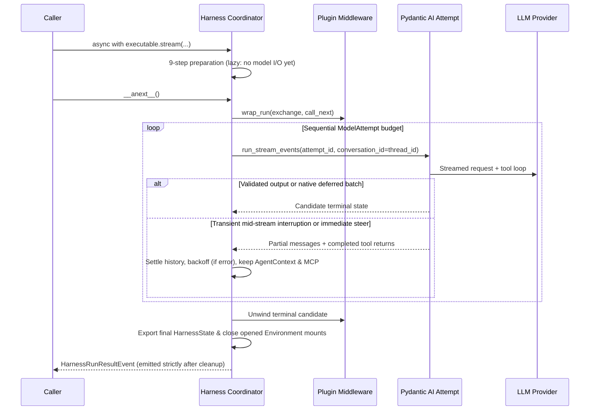

This page explains what happens inside `a13n-harness` when you build an `ExecutableAgent` and drive `run()`, `stream()`, `live()`, or `compact()`. For API usage, start with [Agents and Runs](agents-and-runs.md) and [State and resume](state-and-resume.md).

## Build-time compilation vs. nine-step Run preparation

`HarnessBuilder.build()` compiles an immutable `AgentDefinition` once: it resolves enabled plugin factories, validates custom declarative `Capability` types, pins a `PricingCatalog` (unless an authored cost Capability overrides it), and invokes Pydantic AI's `Agent.from_spec()` once so concurrent Runs share static schemas without rebuilding them.

When `executable.stream(...)` (or `run(...)`) is entered, preparation executes nine deterministic steps **before** any model or tool network I/O occurs:

1. **Validate Environment inputs:** Normalizes `environment`, `environments`, and `default_environment` (or `RunBindings.environment`) without opening connections.
2. **Allocate identities:** Generates a public Harness `run_id` and preserves `previous_state.thread_id` (or mints a new `thread-...` ID).
3. **Register inert mounts:** Assigns opaque mount IDs to `EnvironmentSource` objects with Run/Thread lineage metadata.
4. **Publish initial mount snapshot:** Exposes mount routes atomically while leaving underlying sandboxes unopened until a tool or `input_factory` touches them (**lazy activation**).
5. **Run `input_factory`:** Executes `RunInputFactory(RunPreparationContext)` at most once if supplied.
6. **Normalize semantic input:** Hydrates ordered text/media content and applies any pending `compaction_result` or `DeferredToolResume`.
7. **Construct `AgentContext`:** Freezes `thread_id`, `AgentContextState`, the bound `Environment` facade, `RunConfiguration`, `RequestContext`, and built `SubagentCollection`.
8. **Bind per-Run plugins:** Freezes `BoundPluginContext` and resolves per-logical-Run `ContextualMCP` replacements once so internal retries never re-run effectful MCP factories.
9. **Assemble middleware chain:** Prepares outer `AbstractHarnessPlugin.wrap_run()` hooks; actual execution begins lazily on the caller's first stream iteration.

## Logical Run vs. internal `ModelAttempt` loop

One logical Harness Run owns a single public `run_id`, `AgentContext`, Environment scope, plugin invocation, and `RunUsage` ledger, yet may execute **multiple sequential `ModelAttempt` iterations** internally to handle transient stream drops, context-overflow compaction, or immediate steering:

Each `ModelAttempt` passes a unique upstream attempt ID to Pydantic AI while keeping `conversation_id=thread_id` constant for telemetry correlation and gateway prompt-cache affinity. Crucially, Hosts (such as Service) map one logical Harness Run to **one** durable worker attempt—internal `ModelAttempt` retries never spend Host attempt budgets or re-execute already-completed tool calls.

## Immediate steering and Host-held tool executions

While `steer(..., immediate=False)` queues user guidance for the next model turn boundary, strict immediate steering (`immediate=True`) requires `RunBindings.tool_execution` (`ToolExecutionRuntime`) and branches atomically on the active execution phase within a 5-second readiness window:

| Active phase during `steer(immediate=True)` | Internal handoff behavior                                                                                                                                                                                                                 |
| ------------------------------------------- | ----------------------------------------------------------------------------------------------------------------------------------------------------------------------------------------------------------------------------------------- |
| **Primary model generation**                | Cancels and drains the active `ModelAttempt`, settles usable partial assistant output into history, and starts the next `ModelAttempt` with the steer.                                                                                    |
| **Tool review, validation, or execution**   | Keeps the native attempt alive, releases foreground waits on supported calls (`exec-*` Shell and top-level CodeAct), and records retained execution receipts so the model sees steering immediately without killing background processes. |

Immediate steering never consumes the `ModelRecoveryPolicy` failure budget. Unincorporated steering messages are also snapshotted inside the `steering` Capability namespace on `export_state()`, preventing lost guidance across graceful restarts.

## Prompt-cache prefix stability and context projection

Modern LLM providers cache KV prefixes across turns within a conversation; mutating historical messages or injecting volatile timestamps at the top of system prompts destroys cache hit rates. Harness protects prefix stability through three mechanisms:

1. **Append-only `ModelContextBlock` projection:** Capabilities implementing `AbstractModelContextCapability` emit keyed blocks (such as `REQUEST_EPILOGUE`). Calling `request.history.matches_latest(block)` skips re-emitting unchanged workspace outlines or guides.
2. **Non-mutating outbound request filters:** The **cold-start filter** (trimming huge stale tool outputs after idle gaps while exempting read `SKILL.md` files) and **image preparation filter** (enforcing `image_input` byte/count ceilings) transform only the outbound request view, leaving canonical `message_history` untouched.
3. **Spill-to-disk & Object Reference Transport:** `ToolOutputPolicy(overflow="spill")` writes oversized outputs to `.a13n/tmp/tool-results/` on writable mounts and places a bounded preview in history. Similarly, `object_ref_tools` keeps compact `ObjectStore` pointers in message history and approval cards, hydrating base64 bytes only inside the tool execution boundary after permission checks pass.

## `HarnessState` zero-redecode envelope and crash reconciliation

`HarnessState` (`schema_version="1"`) is a frozen, credential-free Pydantic envelope containing five fields:

| Field                 | Contents & internal optimization                                                                                                                                               |
| --------------------- | ------------------------------------------------------------------------------------------------------------------------------------------------------------------------------ |
| `thread_id`           | Immutable conversation identity (`thread-<32-hex>` or Host `<prefix>_<id>`); only `state.fork()` mints a new Thread ID (and clears `environment_states`).                      |
| `message_history`     | Detached `ModelMessage` tuple. Calling `state.to_json_bytes()` reuses validated raw UTF-8 history bytes directly without re-decoding or re-encoding.                           |
| `agent_context_state` | Versioned JSON map keyed by `capability_id` (`a13n.usage`, working state, CodeAct `store`, inline subagents). Unrecognized plugin keys pass through untouched across upgrades. |
| `environment_states`  | Mount-name map of credential-free `EnvironmentState` values captured under the mount operation fence before teardown.                                                          |
| `refs`                | Tuple of `StoredRef` pointers into an optional Host `StateStore` (used to offload large inline child checkpoints or binary blobs).                                             |

When resuming from an interrupted mid-batch checkpoint (`tool_recovery="declared"`), Harness inspects unanswered `ToolCallPart` entries in `message_history`:

- Calls backed by `HarnessToolMetadata(idempotency="read_only")` re-run automatically under **fresh** `RunBindings` permissions and approval rules (an earlier Run's approval never Carry-overs blindly).
- Calls with side effects (or unknown tools) are synthesized into explicit interrupted `ToolReturnPart` records instructing the model that the prior process terminated mid-call and must inspect external state before retrying.
