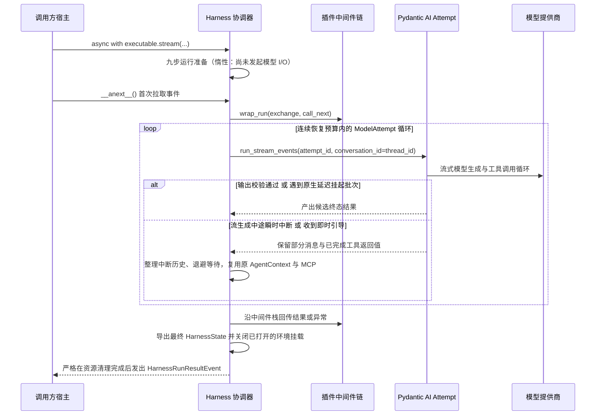

本文解析当你构建 `ExecutableAgent` 并调用 `run()`、`stream()`、`live()` 或 `compact()` 时，`a13n-harness` 在水面之下的完整运转机制。日常接口用法请先阅读[智能体与运行](agents-and-runs.md)及[状态与恢复](state-and-resume.md)。

## 构建期静态编译与九步运行期准备

`HarnessBuilder.build()` 在构建期一次性编译出不可变的 `AgentDefinition`：解析已启用的插件工厂、校验自定义声明式 `Capability` 类型、锁定 `PricingCatalog` 价格目录快照，并调用一次 Pydantic AI 的 `Agent.from_spec()`，使高并发运行能够安全共享静态 Schema 而无需重复构建。

进入 `executable.stream(...)`（或 `run(...)`）时，引擎在发起任何模型或工具网络 I/O **之前**先完成九步确定性准备：

1. **校验环境入参：** 规范化 `environment`、`environments` 与 `default_environment`（或 `RunBindings.environment`），此时不触发底层连接。
2. **分配运行标识：** 生成公开的 `run_id`，继承 `previous_state.thread_id`（新会话则分配全新的 `thread-...` 标识）。
3. **注册惰性挂载源：** 为所有 `EnvironmentSource` 分配不透明挂载 ID 及运行/会话血缘元数据。
4. **原子发布初始挂载视图：** 暴露挂载路径映射，但底层容器或沙箱保持未打开状态，直至工具或 `input_factory` 首次实际访问（**按需惰性激活**）。
5. **执行 `input_factory`：** 若传入 `RunInputFactory(RunPreparationContext)`，在此阶段精确执行一次。
6. **规范化语义输入：** 装配有序文本与多模态内容，并合入待应用的后台 `compaction_result` 或 `DeferredToolResume` 决策结果。
7. **构造 `AgentContext`：** 冻结 `thread_id`、`AgentContextState`、受管 `Environment` 门面、`RunConfiguration`、`RequestContext` 与子智能体集合 `SubagentCollection`。
8. **绑定运行级插件与 MCP：** 冻结 `BoundPluginContext`，并在单次逻辑运行级别解析一次 `ContextualMCP` 实例，防止后续内部重试重复触发带副作用的工厂函数。
9. **装配中间件调用链：** 就绪外层 `AbstractHarnessPlugin.wrap_run()` 管道；真正的模型请求直到调用方首次迭代流（`__anext__`）时才惰性启动。

## 逻辑 Run 与内部 `ModelAttempt` 恢复循环

一次逻辑 Harness Run 拥有唯一的公开 `run_id`、`AgentContext`、环境生命周期、插件调用栈与 `RunUsage` 用量账本，但其内部可以顺序执行**多次 `ModelAttempt`**，用于在单次运行内消化流式断连、上下文溢出压缩或即时引导（Immediate Steering）：

每次内部 `ModelAttempt` 都会向底层传入独立的尝试 ID，同时将 `conversation_id` 固定为 `thread_id`，既保证链路追踪精确关联，又维持网关侧的会话缓存亲和性。对上层宿主（如 Service）而言，一次逻辑 Harness Run 仅对应**一次**持久化 Worker `Attempt`——内部 `ModelAttempt` 重试绝不会消耗宿主的重试配额，也绝不会重复执行已经返回结果的工具调用。

## 即时引导（Immediate Steering）与宿主驻留工具执行

普通引导 `steer(..., immediate=False)` 会在下一轮模型请求边界排队生效；而严格即时引导（`immediate=True`，需绑定 `RunBindings.tool_execution`）会在 5 秒就绪窗口内根据当前所处阶段执行原子交接：

| `steer(immediate=True)` 到达时的活跃阶段 | 内部交接行为                                                                                                                                 |
| ---------------------------------------- | -------------------------------------------------------------------------------------------------------------------------------------------- |
| **主模型流式生成阶段**                   | 立即取消并排空当前 `ModelAttempt`，将已生成的有效半截回复沉淀进历史，携带新引导词直接开启下一个 `ModelAttempt`。                             |
| **工具风险审查、参数校验或执行阶段**     | 保持当前尝试不断开，立即释放受支持工具（顶层 `exec-*` Shell 与 CodeAct）的前台等待并写入驻留执行回执，让模型立即响应新指令且不误杀后台进程。 |

即时引导不会扣减 `ModelRecoveryPolicy` 的故障重试预算。若运行在引导词尚未被模型消费前优雅退出，引导词会自动保存在 `HarnessState` 的 `steering` 命名空间中，确保恢复后按序重放。

## Prompt 缓存前缀稳定性与上下文投影管道

主流大模型提供商均按消息前缀命中 KV 缓存；一旦改写历史消息或在系统提示词头部混入动态时间戳，缓存命中率便会归零。Harness 通过三项机制保护前缀稳定：

1. **只追加的 `ModelContextBlock` 投影：** 实现 `AbstractModelContextCapability` 的能力在尾部（如 `REQUEST_EPILOGUE`）注入键值块，并通过 `request.history.matches_latest(block)` 跳过未发生变化的目录树或规范说明。
2. **不改写历史的出站请求过滤器：** **冷启动过滤器**（空闲一段时间后裁剪早期工具输出中的超长字符串，但豁免已读取的 `SKILL.md`）与**图像预处理过滤器**（执行 `image_input` 数量与字节上限）仅变换当次发出的请求视图，保持规范 `message_history` 原封不动。
3. **超大结果落盘与对象引用传输：** `ToolOutputPolicy(overflow="spill")` 将超限工具输出脱敏落盘至可写挂载的 `.a13n/tmp/tool-results/`，历史中仅保留精简摘要；`object_ref_tools` 则在消息历史与审批卡片中仅传递轻量级 `ObjectStore` 引用，待权限与审批通过后才在工具执行边界还原 Base64 字节。

## `HarnessState` 零重解码信封与崩溃工具对账

`HarnessState`（`schema_version="1"`）是不含任何密钥或活跃句柄的冻结 Pydantic 信封，由五个核心字段组成：

| 字段                  | 内容与内部优化机制                                                                                                                                |
| --------------------- | ------------------------------------------------------------------------------------------------------------------------------------------------- |
| `thread_id`           | 不可变会话标识（`thread-<32位十六进制>` 或宿主 `<前缀>_<id>`）；唯有显式调用 `state.fork()` 才会派生新 ID 并清空 `environment_states`。           |
| `message_history`     | 深度隔离的 `ModelMessage` 元组。调用 `state.to_json_bytes()` 持久化时直接复用底层已校验的 UTF-8 历史字节切片，省去反序列化与重编码开销。          |
| `agent_context_state` | 按 `capability_id` 隔离的带版本号 JSON 字典（含 `a13n.usage`、工作笔记、CodeAct `store`、内联子智能体）。未知插件命名空间在升级与导出时原样透传。 |
| `environment_states`  | 在环境关闭栅栏内采集的挂载名到无凭据 `EnvironmentState` 映射（无状态挂载自动省略）。                                                              |
| `refs`                | 指向宿主 `StateStore` 外部存储对象的 `StoredRef` 元组（用于卸载内联子智能体检查点或大体积二进制内容）。                                           |

当从工具批次中途崩溃的检查点恢复运行（`tool_recovery="declared"`）时，Harness 会扫描 `message_history` 中尚未配对返回值的 `ToolCallPart`：

- 声明为 `HarnessToolMetadata(idempotency="read_only")` 的纯读工具会在**全新** `RunBindings` 权限与审批策略下自动重跑（历史运行中的单次审批绝不会跨运行静默继承）。
- 带有外部副作用（或未声明幂等）的工具调用则会生成明确的已中断 `ToolReturnPart` 记录，指示模型“前序进程在调用期间异常终止，重试前须先核查外部实际状态”。
