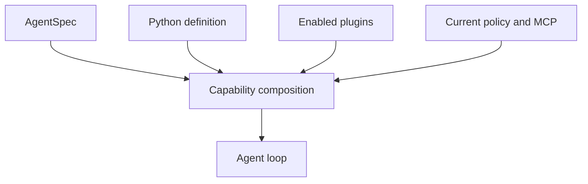

A Capability adds a feature to an Agent: tools, instructions, context, memory, or lifecycle hooks. Select the feature when building the executable. Supply its current clients and policy when starting a Run.

## Add and verify a Capability

Use the Python 3.13 environment from [Getting started](getting-started.md). Save this complete program as `capability_demo.py`. It needs no credentials or external service.

```python title="capability_demo.py"
import asyncio
from collections.abc import AsyncIterator
from dataclasses import dataclass

from a13n_harness import AgentContext, AgentSpec, HarnessBuilder, RunBindings
from pydantic_ai.capabilities import AbstractCapability
from pydantic_ai.messages import ModelMessage
from pydantic_ai.models.function import AgentInfo, FunctionModel


@dataclass(kw_only=True)
class PolicyInstructionsCapability(AbstractCapability[AgentContext]):
    instructions: str
    id: str | None = "policy-instructions"

    @classmethod
    def get_serialization_name(cls) -> str:
        return "policy_instructions"

    def get_instructions(self) -> str:
        return self.instructions


instruction = "Explain material assumptions before the answer."


async def respond(
    messages: list[ModelMessage], info: AgentInfo
) -> AsyncIterator[str]:
    assert instruction in (info.instructions or "")
    yield "Capability instructions received."


model = FunctionModel(stream_function=respond)
executable = HarnessBuilder().build(
    AgentSpec(),
    output_type=str,
    model=model,
    capabilities=(PolicyInstructionsCapability(instructions=instruction),),
)


async def main() -> None:
    result = await executable.run("Check the setup.", bindings=RunBindings.embedded())
    print(result.output_or_raise())


asyncio.run(main())
```

Run `python capability_demo.py`. Expected output:

```text
Capability instructions received.
```

The assertion checks the instructions sent to the Model, not just the final answer. `get_instructions()` contributes the text; `capabilities=(...)` installs the concrete instance. The Model is scripted so the check is repeatable.

## Composition Sources

Choose the source by what you are configuring:

- **Python application:** pass concrete instances to `HarnessBuilder.build(..., capabilities=...)` or `AgentDefinition.capabilities`, as above.
- **Portable Agent configuration:** select supported serialized types in `AgentSpec.capabilities`.
- **Enabled Harness plugin:** contribute instances through the plugin's `get_capabilities()` method.
- **Current invocation policy or native MCP:** attach the supported types through fresh `RunBindings.capabilities`.

For a feature's clients, use typed binding fields such as `RunBindings.web` or `document_converter`. `RunBindings.capabilities` is not an arbitrary dependency-injection slot.



Capability presence does not itself authorize external work. Tools that cross a managed boundary still evaluate fresh run policy and provider enforcement.

## Select Capabilities with AgentSpec

Use `AgentSpec.capabilities` when the feature selection must be stored as data. It accepts native Pydantic AI types, supported Harness types such as `ToolPermissionsCapability`, and exact custom types authorized by the Host. Keep live clients, credentials, Environment configuration, and plugin selection in their owning Host configuration.

For most Harness features, start with concrete Python composition. Use [Shell Command Review](#shell-command-review) for a built-in declarative example.

### Detect repeated-action loops

Select the upstream `pydantic_ai_harness.DetectLoops` Capability explicitly. Harness supports its native `DetectLoops` serialization name without a custom type catalog:

```python
from a13n_harness import AgentSpec

spec = AgentSpec(capabilities=[{"DetectLoops": {"action": "nudge"}}])
```

Pass this spec to `HarnessBuilder.build()`. For code-first composition, import `DetectLoops` from `pydantic_ai_harness` and pass an instance in `capabilities` instead. Selecting neither leaves detection off.

The native defaults inspect a window of 10 tool calls: repeated calls trigger at 5, identical results at 3, alternating calls at 3 A-B cycles, and repeated text-only responses at 3. `action="nudge"` asks the Model to change approach; `action="error"` ends execution with a failed result instead of retrying the loop as a transport failure. Code-first callers can also provide a native callback.

Expected polling can repeat without being stuck. Raise the relevant thresholds and window, or set `repeated_call_threshold` and `repeated_result_threshold` to `None` for such workloads. JSON/YAML uses `null`. A nudge is guidance, not a hard execution budget; retain `UsageLimits` for a hard bound.

Detection counts responses in the current native Model attempt. Continuation and recovery attempts start fresh; counts are not persisted in `HarnessState`. Compaction within that attempt does not reset recorded progress. With CodeAct, the detector sees Model calls to the runner, not individual host calls inside its Python program.

### Authorize a custom declarative type

To select the example's class from data, replace its `executable = ...` block with the following. Keep the class, `instruction`, `model`, and `main()` from the complete program.

```python
from a13n_harness.capability_types import CapabilityTypeCatalog
from pydantic_ai.agent.spec import CapabilitySpec

catalog = CapabilityTypeCatalog.from_types((PolicyInstructionsCapability,))
executable = HarnessBuilder(capability_type_catalog=catalog).build(
    AgentSpec(
        capabilities=[
            CapabilitySpec(
                name="policy_instructions",
                arguments={"instructions": instruction},
            )
        ]
    ),
    output_type=str,
    model=model,
)
```

Run the program again. The same assertion and output verify the declarative path.

The Host catalog makes the exact class available to this builder; the spec selects an instance. Registration alone enables nothing. An unknown name fails during construction. Custom registered classes must directly declare `@dataclass` and a unique serialization name. The Host owns package installation and trust.

`AgentSpec.model_characteristics.capabilities` is a separate setting for Model image, video, and audio understanding. Use `AgentSpec.capabilities` for Agent-loop behavior.

The [integration package example](https://github.com/converge-ai-labs/agent-foundation/tree/main/examples/plugins#custom-capability) runs both the Host-authorized `AgentSpec` path and direct code composition against an offline Model.

## Common Definition Capabilities

Add the selected Capability to the build's `capabilities` tuple. Check the dependency column before running: selecting a feature and supplying its service are separate steps. Follow the dedicated guides for [Environment tools](environments.md), [Skills](skills.md), [memory](context.md), and [delegation](delegation-and-codeact.md).

| Capability                     | Adds                                                                                        | Needs collaborator                                             |
| ------------------------------ | ------------------------------------------------------------------------------------------- | -------------------------------------------------------------- |
| `RuntimeContextCapability`     | Bounded current time, elapsed time, usage, context-window, and selected metadata projection | No                                                             |
| `WorkspaceOutlineCapability`   | Bounded metadata-only file outline from the current Environment                             | Environment file facet                                         |
| `FileContextCapability`        | Run-frozen `AGENTS.md` and explicit file contents                                           | Environment file facet                                         |
| `DynamicEnvironmentCapability` | File and shell Toolset composition, current mount context, and mount-change notices         | Environment mount; managed calls also need current policy      |
| `ToolPermissionsCapability`    | Stable-ID permissions and optional risk review, with shell input specialization             | Fresh invocation policy still authorizes every managed call    |
| `SkillsCapability`             | Explicit Skill discovery, selection, instructions, and paths                                | Entered Environment and optional `RunBindings.skill_selection` |
| `WorkingStateCapability`       | Task and note tools plus model-context projection                                           | Optional `TaskStateBinding` in provider mode                   |
| `FileMemoryCapability`         | Mounted file memories: guides, `memory_file_*` tools, and changed-file context at Run start | One opened `FileStore` per mount; optional `MemoryCursors`     |
| `RecordMemoryCapability`       | Mounted record memories: guides, `memory_record_*` tools, and recall at Run start           | One opened `RecordStore` per mount                             |
| `UserInteractionCapability`    | Structured user questions through native deferred tools                                     | Host handles suspension and resume                             |
| `DocumentsCapability`          | Document-conversion Toolset                                                                 | `RunBindings.document_converter`                               |
| `WebCapability`                | Search, fetch, and scrape Toolset                                                           | `WebBinding` with current client and policy                    |
| `HandoffCapability`            | Explicit `summarize` tool and continuation reminder                                         | No                                                             |
| `CompactionCapability`         | Usage-triggered synchronous or background compaction with retained input replay             | Background: `CompactionOperator`; synchronous: none            |
| `SubagentCapability`           | Inline or asynchronous execution of exact declared children                                 | Async: definition-selected `SubagentOperator`; inline: none    |
| `CodeActCapability`            | Restricted Python runners and explicit key-to-JSON stored values                            | Explicit eligible tools and Environment files for programs     |
| `ContextualMCP`                | URL-based MCP with headers resolved once from the current logical Run                       | Current `AgentContext` supplied by the Harness                 |

For large local tool collections, [ToolSearchCapability](tool-search.md) accepts a `groups` mapping of passive `ToolSearchGroup(source=..., description=...)` values. This single code-first entry provides grouped discovery and exhaustive listing through fixed proxy schemas, with CodeAct compatibility, without replacing native execution. The [Host integration guide](tool-search.md#host-integration) covers source selection and plugin composition.

Keep provider objects in the current `RunBindings`. `WebBinding` and `TaskStateBinding` package dependencies; they do not enable features and never enter `HarnessState`. The Host opens and closes providers. A Harness feature's private run-bound instance is reused across model attempts within one logical Run and replaced for the next Run.

For inline children, `SubagentDefinition.run_bindings_factory` receives the child's baseline `RunBindings` and returns a replacement with that child's collaborators. It must preserve the child instance, borrowed Environment, and inherited invocation policy. Parent feature bindings are not inherited automatically; an explicit shared task-state policy supplies the borrowed cell and rejects a conflicting factory binding.

## Native Image Generation with Saving

Use `NativeImageGenerationCapability` when an image-generation result must become a saved file or URL. It combines the provider-native tool with your async saver.

1. Configure credentials for a Model that supports native image generation.
2. Choose a Host-owned output directory and replace `/path/to/generated-images` below.
3. Build the executable with the saver and the native tool's output format.
4. Run it with an image-generation prompt and inspect the returned reference. This recipe uses a real provider and may incur charges.

```python
from uuid import uuid4

from anyio import Path
from pydantic_ai import RunContext
from pydantic_ai.agent.spec import AgentSpec
from pydantic_ai.messages import FilePart
from pydantic_ai.native_tools import ImageGenerationTool

from a13n_harness import AgentContext, HarnessBuilder
from a13n_harness.capabilities import NativeImageGenerationCapability


async def save_image(ctx: RunContext[AgentContext], image: FilePart) -> str:
    # This Host owns this directory and makes it available to its users/Agents.
    directory = Path("/path/to/generated-images")
    await directory.mkdir(parents=True, exist_ok=True)
    target = directory / f"image-{uuid4().hex}.png"
    await target.write_bytes(image.content.data)
    return str(target)


agent = HarnessBuilder().build(
    AgentSpec(model="openai-responses:gpt-5.4"),
    output_type=str,
    capabilities=(
        NativeImageGenerationCapability(
            tool=ImageGenerationTool(output_format="png"),
            saver=save_image,
        ),
    ),
)
```

The saver receives the current `RunContext` and native image `FilePart`; it can use authorized Environment storage, Host storage, or an upload service. Return a non-empty model-visible path or URL only after the write succeeds. Its code and credentials are process-local, not serialized configuration. The Host owns naming, access, retention, and sharing. Harness UI provides a default implementation that saves under the current Thread's `tmp` directory.

The Capability retains native generation call/return metadata, withholds image previews, saves final images, and includes text references in output and continuation history. Image-only replies work with `output_type=str`. Interrupted images are not embedded into checkpoints, and a saver exception fails the Run. Generation, saving, and continuation publication are separate effects; a failure or cancellation can leave a saved file without a published reference. Saved references do not automatically attach pixels on later turns; an Agent needs an authorized file/media reader to inspect them.

Native search remains independently composable with `NativeTool(WebSearchTool(...))` or upstream `WebSearch`. Provider support and account entitlement are checked by the native Model integration, not by a Harness provider matrix.

## Context Composition

See [Context and working state](context.md#context-composition) for configuration, examples, and lifecycle boundaries.

## Tool permissions and general review

Use one `ToolPermissionsCapability` for stable-ID `allow`, `deny`, `ask`, and `review` rules together with an optional model-backed or custom reviewer. It is also available as a declarative `AgentSpec` type; `inherit` resolves the tool's declared default. [Tool permissions](managed-tools.md#select-tool-permissions) covers configuration, custom instructions, reviewer implementations, approval provenance, result events, and usage. Ordinary Pydantic tools and local MCP targets use the same gate without requiring managed metadata.

## Shell Command Review

Shell review is an optional function of `ToolPermissionsCapability`, not a separate Capability. To review only shell launches, select their permission mode explicitly:

```python
from a13n_harness import AgentSpec

agent_spec = AgentSpec(
    capabilities=[
        {
            "name": "ToolPermissionsCapability",
            "arguments": {
                "default": "inherit",
                "rules": {"environment.shell_exec": "review"},
                "review": {
                    "model": "gateway@openai-responses:gpt-5.4-mini",
                    "risk_threshold": "extra_high",
                    "on_flagged": "deny",
                    "timeout_seconds": 20,
                },
            },
        },
    ]
)
```

Without an explicit review permission or trusted tool default, all tools default to `allow` without review. Installing a reviewer or defining its risk rules alone does not activate it. The single reviewer Agent and common prompt assess the risk level and give an optional reason; runtime policy chooses the action. Shell inputs separate the command from working directory, timing, Environment alias, and environment variable names (never values). Other tools retain their structured schema and arguments. Compact previous reviews and action observations provide context, never authorization or automatic risk reduction.

The Harness defaults to `extra_high` triggering `deny`; configure `on_flagged: approval_required` to ask instead. Non-timeout failures follow `on_error` (default `approval_required`, or `deny` or explicit `allow`). A reviewer timeout always denies before dispatch, regardless of error policy or an earlier approval. Hosts separately own human interaction timeouts. See [reviewer configuration](managed-tools.md#configure-or-replace-the-reviewer) for per-tool rules and custom reviewers.

## Working State

See [Context and working state](context.md#working-state) for configuration, examples, and lifecycle boundaries.

## Structured User Interaction

`UserInteractionCapability` exposes `ask_user_question` when current `RunBindings.deferred_tools_supported` is enabled, for both roots and children. The call does not hold an open Harness Run while waiting for a person. It produces `status="suspended"` with Harness deferred requests and portable state. A Host later supplies fresh bindings, previous state, and a correlated `DeferredToolResume`. [Built-in inline children](delegation-and-codeact.md#host-managed-feedback) explicitly disable deferred tools; Host-managed children use the native resume boundary. Unsupported Runs receive neither the tool nor its guidance.

See [Human-in-the-loop tools](human-in-the-loop.md) for request and answer payloads, application-owned types, and correlated resume examples. [State and Resume](state-and-resume.md) covers the general continuation lifecycle.

## Media, Documents, and Web

These features separate stable model-facing schemas from fresh provider implementations. To enable document conversion:

1. Choose a PDF/Office converter in your application; Harness supplies no default converter.
2. Implement `DocumentConverter.convert(request)` as an async method. Import the protocol, `DocumentConversionRequest`, and `DocumentConversionResult` from `a13n_harness.toolsets.documents`.
3. Convert the request's detached `source_bytes`, honoring its page range, deadline and output limits. Return a `DocumentConversionResult` with Markdown and optional `DocumentAsset` values containing relative paths and bytes. PDF results also require consistent `total_pages`, `converted_pages`, `page_start`, and `page_end` for the requested range, capped at the document's last page. Omit page metadata for Office results. Keep temporary files and converter dependencies inside your adapter.
4. Bind that adapter as `document_converter` below. Harness reads the authorized source and validates and publishes the returned files through the Environment.

In your application setup, use this wiring fragment. Supply your `agent_spec`, a compatible `model`, and the `document_converter` adapter from the steps above. The Run also needs an Environment with authorized source and destination file access.

```python
from a13n_harness import HarnessBuilder, RunBindings
from a13n_harness.capabilities import DocumentsCapability

executable = HarnessBuilder().build(
    agent_spec,
    output_type=str,
    model=model,
    capabilities=(DocumentsCapability(),),
)

bindings = RunBindings.embedded(
    document_converter=document_converter,
)
```

Add your Environment as `environment=...` in `RunBindings.embedded(...)`, then pass `bindings` to `executable.run(...)`. Verify that the converted Markdown and assets exist at the requested destination before presenting them to a user.

The default `VideoUrlCapability` provides `read_media_url` for image, video, and audio URLs. It shares native-first dispatch and configured per-kind fallback with file `view`. Direct resources become bounded bytes before native attachment or auxiliary analysis. Native video uses the current Model's encoded budget; fallback does not inherit an unsupported primary Model's budget. YouTube requires explicit native URL support and has no download or auxiliary fallback. See [multimedia understanding](multimedia-understanding.md) for configuration, limits, and migration. Web additionally evaluates a live `WebPolicy` for each Host request.

### Restrict Web domains

`WebConfiguration.fetch`, `download`, and `scrape` each restrict destinations for their own operation; `WebConfiguration.search` independently filters returned search URLs:

```python
from a13n_harness.capabilities import (
    WebCapability,
    WebConfiguration,
    WebFetchConfiguration,
    WebSearchConfiguration,
)

web = WebCapability(
    WebConfiguration(
        fetch=WebFetchConfiguration(
            allow_domains=("example.org",),
            deny_domains=("private.example.org",),
        ),
        search=WebSearchConfiguration(
            mode="host",
            allow_domains=("example.org",),
            deny_domains=("private.example.org",),
        ),
    )
)
```

A bare hostname matches itself and every subdomain at a label boundary; wildcard entries such as `*.example.org` are rejected. Entries normalize case, IDNA, and trailing dots. Deny wins; empty lists add no restrictions. Set the lists on each operation that needs them; one operation's lists never apply to another. Search can return fewer or zero results after filtering. Restricted `native` search is rejected; restricted `auto` uses Host search and needs a bound backend.

Host transports must retain `WebDomainPolicy` checks on each redirect before DNS/network work as well as their normal address and credential checks. These controls are not universal egress restrictions for shell, remote MCP, installed plugins, or model-provider tools.

### Web search and scrape backends

`WebCapability()` defaults search to `mode="auto"`: it uses provider-native Web search when the effective Model profile supports it and otherwise uses the first usable Host search backend. Native search uses the Model provider's account and billing; it does not use Host search credentials or `WebPolicy`.

Use this wiring fragment after opening your provider adapters. `web_client` handles base HTTP operations; `web_policy` authorizes Host requests. `google_search`, `brave_search`, and `tavily_search` are search adapters; `local_scraper` and `firecrawl_scraper` are scrape adapters. Use your own names and implementations. Bind them in default fallback order, then set per-operation preferences:

```python
from a13n_harness import RunBindings
from a13n_harness.capabilities import (
    WebCapability,
    WebConfiguration,
    WebBinding,
    WebScrapeBackendBinding,
    WebScrapeConfiguration,
    WebSearchBackendBinding,
    WebSearchConfiguration,
)

web = WebCapability(
    WebConfiguration(
        search=WebSearchConfiguration(
            mode="auto",
            backend_priority=("brave", "tavily"),
            search_context_size="high",
        ),
        scrape=WebScrapeConfiguration(
            backend_priority=("firecrawl", "local"),
        ),
    )
)

bindings = RunBindings.embedded(
    web=WebBinding(
        client=web_client,
        policy=web_policy,
        search_backends=(
            WebSearchBackendBinding("google", google_search),
            WebSearchBackendBinding("brave", brave_search),
            WebSearchBackendBinding("tavily", tavily_search),
        ),
        scrape_backends=(
            WebScrapeBackendBinding("local", local_scraper),
            WebScrapeBackendBinding("firecrawl", firecrawl_scraper),
        ),
    ),
)
```

Add `web` to the executable's `capabilities` tuple and pass `bindings` to each Run. Test with a known query and check the returned URLs. A bound client alone does not add search tools.

With no configured preference, tuple order is the default priority. `backend_priority` moves available named backends first and then retains the remaining bound order. Set `backend="tavily"` to require exactly one Host backend with no fallback. A selected backend that is not bound fails before model dispatch. Use `search.mode="host"` to forbid native search, `search.mode="native"` to forbid Host search, and `search.mode="off"` when `WebCapability` is used only for fetch, scrape, or download. Scrape supports `mode="host"` and `mode="off"` and has its own exact selection or priority.

One search or scrape call shares a single operation deadline across its ordered backends. A provider error, invalid response, or provider exception advances to the next backend. A timeout, cancellation, Harness `RunError`, policy failure, or post-result authorization failure ends the operation without fallback. A valid empty search result is successful and also stops fallback.

When `WebCapability()` is constructed without an explicit configuration, these environment variables select its defaults:

| Variable                                   | Values                             | Default       |
| ------------------------------------------ | ---------------------------------- | ------------- |
| `A13N_HARNESS_WEB_SEARCH_MODE`             | `off`, `host`, `native`, or `auto` | `auto`        |
| `A13N_HARNESS_WEB_SEARCH_BACKEND`          | One exact bound backend ID         | unset         |
| `A13N_HARNESS_WEB_SEARCH_BACKEND_PRIORITY` | Comma-separated backend IDs        | binding order |
| `A13N_HARNESS_WEB_SEARCH_CONTEXT_SIZE`     | `low`, `medium`, or `high`         | `medium`      |
| `A13N_HARNESS_WEB_SCRAPE_MODE`             | `off` or `host`                    | `host`        |
| `A13N_HARNESS_WEB_SCRAPE_BACKEND`          | One exact bound backend ID         | unset         |
| `A13N_HARNESS_WEB_SCRAPE_BACKEND_PRIORITY` | Comma-separated backend IDs        | binding order |

An exact `*_BACKEND` value ignores the corresponding `*_BACKEND_PRIORITY` and disables fallback. Environment variables select only modes and backend IDs; provider objects and credentials still come from the fresh `WebBinding` in `RunBindings.web`. Passing `WebCapability(WebConfiguration(...))` is authoritative and does not merge environment defaults, which keeps loaded presets deterministic.

## Shell Executions and Observations

`DynamicEnvironmentCapability` derives shell execution, native discovery/inspection through `shell_info`, explicit-offset `shell_wait`, and supported input/control tools from the current mount actions. The tool surface does not require a Host process operator or all-or-nothing interactive permissions.

With the Host-held tool runtime, top-level Shell executions retain their original process and capture across Runs until native termination and output observation closure. Standalone `process-*` references and buffers remain Run-local, with best-effort native exit hints. Provider discovery owns recovery after scope loss; the Harness tool runtime owns retained execution results and completion observations.

See [Environment tools](environments.md) for signatures, output provenance, observation limits, and Provider-specific recovery behavior.

## Filters

See [Context and working state](context.md#filters) for configuration, examples, and lifecycle boundaries.

## MCP

See [MCP tools](mcp.md) for native composition, Run-scoped headers, local versus provider-native execution, and result boundaries.

## Native Capabilities and Tools

For a small function tool, use native `Capability` directly. Pass `capabilities` below when building an Agent with a Model that calls `double`. [Tools and dependencies](tools-and-dependencies.md) provides a complete offline tool-call test:

```python
from pydantic_ai.capabilities import Capability


def double(value: int) -> int:
    return value * 2

capabilities = (Capability(id="math", tools=[double]),)
```

Unannotated native tools remain trusted in-process calls. Managed tool metadata activates the additional Harness policy, credential, grant, retry, event, and bounded-output path. Do not infer managed authority from a tool name.

## State, identity, and compaction events

A stateful Capability owns one stable namespace in `AgentContext.state` and one exact codec version. It can read and write typed Pydantic values through `AgentContextState`; the Harness snapshots namespaces without interpreting feature-specific data.

Capability IDs, tool IDs, binding IDs, and other compact selectors are correlation and composition identities. They do not grant permissions or restore provider authority.

Successful compaction emits `CompactionSummaryEvent` from `a13n_harness.capabilities` through the native Capability event channel. Its `operation_id` matches the compaction lifecycle events and `summary` contains the generated replacement text. Treat it as content-bearing output, not the Agent's answer or proof of a saved checkpoint. The lifecycle extensions themselves remain metadata-only. When a Host passes a ready `compaction_result` alongside `previous_state` to `run` or `stream`, Harness applies it before recovery and emits restoration and summary events before projecting fresh context. That restoration requires no Compaction Capability or operator; see [Background compaction](context.md#background-compaction).
