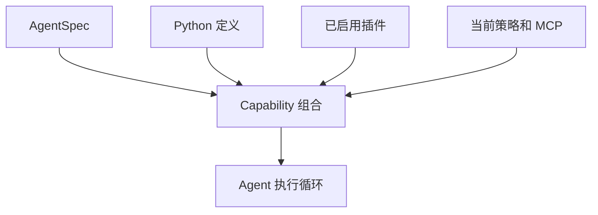

Capability 为 Agent 添加一项功能：工具、指令、上下文、记忆或生命周期 hook。构建 executable 时选择功能，启动 Run 时提供当前客户端和策略。

## 添加并验证 Capability

使用[快速开始](getting-started.md)中准备的 Python 3.13 环境。将以下完整程序保存为 `capability_demo.py`。它不需要凭据或外部服务。

```python title="capability_demo.py"
import asyncio
from collections.abc import AsyncIterator
from dataclasses import dataclass

from a13n_harness import AgentContext, AgentSpec, HarnessBuilder, RunBindings
from pydantic_ai.capabilities import AbstractCapability
from pydantic_ai.messages import ModelMessage
from pydantic_ai.models.function import AgentInfo, FunctionModel


@dataclass(kw_only=True)
class PolicyInstructionsCapability(AbstractCapability[AgentContext]):
    instructions: str
    id: str | None = "policy-instructions"

    @classmethod
    def get_serialization_name(cls) -> str:
        return "policy_instructions"

    def get_instructions(self) -> str:
        return self.instructions


instruction = "Explain material assumptions before the answer."


async def respond(
    messages: list[ModelMessage], info: AgentInfo
) -> AsyncIterator[str]:
    assert instruction in (info.instructions or "")
    yield "Capability instructions received."


model = FunctionModel(stream_function=respond)
executable = HarnessBuilder().build(
    AgentSpec(),
    output_type=str,
    model=model,
    capabilities=(PolicyInstructionsCapability(instructions=instruction),),
)


async def main() -> None:
    result = await executable.run("Check the setup.", bindings=RunBindings.embedded())
    print(result.output_or_raise())


asyncio.run(main())
```

运行 `python capability_demo.py`。预期输出：

```text
Capability instructions received.
```

断言检查实际发送给 Model 的指令，而不只检查最终回答。`get_instructions()` 提供文本，`capabilities=(...)` 安装具体实例。脚本化 Model 让验证可重复。

## 组合来源

根据配置内容选择来源：

- \*\*Python 应用：\*\*像上例一样，将具体实例传给 `HarnessBuilder.build(..., capabilities=...)` 或 `AgentDefinition.capabilities`。
- \*\*可移植 Agent 配置：\*\*在 `AgentSpec.capabilities` 中选择受支持的序列化类型。
- \*\*已启用的 Harness 插件：\*\*通过插件的 `get_capabilities()` 方法提供实例。
- \*\*当前调用策略或原生 MCP：\*\*通过新的 `RunBindings.capabilities` 附加受支持类型。

功能客户端使用 `RunBindings.web`、`document_converter` 等带类型绑定字段。`RunBindings.capabilities` 不是任意依赖注入入口。



存在 Capability 本身不授权外部工作。跨越托管边界的工具仍检查当前执行策略和 provider 强制限制。

## 通过 AgentSpec 选择 Capabilities

需要将功能选择保存为数据时，使用 `AgentSpec.capabilities`。它接受原生 Pydantic AI 类型、`ToolPermissionsCapability` 等受支持 Harness 类型，以及 Host 授权的精确自定义类型。活跃客户端、凭据、Environment 配置和插件选择由各自的 Host 配置管理。

多数 Harness 功能先用具体 Python 实例组合即可。内置声明式示例见 [Shell 命令审查](#shell-command-review)。

### 检测重复动作循环

显式选择上游 `pydantic_ai_harness.DetectLoops` Capability。Harness 直接支持原生序列化名称 `DetectLoops`，无需自定义类型目录：

```python
from a13n_harness import AgentSpec

spec = AgentSpec(capabilities=[{"DetectLoops": {"action": "nudge"}}])
```

将此 spec 传给 `HarnessBuilder.build()`。代码优先组合也可以从 `pydantic_ai_harness` 导入 `DetectLoops`，将实例放入 `capabilities`。未选择时保持关闭。

原生默认值使用最近 10 次工具调用的窗口：相同调用重复 5 次、相同结果重复 3 次、交替调用形成 3 个 A-B 周期，或纯文本回复重复 3 次时触发。`action="nudge"` 提醒 Model 改变方法；`action="error"` 以失败结果结束执行，不把循环当作传输失败重试。代码优先调用者也可以提供原生回调。

正常轮询也可能重复。此类任务应提高对应阈值和窗口，或将 `repeated_call_threshold` 与 `repeated_result_threshold` 设为 `None`；JSON/YAML 使用 `null`。提醒不是硬执行预算，仍应使用 `UsageLimits` 设置硬上限。

检测只累计当前原生 Model attempt 的响应。继续会话和恢复重试都会重新计数，计数不持久化到 `HarnessState`。同一 attempt 内的压缩不会重置计数。使用 CodeAct 时，检测器看到的是 Model 对 runner 的调用，不是 Python 程序内部的每一次 host 工具调用。

### 授权自定义声明式类型

要从数据中选择示例的类，将 `executable = ...` 部分替换为以下代码。保留完整程序中的类、`instruction`、`model` 和 `main()`。

```python
from a13n_harness.capability_types import CapabilityTypeCatalog
from pydantic_ai.agent.spec import CapabilitySpec

catalog = CapabilityTypeCatalog.from_types((PolicyInstructionsCapability,))
executable = HarnessBuilder(capability_type_catalog=catalog).build(
    AgentSpec(
        capabilities=[
            CapabilitySpec(
                name="policy_instructions",
                arguments={"instructions": instruction},
            )
        ]
    ),
    output_type=str,
    model=model,
)
```

再次运行程序。同一断言和输出验证声明式路径。

Host 目录将精确类提供给该 builder，spec 则选择实例。仅注册不会启用功能；未知名称在构建时失败。注册的自定义类必须直接声明 `@dataclass` 和唯一序列化名称。软件包安装与信任由 Host 管理。

`AgentSpec.model_characteristics.capabilities` 单独配置 Model 的图像、视频和音频理解特性。Agent 执行循环行为使用 `AgentSpec.capabilities`。

[集成包示例](https://github.com/converge-ai-labs/agent-foundation/tree/main/examples/plugins#custom-capability)使用离线模型运行 Host 授权 `AgentSpec` 路径和直接代码组合。

## 常用定义 Capabilities

将选定 Capability 添加到构建参数的 `capabilities` 元组。运行前检查依赖列：选择功能和提供服务是两个步骤。具体操作见[环境工具](environments.md)、[Skills](skills.md)、[记忆](context.md)和[委派](delegation-and-codeact.md)。

| Capability                     | 添加内容                                                             | 需要的协作对象                                       |
| ------------------------------ | -------------------------------------------------------------------- | ---------------------------------------------------- |
| `RuntimeContextCapability`     | 大小受限的当前时间、已用时间、用量、上下文窗口和选定元数据投影       | 否                                                   |
| `WorkspaceOutlineCapability`   | 从当前环境获取有界、仅元数据的文件概览                               | 环境文件接口                                         |
| `FileContextCapability`        | 执行期间固定的 `AGENTS.md` 和显式文件内容                            | 环境文件接口                                         |
| `DynamicEnvironmentCapability` | 文件和 shell Toolset 组合、当前挂载上下文和挂载变化通知              | 环境挂载；托管调用还需当前策略                       |
| `ToolPermissionsCapability`    | 基于稳定 ID 的权限和可选风险审查，支持 shell 输入特化                | 当前调用策略仍逐次授权托管调用                       |
| `SkillsCapability`             | 显式 Skill 发现、选择、指令和路径                                    | 已进入环境及可选 `RunBindings.skill_selection`       |
| `WorkingStateCapability`       | 任务、笔记工具和模型上下文投影                                       | provider 模式中可选 `TaskStateBinding`               |
| `FileMemoryCapability`         | 挂载文件记忆：指南、`memory_file_*` 工具和执行开始时的文件变化上下文 | 每个挂载一个已打开 `FileStore`；可选 `MemoryCursors` |
| `RecordMemoryCapability`       | 挂载记录记忆：指南、`memory_record_*` 工具和执行开始时召回           | 每个挂载一个已打开 `RecordStore`                     |
| `UserInteractionCapability`    | 通过原生延后工具提出结构化用户问题                                   | Host 处理暂停与恢复                                  |
| `DocumentsCapability`          | 文档转换 Toolset                                                     | `RunBindings.document_converter`                     |
| `WebCapability`                | 搜索、获取和抓取 Toolset                                             | 具有当前客户端和策略的 `WebBinding`                  |
| `HandoffCapability`            | 显式 `summarize` 工具和续接提醒                                      | 否                                                   |
| `CompactionCapability`         | 用量触发的同步或后台压缩，重放保留的输入                             | 后台：`CompactionOperator`；同步：无需               |
| `SubagentCapability`           | 明确声明的子 Agent 的内联或异步执行                                  | 异步：定义选择的 `SubagentOperator`；内联：无需      |
| `CodeActCapability`            | 受限 Python runner 和显式键到 JSON 存储值                            | 明确选定的适用工具，以及用于程序的环境文件           |
| `ContextualMCP`                | 基于 URL 的 MCP，请求头从当前逻辑执行解析一次                        | Harness 提供的当前 `AgentContext`                    |

大型本地工具集合可使用 [ToolSearchCapability](tool-search.md)，它接受由被动 `ToolSearchGroup(source=..., description=...)` 值组成的 `groups` 映射。这个统一代码入口通过固定代理 schema 支持分组发现、完整列表和 CodeAct，不替代原生执行。来源选择和插件组合见 [Host 集成指南](tool-search.md#host-integration)。

provider 对象放在当前 `RunBindings` 中。`WebBinding` 和 `TaskStateBinding` 用于组合依赖，不启用功能，也不进入 `HarnessState`。Host 负责打开和关闭 provider。Harness 功能的私有执行绑定实例在同一逻辑 Run 的模型尝试间复用，下一次 Run 会重新创建。

内联子 Agent 的 `SubagentDefinition.run_bindings_factory` 接收子 Agent 基础 `RunBindings`，返回携带其协作对象的替代绑定。必须保留子实例、借用环境和继承的调用策略。父功能绑定不会自动继承；显式共享任务状态策略提供借用状态单元，并拒绝与工厂绑定冲突。

## 原生图像生成与保存

生成图像需要保存为文件或 URL 时，使用 `NativeImageGenerationCapability`。它将 provider 原生工具与你的异步 saver 组合。

1. 为支持原生图像生成的 Model 配置凭据。
2. 选择 Host 管理的输出目录，替换下方 `/path/to/generated-images`。
3. 使用 saver 和原生工具的输出格式构建 executable。
4. 发送图像生成提示并检查返回引用。此示例使用真实 provider，可能产生费用。

```python
from uuid import uuid4

from anyio import Path
from pydantic_ai import RunContext
from pydantic_ai.agent.spec import AgentSpec
from pydantic_ai.messages import FilePart
from pydantic_ai.native_tools import ImageGenerationTool

from a13n_harness import AgentContext, HarnessBuilder
from a13n_harness.capabilities import NativeImageGenerationCapability


async def save_image(ctx: RunContext[AgentContext], image: FilePart) -> str:
    # This Host owns this directory and makes it available to its users/Agents.
    directory = Path("/path/to/generated-images")
    await directory.mkdir(parents=True, exist_ok=True)
    target = directory / f"image-{uuid4().hex}.png"
    await target.write_bytes(image.content.data)
    return str(target)


agent = HarnessBuilder().build(
    AgentSpec(model="openai-responses:gpt-5.4"),
    output_type=str,
    capabilities=(
        NativeImageGenerationCapability(
            tool=ImageGenerationTool(output_format="png"),
            saver=save_image,
        ),
    ),
)
```

saver 接收当前 `RunContext` 和原生图像 `FilePart`；可使用获授权环境存储、Host 存储或上传服务。只有写入成功后，才返回非空模型可见路径或 URL。代码和凭据留在进程内，不序列化为配置。Host 负责命名、访问、保留和共享。Harness UI 默认实现在当前线程的 `tmp` 目录下保存。

Capability 保留原生生成调用/返回元数据，不公开图像预览，保存最终图像，并在输出和续接历史中加入文本引用。纯图像回复可配合 `output_type=str`。中断图像不会嵌入检查点，saver 异常使执行失败。生成、保存和续接发布是独立副作用；失败或取消可能留下已保存文件，却没有发布引用。已保存引用不会在后续轮次自动附带像素；Agent 需要获授权文件/媒体 reader 才能检查图像。

原生搜索仍可独立通过 `NativeTool(WebSearchTool(...))` 或上游 `WebSearch` 组合。provider 支持和账号资格由原生模型集成检查，不由 Harness provider 矩阵决定。

## 上下文组合

配置、示例和生命周期边界见[上下文与工作状态](context.md#context-composition)。

## 工具权限与通用审查

使用一个 `ToolPermissionsCapability` 为稳定 ID 设置 `allow`、`deny`、`ask`、`review` 规则，按需提供模型审查器或自定义审查器。也可作为声明式 `AgentSpec` 类型使用；`inherit` 解析工具声明的默认值。[工具权限](managed-tools.md#select-tool-permissions)介绍配置、自定义指令、审查器实现、批准来源、结果事件和用量。普通 Pydantic 工具和本地 MCP 目标使用相同门控，无需托管元数据。

## Shell 命令审查

shell 审查是 `ToolPermissionsCapability` 的可选功能，不是独立 Capability。只审查 shell 启动时，显式选择其权限模式：

```python
from a13n_harness import AgentSpec

agent_spec = AgentSpec(
    capabilities=[
        {
            "name": "ToolPermissionsCapability",
            "arguments": {
                "default": "inherit",
                "rules": {"environment.shell_exec": "review"},
                "review": {
                    "model": "gateway@openai-responses:gpt-5.4-mini",
                    "risk_threshold": "extra_high",
                    "on_flagged": "deny",
                    "timeout_seconds": 20,
                },
            },
        },
    ]
)
```

未显式设置 review 权限或可信工具默认值时，全部工具默认 `allow`，不审查。仅安装审查器或定义风险规则不会启用审查。统一审查 Agent 和公共提示评估风险等级并给出可选原因；运行时策略决定操作。shell 输入把命令与工作目录、时间、环境别名和环境变量名称（绝不包含值）分离。其他工具保留结构化 schema 和参数。精简历史审查与操作观测提供上下文，绝不提供授权或自动降低风险。

Harness 默认在 `extra_high` 风险时触发 `deny`；配置 `on_flagged: approval_required` 可改为请求批准。非超时失败遵循 `on_error`（默认 `approval_required`，或 `deny`、显式 `allow`）。审查器超时始终在分派前拒绝，不受错误策略或之前批准影响。Host 单独管理人工交互超时。逐工具规则和自定义审查器见[审查器配置](managed-tools.md#configure-or-replace-the-reviewer)。

## 工作状态

配置、示例和生命周期边界见[上下文与工作状态](context.md#working-state)。

## 结构化用户交互

当前 `RunBindings.deferred_tools_supported` 启用时，`UserInteractionCapability` 为根和子 Agent 提供 `ask_user_question`。等待用户时，调用不会让 Harness 执行一直打开。它返回 `status="suspended"`，携带 Harness 延后请求和可移植状态。Host 随后提供新绑定、之前状态和关联的 `DeferredToolResume`。[内置内联子 Agent](delegation-and-codeact.md#host-managed-feedback)显式禁用延后工具；Host 管理的子 Agent 使用原生恢复边界。不支持的执行既不提供工具，也不提供其指导。

请求与答案载荷、应用自定义类型和关联恢复示例见[人机协作工具](human-in-the-loop.md)。[状态与恢复](state-and-resume.md)介绍通用的继续执行生命周期。

## 媒体、文档与 Web

这些功能将稳定模型工具 schema 与当前 provider 实现分离。启用文档转换：

1. 在应用中选择 PDF/Office 转换器；Harness 没有默认转换器。
2. 实现异步方法 `DocumentConverter.convert(request)`。从 `a13n_harness.toolsets.documents` 导入该协议、`DocumentConversionRequest` 和 `DocumentConversionResult`。
3. 转换请求中的独立 `source_bytes`，遵守页范围、截止时间和输出限制。返回 `DocumentConversionResult`，包含 Markdown，以及可选的 `DocumentAsset` 相对路径和字节。PDF 结果还必须提供一致的 `total_pages`、`converted_pages`、`page_start` 和 `page_end`，对应请求范围且不超过文档末页。Office 结果省略页元数据。临时文件与转换器依赖由适配器管理。
4. 按下例将适配器绑定为 `document_converter`。Harness 读取获授权的源文件，并通过 Environment 验证和发布返回文件。

在应用初始化代码中使用以下绑定片段。提供自己的 `agent_spec`、兼容的 `model` 和上述步骤实现的 `document_converter` 适配器。Run 还需要一个获准访问源文件和目标文件的 Environment。

```python
from a13n_harness import HarnessBuilder, RunBindings
from a13n_harness.capabilities import DocumentsCapability

executable = HarnessBuilder().build(
    agent_spec,
    output_type=str,
    model=model,
    capabilities=(DocumentsCapability(),),
)

bindings = RunBindings.embedded(
    document_converter=document_converter,
)
```

在 `RunBindings.embedded(...)` 中用 `environment=...` 添加 Environment，再将 `bindings` 传给 `executable.run(...)`。向用户交付前，检查转换后的 Markdown 和资源文件确实已保存到指定目标。

默认 `VideoUrlCapability` 为图像、视频和音频 URL 提供 `read_media_url`。它与文件 `view` 共享原生优先和按类型配置的回退路径。直接资源先下载为有界字节，再附加原生输入或交给辅助模型分析。原生视频使用当前 Model 的编码预算；回退不继承不支持该媒体的主模型预算。YouTube 需要显式原生 URL 支持，不回退到下载或辅助模型。配置、限制和迁移参阅[多媒体理解](multimedia-understanding.md)。Web 还会逐次 Host 请求检查活跃 `WebPolicy`。

### 限制 Web 域名

`WebConfiguration.fetch`、`download` 和 `scrape` 各自限制本操作的目标；`WebConfiguration.search` 独立过滤返回搜索 URL：

```python
from a13n_harness.capabilities import (
    WebCapability,
    WebConfiguration,
    WebFetchConfiguration,
    WebSearchConfiguration,
)

web = WebCapability(
    WebConfiguration(
        fetch=WebFetchConfiguration(
            allow_domains=("example.org",),
            deny_domains=("private.example.org",),
        ),
        search=WebSearchConfiguration(
            mode="host",
            allow_domains=("example.org",),
            deny_domains=("private.example.org",),
        ),
    )
)
```

裸主机名匹配自身及按标签边界划分的全部子域；`*.example.org` 等通配符条目会被拒绝。条目规范化大小写、IDNA 和末尾点。拒绝优先；空列表不添加限制。在每个需要限制的操作上分别设置列表；一个操作的列表不作用于其他操作。过滤后搜索可能返回更少或零结果。受限 `native` 搜索被拒绝；受限 `auto` 使用 Host 搜索，需要绑定后端。

Host 传输必须在每次重定向的 DNS/网络操作之前保留 `WebDomainPolicy` 检查，同时保留普通地址和凭据检查。这些控制不是 shell、远程 MCP、已安装插件或模型 provider 工具的通用出站网络限制。

### Web 搜索与抓取后端

`WebCapability()` 默认搜索 `mode="auto"`：生效模型 profile 支持时使用 provider 原生 Web 搜索，否则使用首个可用 Host 搜索后端。原生搜索使用模型 provider 账号和计费，不使用 Host 搜索凭据或 `WebPolicy`。

打开 provider 适配器后使用以下绑定片段。`web_client` 处理基础 HTTP 操作，`web_policy` 授权 Host 请求。`google_search`、`brave_search`、`tavily_search` 是搜索适配器，`local_scraper` 和 `firecrawl_scraper` 是抓取适配器。换成自己的名称和实现。先按默认回退顺序绑定，再设置各操作的偏好：

```python
from a13n_harness import RunBindings
from a13n_harness.capabilities import (
    WebCapability,
    WebConfiguration,
    WebBinding,
    WebScrapeBackendBinding,
    WebScrapeConfiguration,
    WebSearchBackendBinding,
    WebSearchConfiguration,
)

web = WebCapability(
    WebConfiguration(
        search=WebSearchConfiguration(
            mode="auto",
            backend_priority=("brave", "tavily"),
            search_context_size="high",
        ),
        scrape=WebScrapeConfiguration(
            backend_priority=("firecrawl", "local"),
        ),
    )
)

bindings = RunBindings.embedded(
    web=WebBinding(
        client=web_client,
        policy=web_policy,
        search_backends=(
            WebSearchBackendBinding("google", google_search),
            WebSearchBackendBinding("brave", brave_search),
            WebSearchBackendBinding("tavily", tavily_search),
        ),
        scrape_backends=(
            WebScrapeBackendBinding("local", local_scraper),
            WebScrapeBackendBinding("firecrawl", firecrawl_scraper),
        ),
    ),
)
```

将 `web` 添加到 executable 的 `capabilities` 元组，并在每次 Run 传入 `bindings`。用一个已知查询测试，检查返回 URL。仅绑定客户端不会添加搜索工具。

未配置偏好时，元组顺序是默认优先级。`backend_priority` 将可用命名后端提前，再保持其余绑定顺序。设置 `backend="tavily"` 只允许精确一个 Host 后端，不回退。所选后端未绑定时，在模型分派前失败。`search.mode="host"` 禁止原生搜索，`search.mode="native"` 禁止 Host 搜索，`WebCapability` 仅用于获取、抓取或下载时使用 `search.mode="off"`。抓取支持 `mode="host"` 和 `mode="off"`，有自己的精确选择或优先级。

一次搜索或抓取在有序后端之间共享一个操作期限。provider 错误、无效响应或 provider 异常会转向下一个后端。超时、取消、Harness `RunError`、策略失败或结果后的授权失败会终止操作，不回退。有效空搜索结果属于成功，也停止回退。

未显式配置 `WebCapability()` 时，下列环境变量选择默认值：

| 变量                                       | 值                                | 默认值   |
| ------------------------------------------ | --------------------------------- | -------- |
| `A13N_HARNESS_WEB_SEARCH_MODE`             | `off`, `host`, `native` 或 `auto` | `auto`   |
| `A13N_HARNESS_WEB_SEARCH_BACKEND`          | 一个精确绑定后端 ID               | 未设置   |
| `A13N_HARNESS_WEB_SEARCH_BACKEND_PRIORITY` | 逗号分隔的后端 ID                 | 绑定顺序 |
| `A13N_HARNESS_WEB_SEARCH_CONTEXT_SIZE`     | `low`, `medium` 或 `high`         | `medium` |
| `A13N_HARNESS_WEB_SCRAPE_MODE`             | `off` 或 `host`                   | `host`   |
| `A13N_HARNESS_WEB_SCRAPE_BACKEND`          | 一个精确绑定后端 ID               | 未设置   |
| `A13N_HARNESS_WEB_SCRAPE_BACKEND_PRIORITY` | 逗号分隔的后端 ID                 | 绑定顺序 |

精确 `*_BACKEND` 忽略对应 `*_BACKEND_PRIORITY`，禁用回退。环境变量只选择模式和后端 ID；provider 对象和凭据仍来自 `RunBindings.web` 中的新 `WebBinding`。显式传入 `WebCapability(WebConfiguration(...))` 是权威配置，不合并环境默认值，使加载预设保持确定性。

## Shell 执行与观测

`DynamicEnvironmentCapability` 根据当前挂载操作派生 shell 执行、通过 `shell_info` 进行原生发现/检查、显式偏移量 `shell_wait`，以及支持的输入/控制工具。工具接口不要求 Host 进程 operator，也不要求全有或全无的交互权限。

使用 Host 持有的工具 runtime 时，顶层 Shell 执行跨 Run 保留原进程和捕获，直到原生终结且输出观测关闭。独立的 `process-*` 引用和缓冲仍只属于一个 Run，提供尽力而为的原生退出提示。资源范围丢失后的恢复由 Provider 发现负责；保留执行的结果和完成观测由 Harness 工具 runtime 负责。

签名、输出来源、观测限制和 provider 专属恢复见[环境工具](environments.md)。

## 过滤器

配置、示例和生命周期边界见[上下文与工作状态](context.md#filters)。

## MCP

原生组合、执行范围请求头、本地与 provider 原生执行，以及结果边界见 [MCP 工具](mcp.md)。

## 原生 Capabilities 与工具

小型函数工具可直接使用原生 `Capability`。用会调用 `double` 的 Model 构建 Agent 时，传入下方 `capabilities`。[工具与依赖](tools-and-dependencies.md)提供完整的离线工具调用测试：

```python
from pydantic_ai.capabilities import Capability


def double(value: int) -> int:
    return value * 2

capabilities = (Capability(id="math", tools=[double]),)
```

没有注解的原生工具仍是可信进程内调用。托管工具元数据启用额外 Harness 策略、凭据、grant、重试、事件和有界输出路径。不要从工具名称推断托管权限。

## 状态、身份与压缩事件

有状态 Capability 在 `AgentContext.state` 中拥有一个稳定命名空间和一个精确编解码器版本。可通过 `AgentContextState` 读写带类型的 Pydantic 值；Harness 对命名空间取快照，不解释功能专属数据。

Capability ID、工具 ID、绑定 ID 和其他紧凑选择器用于关联和组合，不授予权限，也不恢复 provider 权限。

压缩成功时，`a13n_harness.capabilities` 通过原生 Capability 事件通道发出 `CompactionSummaryEvent`。其 `operation_id` 与压缩生命周期事件一致，`summary` 包含生成的替代文本。它是带内容的输出，不是 Agent 的回答，也不证明检查点已保存。生命周期扩展本身仍只含元数据。Host 将就绪的 `compaction_result` 与 `previous_state` 一起传给 `run` 或 `stream` 后，Harness 在恢复历史之前判断并应用结果，在投影最新上下文前发出恢复与总结事件。该恢复过程无需配置 Compaction Capability 或 operator，详见[后台压缩](context.md#background-compaction)。
