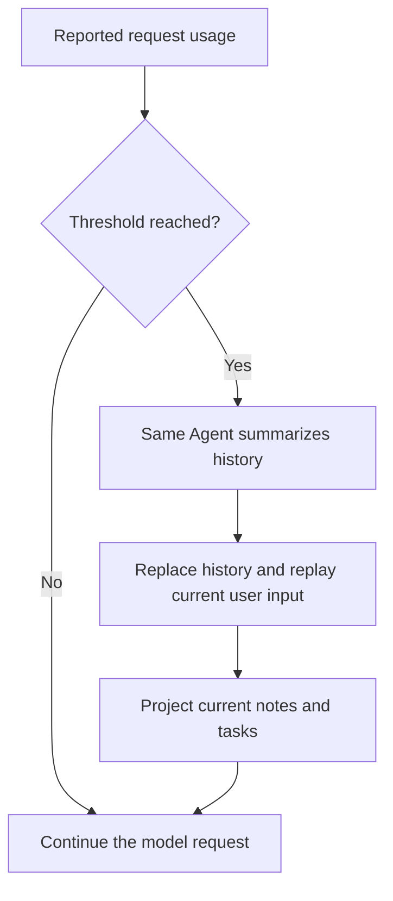

A useful next turn needs both current information and remembered decisions. Context Capabilities prepare the current model request; working state carries structured facts; compaction replaces long conversation history with a summary. Choose each mechanism for the information it owns.

## Choose the right mechanism

| Need                                          | Mechanism                             |
| --------------------------------------------- | ------------------------------------- |
| Current time, usage, selected Run metadata    | Runtime context                       |
| Workspace structure or project instructions   | Workspace outline and file context    |
| Tasks and decisions across turns              | Working state in `HarnessState`       |
| A shorter long-running conversation           | Handoff or proactive compaction       |
| Continue after native context-window overflow | Context recovery (enabled by default) |
| Durable files shared across Threads           | [File memory](memory.md)              |
| Facts recalled by similarity                  | [Record memory](memory.md)            |
| Shorter old tool results after idle time      | Cold-start filter                     |

Start with the [two-Run example](#context-composition), then add workspace guidance or compaction as needed. [State and Resume](state-and-resume.md) explains how the Host saves and continues the Thread.

## Run configuration

`RunConfiguration` supplies settings shared by tools and plugins during one Run. This fragment builds a configuration and checks a URL locally; it makes no HTTP request:

```python
from a13n_harness import RunBindings, RunConfiguration

configuration = RunConfiguration(
    allowed_hosts={"api.example.com", "docs.example.com"},
    extensions={"example.reader": {"images": True}},
)
configuration.authorize_url("https://docs.example.com/guide")
bindings = RunBindings.embedded(configuration=configuration)
# Pass bindings to agent.run(..., bindings=bindings).
```

Tools read `ctx.deps.configuration`; plugins read `AgentContext.configuration`. Each integration validates its own namespaced `extensions` values. These are configuration inputs, separate from the model-facing metadata selected by `RuntimeContextCapability` below.

`allowed_hosts=None` permits all destinations, while an empty set denies all. First-party HTTP integrations apply the rules. Custom integrations must call `authorize_url()` before the initial request and every redirect. The check examines the declared HTTP(S) hostname, without resolving DNS or enforcing network isolation. Use Environment or deployment controls for shell and third-party networking. Under a restricted allowlist, use local MCP and Host Web tools, and supply authorized media bytes as `BinaryContent` rather than forwarding media URLs.

### Host rules and regular expressions

Host rules match the entire normalized hostname using `re.fullmatch`, not the URL path or port. DNS names are lowercased and IDNA-normalized; write lowercase ASCII patterns or use `(?i)`. Exact and regex rules can coexist.

```python
configuration = RunConfiguration(
    allowed_hosts={
        "api.vendor.example",                         # Exact host only.
        r"regex:(api|docs)\.example\.com",            # Two named subdomains.
        r"regex:(?:[a-z0-9-]+\.)*assets\.example\.com", # Base and all subdomain levels.
    },
)
```

| Rule                                  | Allows                              | Does not allow                            |
| ------------------------------------- | ----------------------------------- | ----------------------------------------- |
| `example.com`                         | `example.com`                       | `api.example.com`                         |
| `regex:[a-z0-9-]+\.example\.com`      | `api.example.com`                   | `example.com`, `eu.api.example.com`       |
| `regex:(?:[a-z0-9-]+\.)*example\.com` | `example.com`, `eu.api.example.com` | `notexample.com`, `example.com.evil.test` |

Escape literal dots as `\.`. `*.example.com` is not a glob.

When writing YAML, use single quotes to preserve backslashes, for example `'regex:(api|docs)\.example\.com'`. JSON requires doubled backslashes: `"regex:(api|docs)\\.example\\.com"`. Python raw strings, as shown above, avoid extra escaping.

## Context Composition

Use the Python environment from [Getting started](getting-started.md). Save this complete offline example as `context_demo.py`. The first Run writes a note; the second restores serialized State and receives that note as current context:

```python
import asyncio

from pydantic_ai.messages import ModelRequest, ToolReturnPart, UserPromptPart
from pydantic_ai.models.function import DeltaToolCall, FunctionModel

from a13n_harness import AgentSpec, HarnessBuilder, HarnessState, RunBindings
from a13n_harness.capabilities import (
    RuntimeContextCapability,
    RuntimeContextConfiguration,
    WorkingStateCapability,
)


async def respond(messages, info):
    current = messages[-1]
    assert isinstance(current, ModelRequest)
    projected = "\n".join(
        str(part.content) for part in current.parts if isinstance(part, UserPromptPart)
    )
    assert "runtime" in projected
    returns = [part for part in current.parts if isinstance(part, ToolReturnPart)]
    if returns:
        assert returns[-1].content["action"] == "created"
        yield "Decision recorded."
    elif '<note key="decision">' in projected:
        assert "Keep the public API stable." in projected
        yield "Continuing with the saved decision."
    else:
        assert "migration" in projected
        yield {0: DeltaToolCall(
            name="note_write",
            json_args='{"key":"decision","value":"Keep the public API stable."}',
        )}


async def main():
    agent = HarnessBuilder().build(
        AgentSpec(),
        output_type=str,
        model=FunctionModel(stream_function=respond),
        capabilities=(
            RuntimeContextCapability(
                RuntimeContextConfiguration(metadata_keys=("project",))
            ),
            WorkingStateCapability(),
        ),
    )
    bindings = RunBindings.embedded(metadata={"project": "migration"})
    first = await agent.run("Record the migration decision.", bindings=bindings)
    print(first.output_or_raise())
    assert first.state is not None
    restored = HarnessState.model_validate_json(first.state.model_dump_json())
    second = await agent.run("Continue.", previous_state=restored, bindings=bindings)
    print(second.output_or_raise())
    assert second.thread_id == first.thread_id
    assert second.run_id != first.run_id


asyncio.run(main())
```

Run `uv run --no-sync python context_demo.py`. It prints `Decision recorded.` followed by `Continuing with the saved decision.` The assertions check the current request's projection, not just the old tool result in history. Both Runs belong to the same Thread, with different Run IDs. The JSON round trip demonstrates portable state; durable storage remains the Host's job.

To add workspace information, supply a [prepared Environment source](environments.md#supply-a-source) and a configured Model to this helper:

```python
from pydantic_ai.models import Model

from a13n_harness import AgentSpec, EnvironmentSource, HarnessBuilder
from a13n_harness.capabilities import (
    FileContextCapability,
    RuntimeContextCapability,
    WorkspaceOutlineCapability,
)


async def describe_workspace(source: EnvironmentSource, model: Model) -> str:
    agent = HarnessBuilder().build(
        AgentSpec(),
        output_type=str,
        model=model,
        capabilities=(
            RuntimeContextCapability(),
            WorkspaceOutlineCapability(),
            FileContextCapability(),
        ),
    )
    result = await agent.run(
        "Describe the workspace using its outline and project guidance.",
        environment=source,
    )
    return result.output_or_raise()
```

Each Capability contributes a different part:

- `RuntimeContextCapability` refreshes timing and usage information at request boundaries. `metadata_keys` selects application metadata for user-input requests; arbitrary Run metadata is not exposed automatically.
- `WorkspaceOutlineCapability` supplies file metadata on user-input requests, without reading file bodies.
- `FileContextCapability` loads selected files once per logical Run and checks that their Environment routes remain valid.

File context reads the working directory's `AGENTS.md` by default. It also lists immediate child `AGENTS.md` paths and `.agents/skills` directories in the working directory and immediate children. These are entrypoint hints: the Agent still reads child guidance and Skills through file tools when needed. Add `DynamicEnvironmentCapability` if the Agent should perform those reads itself.

The hint scan examines at most 64 non-hidden entries and uses a separate 8 KiB budget. An `incomplete` marker means more guidance may exist. Hints refresh on the next Run, including when no root `AGENTS.md` exists. Set `FileContextConfiguration(include_project_guidance=False)` to keep file content but omit hints. Each context configuration also exposes limits for its own bytes, files, depth, or lines.

## Compact a long Thread

Add `CompactionCapability()` to compact automatically during a Run. The default trigger is reported usage reaching 90% of the effective Model's context window. Supply `AgentSpec.model_characteristics` if the Model lacks window information. To use a fixed token trigger, add this Capability to the builder's `capabilities` tuple:

```python
from a13n_harness.capabilities import CompactionCapability, CompactionPolicy

compaction = CompactionCapability(CompactionPolicy(trigger_tokens=100_000))
# Include compaction in HarnessBuilder.build(..., capabilities=(compaction,)).
```



The summary request uses the same Agent and complete history. After successful replacement, Harness replays current user input and delivered steering in order, including media, then projects current notes and tasks. The returned State contains the replacement.

Budget for up to three summary requests. Transient failures retry with exponential backoff; each attempt uses a fresh copy of the complete history and shares the Run's usage limits. Every retry reserves allowance for the pending ordinary request. Cancellation, Host refusal, and permanent failures are not retried.

Add `HandoffCapability()` when the Agent should also call `summarize` explicitly. Its default reminder begins at 65% of the context window. Select the Capabilities as well as their thresholds: model characteristics alone do not enable either mechanism.

### Host-triggered compaction

Use `agent.compact()` between Runs when the Host decides to shorten a settled checkpoint. It generates a summary and returns an immediately saveable State without continuing the business task. It requires no automatic-compaction Capability or threshold.

Save this as `compact_demo.py` and run `uv run --no-sync python compact_demo.py` in the same environment:

```python
import asyncio

from pydantic_ai.models.function import FunctionModel
from pydantic_ai.usage import UsageLimits

from a13n_harness import AgentSpec, HarnessBuilder, HarnessState


async def main():
    calls = 0

    async def respond(messages, info):
        nonlocal calls
        calls += 1
        if calls == 1:
            yield "Plan: inspect the schema, then migrate."
        elif calls == 2:
            assert "Do not call tools" in str(messages)
            yield "Migration plan: inspect the schema next."
        else:
            assert "Migration plan: inspect the schema next." in str(messages)
            yield "Ready to inspect the schema."

    agent = HarnessBuilder().build(
        AgentSpec(), output_type=str, model=FunctionModel(stream_function=respond)
    )
    first = await agent.run("Plan the migration.")
    first.output_or_raise()
    assert first.state is not None
    original = first.state.model_dump_json()
    compacted = await agent.compact(
        previous_state=first.state, usage_limits=UsageLimits(request_limit=1)
    )
    print(compacted.output_or_raise())
    assert first.state.model_dump_json() == original
    assert compacted.state is not None
    checkpoint = HarnessState.model_validate_json(compacted.state.model_dump_json())
    continued = await agent.run("Continue.", previous_state=checkpoint)
    print(continued.output_or_raise())
    assert first.thread_id == compacted.thread_id == continued.thread_id
    assert calls == 3


asyncio.run(main())
```

It prints the migration summary, then `Ready to inspect the schema.` The example verifies that compaction leaves the original State unchanged and uses one model request. Serialization happens immediately; the later ordinary Run restores runtime context and continues the task.

For an application checkpoint store, follow this sequence:

1. Prevent concurrent progress on the selected Thread and read its checkpoint version.
2. Call `compact(previous_state=..., bindings=...)` with fresh Host bindings. `instruction=None` uses the default summary guidance; a string replaces that guidance while keeping the built-in history-only and no-tools constraints.
3. Accept only a completed result. Publish its State with the expected-version or execution-ownership check used by your store.
4. Report saved success after publication commits. Let the next ordinary Run restore context before continuing.

The existing Agent output mode must allow text. Native and prompted JSON modes fail rather than changing schemas. System prompts, tool definitions, output configuration, model settings, and full history stay in the request; keeping them stable supports provider cache reuse, subject to provider policy. Blank summaries, tool calls, unfinished responses, or provider failures do not replace history.

A checkpoint with pending tools, retained executions, an unrestored handoff, or pending compaction restoration returns `compaction_boundary_pending` before summary dispatch. Settle that boundary with ordinary Run recovery first. A newly compacted checkpoint is ready to save, but must pass through an ordinary Run before another compaction.

On failure, exception, or cancellation, keep the original checkpoint. Failed results include a safe code/message and `failure.details.phase`; preparation, middleware, and cleanup can raise under the ordinary Run contract. Cancellation propagates. `CompactionSummaryEvent` and `compaction_completed` describe generation, not durable publication, and may precede a later failure. They are not repeated by the subsequent restoration. Handle storage conflicts separately from model failures; scheduling and idle timers belong to the Host.

### Context recovery

Context recovery is enabled by default, independently of proactive `CompactionCapability` and transient `ModelRecoveryPolicy`. After a native context-window overflow in an ordinary request, Harness first tries normal compaction. A successful summary lets the same logical Run continue with compacted history.

If both the ordinary request and its applicable summary request overflow, Harness reconstructs a bounded, lossy history excerpt. Either failure may occur first; an applicable summary failure is reused. The excerpt prioritizes the current task and user corrections. Current instructions, separately stored state, execution ownership and usage limits remain in effect. Recorded tool calls are historical evidence and are never replayed by reconstruction.

History preservation is best effort. Supply `RunBindings.retained_history_directory` for an authorized Environment location that survives continuation and enable a file reader. Missing storage, unavailable readers or write failures produce explicit loss notices and still allow reconstruction. Read retained files selectively; their availability follows the Environment's lifetime. Hosts with worker takeover also supply one stable `context_recovery_scope_id` per logical Run and commit the replacement history and marker before resuming dispatch.

A successful summary does not authorize reconstruction. If the compacted primary request still overflows before a complete primary response advances to tool execution, the Run fails with that overflow. Harness does not repeat overflow-triggered compaction without this progress. After accepted primary progress, a later overflow can try normal compaction again. This retry bound is separate from the persisted limit of one reconstruction per logical Run.

Configure `AgentDefinition.context_recovery` or `HarnessBuilder.build(context_recovery=...)` with `ContextRecoveryPolicy` from `a13n_harness`:

| Setting             | Default | Meaning                                                                                    |
| ------------------- | ------- | ------------------------------------------------------------------------------------------ |
| `enabled`           | `True`  | Enable overflow-triggered compaction and last-resort reconstruction                        |
| `max_history_chars` | `24000` | Aggregate reconstructed history prompt budget, including notices and paths; minimum `2048` |
| `preserve_history`  | `True`  | Attempt to save a readable transcript before reconstruction                                |

Set `enabled=False` to disable this recovery path; configured proactive compaction remains active. The history budget covers the reconstructed excerpt, while system instructions and regenerated live context remain outside it. Preservation uses the Environment's file operations and cancellation behavior, with no additional recovery-specific timeout or size ceiling. A second overflow after reconstruction fails with `context_recovery_exhausted`.

> [!WARNING]
> Every lossy reconstruction requires immediate root-cause investigation, even when continuation succeeds. Check compaction configuration and unbounded tool output first. The warning and recovery outcome remain visible; success does not fix the underlying cause.

### Background compaction

Choose background mode when your Host can retain summary work after the foreground Run closes. It requires an application-owned `CompactionOperator`; this helper connects an existing operator to the Agent:

```python
from a13n_harness.capabilities import CompactionCapability
from a13n_harness.compaction import BackgroundCompactionPolicy, CompactionOperator


def background_compaction(operator: CompactionOperator) -> CompactionCapability:
    return CompactionCapability(
        background=BackgroundCompactionPolicy(enabled=True, blocking_threshold=0.95),
        operator=operator,
    )
```

Implement the operator before adding the returned Capability to the builder:

1. Provide `submit(input)`, `inspect(thread_id)`, and `wait(thread_id, operation_id)`. Admit one unacknowledged operation per Thread, make submission idempotent by operation ID, and keep reads non-consuming.
2. Generate with `generate_compaction(input, request)`. The callback obtains fresh Host authority and reads `request_messages`, `settings`, and `parameters` from its `CompactionInput`. Account for every attempt; retain no parent Agent, live resource, or mutable usage object.
3. Save the ready result before notifying. Reconcile interrupted work after process loss rather than assuming a saved record recreates execution.
4. Apply through an ordinary Run and retire the operation only after the resulting checkpoint commits.

Harness summarizes a complete history prefix and retains later messages, including tool results and steering. Both thresholds use the latest model response's usage, as synchronous compaction does. Background progress requires neither native token counting nor an explicit `max_tokens`. The default trigger is 90%, and the default blocking line is 95%. `blocking_threshold` accepts values above zero through one. Background mode defaults off; `background=True` enables its default policy.

The trigger gates new compaction. If you set the trigger to 98% and leave the blocking line at 95%, Harness continues until 98%, then compacts synchronously. There is no asynchronous interval. The same applies when the thresholds are equal. Without valid latest usage, Harness starts no proactive compaction. An absolute token trigger with no resolved window selects synchronous compaction when reached.

| At a model boundary                                         | Action                                           |
| ----------------------------------------------------------- | ------------------------------------------------ |
| Trigger reached, no operation, usage below blocking line    | Submit background work and continue              |
| Trigger reached, no operation, blocking line reached        | Compact synchronously                            |
| Operation running, usage below blocking line or unavailable | Continue                                         |
| Operation running, blocking line reached                    | Wait for that operation                          |
| Failed operation and trigger reached                        | Try synchronous recovery                         |
| Ready, applicable result                                    | Replace the matching prefix; preserve the suffix |

Successful synchronous recovery marks the failed operation `skipped` for acknowledgement after checkpoint commit. Failed recovery preserves history and returns the original request, just like synchronous compaction. Each failed operation gets at most one bounded retry sequence per Run. Cancellation and Host refusal propagate. Summary calls retain their usage and admission limits.

Latest usage is a lagging signal: new tool results and inputs can still exceed the provider's window. Ordinary model admission and context recovery handle native overflow. Applied summaries proceed to ordinary dispatch without rechecking pre-compaction or summary-generation usage; the next model response supplies fresh usage.

When a result becomes ready between Runs, use this integration fragment. `executable`, `bindings`, `latest_state`, `result`, `state_store`, and `retire_operation` come from your Host; `committed_state` must be the State your checkpoint store actually selected and committed:

```python
from a13n_harness.compaction import compaction_disposition

continued = await executable.run(
    "Continue", previous_state=latest_state, compaction_result=result, bindings=bindings
)
# Commit continued.state through your Host's normal fenced checkpoint path.
# Only the actually selected, committed state permits acknowledgement:
disposition = await compaction_disposition(
    committed_state, basis=result.basis, state_store=state_store
)
if disposition is not None:
    await retire_operation(result.basis.operation_id)  # Your Host's operation store.
```

`CompactionBasis` identifies the operation, Thread, and captured prefix. Harness validates the canonical history before recovery and replaces only a matching prefix. Changing system prompts is allowed; other prefix edits yield `skipped`. An unresolved tool or suspended boundary defers application, so pass the same result again on a later Run. Supply `RunBindings(state_store=...)` when history content is externalized.

Use `compaction_disposition()` rather than parsing the private `a13n.compaction` namespace. A saved `applied` or `skipped` disposition makes re-delivery a no-op. Pending runtime restoration is tracked separately: the next Run refreshes discovery and CodeAct descriptions and resets memory delivery cursors, even without a compaction Capability or operator. A failing listener leaves restoration pending for retry. Restoration is not a storage acknowledgement.

Store `CompactionInput` and `CompactionResult` as confidential execution data. Inputs contain the projected summary request and model configuration; results need only their basis and summary for application. Canonical originals stay in State. The shared `apply_compaction` function performs the pure history transformation. An idle Host retains ready results until an ordinary Run can apply them; it does not rewrite checkpoints in the background. Service and Harness UI each need their own operator and persistence integration for this mode.

## Handoff versus automatic compaction

Use `summarize` at an intentional task boundary, or let automatic compaction react to usage. A useful handoff records the objective, decisions, unfinished work, and next action. Include the paths and roles of Skills needed next; reread those Skills after restoration when their complete contents are no longer available.

Call `summarize` directly as the only tool call in its response, outside CodeAct and ToolSearch proxy groups. A retained CodeAct runner blocks replacement: automatic compaction waits, while Handoff rejects the call. Wait for it to finish, inspect the result, then write a fresh summary. Other retained function tools do not block replacement. Save the returned `HarnessState` using the Host's normal acceptance policy.

### Retain called tools

After replacement, the Agent can reuse a bounded set of [ToolSearch](tool-search.md) tools it actually called. Completed target calls enter this set, including proxy and CodeAct dispatch. Searching alone adds no entry; repeated calls update recency. Business results belong in the summary, not in replayed tool output.

For example, discovering A and B but calling only A retains A. Harness rebuilds discovery from current definitions and labels it as a partial reconstruction. No search runs, and original query text becomes `[query omitted during context replacement]`. Removed, unavailable, or changed-source tools are dropped. Activation through `load_capability` follows a separate lifecycle.

The limits are 32 distinct tools and an estimated 64 KiB discovery context, including native schema expansion and both CodeAct directories. Selected schemas remain complete. This budget counts UTF-8 bytes, not tokens, and excludes recovery metadata. Portable retention state stores names and source identities in recency order, capped at 128 KiB; it stores neither schemas nor search results.

After a call to `crm__customer_name`, context replacement has this order:

| Position | Explicit `summarize`                                             | Automatic compaction                                                |
| -------- | ---------------------------------------------------------------- | ------------------------------------------------------------------- |
| 1        | Stable system prefix, handoff summary, and restoration reminders | Stable system prefix and compact directive                          |
| 2        | Reconstruction notice and synthetic discovery for called tools   | Assistant summary                                                   |
| 3        | Current user input and delivered steering                        | Reconstruction notice and synthetic discovery for called tools      |
| 4        |                                                                  | Restored-context marker, current user input, and delivered steering |

Notes, tasks, and runtime context are projected from their current owners. The summary carries the customer result; retained discovery enables another call without a new search. Both CodeAct directories reflect the retained set on the first replacement request. Persist State to carry this working set into another Run.

## Working State

The first example uses embedded working state: tasks and notes live in the Capability's portable namespace and travel with `HarnessState`. Keep `WorkingStateCapability()` in the definition when restoring that State.

For application-owned tasks, select provider mode and supply a fresh `TaskStateBinding` through `RunBindings.task_state`. The provider owns task truth; Harness events report bounded committed changes. Cross-worker ownership, leases, scheduling, and durable delivery belong to the Host or provider.

| Tool                     | Result                                                     |
| ------------------------ | ---------------------------------------------------------- |
| `note_write(key, value)` | Creates or updates; reports `created` or `updated`         |
| `note_delete(key)`       | Idempotent deletion; reports `deleted` or `already_absent` |
| `note_get(key)`          | Returns the complete value                                 |
| `note_get()`             | Returns sorted keys and a count                            |

Notes project on user-input requests; tasks also refresh on tool-result requests. `<note>` carries a complete value. `<note-ref>` and `<notes-omitted>` direct the Agent to `note_get`. The defaults are 256 projected notes and 128 tasks sharing a 64 KiB budget, configurable through `WorkingStateConfiguration`.

Use notes for facts, tasks for execution progress, and the summary for continuation narrative. Before handoff, reconcile stale notes and task statuses instead of copying their entire contents into the summary.

## Filters

Filters prepare model requests while preserving saved history and source files. Integrity and media compatibility filters run before requests. Optional content filtering selects accepted media; cold-start filtering is enabled by default after one idle hour and shortens old tool text while retaining user input, thinking, media, and pending results.

This construction fragment sets media selection and the cold-start interval. Pass `spec` and `capabilities` to your builder; `without_cold_compression` is the alternative spec with cold-start compression disabled:

```python
from a13n_harness import AgentSpec
from a13n_harness.filters import (
    ColdStartFilterConfiguration,
    ContentFilterCapability,
    ContentFilterConfiguration,
)

capabilities = (
    ContentFilterCapability(
        ContentFilterConfiguration(
            accepted_media=frozenset({"image", "document"}),
            max_media_items=16,
        )
    ),
)
spec = AgentSpec(cold_start_filter=ColdStartFilterConfiguration(idle_seconds=3_600))
without_cold_compression = spec.with_updates(cold_start_filter=None)
```

An explicit `ColdStartFilterCapability` replaces the default policy. Use [media acquisition](multimedia-understanding.md) for video and [image input policy](models.md#image-input-policy) for image limits.

Image preparation is enabled by default. This separate spec example limits images and disables large-image splitting; the alternative disables preparation entirely:

```python
from a13n_harness import HarnessModelCharacteristics, ImageInputPolicy

characteristics = HarnessModelCharacteristics(
    image_input=ImageInputPolicy(max_images=10, split_large_images=False),
)
spec = AgentSpec(model_characteristics=characteristics)
without_image_preparation = spec.with_updates(
    model_characteristics=characteristics.model_copy(update={"image_input": None}),
)
```

Omitting `image_input` selects defaults; setting it to `None` disables preparation. Apply this Model policy together with your chosen context Capabilities.
