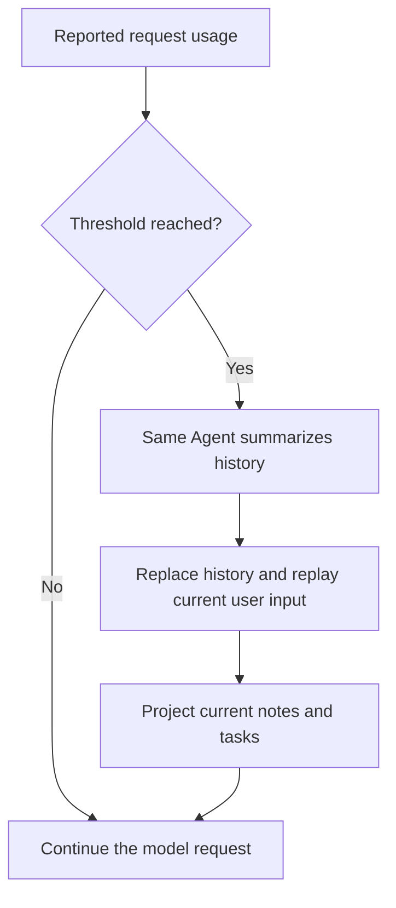

Use context projections for the current request, compaction for long history, and working state for task facts.

## Choose the right mechanism

| Need                                   | Mechanism                             |
| -------------------------------------- | ------------------------------------- |
| Current time, usage, file metadata     | Runtime context and workspace outline |
| Current instructions or selected files | File context                          |
| Long Thread histories                  | Handoff and compaction                |
| Tasks and notes across turns           | Working state in `HarnessState`       |
| Durable files shared across Threads    | [File memory](memory.md)              |
| Facts recalled by similarity           | [Record memory](memory.md)            |
| Smaller requests after idle time       | Cold-start filter                     |

Select the Capability for your task. Use [State and Resume](state-and-resume.md) to persist and continue a Thread.

## Run configuration

Pass shared per-Run settings through `RunConfiguration`:

```python
from a13n_harness import RunBindings, RunConfiguration

configuration = RunConfiguration(
    allowed_hosts={"api.example.com", "docs.example.com"},
    extensions={"example.reader": {"images": True}},
)
bindings = RunBindings.embedded(configuration=configuration)
# Pass bindings to executable.run(..., bindings=bindings).
```

Plugins and tools read `AgentContext.configuration` (`ctx.deps.configuration` inside a tool). Each integration validates its own namespaced `extensions` values.

`allowed_hosts=None` allows all destinations; an empty set denies all. Entries match exact normalized hostnames/IPs or explicit `regex:` rules. First-party HTTP integrations apply this allowlist. In your own integrations, call `configuration.authorize_url(url)` before requests and redirects. Under a restricted allowlist, use local MCP and Host Web tools, and materialize media as authorized `BinaryContent` instead of forwarding a URL. Shell and third-party plugin networking needs Environment or deployment isolation.

### Host rules and regular expressions

Host rules match the entire normalized hostname using `re.fullmatch`, not the URL path or port. DNS names are lowercased and IDNA-normalized; write lowercase ASCII patterns or use `(?i)`. Exact and regex rules can coexist.

```python
configuration = RunConfiguration(
    allowed_hosts={
        "api.vendor.example",                         # Exact host only.
        r"regex:(api|docs)\.example\.com",            # Two named subdomains.
        r"regex:(?:[a-z0-9-]+\.)*assets\.example\.com", # Base and all subdomain levels.
    },
)
```

| Rule                                  | Allows                              | Does not allow                            |
| ------------------------------------- | ----------------------------------- | ----------------------------------------- |
| `example.com`                         | `example.com`                       | `api.example.com`                         |
| `regex:[a-z0-9-]+\.example\.com`      | `api.example.com`                   | `example.com`, `eu.api.example.com`       |
| `regex:(?:[a-z0-9-]+\.)*example\.com` | `example.com`, `eu.api.example.com` | `notexample.com`, `example.com.evil.test` |

Escape literal dots as `\.`. Use `regex:(?:[a-z0-9-]+\.)*example\.com` for a base domain and its subdomains; `*.example.com` is not a glob. Every redirect destination must match a rule.

When writing YAML, use single quotes to preserve backslashes, for example `'regex:(api|docs)\.example\.com'`. JSON requires doubled backslashes: `"regex:(api|docs)\\.example\\.com"`. Python raw strings, as shown above, avoid extra escaping.

## Context Composition

Combine these Capabilities to show current metadata and selected files:

```python
from a13n_harness.capabilities import (
    FileContextCapability,
    RuntimeContextCapability,
    WorkspaceOutlineCapability,
)

capabilities = (
    RuntimeContextCapability(),
    WorkspaceOutlineCapability(),
    FileContextCapability(),
)
```

- Runtime context is refreshed for each request and can expose only explicitly selected metadata keys.
- Workspace outline reads metadata, not file content, and appears only on user-input requests.
- File context loads selected files once for the logical Run and fences the Environment route used to load them.

Use each Capability's configuration to set byte, item, depth, and line limits for your workspace.

File context reads the working directory's `AGENTS.md` by default. It also announces immediate child `AGENTS.md` paths and `.agents/skills` directories in the working directory and its immediate children. These hints load no child file contents or skill descriptions. The Agent reads relevant project guidance and Skills through ordinary file tools when needed. Discovery does not expand the selected Skill catalog or change permissions.

The hint scan examines at most 64 non-hidden working-directory entries and emits at most 8 KiB separately from the file-content budget. Partial results are marked `incomplete`; deeper guidance can still exist. Hints refresh on the next logical Run, even when the root has no `AGENTS.md`. Set `FileContextConfiguration(include_project_guidance=False)` to keep file contents without entrypoint hints.

## Compact a long Thread

Add `CompactionCapability()` to enable automatic history compaction. The default trigger is 90% of the effective Model's context window, using reported token usage. Set `AgentSpec.model_characteristics` when your Model lacks context-window information. For a fixed trigger, select a token policy:

```python
from a13n_harness.capabilities import CompactionCapability, CompactionPolicy

compaction = CompactionCapability(CompactionPolicy(trigger_tokens=100_000))
# Include compaction in HarnessBuilder.build(..., capabilities=(compaction,)).
```



The summary request uses the same Agent and complete history. The summary replaces old history; current user input and delivered steering are replayed in order, including media. Compaction emits `CompactionSummaryEvent` and stores the replacement in returned state. It makes a model request, so include that request in your budget.

Select `HandoffCapability()` when you also want the `summarize` tool for explicit handoffs. Its default reminder starts at 65% of the context window. Both Capabilities are opt-in; threshold configuration alone enables neither.

### Background compaction

A Host can run summary generation independently of the foreground Run:

```python
from a13n_harness.compaction import CompactionOperator


def background_compaction(operator: CompactionOperator) -> CompactionCapability:
    return CompactionCapability(background=True, operator=operator)
```

Implement `submit(input)`, `inspect(thread_id)` and `wait(thread_id, operation_id)` on the operator. Keep execution alive after the submitting Run closes. Admit one unacknowledged operation per Thread, save ready results before notification, and make reads non-consuming. Use `generate_compaction(input, request)` for the summary protocol and bounded transient retries. The callback receives `CompactionInput`, reads fresh `request_messages`, `settings` and `parameters`, and uses fresh Host model authority to account for each attempt; it must not capture the parent Run's Agent, resources or mutable usage.

Harness freezes a complete prefix before the outgoing request. When the summary is ready, Harness replaces that prefix and preserves all later native messages, including tool results and steering. It applies at the next eligible model boundary. Concurrent foreground progress requires native token counting, a known context window and an explicit `max_tokens` reserve. At the compaction trigger, Harness starts background work only with verified capacity; otherwise it compacts synchronously without submitting a new operation. If an operation is already running, unknown or insufficient capacity causes waiting for that same operation. A failed operation, including one interrupted before a later Run, falls back to synchronous compaction when compaction is still needed. Successful fallback records the old operation as skipped, so the Host retires it only after checkpoint commit. Failed fallback preserves history and permits continuation only with verified capacity; it does not repeatedly retry that failure within the same Run. All summary calls retain current usage and admission limits. Harness rejects a known oversized replacement instead of trimming recent work.

For a result ready between Runs, pass it alongside the latest selected checkpoint to the ordinary Run:

```python
from a13n_harness.compaction import compaction_disposition

continued = await executable.run(
    "Continue", previous_state=latest_state, compaction_result=result, bindings=bindings
)
# Commit continued.state through your Host's normal fenced checkpoint path.
# Only the actually selected, committed state permits acknowledgement:
disposition = await compaction_disposition(
    committed_state, basis=result.basis, state_store=state_store
)
if disposition is not None:
    await retire_operation(result.basis.operation_id)  # Your Host's operation store.
```

The Run leaves the supplied checkpoint unchanged. The result contains its own `CompactionBasis`: operation and Thread identities, prefix length and digest, and retained semantic inputs. Harness hydrates and validates canonical history before recovery changes it, then replaces only the matching prefix and preserves the complete suffix. Supply `RunBindings(state_store=...)` when checkpoint content is externalized. Current system prompts come from the executable: changing, reordering or removing system blocks, even in an intervening Run, does not invalidate a result. Other history edits produce a terminal `skipped` disposition. A matching unresolved tool or suspended boundary defers application until a later Run; supply the result again then.

The `a13n.compaction` namespace records the last processed operation, basis fingerprint, applied/skipped disposition and independent pending runtime restoration. Re-delivery with either saved disposition is a no-op. Use `compaction_disposition` rather than parsing that private namespace. Before the next Run's first context projection, Harness restores current tool discovery and CodeAct descriptions and resets memory delivery cursors through restoration events. Current image/video rules and capacity checks govern the outgoing request. The resumed executable needs neither a `CompactionCapability` nor an operator for this restoration. Listener failure or cancellation leaves restoration pending for retry. A restoration event alone is not a save acknowledgement.

`CompactionInput` holds the projected summary request and captured model configuration. `CompactionResult` holds only its basis and summary; applying it needs no generation input or model configuration. Canonical originals remain in State. Store inputs and results as confidential execution data. Keep credentials and connection policy in the fresh Host request callback. `apply_compaction` is the shared pure history transformation; active application and next-Run joint resume share its decision and restoration rules. One operation stays outstanding until a normal checkpoint commit acknowledges it. Background completion stores the result and waits when idle, without rewriting a checkpoint. Service and Harness UI require their own operator and persistence integration to enable this mode.

## Handoff versus automatic compaction

A continuation summary carries the paths and roles of Skills still needed. Reread them on resume when their full content is no longer available.

Use `summarize` for an explicit handoff or let compaction react to usage. See [Compact a long Thread](#compact-a-long-thread) for thresholds.

Call `summarize` directly as the only tool call in its model response, outside CodeAct and ToolSearch proxy groups. While a retained CodeAct runner is active, automatic compaction waits and Handoff rejects the call. Wait for the runner to finish, inspect its result, then write a fresh summary. Other retained function tools do not block context replacement.

Persist the returned `HarnessState` under your Host's acceptance policy; a summary does not save application storage.

### Retain called tools

Both `summarize` and automatic compaction retain a bounded set of previously called [ToolSearch](tool-search.md) tools. Only completed target calls enter the working set, including calls through CodeAct and proxy dispatch. Searching alone adds nothing; repeated calls refresh one entry. Ordinary business-tool results are summarized instead of replayed.

Retention selects the most recently called tools, up to 32 distinct tools within a 64 KiB estimated discovery-context budget. The estimate includes native schema expansion and both CodeAct runner directories, excluding recovery metadata. This is a UTF-8 byte estimate, not a token limit. Each selected tool keeps its complete current schema. Removed, unavailable or changed-source tools are dropped. Deferred Capability activation through `load_capability` is outside this retention policy.

Harness rebuilds a compact synthetic search result from current definitions. A notice explicitly identifies the reconstruction, explains that the retained set is partial, and tells the Agent to search again for other tools. No search is executed. Original queries are not retained: native `queries` and proxy `query` use the explicit placeholder `[query omitted during context replacement]`. Searching for A and B and then calling only A retains only A; B does not consume the retention budget.

For example, after discovering `crm__customer_name` and looking up customer 42, the replacement has this order:

| Position | Explicit `summarize`                                             | Automatic compaction                                                |
| -------- | ---------------------------------------------------------------- | ------------------------------------------------------------------- |
| 1        | Stable system prefix, handoff summary, and restoration reminders | Stable system prefix and compact directive                          |
| 2        | Reconstruction notice and synthetic discovery for called tools   | Assistant summary                                                   |
| 3        | Current user input and delivered steering                        | Reconstruction notice and synthetic discovery for called tools      |
| 4        |                                                                  | Restored-context marker, current user input, and delivered steering |

Current notes, tasks, and runtime context are projected again through their normal providers. The customer lookup result belongs in the summary; the retained discovery lets the Agent call `crm__customer_name` again without another search. Both CodeAct directories reflect the retained tools on the first request after replacement.

Portable retention state contains only called tool names and source identities in call-recency order, capped at 128 KiB. It stores neither search results nor schemas. A target called inside CodeAct follows the same policy as a direct target call. Persist the returned `HarnessState` to carry this working set and the replacement history into another Run.

## Working State

`WorkingStateCapability` can keep tasks and notes inside its portable Capability namespace:

```python
from a13n_harness.capabilities import WorkingStateCapability

capabilities = (WorkingStateCapability(),)
```

This embedded mode, with no `TaskStateBinding`, is useful for one process-local or state-resumed Agent. Provider mode replaces task storage with a fresh `TaskStateBinding` in `RunBindings.task_state`; the provider remains authoritative, while Harness events report bounded committed deltas.

The note tools have explicit mutation semantics:

- `note_write(key, value)` creates or updates a note and reports `created` or `updated`;
- `note_delete(key)` is idempotent and reports `deleted` or `already_absent`;
- `note_get(key=None)` reads one complete value or lists sorted keys with a count.

Notes appear on user-input requests; tasks also refresh on tool-result requests. Complete notes appear as `<note>`; `<note-ref>` and `<notes-omitted>` point to values available through `note_get`. `WorkingStateConfiguration` defaults to 256 projected notes and 128 tasks within a shared 64 KiB budget.

Use notes for facts, tasks for execution progress, and `summarize` for the continuation narrative. Reconcile stale notes and task statuses before a handoff rather than copying them all into the summary.

Working state is not a distributed workflow engine. Cross-worker ownership, durable leases, schedules, and delivery belong to the Host or task provider.

## Filters

Harness applies message-integrity and media compatibility filters before model requests. Media preparation leaves saved history and source files unchanged. Use [media acquisition](multimedia-understanding.md) for video and [image input policy](models.md#image-input-policy) for image limits. Content filtering is optional; cold-start filtering is on by default after one hour of idle time:

```python
from a13n_harness import AgentSpec
from a13n_harness.filters import (
    ColdStartFilterConfiguration,
    ContentFilterCapability,
    ContentFilterConfiguration,
)

capabilities = (
    ContentFilterCapability(
        ContentFilterConfiguration(
            accepted_media=frozenset({"image", "document"}),
            max_media_items=16,
        )
    ),
)
spec = AgentSpec(cold_start_filter=ColdStartFilterConfiguration(idle_seconds=3_600))
without_cold_compression = spec.with_updates(cold_start_filter=None)
```

Content filtering selects compatible media. Cold-start filtering shortens old tool-result text, preserving user input, thinking, media, and pending results. An explicit `ColdStartFilterCapability` replaces the default policy.

Image preparation is on by default. Override the selected Model's policy or disable it:

```python
from a13n_harness import HarnessModelCharacteristics, ImageInputPolicy

characteristics = HarnessModelCharacteristics(
    image_input=ImageInputPolicy(max_images=10, split_large_images=False),
)
spec = AgentSpec(model_characteristics=characteristics)
without_image_preparation = spec.with_updates(
    model_characteristics=characteristics.model_copy(update={"image_input": None}),
)
```

Omitting `image_input` uses defaults; `None` disables preparation. See [Image input policy](models.md#image-input-policy) for limits and custom filters.
