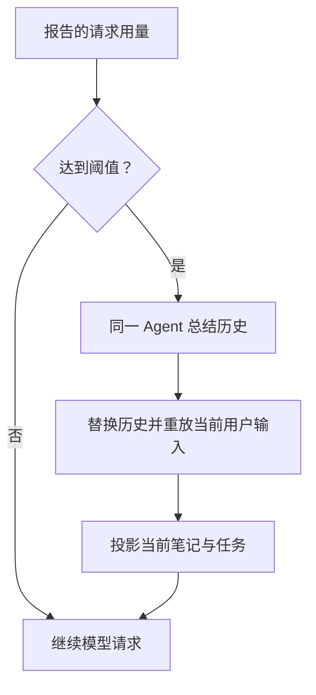

下一轮执行既需要当前信息，也需要之前的决策。上下文 Capability 准备本次模型请求，工作状态携带结构化事实，压缩则用摘要替换较长的对话历史。按信息的用途选择对应机制。

## 选择合适的机制

| 需求                              | 机制                        |
| --------------------------------- | --------------------------- |
| 当前时间、用量、选定的 Run 元数据 | 运行时上下文                |
| 工作区结构或项目指令              | 工作区概览与文件上下文      |
| 跨轮次的任务和决策                | `HarnessState` 中的工作状态 |
| 缩短长时间运行的对话              | Handoff 或主动压缩          |
| 原生上下文窗口溢出后继续执行      | 上下文恢复（默认启用）      |
| 多个 Thread 共享的持久文件        | [文件记忆](memory.md)       |
| 按相似度召回事实                  | [记录记忆](memory.md)       |
| 空闲后缩短旧工具结果              | 冷启动过滤器                |

先运行[两次 Run 的示例](#context-composition)，再按需添加工作区指导或压缩。Host 如何保存和续接 Thread，见[状态与恢复](state-and-resume.md)。

## Run 配置

`RunConfiguration` 提供一次 Run 内工具和插件共享的设置。下面的片段构建配置并在本地检查 URL，不发出 HTTP 请求：

```python
from a13n_harness import RunBindings, RunConfiguration

configuration = RunConfiguration(
    allowed_hosts={"api.example.com", "docs.example.com"},
    extensions={"example.reader": {"images": True}},
)
configuration.authorize_url("https://docs.example.com/guide")
bindings = RunBindings.embedded(configuration=configuration)
# Pass bindings to agent.run(..., bindings=bindings).
```

工具读取 `ctx.deps.configuration`，插件读取 `AgentContext.configuration`。各集成验证自身命名空间下的 `extensions` 值。这些是配置输入，与下文 `RuntimeContextCapability` 选择并提供给模型的元数据分开。

`allowed_hosts=None` 放行全部目标，空集合拒绝全部。第一方 HTTP 集成执行这些规则；自定义集成必须在首次请求及每次重定向前调用 `authorize_url()`。检查只针对 HTTP(S) URL 声明的主机名，不解析 DNS，也不实施网络隔离。Shell 和第三方网络流量需要 Environment 或部署层控制。使用受限允许列表时，选择本地 MCP 和 Host Web 工具，并将已授权媒体作为 `BinaryContent` 字节传入，而不是直接转发媒体 URL。

### 主机规则与正则表达式

主机规则通过 `re.fullmatch` 匹配完整的规范化主机名，不匹配 URL 路径或端口。域名会转为小写并做 IDNA 规范化；使用小写 ASCII 表达式或 `(?i)`。精确规则与正则规则可混用。

```python
configuration = RunConfiguration(
    allowed_hosts={
        "api.vendor.example",                         # Exact host only.
        r"regex:(api|docs)\.example\.com",            # Two named subdomains.
        r"regex:(?:[a-z0-9-]+\.)*assets\.example\.com", # Base and all subdomain levels.
    },
)
```

| 规则                                  | 放行                                | 不放行                                    |
| ------------------------------------- | ----------------------------------- | ----------------------------------------- |
| `example.com`                         | `example.com`                       | `api.example.com`                         |
| `regex:[a-z0-9-]+\.example\.com`      | `api.example.com`                   | `example.com`、`eu.api.example.com`       |
| `regex:(?:[a-z0-9-]+\.)*example\.com` | `example.com`、`eu.api.example.com` | `notexample.com`、`example.com.evil.test` |

字面点使用 `\.` 转义。`*.example.com` 不是 glob。

YAML 中使用单引号保留反斜杠，例如 `'regex:(api|docs)\.example\.com'`。JSON 需要双反斜杠：`"regex:(api|docs)\\.example\\.com"`。上面的 Python 原始字符串可避免额外转义。

## 组合上下文

使用[入门](getting-started.md)中准备的 Python 环境，将这个完整离线示例保存为 `context_demo.py`。第一次 Run 写入笔记，第二次恢复序列化的 State，并在当前上下文中收到这条笔记：

```python
import asyncio

from pydantic_ai.messages import ModelRequest, ToolReturnPart, UserPromptPart
from pydantic_ai.models.function import DeltaToolCall, FunctionModel

from a13n_harness import AgentSpec, HarnessBuilder, HarnessState, RunBindings
from a13n_harness.capabilities import (
    RuntimeContextCapability,
    RuntimeContextConfiguration,
    WorkingStateCapability,
)


async def respond(messages, info):
    current = messages[-1]
    assert isinstance(current, ModelRequest)
    projected = "\n".join(
        str(part.content) for part in current.parts if isinstance(part, UserPromptPart)
    )
    assert "runtime" in projected
    returns = [part for part in current.parts if isinstance(part, ToolReturnPart)]
    if returns:
        assert returns[-1].content["action"] == "created"
        yield "Decision recorded."
    elif '<note key="decision">' in projected:
        assert "Keep the public API stable." in projected
        yield "Continuing with the saved decision."
    else:
        assert "migration" in projected
        yield {0: DeltaToolCall(
            name="note_write",
            json_args='{"key":"decision","value":"Keep the public API stable."}',
        )}


async def main():
    agent = HarnessBuilder().build(
        AgentSpec(),
        output_type=str,
        model=FunctionModel(stream_function=respond),
        capabilities=(
            RuntimeContextCapability(
                RuntimeContextConfiguration(metadata_keys=("project",))
            ),
            WorkingStateCapability(),
        ),
    )
    bindings = RunBindings.embedded(metadata={"project": "migration"})
    first = await agent.run("Record the migration decision.", bindings=bindings)
    print(first.output_or_raise())
    assert first.state is not None
    restored = HarnessState.model_validate_json(first.state.model_dump_json())
    second = await agent.run("Continue.", previous_state=restored, bindings=bindings)
    print(second.output_or_raise())
    assert second.thread_id == first.thread_id
    assert second.run_id != first.run_id


asyncio.run(main())
```

运行 `uv run --no-sync python context_demo.py`，依次输出 `Decision recorded.` 和 `Continuing with the saved decision.` 断言检查的是当前请求中的上下文投影，而不只是历史里的旧工具结果。两次 Run 属于同一 Thread，但 Run ID 不同。JSON 往返验证状态可移植；持久保存仍由 Host 负责。

要加入工作区信息，将[已准备的 Environment source](environments.md#supply-a-source) 和已配置的 Model 传给以下函数：

```python
from pydantic_ai.models import Model

from a13n_harness import AgentSpec, EnvironmentSource, HarnessBuilder
from a13n_harness.capabilities import (
    FileContextCapability,
    RuntimeContextCapability,
    WorkspaceOutlineCapability,
)


async def describe_workspace(source: EnvironmentSource, model: Model) -> str:
    agent = HarnessBuilder().build(
        AgentSpec(),
        output_type=str,
        model=model,
        capabilities=(
            RuntimeContextCapability(),
            WorkspaceOutlineCapability(),
            FileContextCapability(),
        ),
    )
    result = await agent.run(
        "Describe the workspace using its outline and project guidance.",
        environment=source,
    )
    return result.output_or_raise()
```

各 Capability 分别提供不同内容：

- `RuntimeContextCapability` 在请求边界刷新时间和用量信息。`metadata_keys` 选择在用户输入请求中公开的应用元数据；不会自动公开全部 Run 元数据。
- `WorkspaceOutlineCapability` 在用户输入请求中提供文件元数据，不读取文件正文。
- `FileContextCapability` 每个逻辑 Run 加载一次选定文件，并检查读取时使用的 Environment 路由仍然有效。

文件上下文默认读取工作目录的 `AGENTS.md`，还会列出直属子目录中的 `AGENTS.md`，以及工作目录和直属子目录中的 `.agents/skills`。这些只是入口提示，Agent 仍按需通过文件工具读取子项目指导和 Skill。如果需要 Agent 自行读取，添加 `DynamicEnvironmentCapability`。

入口扫描最多检查 64 个非隐藏条目，单独使用 8 KiB 预算。`incomplete` 标记表示可能还有其他指导文件。下一次 Run 会刷新提示，根目录没有 `AGENTS.md` 时也一样。设置 `FileContextConfiguration(include_project_guidance=False)` 可保留正文而关闭提示。各上下文配置还提供相应的字节数、文件数、深度或行数限制。

## 压缩较长的 Thread

添加 `CompactionCapability()`，即可在 Run 内自动压缩。默认在报告的用量达到有效 Model 上下文窗口的 90% 时触发。Model 缺少窗口信息时，提供 `AgentSpec.model_characteristics`。要使用固定 token 阈值，将以下 Capability 放入 builder 的 `capabilities` 元组：

```python
from a13n_harness.capabilities import CompactionCapability, CompactionPolicy

compaction = CompactionCapability(CompactionPolicy(trigger_tokens=100_000))
# Include compaction in HarnessBuilder.build(..., capabilities=(compaction,)).
```



摘要请求使用同一 Agent 和完整历史。替换成功后，Harness 按顺序重放当前用户输入和已交付的 steering，包括媒体，再投影当前笔记和任务。返回的 State 包含替换后的历史。

应为最多三次摘要请求预留预算。瞬时故障按指数退避重试，每次尝试使用完整历史的新副本，共享 Run 的用量限制。每次重试都为待发送的普通请求保留额度。取消、Host 拒绝和永久性故障不重试。

如果还希望 Agent 显式调用 `summarize`，添加 `HandoffCapability()`；默认在窗口的 65% 处开始提醒。除了设置阈值，还要选择 Capability，单独设置模型特征不会启用这两种机制。

### Host 主动压缩

Host 决定缩短一个已完成执行的检查点时，在两次 Run 之间调用 `agent.compact()`。它生成摘要，返回可以立即保存的 State，不继续业务任务，也无需自动压缩 Capability 或阈值。

将以下程序保存为 `compact_demo.py`，在同一环境中运行 `uv run --no-sync python compact_demo.py`：

```python
import asyncio

from pydantic_ai.models.function import FunctionModel
from pydantic_ai.usage import UsageLimits

from a13n_harness import AgentSpec, HarnessBuilder, HarnessState


async def main():
    calls = 0

    async def respond(messages, info):
        nonlocal calls
        calls += 1
        if calls == 1:
            yield "Plan: inspect the schema, then migrate."
        elif calls == 2:
            assert "Do not call tools" in str(messages)
            yield "Migration plan: inspect the schema next."
        else:
            assert "Migration plan: inspect the schema next." in str(messages)
            yield "Ready to inspect the schema."

    agent = HarnessBuilder().build(
        AgentSpec(), output_type=str, model=FunctionModel(stream_function=respond)
    )
    first = await agent.run("Plan the migration.")
    first.output_or_raise()
    assert first.state is not None
    original = first.state.model_dump_json()
    compacted = await agent.compact(
        previous_state=first.state, usage_limits=UsageLimits(request_limit=1)
    )
    print(compacted.output_or_raise())
    assert first.state.model_dump_json() == original
    assert compacted.state is not None
    checkpoint = HarnessState.model_validate_json(compacted.state.model_dump_json())
    continued = await agent.run("Continue.", previous_state=checkpoint)
    print(continued.output_or_raise())
    assert first.thread_id == compacted.thread_id == continued.thread_id
    assert calls == 3


asyncio.run(main())
```

程序先输出迁移摘要，再输出 `Ready to inspect the schema.` 示例验证压缩不会修改原 State，且只使用一次模型请求。序列化可以立即进行；后续普通 Run 恢复运行时上下文，再继续任务。

接入应用的检查点存储时，按以下顺序执行：

1. 阻止目标 Thread 并发推进，读取检查点版本。
2. 使用新的 Host bindings 调用 `compact(previous_state=..., bindings=...)`。`instruction=None` 使用默认摘要指导；字符串替换这段指导，但保留内置的只总结历史和禁止工具调用等约束。
3. 只接受 completed 结果。使用存储已有的预期版本或执行所有权检查，发布返回的 State。
4. 发布提交后再报告保存成功。下一次普通 Run 在继续任务前恢复上下文。

Agent 原有输出模式必须允许文本。原生 JSON 和提示式 JSON 模式会失败，不会切换 schema。系统提示、工具定义、输出配置、模型设置和完整历史都保留在请求中；保持它们稳定有助于复用提供方缓存，具体仍由提供方策略决定。空白摘要、工具调用、未完成响应或提供方失败都不会替换历史。

如果检查点还有待处理工具、保留执行、未恢复的 handoff 或待完成的压缩恢复，会在发起摘要前返回 `compaction_boundary_pending`。先通过普通 Run 恢复处理完这些状态。刚压缩的检查点可以立即保存，但再次压缩前必须经过普通 Run。

失败、异常或取消时保留原检查点。失败结果包含安全的错误码、消息和 `failure.details.phase`；准备、middleware 和清理阶段仍可能按普通 Run 契约抛出异常，取消也会继续传播。`CompactionSummaryEvent` 和 `compaction_completed` 表示摘要生成情况，不代表持久发布，也可能早于后续失败发生。之后的恢复不会重复发出它们。分别处理存储冲突和模型失败；调度和空闲计时器由 Host 实现。

### 上下文恢复

上下文恢复默认启用，独立于主动压缩 `CompactionCapability` 和瞬态故障恢复 `ModelRecoveryPolicy`。普通请求发生原生上下文窗口溢出后，Harness 先尝试正常压缩。摘要成功后，同一逻辑 Run 使用压缩后的历史继续执行。

只有普通请求和适用于当前历史的摘要请求都溢出时，Harness 才重建有界、有损的历史摘录。两次失败的先后顺序不限；已观察到且适用的摘要失败会被复用。摘录优先保留当前任务和用户修正。当前指令、独立存储的状态、执行所有权和用量限制保持不变。记录的工具调用作为历史证据保留，重建不会重放执行它们。

历史保存尽力而为。通过 `RunBindings.retained_history_directory` 指定有权限且能跨续跑保留的 Environment 目录，并启用文件读取工具。缺少存储、读取工具不可用或写入失败时，恢复会明确标记信息丢失并继续重建。按需分段读取历史文件；文件可用性由 Environment 生命周期决定。支持 worker 接管的 Host 还需为同一逻辑 Run 提供稳定的 `context_recovery_scope_id`，并在恢复请求发出前提交替换历史和恢复标记。

摘要成功不会触发重建。如果压缩后的主请求仍然溢出，且此前没有完整的主响应进入工具执行阶段，Run 会以该溢出错误失败。取得这种进展前，Harness 不会重复尝试由溢出触发的压缩。主执行取得有效进展后，再次溢出可以重新尝试正常压缩。这项重试限制独立于持久化的“每个逻辑 Run 最多重建一次”限制。

从 `a13n_harness` 导入 `ContextRecoveryPolicy`，通过 `AgentDefinition.context_recovery` 或 `HarnessBuilder.build(context_recovery=...)` 配置：

| 配置项              | 默认值  | 含义                                                        |
| ------------------- | ------- | ----------------------------------------------------------- |
| `enabled`           | `True`  | 启用溢出触发的压缩和最后手段的有损重建                      |
| `max_history_chars` | `24000` | 重建历史提示的总字符预算，包含提示语和路径；最小值为 `2048` |
| `preserve_history`  | `True`  | 重建前尝试保存可读的历史记录                                |

设置 `enabled=False` 关闭这条恢复路径；已配置的主动压缩仍然生效。历史预算覆盖重建摘录，系统指令和重新投影的实时上下文不计入该预算。历史保存使用 Environment 的文件操作和取消语义，没有额外的恢复专用超时或大小上限。重建后再次溢出会以 `context_recovery_exhausted` 失败。

> [!WARNING]
> 每次有损重建都需要立即调查根因，即使续跑成功。先检查压缩配置和工具输出未受限的问题。警告与恢复结果会持续可见；成功续跑不代表根因已解决。

### 后台压缩

Host 能在前台 Run 关闭后继续保留摘要工作时，可选择后台模式。它需要应用实现 `CompactionOperator`；下面的函数将已有 operator 接入 Agent：

```python
from a13n_harness.capabilities import CompactionCapability
from a13n_harness.compaction import BackgroundCompactionPolicy, CompactionOperator


def background_compaction(operator: CompactionOperator) -> CompactionCapability:
    return CompactionCapability(
        background=BackgroundCompactionPolicy(enabled=True, blocking_threshold=0.95),
        operator=operator,
    )
```

先实现 operator，再将返回的 Capability 加入 builder：

1. 提供 `submit(input)`、`inspect(thread_id)` 和 `wait(thread_id, operation_id)`。每个 Thread 最多有一个未确认操作，按 operation ID 保证提交幂等，读取不消费结果。
2. 使用 `generate_compaction(input, request)` 生成摘要。回调获取新的 Host 授权，从 `CompactionInput` 读取 `request_messages`、`settings` 和 `parameters`。统计每次尝试，不保留父 Agent、活跃资源或可变用量对象。
3. 先保存就绪结果，再通知。进程丢失后核实中断的工作，不把已保存记录当作执行已恢复。
4. 通过普通 Run 应用结果，检查点提交后才清理操作。

Harness 总结完整的历史前缀，保留之后的消息，包括工具结果和 steering。前台继续推进需要原生 token 计数、已知上下文窗口和显式的 `max_tokens` 输出预留。默认触发线仍为 90%；输入计数必须严格低于 95% 阻塞线，连同输出预留也必须能放入窗口。`blocking_threshold` 的范围为大于零且不超过一。后台模式默认关闭，`background=True` 启用默认策略。

| 模型边界的情况                       | 动作                   |
| ------------------------------------ | ---------------------- |
| 达到触发线、没有操作、已验证空间充足 | 提交后台工作并继续     |
| 达到触发线、没有操作、空间未知或不足 | 同步压缩               |
| 操作运行中、已验证空间充足           | 继续                   |
| 操作运行中、空间未知或不足           | 等待该操作             |
| 操作失败且仍需压缩                   | 尝试同步恢复           |
| 结果已就绪且可应用                   | 替换匹配前缀，保留后缀 |

同步恢复成功后，将失败操作标记为 `skipped`，供检查点提交后确认。恢复失败则保留历史，仅在容量已验证充足时继续；启用上下文恢复时，原生摘要请求溢出是例外，此时允许一次普通请求，以确认是否需要有损重建。同一 Run 对每个失败操作最多启动一轮有界重试。替换后的请求只要能放入实际窗口，就可以高于阻塞线；已确认超限时失败，不裁剪最近的工作。摘要调用始终遵循用量和准入限制。

如果无法继续，`compaction_capacity_unavailable` 会报告尝试次数和异常类型，或说明请求预算不足以同时覆盖摘要和待发送的普通请求。错误保留原始异常链，但消息中不包含提供方响应正文。遇到瞬时故障时，在新的 Run 中重试；诊断指出预算不足时，提高请求上限。

结果在两次 Run 之间就绪时，使用下面的集成片段。`executable`、`bindings`、`latest_state`、`result`、`state_store` 和 `retire_operation` 由 Host 提供；`committed_state` 必须是检查点存储实际选中并提交的 State：

```python
from a13n_harness.compaction import compaction_disposition

continued = await executable.run(
    "Continue", previous_state=latest_state, compaction_result=result, bindings=bindings
)
# Commit continued.state through your Host's normal fenced checkpoint path.
# Only the actually selected, committed state permits acknowledgement:
disposition = await compaction_disposition(
    committed_state, basis=result.basis, state_store=state_store
)
if disposition is not None:
    await retire_operation(result.basis.operation_id)  # Your Host's operation store.
```

`CompactionBasis` 标识操作、Thread 和捕获的前缀。Harness 在恢复前验证规范历史，只替换匹配的前缀。系统提示变化可以接受，其他前缀修改会得到 `skipped`。未完成的工具或挂起边界会推迟应用，此时在后续 Run 再传入相同结果。历史内容已外置时，通过 `RunBindings(state_store=...)` 提供存储。

使用 `compaction_disposition()`，不要解析私有的 `a13n.compaction` 命名空间。保存过的 `applied` 或 `skipped` 结果使再次交付成为空操作。待恢复的运行时状态单独记录：下一次 Run 刷新工具发现和 CodeAct 描述，并重置记忆交付游标，即使没有配置压缩 Capability 或 operator 也会执行。监听器失败时保留待恢复标记，供后续重试。恢复不代表存储确认。

将 `CompactionInput` 和 `CompactionResult` 作为机密执行数据保存。输入包含投影后的摘要请求和模型配置，结果应用时只需自身的 basis 和摘要。规范原始内容保留在 State 中，共用的 `apply_compaction` 函数负责纯历史变换。Host 空闲时保留就绪结果，等待普通 Run 应用，不在后台改写检查点。Service 和 Harness UI 都需要各自接入 operator 和持久化流程才能使用这个模式。

## Handoff 与自动压缩

在明确的任务边界使用 `summarize`，或让自动压缩根据用量触发。有效的交接记录目标、决策、未完成工作和下一步。附上后续所需 Skill 的路径及用途；恢复后若完整正文已不可用，就重新读取这些 Skill。

直接调用 `summarize`，并确保它是该响应中唯一的工具调用，不经过 CodeAct 或 ToolSearch 代理组。保留的 CodeAct runner 会阻止替换：自动压缩等待，Handoff 则拒绝调用。先等待 runner 完成并检查结果，再写新的总结。其他保留的函数工具不阻止替换。返回的 `HarnessState` 按 Host 正常的接受策略保存。

### 保留已调用的工具

替换后，Agent 可以复用数量受限的、实际调用过的 [ToolSearch](tool-search.md) 工具。完成的目标调用会进入这个集合，包括代理和 CodeAct 分发。只搜索不会添加条目，重复调用更新最近使用顺序。业务结果写入摘要，而不是重放旧工具输出。

例如，发现 A 和 B 但只调用 A，就只保留 A。Harness 从当前定义重建发现结果，并明确标为不完整的重建记录。不会执行搜索，原查询文本替换为 `[query omitted during context replacement]`。已移除、不可用或来源变化的工具会被丢弃；`load_capability` 激活走独立生命周期。

上限为 32 个不同工具和估算的 64 KiB 发现上下文，包括原生 schema 展开和两个 CodeAct 目录。入选 schema 保持完整。预算按 UTF-8 字节计算，不是 token，也不包括恢复元数据。可移植保留状态按调用顺序存储名称和来源身份，上限 128 KiB，不保存 schema 或搜索结果。

调用 `crm__customer_name` 后，上下文替换的顺序如下：

| 位置 | 显式 `summarize`                   | 自动压缩                                  |
| ---- | ---------------------------------- | ----------------------------------------- |
| 1    | 稳定系统前缀、交接总结与恢复提醒   | 稳定系统前缀与压缩指令                    |
| 2    | 重建提示与已调用工具的合成发现结果 | assistant 总结                            |
| 3    | 当前用户输入与已交付的 steering    | 重建提示与已调用工具的合成发现结果        |
| 4    |                                    | 恢复标记、当前用户输入与已交付的 steering |

笔记、任务和运行时上下文从各自当前的权威来源重新投影。摘要保存客户查询结果，保留的发现记录让 Agent 无需重新搜索即可再次调用。替换后的第一次请求中，两个 CodeAct 目录都反映这个保留集合。保存 State，才能将工作集带入下一次 Run。

## 工作状态

第一个示例使用嵌入式工作状态：任务和笔记位于 Capability 的可移植命名空间，随 `HarnessState` 传递。恢复这份 State 时，定义中继续保留 `WorkingStateCapability()`。

需要应用管理任务时，选择 provider 模式，并通过 `RunBindings.task_state` 提供新的 `TaskStateBinding`。Provider 是任务的权威来源，Harness 事件报告大小受限且已提交的变化。跨 worker 所有权、租约、调度和持久交付由 Host 或 provider 负责。

| 工具                     | 结果                                         |
| ------------------------ | -------------------------------------------- |
| `note_write(key, value)` | 创建或更新，返回 `created` 或 `updated`      |
| `note_delete(key)`       | 幂等删除，返回 `deleted` 或 `already_absent` |
| `note_get(key)`          | 返回完整值                                   |
| `note_get()`             | 返回排序后的键和数量                         |

笔记在用户输入请求中投影，任务还会在工具结果请求中刷新。`<note>` 包含完整值，`<note-ref>` 和 `<notes-omitted>` 提示 Agent 通过 `note_get` 获取。默认最多投影 256 条笔记和 128 个任务，共享 64 KiB 预算，可通过 `WorkingStateConfiguration` 调整。

用笔记记录事实，用任务记录执行进度，用摘要讲清续接脉络。交接前核对过时笔记和任务状态，不必将全部内容复制到摘要。

## 过滤器

过滤器准备模型请求，同时保留保存的历史和源文件。消息完整性及媒体兼容性过滤在请求前执行。可选的内容过滤选择接受的媒体；冷启动过滤默认在空闲一小时后启用，缩短旧工具文本，同时保留用户输入、思考、媒体和待处理结果。

下面的构建片段设置媒体选择和冷启动间隔。将 `spec` 和 `capabilities` 传给 builder；`without_cold_compression` 是关闭冷启动压缩的替代 spec：

```python
from a13n_harness import AgentSpec
from a13n_harness.filters import (
    ColdStartFilterConfiguration,
    ContentFilterCapability,
    ContentFilterConfiguration,
)

capabilities = (
    ContentFilterCapability(
        ContentFilterConfiguration(
            accepted_media=frozenset({"image", "document"}),
            max_media_items=16,
        )
    ),
)
spec = AgentSpec(cold_start_filter=ColdStartFilterConfiguration(idle_seconds=3_600))
without_cold_compression = spec.with_updates(cold_start_filter=None)
```

显式的 `ColdStartFilterCapability` 替换默认策略。视频见[媒体读取](multimedia-understanding.md)，图片限制见[图片输入策略](models.md#image-input-policy)。

图片预处理默认开启。下面这个独立 spec 示例限制图片数量并关闭大图拆分；另一份 spec 则完全关闭预处理：

```python
from a13n_harness import HarnessModelCharacteristics, ImageInputPolicy

characteristics = HarnessModelCharacteristics(
    image_input=ImageInputPolicy(max_images=10, split_large_images=False),
)
spec = AgentSpec(model_characteristics=characteristics)
without_image_preparation = spec.with_updates(
    model_characteristics=characteristics.model_copy(update={"image_input": None}),
)
```

省略 `image_input` 使用默认策略，设为 `None` 关闭预处理。将此 Model 策略与所需的上下文 Capability 一起使用。
