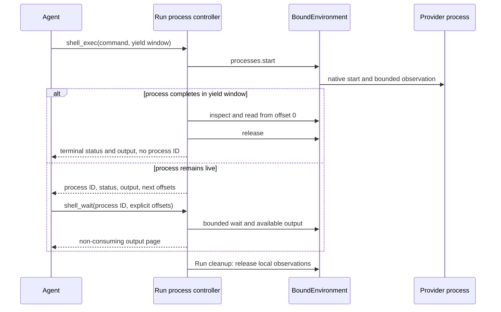

An Environment gives a Run access to files, commands, or a desktop selected by your application. Your Host supplies an `EnvironmentSource`; Harness opens it on first use, applies mount permissions, routes operations, and closes execution resources. The Host retains responsibility for creating and destroying the target.

Start with Direct Local below to read a file without credentials or a server. For deployment, **Native Execution** offers Files & Shell through Local direct access, Docker containers, or E2B sandboxes. **Envd Execution** adds the general path for OS sandbox and Egress enforcement, Computer use, and Device metrics. Vendor resource management remains with its own provider. See the [backend selection guide](../environments/index.md#choose-a-backend).

## Start without an Environment

Keep a text-only Agent's Run free of Environment inputs. In the async code where you already built `executable`, call:

```python
result = await executable.run("Answer without using a workspace")
```

The Run receives an empty Environment facade and no Environment tools. Add a source when your workflow needs actual file, command, or desktop operations.

## Supply a source

The following complete program creates a temporary workspace, exposes file tools, and uses a deterministic Model to call `view`. Use the Python environment from [Getting Started](getting-started.md); no external Model or Environment service is needed. Save it as `environment_demo.py`:

```python title="environment_demo.py"
import asyncio
from dataclasses import dataclass
from pathlib import Path
from tempfile import TemporaryDirectory

from pydantic_ai.messages import ModelRequest, ToolReturnPart
from pydantic_ai.models.function import DeltaToolCall, FunctionModel

from a13n_harness import AgentSpec, HarnessBuilder
from a13n_harness.environment import DynamicEnvironmentCapability, DynamicEnvironmentConfiguration
from a13n_harness.environment.execution import EnvironmentConnector
from a13n_harness.environment.models import EnvironmentDescriptor, EnvironmentState
from a13n_harness.providers.environment.direct_local.provider import DIRECT_LOCAL


@dataclass(frozen=True)
class PreparedSource:
    connector: EnvironmentConnector

    @property
    def provider_key(self) -> str:
        return self.connector.provider_key

    @property
    def environment_id(self) -> str:
        return self.connector.environment_id

    @property
    def descriptor(self) -> EnvironmentDescriptor:
        return self.connector.descriptor

    @property
    def state(self) -> EnvironmentState | None:
        return self.connector.state

    async def ensure_ready(self) -> EnvironmentConnector:
        return self.connector


async def respond(messages, info):
    returns = [
        part for message in messages if isinstance(message, ModelRequest)
        for part in message.parts if isinstance(part, ToolReturnPart)
    ]
    if not returns:
        assert "view" in {tool.name for tool in info.function_tools}
        yield {0: DeltaToolCall(
            name="view", json_args='{"file_path":"/workspace/message.txt"}',
        )}
    else:
        assert "Hello from the workspace." in str(returns[-1].content)
        yield "Workspace file read successfully."


async def main() -> None:
    executable = HarnessBuilder().build(
        AgentSpec(), output_type=str,
        model=FunctionModel(stream_function=respond),
        capabilities=(DynamicEnvironmentCapability(DynamicEnvironmentConfiguration()),),
    )
    with TemporaryDirectory() as directory:
        root = Path(directory).resolve()
        path = root / "message.txt"
        path.write_text("Hello from the workspace.\n", encoding="utf-8")
        connector = DIRECT_LOCAL.execution_connector(
            {"root": {"path": str(root)}}, environment_id="env-workspace",
        )
        result = await executable.run(
            "Read message.txt.", environment=PreparedSource(connector),
        )
        print(result.output_or_raise())
        assert path.is_file()  # Closing the Run preserves the Host's files.


asyncio.run(main())
```

Run `python environment_demo.py`. It prints `Workspace file read successfully.` after checking the actual tool result. The file still exists when the Run has closed; `TemporaryDirectory` removes it only when the enclosing block exits.

Three parts connect the workflow:

1. `DIRECT_LOCAL.execution_connector(...)` describes one existing directory. It does not create that directory.
2. `PreparedSource` implements the Host's readiness boundary. This target is already prepared, so `ensure_ready()` returns the connector directly.
3. `DynamicEnvironmentCapability` exposes tools allowed by the mount and Provider. The first `view` activates the source and opens its execution.

Registration, metadata access, tool injection, and state export leave sources inactive. Input processing or Skill loading can activate one before the first model tool call. Concurrent operations share one activation per mount, with success or failure cached until replacement; cancelling one waiter does not cancel preparation that others need. Unused sources receive no preparation or cleanup calls. Opened executions close in reverse opening order, including cleanup after partial opening failure.

To use a real workspace, keep its directory alive and pass a configured [Model](models.md) to the builder. The source interface stays the same for remote targets; their Host preparation supplies a connector to the selected target.

## The Host owns management state

For a managed target, publish its authoritative `EnvironmentState` before returning a ready connector. The source may perform management in `ensure_ready()`, or the Host may prepare it earlier. Harness then executes against that fixed target.

This integration fragment reconnects to an **already prepared and recorded** target. It belongs inside your Host's async Run handler. Supply `environment_state_store`, `thread_id`, the selected provider `definition`, its `recipe`, backend configuration and credential, a built `executable`, and the accepted previous Harness state. Reuse `PreparedSource` from above:

```python
current_state = await environment_state_store.load(thread_id, "workspace")
connector = definition.execution_connector(
    recipe, configuration=backend_configuration, credential=current_credential,
    environment_id="env-workspace", state=current_state,
)
result = await executable.run(
    "Continue the task", environment=PreparedSource(connector), previous_state=previous_harness_state,
)
```

The state store and its publication method belong to your application. `HarnessState.environment_states` summarizes the mounts; it does not replace authoritative management records. If preparation partially fails or is cancelled, use `observed_environment_state()` to obtain the known reference and publish it through the Host's recovery path. [Lifecycle and state](../environments/lifecycle.md) explains that sequence.

Closing execution releases its resources and leaves the target intact. Destruction uses the separate `EnvironmentProvider.destroy()` operation; clear the management record after confirmed completion. A previously generated connector remains usable after the management client closes. Borrowed runtimes still need their own Host-managed lifetime.

## Use several Environments

Name the sources with `environments=` and choose the default explicitly. For example, keep source data read-only while allowing build output in another mount.

This helper accepts two prepared sources and a Model. The data source must contain `input.txt`; the build source must have room for a new `output.txt`. The Host's input factory reads the data and writes uppercase output before invoking the Model:

```python
from pydantic_ai.models import Model

from a13n_harness import AgentSpec, EnvironmentMount, HarnessBuilder
from a13n_harness.environment import FILE_READ_ACTIONS, EnvironmentPermissionSet
from a13n_harness.environment.sources import EnvironmentSource


async def build_from_data(
    build_source: EnvironmentSource, data_source: EnvironmentSource, model: Model,
) -> str:
    async def prepare(context):
        source = await context.environment.files.read_text("/environment/data/input.txt")
        await context.environment.files.write_text(
            "/workspace/output.txt", source.text.upper(), mode="create",
        )
        return "The Host wrote output.txt from input.txt. Confirm the operation is complete."

    executable = HarnessBuilder().build(AgentSpec(), output_type=str, model=model)
    result = await executable.run(
        input_factory=prepare,
        environments={
            "build": build_source,
            "data": EnvironmentMount(
                data_source,
                permission_ceiling=EnvironmentPermissionSet(operations=FILE_READ_ACTIONS),
            ),
        },
        default_environment="build",
    )
    return result.output_or_raise()
```

Call `await build_from_data(build_source, data_source, model)` from your async entry point. The output file is written under the build source's root. These are Host-side file operations; add `DynamicEnvironmentCapability` if the Model should also use Environment tools.

| Run input                                         | Mount names         | Default         |
| ------------------------------------------------- | ------------------- | --------------- |
| `environment=source`                              | `workspace`         | `workspace`     |
| One entry in `environments`                       | Your supplied name  | That entry      |
| Several entries with `default_environment="name"` | Your supplied names | The named entry |
| Several entries without `default_environment`     | Your supplied names | None            |

By default, `/workspace` addresses the default mount and `/environment/{name}` addresses a named mount. A mount with an explicit `mount_path` is reachable only through that root. With several entries and no default, `/workspace/...` fails; mapping order never chooses one. Relative paths use the selected or default mount's working directory.

Harness validates the complete mount set before publishing it. A first-use failure on one mount leaves the other mounts available.

## Restrict a mount

Wrap a source in `EnvironmentMount` to narrow its operations and set its default working directory. Here `docs_resource` must be a prepared source with an existing provider-local `/reference` directory; pass `read_only_docs` as a Run's Environment input:

```python
from a13n_harness.environment import FILE_READ_ACTIONS, EnvironmentPermissionSet
from a13n_harness import EnvironmentMount

read_only_docs = EnvironmentMount(
    docs_resource,
    permission_ceiling=EnvironmentPermissionSet(operations=FILE_READ_ACTIONS),
    working_directory="/reference",
)
```

Choose the permission set by the work you intend:

| Set                      | Operations admitted, subject to Provider support           |
| ------------------------ | ---------------------------------------------------------- |
| `FILE_READ_ACTIONS`      | File observation                                           |
| `FILE_ACTIONS`           | The full `environment.file.*` family                       |
| `FILE_EXECUTION_ACTIONS` | File and command execution operations; the default ceiling |
| `COMPUTER_ACTIONS`       | Desktop operations, which the Host must include explicitly |

`permission_ceiling` requires an `EnvironmentPermissionSet`. Effective actions are the intersection of this ceiling and Provider support. A ceiling controls Environment operations; it grants neither Host administration nor an OS sandbox against an allowed child process.

`working_directory` is a canonical absolute provider path, without `.` or `..` segments. Leave it as `None` to use the source's configured default. Route roots and working directories select where operations run; they do not change OS isolation.

## Expose tools to the model

Use `DynamicEnvironmentCapability` in the builder when the Model needs to operate the Environment. The earlier program includes it. To add the same surface to another Agent, pass this `capabilities` tuple to `HarnessBuilder.build` alongside the Agent's other capabilities:

```python
from a13n_harness.environment import (
    DynamicEnvironmentCapability,
    DynamicEnvironmentConfiguration,
)

capabilities = (
    DynamicEnvironmentCapability(DynamicEnvironmentConfiguration()),
)
```

Tool availability, invocation policy, and mount permission answer different questions:

1. The Capability determines which tools the Model can discover.
2. `InvocationPolicyCapability`, when supplied, can restrict an invocation for its current identity and arguments. Without one, managed Environment invocations default to allow at this boundary.
3. The selected mount and Provider check the actual operation. A visible tool or an allowed invocation cannot add missing support, credentials, approval, or mount access.

### File tools and operation permissions

A read-only file mount normally provides `view`, `ls`, `glob`, and `grep`. The full file family adds `write`, `edit`, `multi_edit`, `mkdir`, `move`, `copy`, and `delete`. Partial Providers expose the tools their supported actions can serve:

| Tool or operation                 | Required actions                                               |
| --------------------------------- | -------------------------------------------------------------- |
| `ls`, `glob`, `grep`              | List, query, and text-search respectively                      |
| Text `view`                       | Text-read                                                      |
| Media `view`                      | Stat and byte-read on the same mount                           |
| Create/write text                 | Text-write; no read permission needed for creation             |
| Edit an existing file             | Byte-read and text-write                                       |
| Create missing parent directories | Mkdir; writing directly under a mount root does not require it |
| Copy, including between mounts    | Copy-source on the source and copy-destination on the target   |

Arguments are checked again at execution. With one shell-enabled mount, `shell_exec` replaces only `move`, `copy`, and `delete`; `mkdir` stays available. With multiple mounts, file mutations remain so one mount's shell does not hide another mount's operations. An empty Environment exposes none of these tools.

`glob` and `grep` pass patterns, hidden/ignore policy, context width, and scan/result limits to the selected `FileOperator` in one call. Direct Local performs a worker-thread scan; Envd sends one `file.find` or `file.search` request. Set `include_ignored=True` when you intend to search ignored repository paths.

For images, audio, and video, `view` attaches native `BinaryContent` or calls a dedicated understanding Agent. Declare native support in the active `AgentSpec.model_characteristics`; a Model's name or `Model.profile` does not supply that declaration. Dedicated defaults use process environment variables, and a fresh `RunBindings.file_media_understanding` can override them. Continue with [Multimedia Understanding](multimedia-understanding.md) for supported inputs and usage accounting.

### Follow a running command

A shell-enabled Provider exposes `shell_exec`. Process-capable mounts can additionally expose these independently authorized controls:

| Tool           | Use it to                                                                              |
| -------------- | -------------------------------------------------------------------------------------- |
| `shell_info`   | Inspect status; discover commands without an ID only when listing is supported         |
| `shell_wait`   | Wait for a bounded interval, or poll with zero, then read output from explicit offsets |
| `shell_input`  | Write UTF-8 stdin and optionally send EOF                                              |
| `shell_signal` | Request supported `interrupt`, `terminate`, or `kill` control                          |

Start a command once, then follow the result it returns:

| Result                                                        | Next step                                                                                                                     |
| ------------------------------------------------------------- | ----------------------------------------------------------------------------------------------------------------------------- |
| Completed status and output                                   | Check the exit code and output coverage                                                                                       |
| Live `exec-*` receipt from a Host-held `ToolExecutionRuntime` | On process-capable mounts, use the live ID as `process_id` for Shell controls; after settlement, read `tool_execution_result` |
| Run-local `process-*` reference                               | Use Shell controls during this Run; the reference does not survive a new Run                                                  |

On process-capable mounts, top-level `shell_exec` waits up to `ToolExecutionConfig.foreground_wait_seconds` (five seconds by default) in both `inline` and `auto` modes. A Host-held runtime retains a still-running command and returns its `exec-*` receipt; immediate steering can return it earlier. Foreground-only mounts use the general policy: `inline` waits for completion, while `auto` permits timed handoff. Their inline output needs no standalone retained-output permission.

Without runtime ownership, a still-running command returns a `process-*` reference after the configured wait. Shell callbacks inside CodeAct use this path: nested calls return values, while only the outer runner can hand off. The following diagram shows that standalone path:



Use the returned `stdout.next_offset` and `stderr.next_offset` for each subsequent `shell_wait`. Reads are non-consuming, so repeating an offset rereads the same range; Harness keeps no unread cursor. A page reports `origin`, coverage, `observation_closed`, and any reason for missing output. `sdk_text` offsets count UTF-8 bytes of SDK-delivered text rather than original process bytes. Unknown producer counts or completion remain null. Reconnection preserves accumulated offsets and marks gaps.

Keep three observations separate: command exit, complete output capture, and process-tree cleanup. `ok=true` says the tool call returned normally; command success requires a successful process status and exit code. A runtime-owned Shell execution settles after native terminal evidence and closure of both output observations. Capped output does not prove exit. E2B continues checking native status within the wait budget after a cap and reports missing/unknown when final exit evidence is unavailable.

`shell_wait.timeout_seconds` limits waiting. `shell_exec.execution_timeout_seconds` requests a hard deadline enforced by the Provider. Unsupported deadlines, including native E2B's, fail before the command starts.

### Inspect and recover process observations

Use `shell_info(process_id=...)` for status only; it does not attach, read, refresh, or reset output. Where process listing is supported, `shell_info(alias="workspace", limit=50)` can discover recoverable commands. Direct Local has inspection but no discovery, so its schema requires an ID and omits `limit`. Listing and inspection have independent authorization, and listings do not expose native PIDs, arbitrary arguments, or environment variables.

`alias` names an existing mount. Omit it to use the default; an unknown alias or a conflict with a process reference fails. A saved reference alone does not restore authority. A retained `exec-*` remains controllable across Runs of the same Thread while the same runtime owns its original handle and the current mount authorizes that target and every requested action. Native discovery in a later Run creates fresh references and observations. Inspect uncertain outcomes before issuing new work; a missing command is not permission to restart it automatically.

Run cleanup releases standalone observations. Backend cleanup determines command survival: Direct Local closes owned process trees, Envd closes Session-owned resources, and native Docker/E2B release observations without blanket termination. Runtime-owned work retains its original scope until settlement; cancellation attempts native termination, and Host shutdown drains owned work. Recovery after Host or scope loss depends on what the Provider actually retained. E2B can discover still-running commands in a restored sandbox.

### Keep authorization tied to execution

Canonical resource metadata describes the mount and path observed during policy evaluation. It does not reserve that backend while approval waits. If the Host replaces a mount or changes the default, dispatch selects the current route and checks current permissions. To require one exact target, enforce that requirement on the execution path, such as in the Provider or a Host-controlled stable binding; an approval revision alone does not pin it.

Once a compound operation starts, it keeps its selected scope. Document conversion holds it from reading the source through publishing output; downloads hold it through fetch and write. Replacing a mount cannot redirect that in-flight operation. Process handles and generation checks retain their exact ownership, and uncertain outcomes are not replayed automatically.

## Manage Provider state outside Harness

For each independent Run, a production Host follows this sequence:

1. Select a trusted Provider and validate the desired configuration.
2. Load authoritative state. An authoritative `None` suppresses stale fallback state.
3. Supply a source whose `ensure_ready()` performs required management and publishes observed state, including a known reference after partial failure or cancellation.
4. Return a fixed-target connector only after the target is ready and state is published.
5. Let Harness open and close a fresh execution for each used mount.
6. Destroy the target separately when your retention or prune policy authorizes it.

A stopped or missing target fails opening; explicitly manage it before retrying. Execution does not update authoritative Provider state. Tables, leases, Thread links, prune candidates, pause modes, and reconciliation records belong to the Host's application model.

## Advanced Run-local mount mutation

Use ordinary `environment=` or `environments=` for a fixed Run setup. Trusted integrations that need live changes can supply an advanced runtime through `RunBindings.environment` and call `mount()`, `replace()`, `unmount()`, or `set_default()`. The advanced runtime and high-level Environment arguments are mutually exclusive.

A mutation accepts an `EnvironmentSource` or an `EnvironmentMount` wrapping one. Static validation happens before commit and leaves the old mount unchanged on invalid input. Replacement preserves default selection, creates a new mount incarnation, and resets activation. The retired mount accepts no new activation; its execution closes after admitted operations finish. A new mount's first-use failure does not restore the old one.

These changes use the same routing, permissions, and cleanup as ordinary inputs. They neither discover a Provider nor restore, persist, or destroy its target.

## Direct Local boundary

Direct Local operates on an existing Host directory. The Host creates, selects, shares, retains, backs up, and removes that directory. Each Run opens a fresh execution to validate and use it. Its deterministic target needs no saved state, so `state` is `None`; closing or destroying the Provider never deletes the directory.

The Provider root is writable. Mount ceilings narrow file and command operations, but an allowed child process still has the Host account's OS authority. Use an appropriately configured Local Envd or Docker boundary for untrusted code. The Host owns the Local Envd daemon; a Docker connector attaches to the exact running container recorded in state.

## Temporary tool-result files

A large result can include an `output_file_path` in a Run-private directory. Its explicit mount root or `/environment/{name}` path keeps it on the original route when the default changes. Read it while that mount selection remains valid, and copy important results to a durable destination.

Cleanup removes owned temporary directories through their original selections. If a mount was replaced, unmounted, or became unavailable, cleanup may leave files behind rather than delete from a replacement. Downloads and document-conversion exports are user output and are retained; temporary result paths are not permanent handles across mount replacement.
