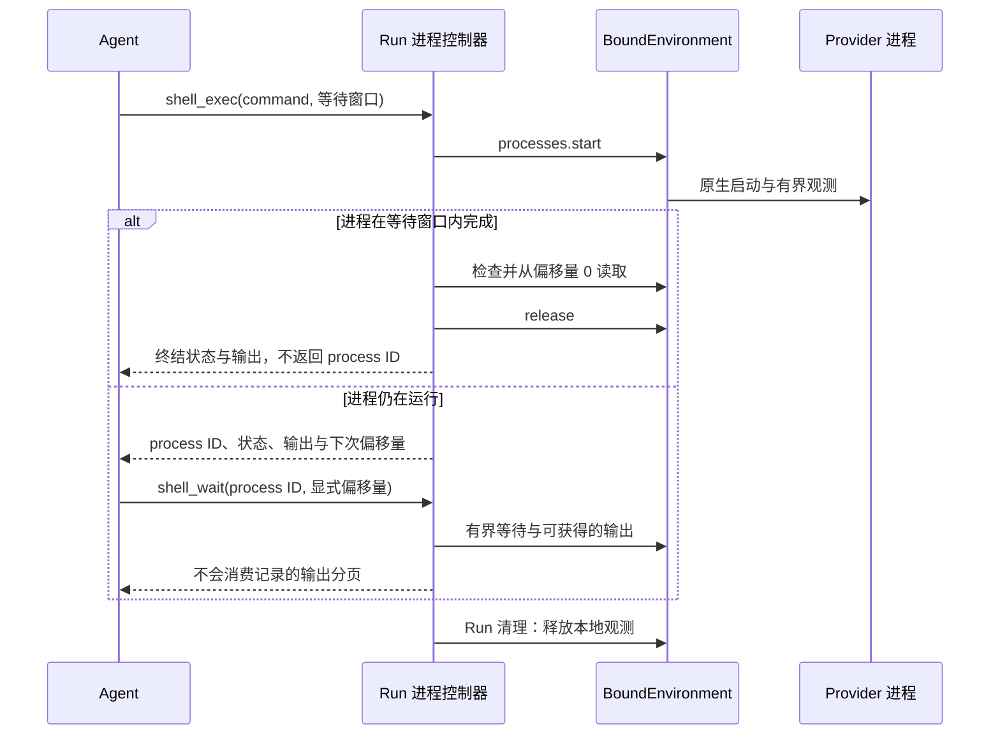

Environment 让 Run 使用应用选定的文件、命令或桌面。Host 提供 `EnvironmentSource`，Harness 在首次使用时打开它，检查挂载权限、路由操作，并关闭执行资源。目标的创建和销毁仍由 Host 负责。

先用下面的 Direct Local 示例读取文件，无需凭据或服务器。部署时，**Native Execution** 通过 Local 本地直连、Docker 容器或 E2B 沙箱提供 Files & Shell；**Envd Execution** 提供通用路径，支持 OS sandbox、Egress 控制、Computer use 和 Device 指标。供应商资源仍由各自的 provider 管理。选择方法见[后端指南](../environments/index.md#choose-a-backend)。

## 不使用环境

纯文本 Agent 的 Run 可以不传 Environment。在已经构建 `executable` 的异步代码中调用：

```python
result = await executable.run("Answer without using a workspace")
```

Run 获得空的 Environment 接口，不提供环境工具。工作流需要实际文件、命令或桌面操作时，再添加来源。

## 传入环境来源

下面的完整程序创建临时工作区、开放文件工具，并用确定性 Model 调用 `view`。使用[快速开始](getting-started.md)中的 Python 环境即可，无需外部 Model 或 Environment 服务。保存为 `environment_demo.py`：

```python title="environment_demo.py"
import asyncio
from dataclasses import dataclass
from pathlib import Path
from tempfile import TemporaryDirectory

from pydantic_ai.messages import ModelRequest, ToolReturnPart
from pydantic_ai.models.function import DeltaToolCall, FunctionModel

from a13n_harness import AgentSpec, HarnessBuilder
from a13n_harness.environment import DynamicEnvironmentCapability, DynamicEnvironmentConfiguration
from a13n_harness.environment.execution import EnvironmentConnector
from a13n_harness.environment.models import EnvironmentDescriptor, EnvironmentState
from a13n_harness.providers.environment.direct_local.provider import DIRECT_LOCAL


@dataclass(frozen=True)
class PreparedSource:
    connector: EnvironmentConnector

    @property
    def provider_key(self) -> str:
        return self.connector.provider_key

    @property
    def environment_id(self) -> str:
        return self.connector.environment_id

    @property
    def descriptor(self) -> EnvironmentDescriptor:
        return self.connector.descriptor

    @property
    def state(self) -> EnvironmentState | None:
        return self.connector.state

    async def ensure_ready(self) -> EnvironmentConnector:
        return self.connector


async def respond(messages, info):
    returns = [
        part for message in messages if isinstance(message, ModelRequest)
        for part in message.parts if isinstance(part, ToolReturnPart)
    ]
    if not returns:
        assert "view" in {tool.name for tool in info.function_tools}
        yield {0: DeltaToolCall(
            name="view", json_args='{"file_path":"/workspace/message.txt"}',
        )}
    else:
        assert "Hello from the workspace." in str(returns[-1].content)
        yield "Workspace file read successfully."


async def main() -> None:
    executable = HarnessBuilder().build(
        AgentSpec(), output_type=str,
        model=FunctionModel(stream_function=respond),
        capabilities=(DynamicEnvironmentCapability(DynamicEnvironmentConfiguration()),),
    )
    with TemporaryDirectory() as directory:
        root = Path(directory).resolve()
        path = root / "message.txt"
        path.write_text("Hello from the workspace.\n", encoding="utf-8")
        connector = DIRECT_LOCAL.execution_connector(
            {"root": {"path": str(root)}}, environment_id="env-workspace",
        )
        result = await executable.run(
            "Read message.txt.", environment=PreparedSource(connector),
        )
        print(result.output_or_raise())
        assert path.is_file()  # Closing the Run preserves the Host's files.


asyncio.run(main())
```

运行 `python environment_demo.py`，程序检查实际工具结果后输出 `Workspace file read successfully.`。Run 关闭后文件仍然存在，直到外层代码块退出，才由 `TemporaryDirectory` 删除。

三个部分串起这条路径：

1. `DIRECT_LOCAL.execution_connector(...)` 描述一个已有目录，不负责创建目录。
2. `PreparedSource` 实现 Host 的就绪接口。这里的目标已准备好，因此 `ensure_ready()` 直接返回 connector。
3. `DynamicEnvironmentCapability` 提供挂载和 Provider 允许的工具。首次 `view` 激活来源并打开执行对象。

注册挂载、读取元数据、注入工具和导出状态都不会激活来源。输入处理或 Skill 加载可能先于第一次模型工具调用触发激活。同一挂载的并发操作共用一次激活，成功或失败会缓存到挂载被替换；取消一个等待者不会取消其他操作需要的准备。未使用的来源不收到准备或清理调用。已打开的执行对象按打开顺序反向关闭，部分打开失败也会清理已获取的资源。

接入真实工作区时，保留目录，并向 builder 传入已配置的 [Model](models.md)。远端目标沿用相同的来源接口，由 Host 准备后返回指向所选目标的 connector。

## 管理状态由 Host 负责

对于托管目标，应在返回就绪 connector 前发布权威 `EnvironmentState`。来源可以在 `ensure_ready()` 中完成管理，也可以由 Host 提前准备。随后 Harness 对固定目标执行操作。

下面的集成片段连接一个**已经准备好并记录状态**的目标，放在 Host 的异步 Run handler 中使用。应用需提供 `environment_state_store`、`thread_id`、所选 provider `definition`、`recipe`、后端配置与凭据、已构建的 `executable`，以及接受的上一份 Harness state。复用前面的 `PreparedSource`：

```python
current_state = await environment_state_store.load(thread_id, "workspace")
connector = definition.execution_connector(
    recipe, configuration=backend_configuration, credential=current_credential,
    environment_id="env-workspace", state=current_state,
)
result = await executable.run(
    "Continue the task", environment=PreparedSource(connector), previous_state=previous_harness_state,
)
```

状态存储及其发布方法由应用实现。`HarnessState.environment_states` 汇总各挂载的状态，不能替代权威管理记录。准备部分失败或被取消时，通过 `observed_environment_state()` 取得已知引用，再由 Host 的恢复流程保存。[生命周期与状态](../environments/lifecycle.md)介绍了这个顺序。

关闭执行会释放执行资源，保留目标。销毁使用独立的 `EnvironmentProvider.destroy()` 操作，确认完成后再清空管理记录。管理客户端关闭后，已生成的 connector 仍可使用；借用的 runtime 仍需由 Host 单独管理生命周期。

## 使用多个环境

通过 `environments=` 为来源命名，并明确指定默认挂载。例如，让源数据保持只读，把构建输出写到另一个挂载。

下面的函数接收两个已准备的来源和一个 Model。数据来源应包含 `input.txt`，构建来源应允许新建 `output.txt`。Host 的 input factory 先读取数据、写出大写文字，再调用 Model：

```python
from pydantic_ai.models import Model

from a13n_harness import AgentSpec, EnvironmentMount, HarnessBuilder
from a13n_harness.environment import FILE_READ_ACTIONS, EnvironmentPermissionSet
from a13n_harness.environment.sources import EnvironmentSource


async def build_from_data(
    build_source: EnvironmentSource, data_source: EnvironmentSource, model: Model,
) -> str:
    async def prepare(context):
        source = await context.environment.files.read_text("/environment/data/input.txt")
        await context.environment.files.write_text(
            "/workspace/output.txt", source.text.upper(), mode="create",
        )
        return "The Host wrote output.txt from input.txt. Confirm the operation is complete."

    executable = HarnessBuilder().build(AgentSpec(), output_type=str, model=model)
    result = await executable.run(
        input_factory=prepare,
        environments={
            "build": build_source,
            "data": EnvironmentMount(
                data_source,
                permission_ceiling=EnvironmentPermissionSet(operations=FILE_READ_ACTIONS),
            ),
        },
        default_environment="build",
    )
    return result.output_or_raise()
```

从异步入口调用 `await build_from_data(build_source, data_source, model)`，输出文件会写入构建来源的根目录。这些是 Host 侧的文件操作；如果 Model 也需要使用环境工具，再添加 `DynamicEnvironmentCapability`。

| Run 输入                                      | 挂载名称       | 默认挂载    |
| --------------------------------------------- | -------------- | ----------- |
| `environment=source`                          | `workspace`    | `workspace` |
| `environments` 只有一个条目                   | 应用提供的名称 | 该条目      |
| 多个条目，且设置 `default_environment="name"` | 应用提供的名称 | 指定条目    |
| 多个条目，未设置 `default_environment`        | 应用提供的名称 | 无          |

默认情况下，`/workspace` 指向默认挂载，`/environment/{name}` 指向命名挂载。设置了显式 `mount_path` 的挂载只能通过该根路径访问。多个条目没有默认挂载时，`/workspace/...` 会失败，不按映射顺序选择。相对路径使用指定或默认挂载的工作目录。

Harness 先验证整个挂载集合，再一次性发布。一个挂载首次使用失败，不会移除其他挂载。

## 限制挂载

用 `EnvironmentMount` 包装来源，收窄操作范围并设置默认工作目录。这里的 `docs_resource` 应是已准备的来源，并具有 provider 本地路径 `/reference` 对应的现有目录；将 `read_only_docs` 作为 Run 的 Environment 输入：

```python
from a13n_harness.environment import FILE_READ_ACTIONS, EnvironmentPermissionSet
from a13n_harness import EnvironmentMount

read_only_docs = EnvironmentMount(
    docs_resource,
    permission_ceiling=EnvironmentPermissionSet(operations=FILE_READ_ACTIONS),
    working_directory="/reference",
)
```

根据允许的工作选择权限集合：

| 集合                     | 在 Provider 支持范围内允许的操作 |
| ------------------------ | -------------------------------- |
| `FILE_READ_ACTIONS`      | 文件观测                         |
| `FILE_ACTIONS`           | 完整的 `environment.file.*` 类别 |
| `FILE_EXECUTION_ACTIONS` | 文件和命令执行操作，也是默认上限 |
| `COMPUTER_ACTIONS`       | 桌面操作，需由 Host 显式加入     |

`permission_ceiling` 接受 `EnvironmentPermissionSet`。有效操作是该上限与 Provider 支持范围的交集。权限上限约束 Environment 操作，不授予 Host 管理权，也不会为获准的子进程提供 OS 沙箱。

`working_directory` 是不含 `.`、`..` 段的规范 provider 绝对路径，设为 `None` 时使用来源配置的默认值。路由根和工作目录选择操作位置，不改变 OS 隔离。

## 向模型提供工具

Model 需要操作 Environment 时，在 builder 中加入 `DynamicEnvironmentCapability`。前面的程序已经这样配置。要为其他 Agent 添加同样的接口，将这个 `capabilities` 元组与其他 Capability 一起传给 `HarnessBuilder.build`：

```python
from a13n_harness.environment import (
    DynamicEnvironmentCapability,
    DynamicEnvironmentConfiguration,
)

capabilities = (
    DynamicEnvironmentCapability(DynamicEnvironmentConfiguration()),
)
```

工具可见性、调用策略和挂载权限分别回答不同的问题：

1. Capability 决定 Model 能发现哪些工具。
2. 如提供 `InvocationPolicyCapability`，它可根据当前身份和参数限制调用。未提供时，托管 Environment 调用在这一层默认允许。
3. 所选挂载和 Provider 检查实际操作。工具可见或调用获准，都不能补足缺失的支持、凭据、批准或挂载权限。

### 文件工具与操作权限

只读文件挂载通常提供 `view`、`ls`、`glob` 和 `grep`。完整文件类别还提供 `write`、`edit`、`multi_edit`、`mkdir`、`move`、`copy` 和 `delete`。只支持部分动作的 Provider 按可用动作开放工具：

| 工具或操作           | 所需动作                                  |
| -------------------- | ----------------------------------------- |
| `ls`、`glob`、`grep` | 分别需要列表、查询、文本搜索              |
| 文本 `view`          | 文本读取                                  |
| 媒体 `view`          | 同一挂载上的 stat 与字节读取              |
| 创建或写入文字       | 文本写入；创建不要求读取                  |
| 编辑已有文件         | 字节读取与文本写入                        |
| 创建缺失的父目录     | Mkdir；直接写入挂载根目录不需要它         |
| 复制，包括跨挂载复制 | 源端 copy-source，目标端 copy-destination |

执行时会再次检查参数。只有一个启用 shell 的挂载时，`shell_exec` 仅替代 `move`、`copy` 和 `delete`，`mkdir` 仍保留。多个挂载时保留文件修改工具，避免一个挂载的 shell 隐藏另一个挂载的操作。空 Environment 不开放这些工具。

`glob` 和 `grep` 在一次调用中将模式、隐藏及忽略策略、上下文宽度和扫描/结果限制传给所选 `FileOperator`。Direct Local 在线程中扫描，Envd 发送一次 `file.find` 或 `file.search` 请求。需要搜索仓库忽略的路径时，设置 `include_ignored=True`。

对于图像、音频和视频，`view` 附加原生 `BinaryContent`，或调用专用理解 Agent。在活跃 `AgentSpec.model_characteristics` 中声明原生输入支持；Model 名称或 `Model.profile` 不提供这项声明。专用默认值来自进程环境变量，新的 `RunBindings.file_media_understanding` 可覆盖它们。支持的输入和用量归因见[多媒体理解](multimedia-understanding.md)。

### 跟进运行中的命令

支持 shell 的 Provider 提供 `shell_exec`。支持进程的挂载还可提供以下分别授权的控制工具：

| 工具           | 用途                                           |
| -------------- | ---------------------------------------------- |
| `shell_info`   | 检查状态；只有支持列表时，才可不带 ID 发现命令 |
| `shell_wait`   | 有界等待或用零轮询，再按显式偏移量读取输出     |
| `shell_input`  | 写入 UTF-8 stdin，按需发送 EOF                 |
| `shell_signal` | 请求支持的 `interrupt`、`terminate` 或 `kill`  |

命令只启动一次，随后按返回结果继续操作：

| 返回结果                                                  | 下一步                                                                                            |
| --------------------------------------------------------- | ------------------------------------------------------------------------------------------------- |
| 完成状态与输出                                            | 检查退出码和输出覆盖情况                                                                          |
| Host 持有的 `ToolExecutionRuntime` 返回存活 `exec-*` 回执 | 支持进程的挂载上，将存活 ID 作为 `process_id` 传给 Shell 控制；结束后读取 `tool_execution_result` |
| Run 内的 `process-*` 引用                                 | 在当前 Run 使用 Shell 控制；新 Run 不能沿用该引用                                                 |

支持进程的挂载上，顶层 `shell_exec` 在 `inline` 和 `auto` 模式下都最多等待 `ToolExecutionConfig.foreground_wait_seconds`，默认五秒。Host 持有的 runtime 保留仍在运行的命令，返回 `exec-*` 回执；即时 steering 可使回执提前返回。仅支持前台执行的挂载采用通用策略：`inline` 等到完成，`auto` 允许定时交接。其内联输出不需要独立的保留输出权限。

没有 runtime 持有时，仍在运行的命令会在配置的等待时间后返回 `process-*` 引用。CodeAct 内的 Shell 回调采用这条路径：嵌套调用返回值，只有外层 runner 可以交接。下图展示这个独立进程流程：



后续每次 `shell_wait` 使用返回的 `stdout.next_offset` 和 `stderr.next_offset`。读取不会消费内容，重复偏移量可重读同一段；Harness 不维护未读游标。输出页报告 `origin`、覆盖情况、`observation_closed` 和缺失原因。`sdk_text` 偏移量计算 SDK 交付文字的 UTF-8 字节数，而非原始进程字节。未知的生产方计数或完成情况保持 null。重连保留累计偏移量，并标记缺口。

分别判断三个结果：命令退出、输出完整捕获和进程树清理。`ok=true` 只说明工具正常返回；命令成功需要对应的进程状态和退出码。runtime 持有的 Shell 执行在取得原生终结证据且两路输出观测关闭后结束。输出达到上限不代表进程退出。E2B 在达到上限后仍会在等待预算内检查原生状态；无法取得最终退出证据时报告 missing/unknown。

`shell_wait.timeout_seconds` 限制等待时间。`shell_exec.execution_timeout_seconds` 请求 Provider 实施硬执行期限。不支持的期限（包括原生 E2B 的情况）会在启动命令前被拒绝。

### 检查和恢复进程观测

`shell_info(process_id=...)` 只检查状态，不附加、读取、刷新或重置输出。支持进程列表时，`shell_info(alias="workspace", limit=50)` 可发现能够恢复观测的命令。Direct Local 支持检查、不支持发现，因此 schema 要求 ID，不提供 `limit`。列表与检查分别授权，列表不会公开原生 PID、任意参数或环境变量。

`alias` 是现有挂载名，省略时使用默认挂载；名称未知或与进程引用冲突会失败。保存引用本身不能恢复权限。只要同一 runtime 仍持有原始句柄，且当前挂载允许该目标和全部请求动作，保留的 `exec-*` 就能跨同一 Thread 的多个 Run 控制。后续 Run 的原生发现会创建新引用和新观测。发出新工作前先核对不确定结果；找不到命令不意味着可以自动重启。

Run 清理会释放独立观测。命令是否存活取决于后端清理方式：Direct Local 关闭其拥有的进程树，Envd 关闭 Session 拥有的资源，原生 Docker/E2B 释放观测而不统一终止命令。runtime 持有的工作保留原始作用域直到结束；取消尝试原生终止，Host 关闭时等待其拥有的工作清理。Host 或作用域丢失后的恢复取决于 Provider 实际保留了什么。E2B 能在恢复的沙箱中发现仍运行的命令。

### 将授权落实到执行路径

规范资源元数据描述策略评估时观察到的挂载和路径，不会在等待批准期间预留后端。Host 如果替换挂载或改变默认挂载，分派会选择当前路由并检查当前权限。必须使用某个精确目标时，应在执行路径中检查，例如在 Provider 或 Host 控制的稳定绑定中检查；单凭批准修订号无法固定目标。

复合操作一旦开始，就保留选中的作用域。文档转换从读取源文件到发布输出都使用它，下载在获取和写入期间也保留它。替换挂载不能重定向这些在途操作。进程句柄和代次检查保持精确归属，不自动重放结果不确定的操作。

## 在 Harness 之外管理 provider 状态

生产 Host 对每次独立 Run 执行以下流程：

1. 选择可信 Provider，验证期望配置。
2. 加载权威状态；权威 `None` 阻止使用陈旧的回退状态。
3. 提供来源，由其 `ensure_ready()` 完成必要管理并发布观察到的状态，包括部分失败或取消后已知的引用。
4. 目标就绪且状态已发布后，才返回固定目标的 connector。
5. 由 Harness 为每个实际使用的挂载打开并关闭独立执行对象。
6. 保留或修剪策略授权后，再单独销毁目标。

目标已停止或缺失时，打开失败；先显式管理，再重试。执行不会更新权威 Provider 状态。表、租约、Thread 关联、修剪候选、暂停模式和核对记录属于 Host 的应用模型。

## 高级执行内挂载修改

固定的 Run 配置使用普通 `environment=` 或 `environments=` 即可。需要实时变更的可信集成可以通过 `RunBindings.environment` 提供高级 runtime，调用 `mount()`、`replace()`、`unmount()` 或 `set_default()`。高级 runtime 与高层 Environment 参数互斥。

修改接受 `EnvironmentSource` 或包装它的 `EnvironmentMount`。提交前先做静态验证，输入无效时原挂载不变。替换保留默认选择、创建新的挂载实例并重置激活结果。旧挂载不再接受新激活，已获准操作结束后关闭执行。新挂载首次使用失败不会恢复旧挂载。

这些变更使用与普通输入相同的路由、权限和清理机制，不发现 Provider，也不恢复、持久化或销毁目标。

## Direct Local 边界

Direct Local 操作一个已有 Host 目录。Host 负责创建、选择、共享、保留、备份和移除目录。每次 Run 打开独立执行对象来验证并使用目录。目标确定，无需保存状态，因此 `state` 为 `None`；关闭或销毁 Provider 都不会删除目录。

Provider 根目录可写。挂载上限收窄文件和命令操作，但获准的子进程仍具有 Host 账户的 OS 权限。不可信代码应使用适当配置的 Local Envd 或 Docker 边界。Host 拥有 Local Envd daemon，Docker connector 则连接到状态记录的精确运行中容器。

## 临时工具结果文件

较大结果可能通过 `output_file_path` 指向 Run 私有目录中的文件。路径使用显式挂载根或 `/environment/{name}`，更改默认挂载不会改变原路由。在该挂载选择仍有效时读取文件，并将重要结果复制到持久位置。

清理通过原始选择删除其拥有的临时目录。挂载已替换、卸载或不可用时，可能留下文件，而不会删除替代挂载上的内容。下载文件和文档转换导出属于用户输出，会被保留；临时结果路径不是跨挂载替换的永久句柄。
