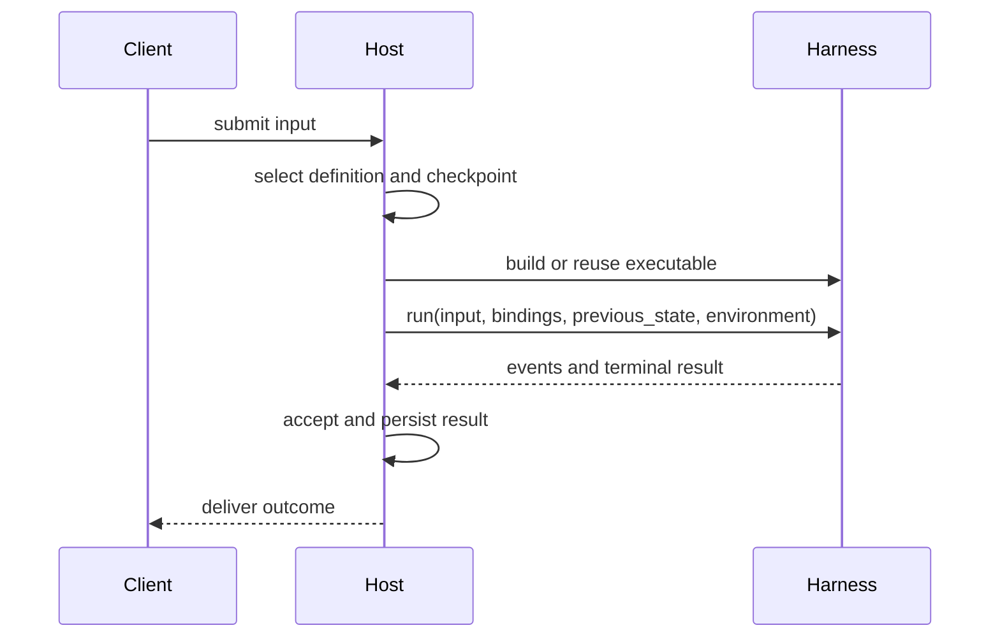

An embedded application calls Harness directly. A durable Host adds definition selection, current policy, checkpoint storage, and delivery around the same process-local API. Start with the [offline application example](https://github.com/converge-ai-labs/agent-foundation/tree/main/examples/agent-app) before adding a worker or database.

## Core Integration Path



Harness executes one Run; the Host decides which result becomes durable.

## Reconstruct Trusted Definitions

Store a Host-owned schema for model selection, output type, tools, Capabilities, plugins, and child topology. Trusted code resolves those choices into Python objects before calling `HarnessBuilder`; do not deserialize a Python callable or plugin from untrusted input. Harness UI YAML is one Host format, not a universal SDK schema.

For large tool catalogs, a Host can assemble `ToolSearchCapability(groups=...)` from selected sources. See [ToolSearch Host integration](tool-search.md#host-integration).

## Build and Reuse

Cache an executable by its exact trusted definition revision, then supply current inputs to each Run:

```python
result = await executable.run(
    input_value,
    bindings=reconstruct_current_bindings(execution_attempt),
    previous_state=selected_checkpoint,
)
```

Scope streams with `async with executable.stream(...)`. The executable has no `close()` method; close Host-owned clients at their own lifespan boundary.

## Retain Tools Across Conversation Turns

Add `ToolExecutionCapability` to the definition and hold one `ToolExecutionRuntime` for the Host lifetime. Bind the runtime to each Run; use a separate `CodeActStateOwner` per Thread when CodeAct writes must remain visible after the originating Run ends.

```python
from a13n_harness import (
    CodeActStateOwner,
    RunBindings,
    ToolExecutionConfig,
    ToolExecutionRuntime,
)
from a13n_harness.capabilities import ToolExecutionCapability

capability = ToolExecutionCapability(
    ToolExecutionConfig(mode="auto", foreground_wait_seconds=5.0)
)
runtime = ToolExecutionRuntime()
thread_values = CodeActStateOwner()
bindings = RunBindings.embedded(tool_execution=runtime, codeact_state=thread_values)
```

Include `capability` in `AgentDefinition.capabilities` and pass `bindings` to the Run. Fast tools return their native results; eligible slow tools return an execution receipt while the original invocation continues. The default mode is `inline`. Whole CodeAct runners can detach; their nested calls still await real values. Sequential tools retain their execution barrier until the real work settles.

Bind the Harness runtime through `RunBindings.tool_execution` to enable automatic background execution and immediate steering. The runtime owns active calls; its store retains records and results. Runs without this binding use blocking generic tools, queued steering, and the Environment's native shell process controls. Enabling `auto` requires the binding at Run preparation; requesting immediate steering requires it before input acceptance.

`await stream.steer(message, immediate=True)` continues the same logical Run with new input. During a primary model request it interrupts the request and recovers the attempt. During tools it preserves the current attempt, finishes review and validation, and releases supported foreground waits with real results or retained execution receipts. The native tool batch settles or suspends for approval before the next model request. Its returned input ID confirms acceptance; canonical history confirms incorporation. Automatic mode independently returns control when the foreground wait expires. Ordinary steering defaults to `immediate=False`, and accepted pending input is included in normal state exports.

If native steering is not ready or an unsupported tool is active, immediate steering waits up to five seconds before acceptance. A timeout raises `RunError` with code `steering_timeout` and leaves the input unaccepted. Stopping or closing the Run ends this wait promptly. By default, the call keeps immediate semantics and does not fall back to queued steering; the deadline ends once input is accepted.

For interactive delivery, pass `immediate=True, best_effort=True`. Harness accepts ordinary queued input immediately if an unsupported tool is active or no tool runtime is bound, and otherwise requests immediate handoff. Native readiness still has the same bounded wait. Input is enqueued once; invalid input, cancellation, and a stopped Run remain failures. `best_effort` has no effect for ordinary steering. The `steering_input_enqueued` event reports `handoff_requested` so Hosts can distinguish immediate handoff requests from queueing. Neither result means the model has already incorporated the input.

The Agent inspects, retrieves, waits for and cancels work through `tool_execution_info`, `tool_execution_result`, `tool_execution_wait` and `tool_execution_cancel`. These controls and the status-only context summary appear only when the Run has both `ToolExecutionCapability` and a runtime binding, in either `inline` or `auto` mode. An unbound inline Run exposes neither. Reads are scoped to the owning Thread. A real result entering canonical history acknowledges delivery. The default memory store keeps active work and the most recently completed records; its contents last for the Host process lifetime. Hosts can supply a `ToolExecutionStore` with their own persistence and retention policy.

Use the runtime's `on_completed` callback to schedule Host delivery without blocking execution. Before closing shared clients, stop new Host admission, settle interactive waiters, then call `await runtime.close(timeout_seconds=...)` and `await runtime.join()`. `close` bounds its cancellation wait; `join` preserves ownership until cooperative cleanup finishes. Conversation cancellation and tool cancellation are separate policies.

## Fresh Authority

On every Run, select the current user/policy, model credentials, Provider state, and current Environment sources. Saved `HarnessState` restores the Thread's message history and Capability state, not clients or permissions. `RunBindings` supplies current collaborators, including optional `model_call_check`; see [Agents and Runs](agents-and-runs.md) and [Environments](environments.md).

Pass business request headers through `RunBindings.embedded(request_context=RequestContext(headers={"x-trace": "trace-123"}))`, importing `RequestContext` from `a13n_harness`. Trusted tools read the detached, read-only map at `ctx.deps.request_context.headers`. Names normalize to lower case. Inline children inherit it. Hosts retain and reconstruct context for recovery or independent children; `HarnessState` does not store it, and new bindings default to empty. Headers are not automatically exposed in prompts, tool results or shell environments. The Host explicitly wires forwarding to model and MCP transports.

Set `A13N_HARNESS_FORWARD_CONTEXT_HEADERS=false` to change the default for an omitted model Provider `forward_context_headers` parameter. Explicit `true` or `false` wins over the environment; unset keeps the built-in default `true`. The environment accepts `true` and `false` case-insensitively with surrounding whitespace ignored, and rejects other values. Resolution happens when the configuration is constructed. Hosts can use `a13n_harness.http.forward_context_headers_default()` for the same default in their MCP integration.

### Check Model Calls Before Dispatch

A Host may supply `RunBindings.model_call_check` implementing `ModelCallCheck.check(ModelCall)`. Harness invokes it before a public model call; return to permit the call or raise to refuse it. This is a per-call admission check, not a record that an HTTP request or billable usage occurred. The check is fresh Run authority and is never serialized into `HarnessState`. See [usage correlation](usage-and-limits.md#usage).

## Durable State Boundary

Persist the returned `HarnessState` alongside your Host's definition revision, run/attempt identity, selected Environment state, pending deferred calls, and delivery status. For distributed workers, also keep lease/fence and checkpoint provenance. None of those Host records is recreated from `HarnessState`.

## Attempts and Recovery

When `ModelRecoveryPolicy` is enabled, Harness may retry an interrupted model attempt within one Run; those model attempts share its `run_id`. A replacement worker attempt is a **new** Run with a fresh `run_id`, current bindings, current Environment sources, and the Host-selected checkpoint. If a previous tool mutation has an uncertain outcome, reconcile it before replaying. See [State and Resume](state-and-resume.md).

## Events and Streaming

Consume `HarnessRunStream` within its async scope and project its public events to the application stream or store. A terminal `HarnessRunResultEvent` follows Harness cleanup; persist the result before promising durable completion or delivery to a client.

## Deferred Work

A suspended Run is closed. Store its pending request and checkpoint, authenticate the external result, then start a new Run with `DeferredToolResume`. Retain accepted results when a resume is interrupted before they enter history. [Deferred resume](state-and-resume.md#resume-unanswered-tool-calls) covers the request/result contract.

`RunBindings.deferred_tools_supported` defaults to `True`, so async children can suspend unless the Host disables it. A Host that supports async child deferrals retains the child checkpoint and pending requests. A Host without that lifecycle sets `deferred_tools_supported=False` for each async child Run; ordinary prompt continuation does not require deferred support.

## Environments

Supply a Host-owned `EnvironmentSource` for each target through `environment=` or a named `environments=` mapping. Harness prepares each target on first use, opens a fresh execution, and closes it without destroying the target; the Host owns Provider configuration, authoritative `EnvironmentState`, retention, and explicit `destroy()`. For multiple mounts, choose `default_environment` explicitly when a default route is needed. [Environments](environments.md) has runnable examples.

## Shell Executions and Observations

Standalone `process-*` references belong to one Run and are released with its observations at Run close, without blanket command termination. Top-level Shell calls bound to the Host-held tool runtime instead retain their original scope until execution settlement, and live `exec-*` controls use current-Run authorization. After Host or scope loss, use Provider state/native discovery if the backend retained the command. Persisted references alone do not restore execution authority.

## Minimal vs. Production Host

A single-process application can use embedded bindings and persist only the `HarnessState` of successful Runs. Add durable acceptance, fencing, separate Environment state, pending-call records, and delivery tracking when multiple workers or deferred actions require them. These are Host workflows, not extra Harness loop APIs.

## Runnable Example

The [Agent Application example](https://github.com/converge-ai-labs/agent-foundation/tree/main/examples/agent-app) streams turns, atomically stores successful `HarnessState`, and constructs a fresh Direct Local Environment on each call. [Provider plugin examples](https://github.com/converge-ai-labs/agent-foundation/tree/main/examples/plugins) show installed Provider selection and Environment Run extensions.
