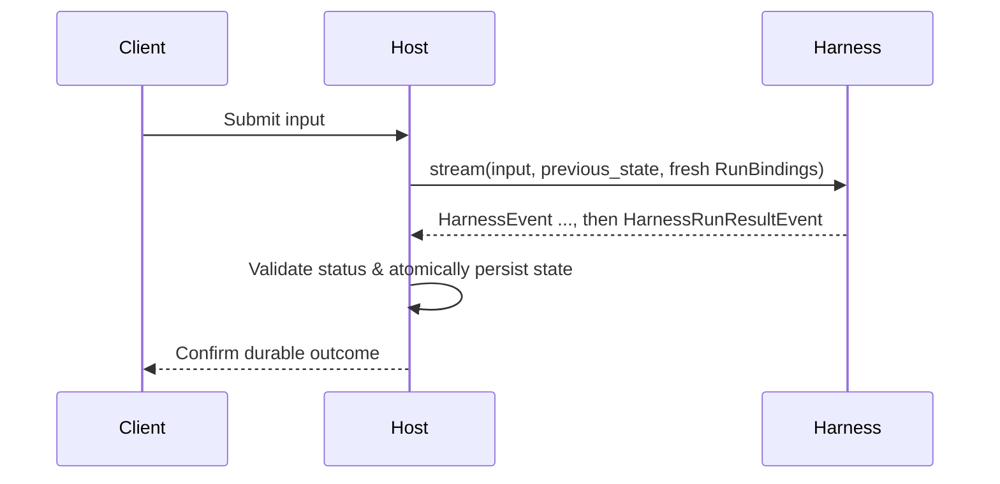

A **Host** is the application surrounding Harness: it reconstructs trusted Agent definitions, supplies per-Run credentials and Environment sources via `RunBindings`, streams events, and persists accepted `HarnessState` checkpoints. See [`examples/agent-app`](https://github.com/converge-ai-labs/agent-foundation/tree/main/examples/agent-app) for a complete runnable reference.



## Reconstruct trusted definitions

Store your own serializable configuration/revision in your database, resolve Models, Capabilities, plugins, and subagents through trusted Python factories, and cache the resulting `HarnessBuilder().build(...)` executable while its revision is unchanged. For large tool catalogs, compose sources with [ToolSearch](tool-search.md#host-integration).

## Retain tools across conversation turns

Hold one `ToolExecutionRuntime` for the Host process lifetime (plus a per-Thread `CodeActStateOwner` when using CodeAct state) so supported shell and runner calls can continue in the background across turns:

```python
from a13n_harness import (
    AgentSpec,
    CodeActStateOwner,
    HarnessBuilder,
    RunBindings,
    ToolExecutionConfig,
    ToolExecutionRuntime,
)
from a13n_harness.capabilities import ToolExecutionCapability


async def run_host(model) -> None:
    runtime = ToolExecutionRuntime()
    thread_values = CodeActStateOwner()
    try:
        executable = HarnessBuilder().build(
            AgentSpec(),
            output_type=str,
            model=model,
            capabilities=(
                ToolExecutionCapability(
                    ToolExecutionConfig(mode="auto", foreground_wait_seconds=5.0)
                ),
            ),
        )
        result = await executable.run(
            "Start the task",
            bindings=RunBindings.embedded(tool_execution=runtime, codeact_state=thread_values),
        )
        print(result.output_or_raise())
    finally:
        await runtime.close(timeout_seconds=5.0)
        await runtime.join()
```

Bound Agents receive `tool_execution_info`, `tool_execution_result`, `tool_execution_wait`, and `tool_execution_cancel`. On active streams, steer with `await stream.steer(msg)` (queued), `immediate=True` (strict immediate handoff), or `immediate=True, best_effort=True`.

## Fresh authority and pre-dispatch checks

Reconstruct identity, credentials, `RequestContext(headers={...})`, and `EnvironmentSource` mounts on fresh `RunBindings` for every Run—`HarnessState` stores conversation history only, never secrets or live sockets.

### Check model calls before dispatch

Attach `RunBindings(model_call_check=...)` (`check(ModelCall)`) when the Host must admit or rate-limit each outbound model request before dispatch, and correlate charges via [usage records](usage-and-limits.md#usage).

## Events and streaming

Consume all `HarnessEvent` items inside `async with executable.stream(...) as stream:`. Wait for the final `HarnessRunResultEvent` (emitted after Run resource cleanup), verify `result.status`, and atomically commit the accepted `HarnessState` alongside your Environment state, pending deferred calls, and worker lease/fence ([Host checkpointing](state-and-resume.md#host-checkpointing)).
