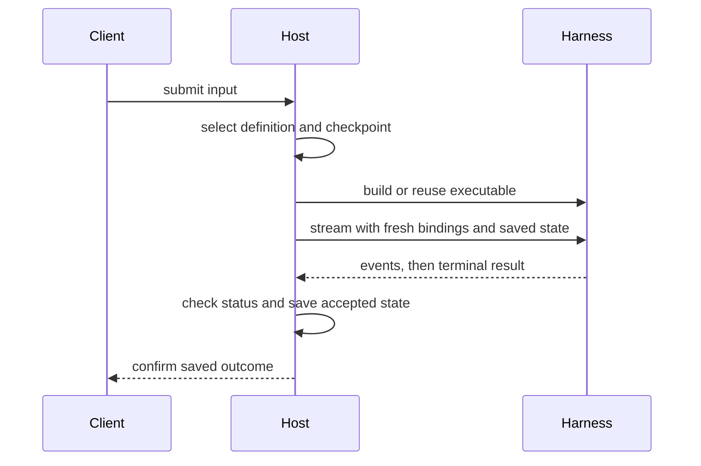

A Host is the application that calls Harness. It selects the Agent, supplies current access and clients, saves accepted state, and delivers results. Start with a single-process conversation; add worker coordination when your application needs it.

This guide uses the repository's offline [Agent Application example](https://github.com/converge-ai-labs/agent-foundation/tree/main/examples/agent-app). It needs Python 3.13, uv, and a repository checkout, but no provider credentials. For a standalone state-file program using only Harness, see [State and resume](state-and-resume.md).

## Core Integration Path

From the repository root, install the example and run two turns. Choose a new state filename for this exercise:

```bash
cd examples/agent-app
uv sync --locked
uv run agent-app-example --state ./hosting-demo.json "First turn" "Second turn"
uv run agent-app-example --state ./hosting-demo.json "After restart"
```

The first command prints answers beginning with `Turn 1:` and `Turn 2:`. The restarted process prints `Turn 3:`. The offline Model counts the conversation it receives, so the third answer verifies that saved history reached a new application instance.

The application follows this sequence for each turn:



Text can reach the client while the Run is active. Confirm durable completion only after saving the accepted terminal result. If the Run fails or the consumer leaves the stream early, this example keeps the previous checkpoint.

## Reconstruct Trusted Definitions

Keep definition selection separate from turn input:

1. Select the application's trusted Agent revision.
2. Resolve its Model, output type, tools, Capabilities, plugins, and child definitions into installed Python objects.
3. Build an executable with `HarnessBuilder`.
4. Reuse that executable while the exact trusted definition remains unchanged.

Store your own serializable definition schema and revision. Resolve references through trusted code rather than deserializing callables or plugins from client input. Harness UI YAML is one Host's format. For a large tool catalog, assemble selected sources with [ToolSearch](tool-search.md#host-integration).

## Build and Reuse

The example's `ConversationApplication` caches its executable and serializes turns with an async lock. You can call it from another Python entry point. Save this as `host_demo.py` in `examples/agent-app`, after the setup above:

```python title="host_demo.py"
import asyncio
from pathlib import Path
from tempfile import TemporaryDirectory

from a13n_agent_app_example import ConversationApplication, create_demo_environment
from a13n_agent_app_example.cli import create_demo_model


async def main() -> None:
    with TemporaryDirectory() as directory:
        root = Path(directory)
        application = ConversationApplication(
            model=create_demo_model(),
            state_path=root / "conversation.json",
            environment_factory=lambda: create_demo_environment(root / "workspace"),
        )
        for prompt in ("First turn", "Second turn"):
            async with application.stream_turn(prompt) as stream:
                answer = "".join([text async for text in stream])
            print(answer)

        state = await application.load_state()
        assert state is not None
        print("Saved conversation state.")


asyncio.run(main())
```

Run `uv run python host_demo.py`. Expect two numbered answers and `Saved conversation state.`. This program removes its temporary data on exit; the CLI exercise above demonstrates persistence across processes.

When integrating Harness directly, use `async with executable.stream(...)` or await `executable.run(...)`. The executable has no `close()` method. Close application-owned clients at their own lifespan boundary, after Runs and retained work have released them.

## Retain Tools Across Conversation Turns

Use a Host-held runtime when supported tool calls must continue after the foreground wait ends. This is a separate integration from the example application's completed-turn state file:

1. Add `ToolExecutionCapability` to the Agent definition.
2. Hold one `ToolExecutionRuntime` for the Host lifetime.
3. Bind that runtime to every participating Run with fresh `RunBindings`.
4. For late CodeAct explicit-state writes, hold a separate `CodeActStateOwner` for each Thread.
5. On shutdown, stop accepting new work, settle interactive waiters, close and join the runtime, then close shared clients.

The following function shows the complete wiring and shutdown order. It accepts an application-selected native `Model` and executes two turns in one Thread:

```python
from a13n_harness import (
    AgentSpec,
    CodeActStateOwner,
    HarnessBuilder,
    RunBindings,
    ToolExecutionConfig,
    ToolExecutionRuntime,
)
from a13n_harness.capabilities import ToolExecutionCapability
from pydantic_ai.models import Model


async def run_host(model: Model) -> None:
    runtime = ToolExecutionRuntime()
    thread_values = CodeActStateOwner()
    try:
        executable = HarnessBuilder().build(
            AgentSpec(),
            output_type=str,
            model=model,
            capabilities=(
                ToolExecutionCapability(
                    ToolExecutionConfig(mode="auto", foreground_wait_seconds=5.0)
                ),
            ),
        )
        previous = None
        for prompt in ("Start the task", "Continue the task"):
            result = await executable.run(
                prompt,
                previous_state=previous,
                bindings=RunBindings.embedded(
                    tool_execution=runtime,
                    codeact_state=thread_values,
                ),
            )
            print(result.output_or_raise())
            previous = result.state
    finally:
        await runtime.close(timeout_seconds=5.0)
        await runtime.join()
```

To exercise the function offline in `host_demo.py`, replace its final `asyncio.run(main())` with this function and its imports, followed by `asyncio.run(run_host(create_demo_model()))`. The Model returns two answers. This checks runtime binding and cleanup; it does not invoke a background tool.

Actual detachment requires a tool with retained execution ownership and a retainable resource scope, such as supported Environment Shell calls or whole CodeAct runners. An ordinary `async def` custom tool remains inline. CodeAct nested calls await actual values, and sequential tools keep their execution barrier until work settles. The default execution mode is `inline`; `auto` requires a runtime binding when the Run is prepared.

A bound Agent gets `tool_execution_info`, `tool_execution_result`, `tool_execution_wait`, and `tool_execution_cancel`, plus a status-only context summary. Both the Capability and runtime binding are required, in either mode. Reads are scoped to the owning Thread; a real result entering canonical history acknowledges delivery. The default memory store retains active work and recent completed records for the Host process lifetime. Supply a `ToolExecutionStore` for your own retention or persistence policy, and use `on_completed` to schedule delivery without blocking execution. Durable records alone do not transfer a running invocation to a replacement worker.

For active-stream input, choose the required handoff behavior:

| Call                                                            | Behavior                                                                                                 |
| --------------------------------------------------------------- | -------------------------------------------------------------------------------------------------------- |
| `await stream.steer(message)`                                   | Queue input for the active Run.                                                                          |
| `await stream.steer(message, immediate=True)`                   | Require immediate handoff support before accepting input.                                                |
| `await stream.steer(message, immediate=True, best_effort=True)` | Queue immediately if a tool cannot hand off or no runtime is bound; otherwise request immediate handoff. |

Immediate steering interrupts and recovers a primary Model request. During tools it preserves the attempt, finishes review and validation, and releases supported foreground waits with actual results or retained receipts. The native tool batch settles or suspends for approval before the next Model request. Automatic foreground timeout operates independently.

If native steering is not ready, immediate steering waits up to five seconds before acceptance. Strict immediate steering also waits when an unsupported tool is active. Timeout raises `RunError` with code `steering_timeout` and leaves the input unaccepted; stopping or closing the Run ends the wait. `best_effort` keeps the native-readiness wait, does not change ordinary steering, and still rejects invalid input, cancellation, or a stopped Run.

The returned input ID means accepted, not yet incorporated by the Model. Input is enqueued once and pending accepted input appears in normal state exports. Use canonical history to confirm incorporation; the `steering_input_enqueued` event's `handoff_requested` field distinguishes handoff from queueing. Conversation cancellation and tool cancellation remain separate Host choices. Runtime `close` bounds its cancellation wait; `join` waits for cooperative cleanup before shared resources can close.

## Fresh Authority

For every Run, reconstruct the current identity and policy, Model credentials, Provider state, and Environment sources. Load history from `HarnessState`; supply current collaborators through `RunBindings`. See [Agents and Runs](agents-and-runs.md) for binding fields.

For business request headers, construct a fresh binding at the call site:

```python
from a13n_harness import RequestContext, RunBindings

bindings = RunBindings.embedded(
    request_context=RequestContext(headers={"x-trace": "trace-123"})
)
```

Pass `bindings=bindings` to `run()` or `stream()`. Trusted tools read `ctx.deps.request_context.headers`, a detached read-only map with lower-case names. Inline children inherit it. Reconstruct it for recovery and independent children: new bindings default to empty, and `HarnessState` does not save these headers. Prompt, tool-result, and shell-environment projection is separate from explicitly configured Model or MCP forwarding.

The Model Provider's `forward_context_headers` option uses `A13N_HARNESS_FORWARD_CONTEXT_HEADERS` when omitted. Unset means `true`; explicit booleans win over the environment. The variable accepts case-insensitive `true` or `false` with surrounding whitespace ignored, and rejects other values. Defaults resolve when constructing the configuration. Your MCP integration can use `a13n_harness.http.forward_context_headers_default()` for the same default.

### Check Model Calls Before Dispatch

Supply a `ModelCallCheck` through `RunBindings.model_call_check` when your application must admit each public Model call. Its `check(ModelCall)` method returns to allow dispatch or raises to refuse it. Recreate this authority for the current Run. Record actual usage separately: admission does not establish that an HTTP request was sent or billed. See [usage correlation](usage-and-limits.md#usage).

## Durable State Boundary

Save the returned `HarnessState` together with the Host records needed to interpret and accept it:

| Host record                                                    | Why it matters                                                  |
| -------------------------------------------------------------- | --------------------------------------------------------------- |
| Definition revision and Run/attempt identity                   | Reconstruct the selected executable and correlate work.         |
| Selected Environment state                                     | Reconnect to the intended targets under current policy.         |
| Pending deferred calls and accepted feedback                   | Resume the correct external work.                               |
| Delivery status                                                | Distinguish saved completion from client receipt.               |
| Lease/fence and checkpoint provenance, for distributed workers | Prevent an obsolete worker from publishing over newer progress. |

The file example saves only successful turns and has one writer. For coordinated checkpoint publication, follow [Host Checkpointing](state-and-resume.md#host-checkpointing).

## Attempts and Recovery

Keep two recovery paths distinct:

- `ModelRecoveryPolicy` retries interrupted Model attempts inside one logical Run, retaining its `run_id`.
- A replacement worker starts a new Run with a fresh `run_id`, current bindings, current Environment sources, and the Host-selected checkpoint.

Reconcile uncertain tool mutations before replaying them. A checkpoint cannot tell you whether an external write whose response was lost actually happened. [State and resume](state-and-resume.md) explains declared recovery and interrupted deferred input.

## Events and Streaming

Consume events inside the stream's async scope. Project public events into your application stream or observation store, then handle `HarnessRunResultEvent` separately:

1. Wait for the terminal result, which follows Harness cleanup.
2. Check its status and continuation state.
3. Apply your checkpoint acceptance rule and save the state.
4. Confirm durable completion to the client and track delivery as needed.

The example's `stream_turn()` implements this order while yielding text immediately. Leaving that scope early closes the active stream and preserves the previous completed checkpoint.

## Deferred Work

A suspended Run is closed. To continue external work:

1. Save the pending request with its checkpoint.
2. Authenticate and correlate the external results with the exact pending calls.
3. Start a new Run with current bindings and `DeferredToolResume`.
4. Retain accepted feedback until it reaches canonical history, including across an interrupted resume.

See [Deferred resume](state-and-resume.md#resume-unanswered-tool-calls) and [Human-in-the-loop](human-in-the-loop.md) for executable examples.

`RunBindings.deferred_tools_supported` defaults to `True`. A Host that supports async child deferrals must retain each child's checkpoint and pending requests. If your child lifecycle cannot do that, set `deferred_tools_supported=False` on each async child Run. Ordinary prompt continuation needs no deferred support.

## Environments

Supply a Host-owned `EnvironmentSource` for each target through `environment=` or a named `environments=` mapping. Choose `default_environment` explicitly when multiple mounts need a default route.

Harness prepares a target on first use, opens a fresh execution, and closes that execution without destroying the target. Your Host owns Provider configuration, authoritative `EnvironmentState`, retention, and explicit `destroy()`. The application example creates a fresh Direct Local source per turn; its workspace persists independently. Use [Environments](environments.md) to add real file or shell operations.

## Shell Executions and Observations

Choose the recovery path from the execution reference:

- Standalone `process-*` references belong to one Run. Run close releases their observations; the Provider's cleanup policy determines command survival.
- Top-level Shell calls bound to the Host runtime retain their original resource scope until settlement. Live `exec-*` controls use current-Run authorization.
- After Host or scope loss, inspect Provider state or use native discovery if the backend retained the command. A saved reference alone cannot restore execution authority.

## Minimal vs. Production Host

Add coordination to solve a concrete lifecycle need:

| Application need                           | Add                                                             |
| ------------------------------------------ | --------------------------------------------------------------- |
| Continue a single-process conversation     | Successful-turn state storage and one writer per Thread.        |
| Wait for approval or client work           | Pending-call storage, authenticated feedback, and resume.       |
| Keep supported tools running between turns | A shared tool runtime, Thread ownership, and shutdown ordering. |
| Replace workers safely                     | Durable admission, leases/fencing, and checkpoint publication.  |
| Recover client delivery                    | Saved result and delivery tracking.                             |

## Runnable Example

Use the [Agent Application source](https://github.com/converge-ai-labs/agent-foundation/tree/main/examples/agent-app) to inspect the completed-turn lock, event projection, atomic state-file replacement, and restart tests. The [Provider plugin examples](https://github.com/converge-ai-labs/agent-foundation/tree/main/examples/plugins) extend that integration with installed Provider selection and Environment Run extensions.
