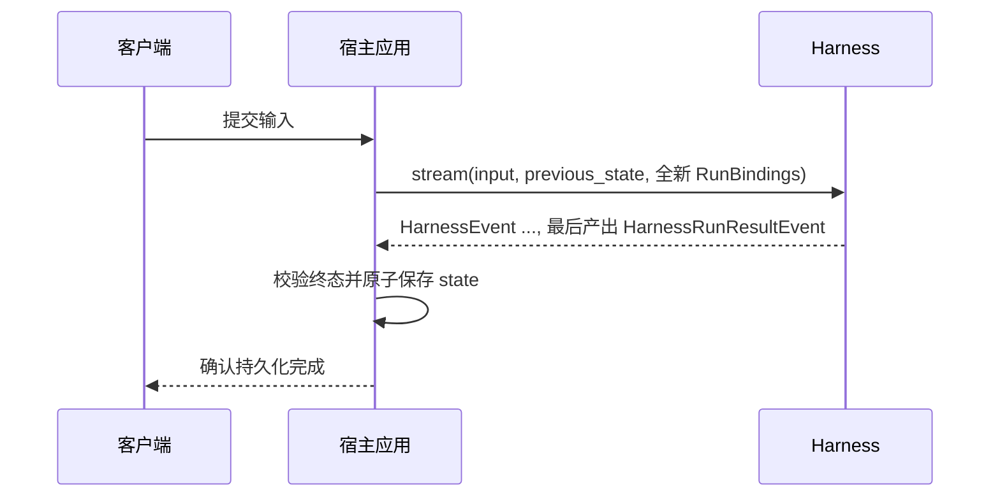

\*\*宿主（Host）\*\*是包裹并调度 Harness 的上层应用：负责重建可信的智能体定义、通过 `RunBindings` 按次注入最新凭据与运行环境、消费流式事件，并将已确认的 `HarnessState` 检查点原子落盘。完整可运行参考项目见 [`examples/agent-app`](https://github.com/converge-ai-labs/agent-foundation/tree/main/examples/agent-app)。



## 重建可信智能体定义

在自有数据库中保存可序列化的配置与版本号，通过可信 Python 工厂将模型、能力、插件与子智能体解析为内存对象，并在同一版本未变更期间缓存复用 `HarnessBuilder().build(...)` 生成的可执行体。大型工具目录请配合 [ToolSearch](tool-search.md#host-integration) 组装。

## 跨对话轮次保留工具执行

在宿主进程生命周期内持有一个共享 `ToolExecutionRuntime`（使用 CodeAct 状态时为每个线程配一个 `CodeActStateOwner`），使受支持的 Shell 命令与执行器在前台等待结束后继续在后台运行：

```python
from a13n_harness import (
    AgentSpec,
    CodeActStateOwner,
    HarnessBuilder,
    RunBindings,
    ToolExecutionConfig,
    ToolExecutionRuntime,
)
from a13n_harness.capabilities import ToolExecutionCapability


async def run_host(model) -> None:
    runtime = ToolExecutionRuntime()
    thread_values = CodeActStateOwner()
    try:
        executable = HarnessBuilder().build(
            AgentSpec(),
            output_type=str,
            model=model,
            capabilities=(
                ToolExecutionCapability(
                    ToolExecutionConfig(mode="auto", foreground_wait_seconds=5.0)
                ),
            ),
        )
        result = await executable.run(
            "Start the task",
            bindings=RunBindings.embedded(tool_execution=runtime, codeact_state=thread_values),
        )
        print(result.output_or_raise())
    finally:
        await runtime.close(timeout_seconds=5.0)
        await runtime.join()
```

绑定后的智能体自动获得 `tool_execution_info`、`tool_execution_result`、`tool_execution_wait` 与 `tool_execution_cancel`。在活动流上可通过 `await stream.steer(msg)`（排队）、`immediate=True`（严格立即交接）或 `immediate=True, best_effort=True` 实时引导。

## 按次重建权限与调用前准入检查

每次 Run 都应在全新的 `RunBindings` 上重建当前身份、凭据、`RequestContext(headers={...})` 与 `EnvironmentSource`；`HarnessState` 仅保存对话历史与可序列化的能力状态。

### 在发送模型请求前执行准入检查

当宿主需要在每次外部模型调用发出前执行配额或权限准入时，在 `RunBindings(model_call_check=...)` 上传入实现了 `check(ModelCall)` 的检查器，并通过[用量记录](usage-and-limits.md#usage)关联计费。

## 事件流与持久化边界

始终在 `async with executable.stream(...) as stream:` 作用域内消费 `HarnessEvent`。等待资源清理后的终态事件 `HarnessRunResultEvent`，核对 `result.status`，并将通过验收的 `HarnessState` 与环境状态、待处理延迟请求及分布式 Worker 租约/栅栏（Fence）在同一事务内原子提交（见[宿主检查点机制](state-and-resume.md#host-checkpointing)）。
