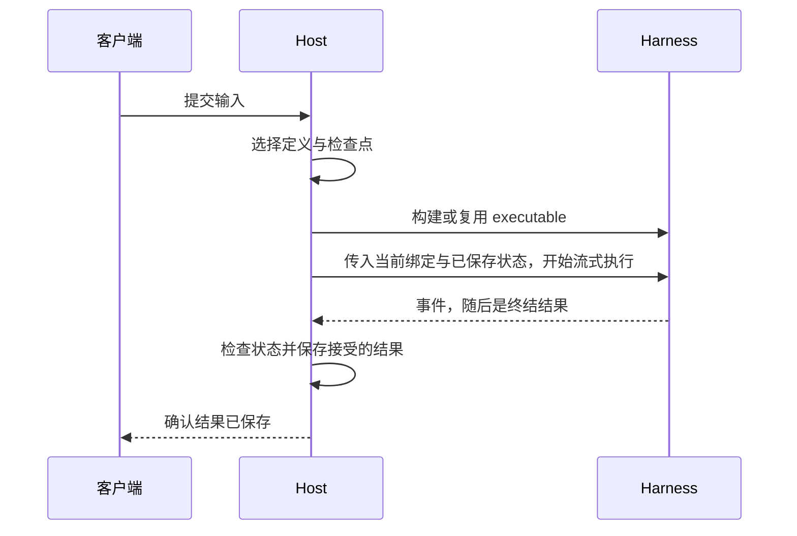

Host 就是调用 Harness 的应用。它选择 Agent，提供当前权限和客户端，保存已接受的状态，并向用户交付结果。先从单进程对话开始，应用需要多个 worker 时再增加协调机制。

本页使用仓库中的离线 [Agent 应用示例](https://github.com/converge-ai-labs/agent-foundation/tree/main/examples/agent-app)。需要 Python 3.13、uv 和仓库检出，无需 provider 凭据。如果希望先看只依赖 Harness 的独立状态文件程序，请阅读[状态与恢复](state-and-resume.md)。

## 核心接入流程

从仓库根目录进入示例，安装依赖并执行两轮对话。请为本次练习选择一个尚未使用的状态文件名：

```bash
cd examples/agent-app
uv sync --locked
uv run agent-app-example --state ./hosting-demo.json "First turn" "Second turn"
uv run agent-app-example --state ./hosting-demo.json "After restart"
```

第一次运行输出以 `Turn 1:` 和 `Turn 2:` 开头的回答；重启后的进程输出 `Turn 3:`。离线 Model 会统计收到的对话轮次，因此第三次回答可以验证保存的历史已传入新的应用实例。

应用每轮都执行以下流程：



Run 执行期间就可以向客户端输出文本。只有保存接受的终结结果后，才确认任务已持久完成。如果 Run 失败，或消费者提前退出流作用域，示例会保留上一份检查点。

## 重建可信定义

将定义选择与每轮输入分开：

1. 选择应用信任的 Agent 修订版本。
2. 将其中的 Model、输出类型、工具、Capabilities、插件和子 Agent 定义解析为已安装的 Python 对象。
3. 用 `HarnessBuilder` 构建 executable。
4. 只要可信定义的准确版本不变，就复用该 executable。

保存应用自己的可序列化定义 schema 和修订版本。通过可信代码解析引用，不从客户端输入中反序列化 callable 或插件。Harness UI YAML 是一种 Host 格式。工具目录较大时，通过 [ToolSearch](tool-search.md#host-integration) 组合选定来源。

## 构建与复用

示例中的 `ConversationApplication` 缓存 executable，并用异步锁串行处理对话轮次。你也可以从另一个 Python 入口调用它。完成上面的安装后，在 `examples/agent-app` 下保存 `host_demo.py`：

```python title="host_demo.py"
import asyncio
from pathlib import Path
from tempfile import TemporaryDirectory

from a13n_agent_app_example import ConversationApplication, create_demo_environment
from a13n_agent_app_example.cli import create_demo_model


async def main() -> None:
    with TemporaryDirectory() as directory:
        root = Path(directory)
        application = ConversationApplication(
            model=create_demo_model(),
            state_path=root / "conversation.json",
            environment_factory=lambda: create_demo_environment(root / "workspace"),
        )
        for prompt in ("First turn", "Second turn"):
            async with application.stream_turn(prompt) as stream:
                answer = "".join([text async for text in stream])
            print(answer)

        state = await application.load_state()
        assert state is not None
        print("Saved conversation state.")


asyncio.run(main())
```

运行 `uv run python host_demo.py`，应看到两条带轮次编号的回答和 `Saved conversation state.`。此程序退出时删除临时数据；前面的 CLI 练习用于验证跨进程持久化。

直接集成 Harness 时，使用 `async with executable.stream(...)`，或等待 `executable.run(...)`。executable 没有 `close()` 方法。应用自己创建的客户端应在所属生命周期结束时关闭，并确保所有 Run 和保留执行已先释放它们。

## 跨对话轮次保留工具执行

如果支持的工具调用需要在前台等待结束后继续运行，使用 Host 持有的 runtime。这与示例应用保存已完成轮次的状态文件是两个独立接入点：

1. 在 Agent 定义中加入 `ToolExecutionCapability`。
2. 在 Host 生命周期内持有一个 `ToolExecutionRuntime`。
3. 为每个参与此流程的 Run 创建新的 `RunBindings`，并绑定该 runtime。
4. 如果需要接收 CodeAct 延迟完成的显式状态写入，为每个 Thread 单独持有一个 `CodeActStateOwner`。
5. 关闭时，先停止接收新工作并结束交互等待，再关闭并等待 runtime，最后关闭共享客户端。

下面的函数展示完整绑定与关闭顺序。它接收应用选定的原生 `Model`，在同一个 Thread 中执行两轮：

```python
from a13n_harness import (
    AgentSpec,
    CodeActStateOwner,
    HarnessBuilder,
    RunBindings,
    ToolExecutionConfig,
    ToolExecutionRuntime,
)
from a13n_harness.capabilities import ToolExecutionCapability
from pydantic_ai.models import Model


async def run_host(model: Model) -> None:
    runtime = ToolExecutionRuntime()
    thread_values = CodeActStateOwner()
    try:
        executable = HarnessBuilder().build(
            AgentSpec(),
            output_type=str,
            model=model,
            capabilities=(
                ToolExecutionCapability(
                    ToolExecutionConfig(mode="auto", foreground_wait_seconds=5.0)
                ),
            ),
        )
        previous = None
        for prompt in ("Start the task", "Continue the task"):
            result = await executable.run(
                prompt,
                previous_state=previous,
                bindings=RunBindings.embedded(
                    tool_execution=runtime,
                    codeact_state=thread_values,
                ),
            )
            print(result.output_or_raise())
            previous = result.state
    finally:
        await runtime.close(timeout_seconds=5.0)
        await runtime.join()
```

要在 `host_demo.py` 中离线运行此函数，请将末尾的 `asyncio.run(main())` 替换为此函数及其导入，再加上 `asyncio.run(run_host(create_demo_model()))`。Model 会返回两次回答。这验证了 runtime 绑定和清理流程，但没有调用后台工具。

真正脱离前台等待，要求工具具有可保留的执行所有权和资源作用域，例如支持此能力的 Environment Shell 调用或完整 CodeAct runner。普通 `async def` 自定义工具仍内联执行。CodeAct 的嵌套调用等待实际值，顺序工具的执行屏障持续到工作结束。默认执行模式为 `inline`；`auto` 要求在 Run 准备时已绑定 runtime。

完成绑定的 Agent 可以使用 `tool_execution_info`、`tool_execution_result`、`tool_execution_wait` 和 `tool_execution_cancel`，并收到仅含状态的上下文摘要。两种模式都要求同时启用 Capability 并绑定 runtime。读取限定在所属 Thread；真实结果进入规范历史后，才确认交付。默认内存 store 在 Host 进程生命周期内保留活动工作和最近完成的记录。自定义保留或持久化策略使用 `ToolExecutionStore`；通过 `on_completed` 安排投递，避免阻塞执行。只保存记录不会把正在运行的调用转移给替代 worker。

向活动流发送新输入时，按交接要求选择：

| 调用                                                            | 行为                                                            |
| --------------------------------------------------------------- | --------------------------------------------------------------- |
| `await stream.steer(message)`                                   | 为当前 Run 排队输入。                                           |
| `await stream.steer(message, immediate=True)`                   | 确认支持即时交接后才接受输入。                                  |
| `await stream.steer(message, immediate=True, best_effort=True)` | 工具无法交接或未绑定 runtime 时立即排队；其他情况请求即时交接。 |

即时 steering 会中断并恢复主 Model 请求。在工具阶段，它保留当前尝试，完成审查与校验，并以实际结果或保留执行回执结束支持工具的前台等待。原生工具批次完成或暂停等待审批后，才发起下一次 Model 请求。自动模式的前台超时独立生效。

如果原生 steering 尚未就绪，即时 steering 会在接受输入前最多等待 5 秒。严格的即时模式遇到不支持交接的工具时也会等待。超时抛出错误码为 `steering_timeout` 的 `RunError`，输入未被接受；停止或关闭 Run 会结束等待。`best_effort` 仍保留原生就绪等待，不改变普通 steering，并且仍会拒绝非法输入、取消或已停止的 Run。

返回的输入 ID 表示已接受，不表示 Model 已读到内容。输入只入队一次，已接受但待处理的输入会进入正常状态导出。通过规范历史确认输入已纳入；`steering_input_enqueued` 事件的 `handoff_requested` 字段区分即时交接与排队。对话取消和工具取消分别由 Host 决定。runtime 的 `close` 限制取消等待时间；`join` 等待协作式清理结束，之后才可关闭共享资源。

## 每次执行都使用当前权限

每次 Run 都重建当前身份与策略、Model 凭据、Provider 状态和 Environment 来源。从 `HarnessState` 加载历史，通过 `RunBindings` 提供当前协作对象。[Agent 与执行](agents-and-runs.md)列出了绑定字段。

需要业务请求头时，在调用处创建新的绑定：

```python
from a13n_harness import RequestContext, RunBindings

bindings = RunBindings.embedded(
    request_context=RequestContext(headers={"x-trace": "trace-123"})
)
```

调用 `run()` 或 `stream()` 时传入 `bindings=bindings`。可信工具通过 `ctx.deps.request_context.headers` 读取名称已转为小写的独立只读映射。内联子 Agent 继承此值。恢复执行或创建独立子 Agent 时需重新构造：新绑定默认为空，`HarnessState` 不保存这些请求头。提示词、工具结果和 shell 环境中的投影，与显式配置的 Model 或 MCP 请求头转发是不同路径。

Model Provider 的 `forward_context_headers` 选项省略时，使用 `A13N_HARNESS_FORWARD_CONTEXT_HEADERS`。未设置环境变量表示 `true`；显式布尔值优先。环境变量接受大小写不敏感的 `true` 或 `false`，忽略首尾空白，拒绝其他值。默认值在构造配置时解析。MCP 集成可以调用 `a13n_harness.http.forward_context_headers_default()` 使用同样的默认值。

### 发起模型调用前检查

如果应用必须逐次批准公开 Model 调用，通过 `RunBindings.model_call_check` 提供 `ModelCallCheck`。其 `check(ModelCall)` 方法正常返回表示允许发出调用，抛出异常表示拒绝。每次 Run 都应提供当前检查权限。实际用量需要另行记录：获准调用不代表 HTTP 请求已发出或已经计费。参阅[用量关联](usage-and-limits.md#usage)。

## 持久化状态的边界

保存返回的 `HarnessState` 时，同时保存解释和接受该状态所需的 Host 记录：

| Host 记录                                | 用途                              |
| ---------------------------------------- | --------------------------------- |
| 定义修订版本、Run 与执行尝试标识         | 重建选定 executable，并关联工作。 |
| 选定的 Environment 状态                  | 按当前策略重新连接到指定目标。    |
| 待处理的延后调用与已接受反馈             | 恢复正确的外部工作。              |
| 交付状态                                 | 区分结果已保存与客户端已收到。    |
| 分布式 worker 的租约、fence 和检查点来源 | 防止失效 worker 覆盖更新的进展。  |

文件示例只保存成功轮次，并由单个写入者更新。需要协调检查点发布时，按 [Host 检查点](state-and-resume.md#host-checkpointing)接入。

## 执行尝试与恢复

区分两条恢复路径：

- `ModelRecoveryPolicy` 在一个逻辑 Run 内重试中断的 Model 尝试，保留同一个 `run_id`。
- 替代 worker 启动新的 Run，使用新的 `run_id`、当前绑定、当前 Environment 来源和 Host 选定的检查点。

重放工具修改前，先核实结果不明确的外部操作。外部写入的响应丢失时，检查点本身无法判断写入是否已经发生。[状态与恢复](state-and-resume.md)介绍了声明式恢复和中断的延后输入。

## 事件与流式输出

在流的异步作用域内消费事件。将公开事件投影到应用输出流或观测存储，单独处理 `HarnessRunResultEvent`：

1. 等待 Harness 清理完成后的终结结果。
2. 检查结果状态和续接状态。
3. 按应用的检查点接受规则保存状态。
4. 向客户端确认任务已持久完成，并按需跟踪交付。

示例的 `stream_turn()` 一边即时输出文本，一边按此顺序处理结果。提前退出作用域会关闭活动流，并保留上一份已完成的检查点。

## 延后执行的工作

暂停的 Run 已经关闭。继续外部工作时：

1. 将待处理请求与检查点一起保存。
2. 验证外部结果，并与准确的待处理调用关联。
3. 使用当前绑定和 `DeferredToolResume` 启动新的 Run。
4. 在已接受反馈进入规范历史前保留它，包括恢复再次中断的情况。

可运行示例见[延后恢复](state-and-resume.md#resume-unanswered-tool-calls)和[人机交互](human-in-the-loop.md)。

`RunBindings.deferred_tools_supported` 默认为 `True`。支持异步子 Agent 延后调用的 Host，必须保留各子 Agent 的检查点和待处理请求。如果子 Agent 生命周期无法做到这一点，为每次异步子 Agent Run 设置 `deferred_tools_supported=False`。普通提示词续接无需延后支持。

## 环境

通过 `environment=` 或具名的 `environments=` 映射，为每个目标提供 Host 持有的 `EnvironmentSource`。多个挂载需要默认路由时，显式选择 `default_environment`。

Harness 在首次使用时准备目标，打开新的 execution，并在结束时关闭 execution，不销毁目标。Provider 配置、权威 `EnvironmentState`、保留策略和显式 `destroy()` 由 Host 管理。应用示例每轮创建一个新的 Direct Local 来源；工作区独立保留。按[环境](environments.md)章节接入真正的文件或 shell 操作。

## Shell 执行与观测

根据执行引用选择恢复路径：

- 独立的 `process-*` 引用属于一个 Run。Run 关闭时释放其观测；命令是否存活由 Provider 的清理策略决定。
- 绑定到 Host runtime 的顶层 Shell 调用保留原资源作用域，直到执行结束。活动 `exec-*` 控制使用当前 Run 的授权。
- Host 或作用域丢失后，检查 Provider 状态；如果后端仍保留命令，可使用原生发现。保存引用本身不能恢复执行权限。

## 从简单应用到生产 Host

针对具体生命周期需求增加协调机制：

| 应用需求               | 增加的机制                                   |
| ---------------------- | -------------------------------------------- |
| 继续单进程对话         | 成功轮次的状态存储，每个 Thread 一个写入者。 |
| 等待审批或客户端工作   | 待处理调用存储、经过认证的反馈与恢复。       |
| 让支持的工具跨轮次运行 | 共享工具 runtime、Thread 所有权和关闭顺序。  |
| 安全替换 worker        | 持久化准入、租约与 fencing、检查点发布。     |
| 恢复客户端交付         | 保存结果并跟踪交付。                         |

## 可运行的示例

在 [Agent 应用源码](https://github.com/converge-ai-labs/agent-foundation/tree/main/examples/agent-app)中查看完整轮次锁、事件投影、状态文件原子替换和重启测试。[Provider 插件示例](https://github.com/converge-ai-labs/agent-foundation/tree/main/examples/plugins)继续介绍已安装 Provider 的选择和 Environment Run 扩展。
