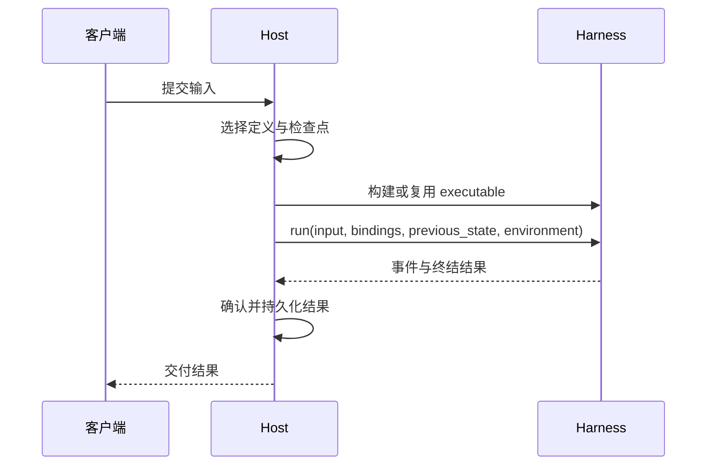

嵌入式应用可以直接调用 Harness。需要持久化的 Host 则在同一套进程内 API 周围增加定义选择、当前访问策略、检查点存储和结果交付。在引入 worker 或数据库之前，建议先运行[离线应用示例](https://github.com/converge-ai-labs/agent-foundation/tree/main/examples/agent-app)。

## 核心接入流程



Harness 负责执行一次 Run；哪些结果最终持久化，由 Host 决定。

## 重建可信定义

由 Host 定义并保存配置 schema，涵盖模型选择、输出类型、工具、Capabilities、插件和子 Agent 拓扑。可信代码先将这些配置解析为 Python 对象，再调用 `HarnessBuilder`；不要从不可信输入中反序列化 Python callable 或插件。Harness UI 的 YAML 是一种 Host 配置格式，并不是通用的 SDK schema。

如果工具目录较大，Host 可以从选定来源组装 `ToolSearchCapability(groups=...)`。参阅 [ToolSearch 的 Host 集成](tool-search.md#host-integration)。

## 构建与复用

以可信定义的准确修订版本作为缓存键，复用构建好的 executable；每次 Run 都传入当前输入：

```python
result = await executable.run(
    input_value,
    bindings=reconstruct_current_bindings(execution_attempt),
    previous_state=selected_checkpoint,
)
```

通过 `async with executable.stream(...)` 管理流的作用域。executable 没有 `close()` 方法；Host 自己持有的客户端，应在各自生命周期结束时关闭。

## 跨对话轮次保留工具执行

将 `ToolExecutionCapability` 加入定义，并在 Host 生命周期内持有一个 `ToolExecutionRuntime`。每次 Run 都绑定该运行时；如果 CodeAct 写入需要在来源 Run 结束后继续可见，则为每个 Thread 单独持有一个 `CodeActStateOwner`。

```python
from a13n_harness import (
    CodeActStateOwner,
    RunBindings,
    ToolExecutionConfig,
    ToolExecutionRuntime,
)
from a13n_harness.capabilities import ToolExecutionCapability

capability = ToolExecutionCapability(
    ToolExecutionConfig(mode="auto", foreground_wait_seconds=5.0)
)
runtime = ToolExecutionRuntime()
thread_values = CodeActStateOwner()
bindings = RunBindings.embedded(tool_execution=runtime, codeact_state=thread_values)
```

将 `capability` 放入 `AgentDefinition.capabilities`，并向 Run 传入 `bindings`。快速工具直接返回原生结果；支持的慢工具返回执行回执，原始调用继续运行。默认模式为 `inline`。CodeAct runner 可整体转到后台，嵌套调用仍等待真实结果。顺序工具的执行屏障持续到实际工作结束。

通过 `RunBindings.tool_execution` 绑定 Harness runtime，即可启用自动后台执行和即时 steering。runtime 管理活动调用，store 保留记录和结果。未绑定时，Run 使用阻塞式通用工具、排队 steering，以及 Environment 的原生 shell 进程控制。启用 `auto` 时在 Run 准备阶段检查绑定；请求即时 steering 时在接收输入前检查绑定。

`await stream.steer(message, immediate=True)` 在同一个逻辑 Run 中接收新输入并继续执行。主模型请求期间会中断请求并恢复执行尝试；工具阶段则保留当前尝试，完成审查和参数校验，并以真实结果或保留执行回执结束支持工具的前台等待。原生工具批次完成或挂起等待审批后，才进入下一次模型请求。返回的输入 ID 表示已接受，规范历史记录确认输入已纳入。自动模式独立地在前台等待到期时交还控制权。普通 steering 默认为 `immediate=False`，已接受但尚未送达的输入随正常状态导出保留。

Agent 通过 `tool_execution_info`、`tool_execution_result`、`tool_execution_wait` 和 `tool_execution_cancel` 查看、获取、等待和取消执行。只有 Run 同时启用 `ToolExecutionCapability` 并绑定 runtime，才会提供这些控制工具和仅含状态的上下文摘要；`inline` 与 `auto` 模式遵循同一规则。未绑定的 inline Run 不提供这两项。读取限定在所属 Thread，真实结果进入规范历史后确认交付。默认内存 store 保留活动执行和最近完成的记录，内容持续到 Host 进程结束。Host 可以提供自定义 `ToolExecutionStore`，管理持久化和保留策略。

通过运行时的 `on_completed` 回调安排 Host 投递，不阻塞执行。关闭共享客户端前，先停止 Host 新准入并结束交互等待，再调用 `await runtime.close(timeout_seconds=...)` 和 `await runtime.join()`。`close` 限制取消等待时间；`join` 保持所有权直到协作式清理完成。对话取消与工具取消由不同策略控制。

## 每次执行都使用当前权限

每次 Run 都应重新选择当前用户和策略、模型凭据、Provider 状态，并创建当前 Environment 来源。保存的 `HarnessState` 只恢复 Thread 的消息历史和 Capability 状态，不恢复客户端或权限。`RunBindings` 提供当前执行所需的协作对象，也可传入 `model_call_check`。参阅 [Agent 与执行](agents-and-runs.md)及[环境](environments.md)。

### 发起模型调用前检查

Host 可以通过 `RunBindings.model_call_check` 提供实现了 `ModelCallCheck.check(ModelCall)` 的对象。Harness 会在公开模型调用发出前执行检查：正常返回表示允许调用，抛出异常表示拒绝。这只是单次调用的准入检查，不能据此认定 HTTP 请求已经发出或产生了计费用量。检查对象属于当前 Run 的权限配置，绝不会序列化到 `HarnessState` 中。参阅[用量关联](usage-and-limits.md#usage)。

## 持久化状态的边界

保存返回的 `HarnessState` 时，还应一并保存 Host 的定义修订版本、Run 与执行尝试的标识、选定的 Environment 状态、待处理的延后调用和交付状态。使用分布式 worker 时，还需保存租约、fence 和检查点来源信息。`HarnessState` 无法重建这些 Host 记录。

## 执行尝试与恢复

启用 `ModelRecoveryPolicy` 时，Harness 可以在同一次 Run 中重试中断的模型尝试，这些模型尝试共用同一个 `run_id`。替代 worker 发起的执行尝试则是一次**新的** Run：使用新的 `run_id`、当前绑定、当前 Environment 来源，以及 Host 选定的检查点。如果上一次工具操作可能已修改数据，但结果无法确定，应先核实并处理实际状态，再决定是否重放。参阅[状态与恢复](state-and-resume.md)。

## 事件与流式输出

在异步作用域内消费 `HarnessRunStream`，并将公开事件转换为应用的输出流或存储记录。Harness 完成清理后，才会产生终结事件 `HarnessRunResultEvent`；只有先持久化结果，才能向客户端承诺任务已持久完成或结果已交付。

## 延后执行的工作

进入暂停状态的 Run 已经关闭。保存其待处理请求和检查点，验证外部结果后，通过 `DeferredToolResume` 启动新的 Run。如果恢复过程在已接受的结果写入历史之前中断，应保留这些结果。[恢复未完成的工具调用](state-and-resume.md#resume-unanswered-tool-calls)说明了请求与结果的约定。

`RunBindings.deferred_tools_supported` 默认为 `True`，因此除非 Host 将其关闭，异步子 Agent 都可以暂停。支持异步子 Agent 延后调用的 Host 应保留子 Agent 的检查点及待处理请求。不具备这一生命周期的 Host 应为每次异步子 Agent 的 Run 设置 `deferred_tools_supported=False`；普通的提示词续接不需要延后支持。

## 环境

Host 为每个目标提供 `EnvironmentSource`，通过 `environment=` 或具名的 `environments=` 映射传入。Harness 在首次使用时准备目标、打开独立 execution，并在结束时关闭 execution，不销毁目标。Provider 配置、权威 `EnvironmentState`、保留策略和显式 `destroy()` 都由 Host 管理。挂载多个环境时，如果需要默认路由，请显式选择 `default_environment`。[环境](environments.md)中有可运行的示例。

## Shell 执行与观测

独立的 `process-*` 引用只属于一个 Run，在 Run 关闭时随观测一起释放，不统一终止所有命令。绑定 Host 工具 runtime 的顶层 Shell 调用则保留原资源范围直到执行结束，存活的 `exec-*` 控制使用当前 Run 的授权。Host 或资源范围丢失后，如果后端仍保留命令，通过 Provider 状态或原生发现恢复。只持久化引用不能恢复执行权限。

## 从简单应用到生产 Host

单进程应用可以使用嵌入式绑定，只保存成功 Run 的 `HarnessState`。当多个 worker 或延后操作需要协调时，再增加持久化的请求接收记录、fencing、独立的 Environment 状态、待处理调用记录和交付跟踪。这些属于 Host 的工作流程，不是新增的 Harness 执行循环 API。

## 可运行的示例

[Agent 应用示例](https://github.com/converge-ai-labs/agent-foundation/tree/main/examples/agent-app)支持以流式方式执行多个轮次、原子保存成功的 `HarnessState`，并在每次调用时创建新的 Direct Local Environment。[Provider 插件示例](https://github.com/converge-ai-labs/agent-foundation/tree/main/examples/plugins)演示了如何选择已安装的 Provider，以及使用 Environment Run 扩展。
