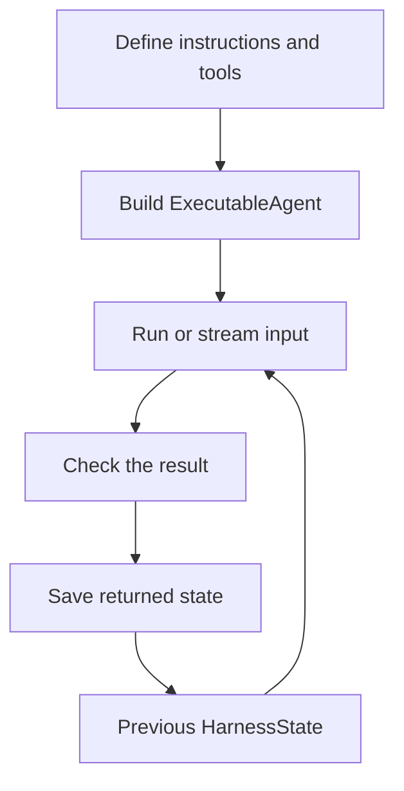

Use Harness when your Python application should own an Agent's execution. You provide instructions, a model, and tools. Harness runs the conversation and returns output plus state for the next turn.

Start with the [quickstart](getting-started.md): install the locked source package, run an offline Agent, continue its Thread, and display a streamed answer. Connect a provider after that path works.

## Start with a small Agent

Follow these guides in order for a first integration:

| Step                                                | Build                               | Check your result                                |
| --------------------------------------------------- | ----------------------------------- | ------------------------------------------------ |
| [Quickstart](getting-started.md)                    | One executable and an offline model | A greeting and a second Run in the same Thread   |
| [Tools and dependencies](tools-and-dependencies.md) | A typed Python function             | The Agent calls `double(4)` and returns `8`      |
| [State and Resume](state-and-resume.md)             | Save and reload continuation state  | A later invocation retains the Thread            |
| [Testing](testing.md)                               | Deterministic tests                 | Verify tool calls and results without a provider |

The same execution path supports all four steps:

Build once with `HarnessBuilder`, then call `run()` for a terminal result or `stream()` for events. Pass `previous_state` to continue the Thread. [Agents and Runs](agents-and-runs.md) explains these objects and their lifetimes.

## Give the Agent what it needs

Choose the next guide by the task you want the Agent to perform:

| Task                                           | Guide                                                             |
| ---------------------------------------------- | ----------------------------------------------------------------- |
| Connect a model account                        | [Models](models.md) and [authentication](model-authentication.md) |
| Call application functions                     | [Tools and dependencies](tools-and-dependencies.md)               |
| Ask the user or request approval               | [Human-in-the-loop tools](human-in-the-loop.md)                   |
| Accept files or return a typed result          | [Inputs and outputs](inputs-and-outputs.md)                       |
| Understand images, audio, video, or media URLs | [Multimedia understanding](multimedia-understanding.md)           |
| Hold a real-time voice conversation            | [Live](live.md)                                                   |
| Read files and run commands                    | [Environments](environments.md)                                   |
| Connect MCP tools and interactive results      | [MCP](mcp.md)                                                     |
| Load reusable task instructions                | [Skills](skills.md)                                               |
| Delegate work or orchestrate tools in Python   | [Delegation and CodeAct](delegation-and-codeact.md)               |

[Capabilities](capabilities.md) compose reusable features. Start with the ones your task requires; add more as you extend the application.

## Continue and manage work

| Task                                          | Guide                                                                                 |
| --------------------------------------------- | ------------------------------------------------------------------------------------- |
| Save, restore, or fork a Thread               | [State and Resume](state-and-resume.md)                                               |
| Manage context, compression, notes, and tasks | [Context](context.md)                                                                 |
| Share remembered information across Threads   | [Memory](memory.md)                                                                   |
| Set budgets and inspect usage                 | [Usage and limits](usage-and-limits.md)                                               |
| Trace execution or publish a stream           | [Observation](observation.md) and [Stream Protocol](../a13n-stream-protocol/index.md) |
| Verify behavior offline                       | [Testing](testing.md)                                                                 |

## Embed Harness in your application

Keep three kinds of input separate:

| Input                                                                     | Put here                               | Lifetime                  |
| ------------------------------------------------------------------------- | -------------------------------------- | ------------------------- |
| Instructions, output type, tools, stable features                         | `AgentSpec` and builder arguments      | Reusable Agent definition |
| Current identity, model resolver, supported service bindings, Environment | `RunBindings` and invocation arguments | Fresh Run                 |
| Messages and portable feature state                                       | `HarnessState`                         | Saved continuation        |

Your application owns credentials, access policy, and durable storage. Restore saved state alongside newly authorized live resources. Arbitrary Python tools belong in build-time Capabilities; `RunBindings.capabilities` has a narrow MCP/invocation-policy contract.

Use [Hosting](hosting.md) to connect these lifetimes and [Plugins](plugins.md) for application middleware or Environment integrations. Native Pydantic AI model, message, tool, and output types work directly with Harness.

If you want a ready-to-use workbench, start with [Harness UI](../a13n-harness-ui/index.md). Use [Service](../a13n-service/index.md) for managed users and durable server execution.

## Runnable applications

Use a complete application when you need more than a single-page example:

| Example                                                                                                               | Demonstrates                                         |
| --------------------------------------------------------------------------------------------------------------------- | ---------------------------------------------------- |
| [Agent application](https://github.com/converge-ai-labs/agent-foundation/tree/main/examples/agent-app)                | Offline streaming, persisted turns, restart recovery |
| [Environment Providers](https://github.com/converge-ai-labs/agent-foundation/tree/main/examples/environment-provider) | Execution connections and target lifecycles          |
| [Plugins](https://github.com/converge-ai-labs/agent-foundation/tree/main/examples/plugins)                            | Middleware and Environment extensions                |
| [Installed Provider](https://github.com/converge-ai-labs/agent-foundation/tree/main/examples/provider-plugin)         | Packaged Provider discovery                          |
| [MCP App](https://github.com/converge-ai-labs/agent-foundation/tree/main/examples/mcp-apps)                           | Interactive tool results                             |

## Versions and scope

These guides follow the source API on `main`; the quickstart uses the matching lockfile. Harness and Stream Protocol release at one exact version, while Harness UI releases independently. Architecture contracts live in the [accepted specifications](https://github.com/converge-ai-labs/agent-foundation/tree/main/spec/a13n-harness).
