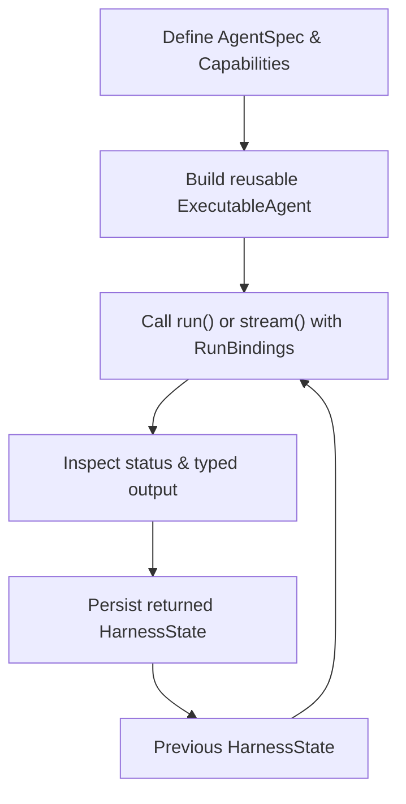

**Harness** (`a13n-harness`) is the embeddable Python agent SDK at the core of Agent Foundation. You define instructions, a model, typed tools, and capabilities; Harness executes the reasoning and tool-calling loop in your Python process and returns validated output plus a serializable `HarnessState` for the next turn.

Start with the [quickstart](getting-started.md) to run an offline Agent, continue a multi-turn Thread, stream incremental events, and connect a live model provider.

## Core execution loop

Follow these four guides in order to build your first production-ready integration:

| Step                                                   | What you build                                                  | Outcome                                                                   |
| ------------------------------------------------------ | --------------------------------------------------------------- | ------------------------------------------------------------------------- |
| 1. [Quickstart](getting-started.md)                    | An `ExecutableAgent` backed by a deterministic offline model    | Execute two turns in the same Thread and stream live text events          |
| 2. [Tools and dependencies](tools-and-dependencies.md) | A typed Python function tool with per-Run `AgentContext` access | The Agent invokes `double(4)` and uses injected request metadata          |
| 3. [State and resume](state-and-resume.md)             | JSON checkpoint persistence across process restarts             | Reload `HarnessState` from disk and continue the same Thread ID           |
| 4. [Testing](testing.md)                               | Deterministic unit tests with `FunctionModel` and `TestModel`   | Assert tool calls, structured outputs, and policies without network calls |

Build the `ExecutableAgent` once with `HarnessBuilder`, then call `await executable.run(...)` for a final result or `async with executable.stream(...)` for real-time events. Pass `previous_state` to continue the conversation. See [Agents and Runs](agents-and-runs.md) for the full execution lifecycle.

## Three-lifetime architecture

Harness cleanly separates build-time definitions, per-run live authority, and portable conversation state so your application stays in control of multi-tenancy, credentials, and storage:

| Lifetime                         | Primary objects                                  | What belongs here                                                                                                                |
| -------------------------------- | ------------------------------------------------ | -------------------------------------------------------------------------------------------------------------------------------- |
| **Build time (reusable)**        | `AgentSpec`, `AgentDefinition`, `HarnessBuilder` | Instructions, output type or JSON Schema, Python function tools, static Capabilities, subagent definitions, and plugins          |
| **Run time (fresh per turn)**    | `RunBindings`, invocation arguments              | Current caller identity, live model resolver, authorized `Environment` mounts, MCP connections, and invocation approval policies |
| **Continuation (portable JSON)** | `HarnessState`                                   | Stable `thread_id`, message history, versioned Capability state, and portable environment state                                  |

Your application owns credentials, access policy, and database storage. On every turn, load the saved `HarnessState` and pair it with freshly authorized `RunBindings`.

## Add tools, context, and capabilities

Extend your Agent one capability at a time:

| Goal                                                                   | Guide                                                                                                   |
| ---------------------------------------------------------------------- | ------------------------------------------------------------------------------------------------------- |
| Connect OpenAI, Anthropic, Gemini, Bedrock, Vertex, or custom gateways | [Models](models.md) and [Authentication and HTTP clients](model-authentication.md)                      |
| Register Python functions and inject live application services         | [Tools and dependencies](tools-and-dependencies.md)                                                     |
| Pause for human questions or sensitive tool approvals                  | [Human-in-the-loop](human-in-the-loop.md) and [Managed tools](managed-tools.md#select-tool-permissions) |
| Execute tools in the caller's frontend or external worker              | [Client tools](client-tools.md)                                                                         |
| Validate Pydantic outputs or pass multimodal inputs                    | [Inputs and outputs](inputs-and-outputs.md) and [Multimedia understanding](multimedia-understanding.md) |
| Give the Agent sandboxed file, shell, and desktop tools                | [Environments](environments.md)                                                                         |
| Connect MCP servers and interactive MCP Apps                           | [MCP](mcp.md)                                                                                           |
| Load on-demand `SKILL.md` workflows                                    | [Skills](skills.md)                                                                                     |
| Scale to hundreds of tools with native or grouped discovery            | [ToolSearch](tool-search.md)                                                                            |
| Delegate to child Agents or orchestrate tools with Python CodeAct      | [Delegation and CodeAct](delegation-and-codeact.md)                                                     |
| Hold real-time bidirectional voice sessions                            | [Live](live.md)                                                                                         |
| Compose built-in or custom capabilities                                | [Capabilities](capabilities.md)                                                                         |

## Manage long conversations and production operations

| Goal                                                                   | Guide                                                                                 |
| ---------------------------------------------------------------------- | ------------------------------------------------------------------------------------- |
| Save, restore, fork, or recover interrupted tool calls                 | [State and resume](state-and-resume.md)                                               |
| Compact long histories, filter context, and manage working notes/tasks | [Context](context.md)                                                                 |
| Share file or record memories across Threads                           | [Memory](memory.md)                                                                   |
| Architect a multi-tenant Host around Harness                           | [Hosting](hosting.md) and [Plugins](plugins.md)                                       |
| Enforce token/request budgets and calculate costs                      | [Usage and limits](usage-and-limits.md)                                               |
| Export OpenTelemetry traces or stream AG-UI events to a browser        | [Observation](observation.md) and [Stream Protocol](../a13n-stream-protocol/index.md) |

If you want a ready-to-use interactive terminal and browser workbench built on Harness, see [Harness UI](../a13n-harness-ui/index.md). If you want a self-hosted multi-tenant platform with Console, RBAC, and background workers, see [Service](../a13n-service/index.md).

## Complete runnable example projects

Explore full multi-file reference applications in the repository's [`examples/`](https://github.com/converge-ai-labs/agent-foundation/tree/main/examples) directory:

| Example                                                                                                               | What it demonstrates                                                        |
| --------------------------------------------------------------------------------------------------------------------- | --------------------------------------------------------------------------- |
| [Agent application](https://github.com/converge-ai-labs/agent-foundation/tree/main/examples/agent-app)                | Offline streaming turns, persisted checkpoints, and restart recovery        |
| [Environment Providers](https://github.com/converge-ai-labs/agent-foundation/tree/main/examples/environment-provider) | Direct Local, Local Envd, and Docker execution lifecycles                   |
| [Plugins](https://github.com/converge-ai-labs/agent-foundation/tree/main/examples/plugins)                            | Custom Capabilities, Harness middleware plugins, and environment extensions |
| [Installed Provider](https://github.com/converge-ai-labs/agent-foundation/tree/main/examples/provider-plugin)         | Packaging and discovering an Environment Provider via Python entry points   |
| [MCP App](https://github.com/converge-ai-labs/agent-foundation/tree/main/examples/mcp-apps)                           | Interactive browser tool UI backed by a stdio MCP server                    |

## Versioning and specifications

These guides track the `main` branch and use the repository lockfile in quickstart examples. `a13n-harness` and `a13n-stream-protocol` always release together at the exact same version. Deep architectural contracts live in [`spec/a13n-harness/`](https://github.com/converge-ai-labs/agent-foundation/tree/main/spec/a13n-harness).
