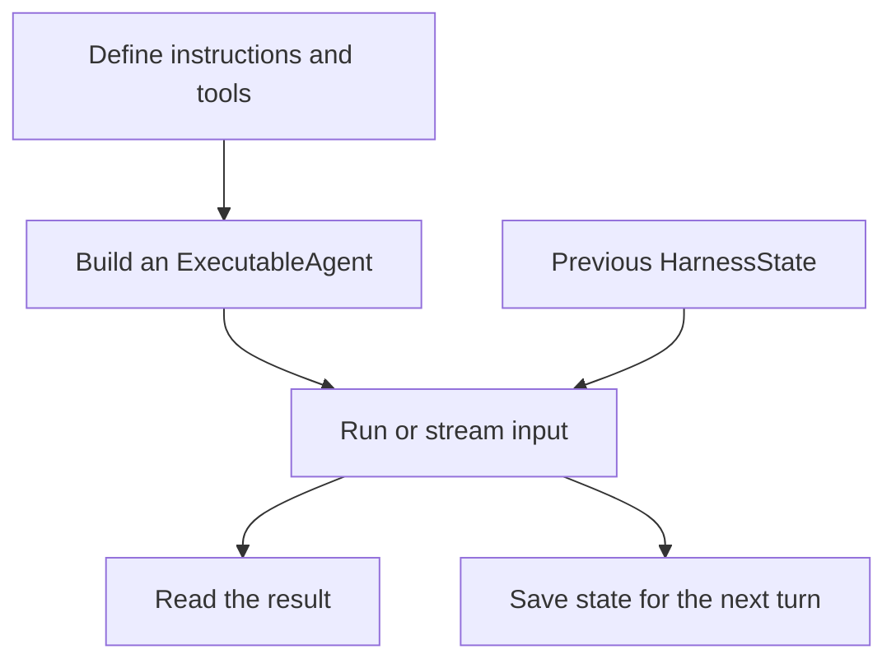

Harness runs Agents inside your Python application. Define instructions and tools, choose a model, and call or stream the Agent. Each Run returns a result and state you can save for the next turn.

Start with the [offline quickstart](getting-started.md). It runs a complete example before connecting a model account.

## Start with a small Agent

A Harness application follows this path:

`AgentSpec` describes the Agent. `HarnessBuilder` builds a reusable `ExecutableAgent`. Call `run()` for a result or `stream()` for events; pass the previous `HarnessState` to continue a Thread. See [Agents and Runs](agents-and-runs.md).

## Give the Agent what it needs

| Task                                          | Guide                                                             |
| --------------------------------------------- | ----------------------------------------------------------------- |
| Connect a model account                       | [Models](models.md) and [authentication](model-authentication.md) |
| Call your application functions               | [Tools and dependencies](tools-and-dependencies.md)               |
| Ask a question or request approval            | [Human-in-the-loop tools](human-in-the-loop.md)                   |
| Accept files and return typed results         | [Inputs and outputs](inputs-and-outputs.md)                       |
| Read images, audio, video, and media URLs     | [Multimedia understanding](multimedia-understanding.md)           |
| Add a real-time voice connection              | [Live](live.md)                                                   |
| Work with files and commands                  | [Environments](environments.md)                                   |
| Connect MCP tools or interactive results      | [MCP](mcp.md)                                                     |
| Load reusable instructions                    | [Skills](skills.md)                                               |
| Delegate tasks or orchestrate tools in Python | [Delegation and CodeAct](delegation-and-codeact.md)               |

[Capabilities](capabilities.md) add reusable context, tools, and lifecycle behavior. Choose them as the workflow grows.

## Continue and manage work

| Task                                   | Guide                                                                                 |
| -------------------------------------- | ------------------------------------------------------------------------------------- |
| Save, restore, or fork a Thread        | [State and Resume](state-and-resume.md)                                               |
| Manage context, notes, and task state  | [Context](context.md)                                                                 |
| Remember information across Threads    | [Memory](memory.md)                                                                   |
| Set request budgets and inspect usage  | [Usage and limits](usage-and-limits.md)                                               |
| Observe execution and publish a stream | [Observation](observation.md) and [Stream Protocol](../a13n-stream-protocol/index.md) |
| Run deterministic tests                | [Testing](testing.md)                                                                 |

## Embed Harness in your application

Your application supplies credentials, access policy, and storage. Keep configuration in three places:

- **Agent definition:** instructions, output type, and stable Capabilities in `AgentSpec` and builder arguments.
- **Run inputs:** current identity, clients, tools, and Environment through bindings and invocation arguments.
- **Continuation:** messages and portable Capability state in `HarnessState`. Reconstruct credentials and live resources when restoring it.

[Hosting](hosting.md) shows how to connect these pieces. [Plugins](plugins.md) add middleware and Environment integrations. Harness accepts native Pydantic AI model, message, tool, and output types.

For a ready-made workbench, use [Harness UI](../a13n-harness-ui/index.md). For managed users and durable server execution, use [Service](../a13n-service/index.md).

## Runnable applications

- [Agent application](https://github.com/converge-ai-labs/agent-foundation/tree/main/examples/agent-app): offline streaming, persisted turns, and restart recovery.
- [Environment Providers](https://github.com/converge-ai-labs/agent-foundation/tree/main/examples/environment-provider): connect execution and manage target lifecycles.
- [Plugins](https://github.com/converge-ai-labs/agent-foundation/tree/main/examples/plugins): middleware and Environment extensions.
- [Installed Provider](https://github.com/converge-ai-labs/agent-foundation/tree/main/examples/provider-plugin): discover a packaged Provider.
- [MCP App](https://github.com/converge-ai-labs/agent-foundation/tree/main/examples/mcp-apps): interactive tool results.

## Versions and scope

These guides track the source API on `main`. Harness and Stream Protocol publish at one exact release version; Harness UI releases independently. See the [accepted specifications](https://github.com/converge-ai-labs/agent-foundation/tree/main/spec/a13n-harness) for architecture contracts.
