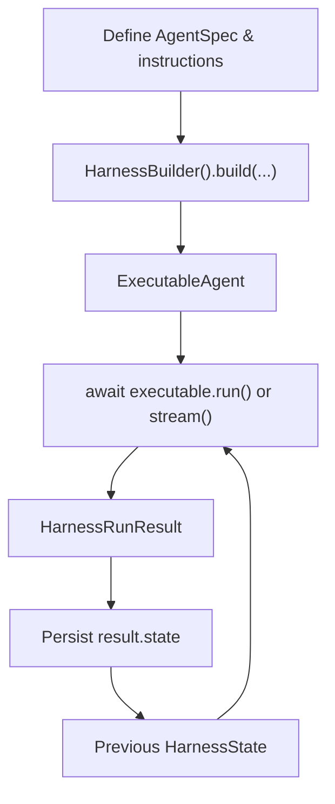

**Harness** is an embeddable, type-safe agent execution engine built for Python developers. When your application needs programmatic control over how an agent runs, interacts with local tools, preserves multi-turn conversation state, or recovers from interruptions, Harness provides the engineering foundation you need without black-box abstractions.

Harness is built on modern Python (3.13+) and is designed to integrate cleanly with async runtimes like FastAPI, Celery, and custom background worker fleets.

## Start with a small Agent

Get a working agent up and running offline in minutes before introducing external model credentials or cloud infrastructure:

| Step | Focus area | What you will build |
| :--- | :--- | :--- |
| [Quickstart](getting-started.md) | Offline execution | Build an executable with a deterministic function model, stream responses, and verify turn continuity |
| [Tools and dependencies](tools-and-dependencies.md) | Function calling | Attach typed Python functions and inspect validated tool call executions |
| [State and Resume](state-and-resume.md) | Checkpoint persistence | Extract serialized `HarnessState` and resume conversations across process restarts |
| [Testing](testing.md) | Deterministic evaluation | Write unit and integration tests that verify agent tool selection and outputs without external API calls |

All four milestones share the identical, predictable execution lifecycle:

You assemble instructions, models, and capabilities once using `HarnessBuilder`. The resulting `ExecutableAgent` is thread-safe and reusable across concurrent runs. Call `executable.run()` for completed outcomes or `async with executable.stream()` for real-time events.

## Give the Agent what it needs

Progressively enhance your agent with capabilities as your application requirements evolve:

| Capability | Focus | Integration guide |
| :--- | :--- | :--- |
| **Model connections** | Multi-provider support (OpenAI, Anthropic, Gemini, local models) | [Models](models.md) and [Authentication](model-authentication.md) |
| **Python tools** | Native async functions with automatic Pydantic validation | [Tools and dependencies](tools-and-dependencies.md) |
| **Human in the loop** | Interactive decision cards, confirmations, and question asking | [Questions](human-in-the-loop.md) and [Tool permissions](managed-tools.md#select-tool-permissions) |
| **Structured I/O** | Enforce typed Pydantic models for structured outputs | [Inputs and outputs](inputs-and-outputs.md) |
| **Multimodal media** | Ingest images, audio, video files, and remote URLs | [Multimedia understanding](multimedia-understanding.md) |
| **Real-time voice** | Low-latency WebRTC bidirectional audio streams | [Live mode](live.md) |
| **Execution environments** | Safely read files, inspect directories, and run commands | [Environments](environments.md) |
| **External tool protocols** | Attach Model Context Protocol (MCP) servers and interactive UI apps | [MCP](mcp.md) |
| **Dynamic procedures** | Discover and load structured `SKILL.md` instruction files | [Skills](skills.md) |
| **Advanced orchestration** | Coordinate subagents or execute Python control flow via CodeAct | [Delegation and CodeAct](delegation-and-codeact.md) |

The [Capabilities](capabilities.md) architecture gives you fine-grained control: enable only the features your agent actually requires to keep context windows lean and execution predictable.

## Continue and manage work

Production agent architectures must survive network disconnects, node restarts, and long-running workflows:

| Production requirement | Implementation pattern | Guide |
| :--- | :--- | :--- |
| **State persistence & forking** | Save, restore, or branch conversations using serializable checkpoints | [State and Resume](state-and-resume.md) |
| **Context budget management** | Manage context window limits, note compression, and task lists | [Context](context.md) |
| **Cross-conversation memory** | Persist long-term facts and recall them across different threads | [Memory](memory.md) |
| **Cost & latency quotas** | Impose token ceilings, invocation deadlines, and pricing tracking | [Usage and limits](usage-and-limits.md) |
| **Observability & telemetry** | Capture OpenTelemetry traces, raw request spans, and AG-UI streams | [Observation](observation.md) & [Stream Protocol](../a13n-stream-protocol/index.md) |
| **Automated test suites** | Test multi-turn conversations deterministically using mock models | [Testing](testing.md) |

## Embed Harness in your application

When integrating Harness into your microservices, keep your architectural layers clearly partitioned:

| Layer | Responsibility | Runtime object |
| :--- | :--- | :--- |
| **Agent Definition** | Static system prompt, model selection, tool schemas, and capabilities | `AgentSpec` and builder arguments |
| **Invocation Context** | Ephemeral request metadata, auth tokens, client environment bindings | `RunBindings` |
| **Execution State** | Conversation message history, tool execution results, and checkpoint state | `HarnessState` |

This separation ensures your application stays in complete control of sensitive credentials, database transactions, and authorization policies.

If you prefer a ready-to-use local workbench with terminal and browser interfaces, explore [Harness UI](../a13n-harness-ui/index.md). For enterprise deployments requiring multi-tenant access control and distributed worker scheduling, see [Service](../a13n-service/index.md).

## Runnable applications

Review end-to-end reference applications in the `examples/` directory:

| Architecture pattern | Reference code |
| :--- | :--- |
| **Streaming agent app** | [examples/agent-app](https://github.com/converge-ai-labs/agent-foundation/tree/main/examples/agent-app) (Streaming SSE, turn persistence, SQLite storage, restart recovery) |
| **Custom environment providers** | [examples/environment-provider](https://github.com/converge-ai-labs/agent-foundation/tree/main/examples/environment-provider) (Local paths, Docker sandbox lifecycles) |
| **Middleware plugins** | [examples/plugins](https://github.com/converge-ai-labs/agent-foundation/tree/main/examples/plugins) (Custom capabilities, environment interceptors) |
| **Packaged provider plugins** | [examples/provider-plugin](https://github.com/converge-ai-labs/agent-foundation/tree/main/examples/provider-plugin) (Entry-point discovery for custom backends) |
| **Interactive MCP UI** | [examples/mcp-apps](https://github.com/converge-ai-labs/agent-foundation/tree/main/examples/mcp-apps) (Stdio MCP server rendering interactive browser widgets) |

## Versions and scope

The documentation reflects the active API on `main`. Harness pins dependencies carefully to ensure reproducible builds, leveraging Pydantic AI for underlying model primitives while adding comprehensive state management, environment execution, and streaming protocols. Explore the [Harness specifications](https://github.com/converge-ai-labs/agent-foundation/tree/main/spec/a13n-harness) for formal protocol definitions.
