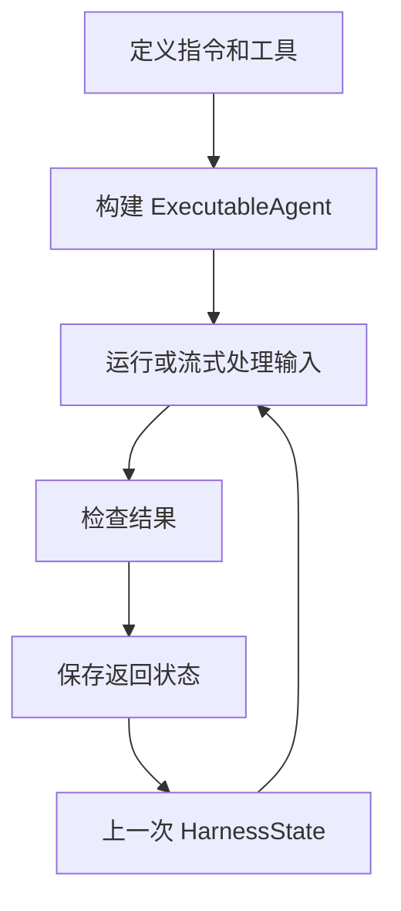

当 Python 应用需要自行管理 Agent 执行时，使用 Harness。你提供指令、模型和工具；Harness 执行对话，返回输出以及下一轮所需的状态。

从[快速入门](getting-started.md)开始：按锁文件安装源码包，运行离线 Agent，继续同一 Thread，再显示流式回答。这条路径跑通后再连接 provider。

## 从一个简单的 Agent 开始

第一次集成时，按以下顺序阅读：

| 步骤                                    | 构建内容               | 检查结果                                   |
| --------------------------------------- | ---------------------- | ------------------------------------------ |
| [快速入门](getting-started.md)          | 一个执行对象和离线模型 | 得到问候，并在同一 Thread 中开始第二次 Run |
| [工具与依赖](tools-and-dependencies.md) | 有类型的 Python 函数   | Agent 调用 `double(4)` 并返回 `8`          |
| [状态与恢复](state-and-resume.md)       | 保存并重新加载续接状态 | 后续调用保留同一 Thread                    |
| [测试](testing.md)                      | 确定性测试             | 无需 provider 即可验证工具调用和结果       |

四步使用相同的执行路径：

用 `HarnessBuilder` 构建一次，再调用 `run()` 获取终态结果，或调用 `stream()` 接收事件。传入 `previous_state` 继续同一 Thread。[Agent 与执行](agents-and-runs.md)介绍这些对象及其生命周期。

## 为 Agent 提供所需能力

根据希望 Agent 完成的任务选择下一篇指南：

| 任务                           | 指南                                                   |
| ------------------------------ | ------------------------------------------------------ |
| 连接模型账号                   | [模型](models.md)与[身份验证](model-authentication.md) |
| 调用应用函数                   | [工具与依赖](tools-and-dependencies.md)                |
| 询问用户或请求审批             | [人机协作工具](human-in-the-loop.md)                   |
| 接收文件或返回指定类型的结果   | [输入与输出](inputs-and-outputs.md)                    |
| 理解图片、音频、视频或媒体 URL | [多媒体理解](multimedia-understanding.md)              |
| 进行实时语音对话               | [Live](live.md)                                        |
| 读取文件和执行命令             | [环境](environments.md)                                |
| 连接 MCP 工具和交互式结果      | [MCP](mcp.md)                                          |
| 加载可复用的任务指引           | [Skill](skills.md)                                     |
| 委派工作或用 Python 编排工具   | [委派与 CodeAct](delegation-and-codeact.md)            |

[Capabilities](capabilities.md) 用于组合可复用功能。先选择当前任务需要的功能，再随应用扩展逐步添加。

## 继续并管理工作

| 任务                         | 指南                                                                         |
| ---------------------------- | ---------------------------------------------------------------------------- |
| 保存、恢复或分叉 Thread      | [状态与恢复](state-and-resume.md)                                            |
| 管理上下文、压缩、笔记和任务 | [上下文](context.md)                                                         |
| 跨 Thread 共享记忆信息       | [记忆](memory.md)                                                            |
| 设置预算并查看用量           | [用量与限制](usage-and-limits.md)                                            |
| 追踪执行或发布事件流         | [观测](observation.md)与 [Stream Protocol](../a13n-stream-protocol/index.md) |
| 离线验证行为                 | [测试](testing.md)                                                           |

## 将 Harness 嵌入应用

区分三类输入：

| 输入                                                 | 放置位置                    | 生命周期            |
| ---------------------------------------------------- | --------------------------- | ------------------- |
| 指令、输出类型、工具和稳定功能                       | `AgentSpec` 和 builder 参数 | 可复用的 Agent 定义 |
| 当前身份、模型解析器、受支持的服务绑定和 Environment | `RunBindings` 和调用参数    | 新的 Run            |
| 消息和可移植的功能状态                               | `HarnessState`              | 保存的续接状态      |

应用负责凭据、访问策略和持久存储。恢复状态时，另外提供重新授权的活跃资源。普通 Python 工具放入构建时的 Capability；`RunBindings.capabilities` 只接受限定的 MCP 和调用策略类型。

通过[托管与嵌入](hosting.md)连接这些生命周期，通过[插件](plugins.md)添加应用中间件或 Environment 集成。Harness 直接使用 Pydantic AI 原生的模型、消息、工具和输出类型。

需要现成的工作台时，从 [Harness UI](../a13n-harness-ui/index.md) 开始。需要受管理的用户和持久服务端执行时，使用 [Service](../a13n-service/index.md)。

## 可运行的应用示例

需要超出单页示例的完整流程时，参考以下应用：

| 示例                                                                                                                 | 演示内容                           |
| -------------------------------------------------------------------------------------------------------------------- | ---------------------------------- |
| [Agent 应用](https://github.com/converge-ai-labs/agent-foundation/tree/main/examples/agent-app)                      | 离线流式执行、持久化轮次、重启恢复 |
| [Environment Provider](https://github.com/converge-ai-labs/agent-foundation/tree/main/examples/environment-provider) | 执行连接与目标生命周期             |
| [插件](https://github.com/converge-ai-labs/agent-foundation/tree/main/examples/plugins)                              | 中间件和 Environment 扩展          |
| [已安装的 Provider](https://github.com/converge-ai-labs/agent-foundation/tree/main/examples/provider-plugin)         | 打包发布的 Provider 发现           |
| [MCP App](https://github.com/converge-ai-labs/agent-foundation/tree/main/examples/mcp-apps)                          | 交互式工具结果                     |

## 版本与适用范围

这些指南对应 `main` 分支的源码 API；快速入门使用配套的锁文件。Harness 和 Stream Protocol 以完全相同的版本号发布，Harness UI 则独立发布。架构约定见[已接受的规范](https://github.com/converge-ai-labs/agent-foundation/tree/main/spec/a13n-harness)。
