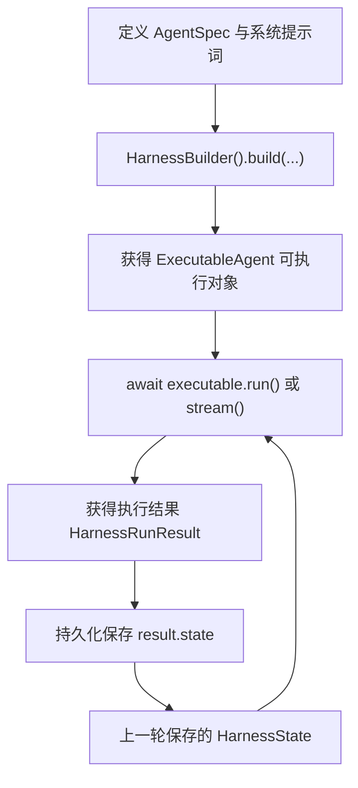

**Harness** 是专为 Python 开发者设计的内嵌式、类型安全 Agent 执行引擎。当您的业务应用需要精准掌控 Agent 的执行流程、连接本地工具、跨轮次维持对话状态，或者在服务中断后可靠恢复时，Harness 能够提供无黑盒封装的稳健工程基石。

Harness 基于现代 Python (3.13+) 构建，能够原生无缝接入 FastAPI、Celery 以及自建的异步后台任务工作池。

## 从一个简单的 Agent 开始

在配置真实模型密钥或云端基础设施前，只需几分钟即可在本地完全离线构建并跑通一个确定性的 Agent：

| 步骤 | 关注重点 | 您将构建的内容 |
| :--- | :--- | :--- |
| [快速入门](getting-started.md) | 离线执行流程 | 使用确定性函数模型构建可执行对象、消费流式回复并验证多轮对话延续性 |
| [工具与依赖](tools-and-dependencies.md) | 函数调用（Function Calling） | 挂载带类型约束的 Python 原生函数，捕获并检验结构化工具调用结果 |
| [状态与恢复](state-and-resume.md) | 检查点持久化 | 提取序列化的 `HarnessState`，跨进程重启平滑恢复会话上下文 |
| [测试](testing.md) | 确定性质量保障 | 编写单元与集成测试，在完全无需外部 API 请求的情况下精确验证 Agent 的工具决策与输出 |

上述四个开发里程碑遵循统一、直观的执行生命周期：

您通过 `HarnessBuilder` 声明式地完成指令、模型与能力的组装。构建产出的 `ExecutableAgent` 具备线程安全性，可被高并发调用复用。调用 `executable.run()` 即可同步等待终态结果，调用 `async with executable.stream()` 即可实时消费流式事件。

## 为 Agent 提供所需能力

根据业务场景的逐步深入，按需为 Agent 挂载丰富的能力插件（Capabilities）：

| 能力维度 | 重点功能 | 集成指南 |
| :--- | :--- | :--- |
| **多模型生态** | 原生兼容 OpenAI、Anthropic、Gemini、开源本地模型等 | [模型接入](models.md)与[身份认证](model-authentication.md) |
| **Python 本地工具** | 基于 Pydantic 自动完成参数校验的异步函数调用 | [工具与依赖](tools-and-dependencies.md) |
| **人机交互协同** | 支持交互式决策卡片、敏感操作二次确认与主动向人提问 | [人机交互](human-in-the-loop.md)与[工具权限控制](managed-tools.md#select-tool-permissions) |
| **强类型结构化 I/O** | 强制返回符合 Pydantic Model 规范的确定性数据对象 | [输入与输出](inputs-and-outputs.md) |
| **多模态数据理解** | 原生解析图像、音频、视频文件及远程多媒体资源 | [多媒体理解](multimedia-understanding.md) |
| **实时全双工语音** | 基于 WebRTC 的超低延迟双向实时语音通话流 | [Live 实时语音](live.md) |
| **沙箱执行环境** | 安全地遍历目录、读写代码并执行终端命令 | [执行环境 Environments](environments.md) |
| **标准协议工具接入** | 挂载 Model Context Protocol (MCP) 服务并渲染交互式网页控件 | [MCP 集成](mcp.md) |
| **动态技能与操作规程** | 自动发现并按需加载基于规范编写的 `SKILL.md` 指令 | [Skills 技能系统](skills.md) |
| **多智能体与代码执行** | 调度专属 Subagent 子智能体或借助 CodeAct 用 Python 并发编排工具 | [委派与 CodeAct 编排](delegation-and-codeact.md) |

通过 [Capabilities](capabilities.md) 机制，您可以保持极高的系统掌控度：仅挂载当前场景确需的功能，有效压低模型上下文窗口消耗并提升响应稳定性。

## 继续并管理工作

生产环境下的智能体架构必须能够从容应对网络抖动、进程重启与长时间运行的复杂业务流程：

| 生产级工程需求 | 实现方案 | 深度指南 |
| :--- | :--- | :--- |
| **状态持久化与分支派生** | 基于轻量可序列化的检查点安全保存、恢复或派生分支对话 | [状态与恢复](state-and-resume.md) |
| **上下文预算精细管控** | 自动管理窗口配额、会话记录压缩与临时任务备忘录 | [上下文治理](context.md) |
| **跨会话长期记忆** | 将跨会话的事实沉淀并结构化检索回填至 Prompt | [记忆管理 Memory](memory.md) |
| **Token 与耗时配额限制** | 严格限制 Token 预算、单次调用超时截断并追踪费用开销 | [配额与使用限制](usage-and-limits.md) |
| **全链路可观测性与审计** | 捕获 OpenTelemetry Trace、原始模型通信 Spans 与 AG-UI 事件流 | [可观测性](observation.md)与 [Stream Protocol](../a13n-stream-protocol/index.md) |
| **自动化确定性评测** | 借助 Mock 确定性模型在 CI 流程中秒级回归多轮对话质量 | [单元与集成测试](testing.md) |

## 将 Harness 嵌入应用

在微服务系统中集成 Harness 时，建议将三层生命周期对象清晰解耦：

| 架构层级 | 核心职责 | 对应运行时对象 |
| :--- | :--- | :--- |
| **Agent 定义层** | 静态系统提示词、模型选型、工具契约与启用的 Capabilities | `AgentSpec` 以及构建器参数 |
| **调用绑定层** | 单次调用的临时请求上下文、认证令牌、客户端注入的执行环境 | `RunBindings` |
| **状态持久层** | 历史消息栈、工具执行结果快照以及可序列化的检查点数据 | `HarnessState` |

这种严格的分层设计确保您的业务宿主对敏感认证密钥、数据库事务以及租户隔离控制享有绝对的所有权。

若您需要开箱即用的本地命令行与浏览器工作台，请参阅 [Harness UI](../a13n-harness-ui/index.md)；若需面向企业部署支持多租户与分布式调度的高可用后端平台，请查阅 [Service 平台](../a13n-service/index.md)。

## 可运行的应用示例

欢迎查阅 `examples/` 目录下提供的端到端生产级参考工程：

| 典型架构示例 | 核心技术亮点与参考源码 |
| :--- | :--- |
| **流式智能体服务** | [examples/agent-app](https://github.com/converge-ai-labs/agent-foundation/tree/main/examples/agent-app)（SSE 流式推送、按轮次检查点持久化、SQLite 状态存储、重启恢复） |
| **自定义执行环境提供方** | [examples/environment-provider](https://github.com/converge-ai-labs/agent-foundation/tree/main/examples/environment-provider)（Direct Local 本地目录、Docker 沙箱生命周期管理） |
| **中间件插件开发** | [examples/plugins](https://github.com/converge-ai-labs/agent-foundation/tree/main/examples/plugins)（自定义 Capability、运行时执行环境拦截器） |
| **已打包的环境插件** | [examples/provider-plugin](https://github.com/converge-ai-labs/agent-foundation/tree/main/examples/provider-plugin)（基于 Python Entry-Point 机制自动加载扩展） |
| **交互式 MCP 网页应用** | [examples/mcp-apps](https://github.com/converge-ai-labs/agent-foundation/tree/main/examples/mcp-apps)（通过 stdio MCP 协议在前端渲染响应式交互控件） |

## 版本与适用范围

本文档完全同步自 `main` 主分支 API 契约。Harness 严格锁定核心依赖版本以保证构建的一致性与可复现性，底层充分融合 Pydantic AI 的模型交互原语，并在上层扩展了完整的状态持久化、环境沙箱管理与流式通信协议。深入了解底层正式协议设计，请参阅 [Harness 架构技术规范](https://github.com/converge-ai-labs/agent-foundation/tree/main/spec/a13n-harness)。
