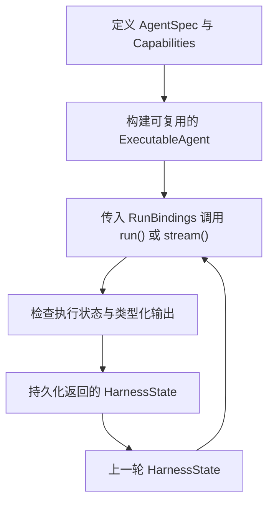

**Harness**（`a13n-harness`）是 Agent Foundation 的核心可嵌入 Python Agent SDK。你只需定义指令、模型、类型化工具与能力（Capabilities），Harness 即可在你的 Python 进程内驱动推理与工具调用循环，返回经过校验的结构化输出，并生成可序列化的 `HarnessState` 供下一轮对话继续使用。

请从[快速入门](getting-started.md)开始：先在本地离线运行首个 Agent、在同一 Thread 中推进多轮对话、流式输出实时事件，随后接入真实模型服务。

## 核心构建路径

按顺序跟随以下四篇指南，即可跑通从最小原型到生产级集成的完整闭环：

| 步骤                                           | 构建内容                                                 | 验证结果                                                     |
| ---------------------------------------------- | -------------------------------------------------------- | ------------------------------------------------------------ |
| 1. [快速入门](getting-started.md)              | 基于确定性离线模型的 `ExecutableAgent`                   | 在同一 Thread 内完成两轮对话并流式打印增量事件               |
| 2. [工具与依赖注入](tools-and-dependencies.md) | 带有 `AgentContext` 运行期上下文的 Python 类型化函数工具 | Agent 自动调用 `double(4)` 并读取宿主注入的请求元数据        |
| 3. [状态持久化与恢复](state-and-resume.md)     | 跨进程重启的 JSON 检查点落盘与恢复                       | 从磁盘重新加载 `HarnessState` 并沿用同一 Thread ID 继续对话  |
| 4. [确定性测试](testing.md)                    | 基于 `FunctionModel` 与 `TestModel` 的离线单元测试       | 无需联网或消耗 Token，直接断言工具调用、结构化输出与权限策略 |

通过 `HarnessBuilder` 一次性构建 `ExecutableAgent`，随后调用 `await executable.run(...)` 获取最终结果，或使用 `async with executable.stream(...)` 消费实时事件流。传入 `previous_state` 即可延续对话上下文。完整的执行生命周期详见 [Agents 与 Runs](agents-and-runs.md)。

## 三层生命周期分离架构

Harness 将构建期定义、单次运行期权限与可移植对话状态严格解耦，让你的宿主应用完全掌控多租户隔离、凭证安全与数据库存储：

| 生命周期层级                | 核心对象                                         | 承载内容                                                                                        |
| --------------------------- | ------------------------------------------------ | ----------------------------------------------------------------------------------------------- |
| **构建期（可跨请求复用）**  | `AgentSpec`、`AgentDefinition`、`HarnessBuilder` | 系统指令、输出类型或 JSON Schema、Python 函数工具、静态 Capabilities、子 Agent 定义与中间件插件 |
| **运行期（每轮新建注入）**  | `RunBindings`、调用参数                          | 当前调用方身份、动态模型解析器、已授权的 `Environment` 挂载、MCP 连接及工具审批策略             |
| **续接状态（可移植 JSON）** | `HarnessState`                                   | 稳定的 `thread_id`、消息历史、带版本号的 Capability 状态及可移植环境状态                        |

你的应用负责保管密钥、执行访问控制并读写数据库。在每一轮新对话中，从存储加载已保存的 `HarnessState`，并与当前重新授权的 `RunBindings` 组合即可恢复运行。

## 添加工具、上下文与能力

根据业务需求按需组装能力：

| 目标场景                                                     | 指南                                                                                                            |
| ------------------------------------------------------------ | --------------------------------------------------------------------------------------------------------------- |
| 接入 OpenAI、Anthropic、Gemini、Bedrock、Vertex 或自定义网关 | [模型配置](models.md)与[认证及 HTTP 客户端](model-authentication.md)                                            |
| 注册 Python 函数工具并注入业务服务实例                       | [工具与依赖注入](tools-and-dependencies.md)                                                                     |
| 挂起等待用户回答问题或审批敏感操作                           | [人机协同 (Human-in-the-loop)](human-in-the-loop.md) 与[托管工具审批](managed-tools.md#select-tool-permissions) |
| 将工具交由前端或外部进程执行后回填结果                       | [客户端工具 (Client tools)](client-tools.md)                                                                    |
| 校验 Pydantic 结构化输出或传入多模态文件                     | [输入与输出](inputs-and-outputs.md)及[多模态内容理解](multimedia-understanding.md)                              |
| 赋予 Agent 沙箱化的文件读写、Shell 命令与桌面操控能力        | [Environments 集成](environments.md)                                                                            |
| 接入 MCP 服务端与交互式 MCP Apps                             | [MCP](mcp.md)                                                                                                   |
| 按需加载 `SKILL.md` 可复用工作流指令                         | [Skills](skills.md)                                                                                             |
| 利用原生或分组按需检索支撑上百个工具                         | [ToolSearch 工具检索](tool-search.md)                                                                           |
| 委派子 Agent 或使用 Python CodeAct 编排并发工具调用          | [子 Agent 委派与 CodeAct](delegation-and-codeact.md)                                                            |
| 建立实时双向语音对话                                         | [Live 实时语音](live.md)                                                                                        |
| 组合内置能力或编写自定义 Capability                          | [Capabilities](capabilities.md)                                                                                 |

## 长对话管理与生产级运维

| 目标场景                                               | 指南                                                                                            |
| ------------------------------------------------------ | ----------------------------------------------------------------------------------------------- |
| 保存、恢复、分叉（Fork）对话或恢复中断的工具调用       | [状态持久化与恢复](state-and-resume.md)                                                         |
| 自动压缩长上下文、过滤历史记录并管理工作笔记与任务面板 | [上下文管理](context.md)                                                                        |
| 在多个 Thread 之间共享文件记忆或语义向量记忆           | [记忆系统 (Memory)](memory.md)                                                                  |
| 基于 Harness 架构多租户宿主服务                        | [宿主嵌入指南 (Hosting)](hosting.md) 与[插件体系 (Plugins)](plugins.md)                         |
| 设置 Token 与请求预算并核算模型成本                    | [用量、限额与计费](usage-and-limits.md)                                                         |
| 导出 OpenTelemetry 追踪或将流转换为前端 AG-UI 事件     | [可观测性 (Observation)](observation.md) 与 [Stream Protocol](../a13n-stream-protocol/index.md) |

如果你需要开箱即用的终端与浏览器交互工作台，请参阅 [Harness UI](../a13n-harness-ui/index.md)。如果你需要带 Console、RBAC 权限与后台分布式 Worker 的自托管团队平台，请参阅 [Service](../a13n-service/index.md)。

## 完整可运行示例工程

仓库 [`examples/`](https://github.com/converge-ai-labs/agent-foundation/tree/main/examples) 目录下提供了多个完整的多文件参考应用：

| 示例工程                                                                                                              | 演示重点                                                        |
| --------------------------------------------------------------------------------------------------------------------- | --------------------------------------------------------------- |
| [Agent application](https://github.com/converge-ai-labs/agent-foundation/tree/main/examples/agent-app)                | 离线流式多轮对话、持久化检查点与进程重启恢复                    |
| [Environment Providers](https://github.com/converge-ai-labs/agent-foundation/tree/main/examples/environment-provider) | Direct Local、Local Envd 与 Docker 执行目标的连接与生命周期管理 |
| [Plugins](https://github.com/converge-ai-labs/agent-foundation/tree/main/examples/plugins)                            | 自定义 Capabilities、Harness 中间件插件与环境扩展               |
| [Installed Provider](https://github.com/converge-ai-labs/agent-foundation/tree/main/examples/provider-plugin)         | 通过 Python entry points 打包并自动发现自定义环境提供方         |
| [MCP App](https://github.com/converge-ai-labs/agent-foundation/tree/main/examples/mcp-apps)                           | 基于 stdio MCP 服务端的交互式浏览器工具 UI                      |

## 版本关系与架构规范

本文档对应仓库 `main` 分支源码，快速入门示例配合仓库锁文件运行。`a13n-harness` 与 `a13n-stream-protocol` 始终保持完全相同的发布版本号。底层架构契约详见 [`spec/a13n-harness/`](https://github.com/converge-ai-labs/agent-foundation/tree/main/spec/a13n-harness)。
