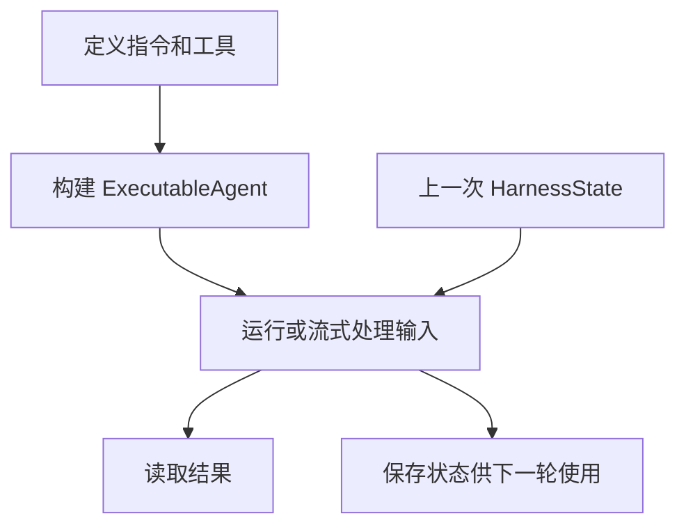

Harness 在你的 Python 应用中运行 Agent。定义指令和工具，选择模型，然后调用 Agent 或接收流式输出。每次 Run 返回结果和状态，保存状态即可继续下一轮对话。

从[离线快速入门](getting-started.md)开始，先运行完整示例，再连接模型账号。

## 从一个简单的 Agent 开始

Harness 应用的基本流程：

`AgentSpec` 描述 Agent，`HarnessBuilder` 构建可复用的 `ExecutableAgent`。调用 `run()` 获取结果，或调用 `stream()` 接收事件；传入之前的 `HarnessState` 即可继续同一 Thread。详见 [Agent 与执行](agents-and-runs.md)。

## 为 Agent 提供所需能力

| 任务                           | 指南                                                   |
| ------------------------------ | ------------------------------------------------------ |
| 连接模型账号                   | [模型](models.md)与[身份验证](model-authentication.md) |
| 调用应用函数                   | [工具与依赖](tools-and-dependencies.md)                |
| 提出问题或请求审批             | [人机协作工具](human-in-the-loop.md)                   |
| 接收文件并返回指定类型的结果   | [输入与输出](inputs-and-outputs.md)                    |
| 读取图片、音频、视频和媒体 URL | [多媒体理解](multimedia-understanding.md)              |
| 添加实时语音连接               | [Live](live.md)                                        |
| 操作文件和命令                 | [环境](environments.md)                                |
| 连接 MCP 工具或交互式结果      | [MCP](mcp.md)                                          |
| 加载可复用的操作指引           | [Skill](skills.md)                                     |
| 委派任务或用 Python 编排工具   | [委派与 CodeAct](delegation-and-codeact.md)            |

[Capabilities](capabilities.md) 提供可复用的上下文、工具和生命周期行为，随工作流需要逐步添加。

## 继续并管理工作

| 任务                       | 指南                                                                         |
| -------------------------- | ---------------------------------------------------------------------------- |
| 保存、恢复或分叉 Thread    | [状态与恢复](state-and-resume.md)                                            |
| 管理上下文、笔记和任务状态 | [上下文](context.md)                                                         |
| 在多个 Thread 间记住信息   | [记忆](memory.md)                                                            |
| 设置请求预算并查看用量     | [用量与限制](usage-and-limits.md)                                            |
| 观测执行并发布事件流       | [观测](observation.md)与 [Stream Protocol](../a13n-stream-protocol/index.md) |
| 运行确定性测试             | [测试](testing.md)                                                           |

## 将 Harness 嵌入应用

应用提供凭据、访问策略和存储。按用途组织三类配置：

- **Agent 定义：** 在 `AgentSpec` 和 builder 参数中指定指令、输出类型和稳定的 Capabilities。
- **Run 输入：** 通过绑定和调用参数提供当前身份、客户端、工具和 Environment。
- **继续执行的状态：** 将消息和可移植的 Capability 状态保存在 `HarnessState` 中。恢复时重新构建凭据和运行中的资源。

[托管与嵌入](hosting.md)介绍这些组件的连接方式，[插件](plugins.md)用于添加中间件和 Environment 集成。Harness 接受 Pydantic AI 原生的模型、消息、工具和输出类型。

需要现成的工作台时，使用 [Harness UI](../a13n-harness-ui/index.md)；需要受管理的用户和持久服务端执行时，使用 [Service](../a13n-service/index.md)。

## 可运行的应用示例

- [Agent 应用](https://github.com/converge-ai-labs/agent-foundation/tree/main/examples/agent-app)：离线流式执行、持久化轮次和重启恢复。
- [Environment Provider](https://github.com/converge-ai-labs/agent-foundation/tree/main/examples/environment-provider)：连接执行并管理目标生命周期。
- [插件](https://github.com/converge-ai-labs/agent-foundation/tree/main/examples/plugins)：中间件和 Environment 扩展。
- [已安装的 Provider](https://github.com/converge-ai-labs/agent-foundation/tree/main/examples/provider-plugin)：发现打包发布的 Provider。
- [MCP App](https://github.com/converge-ai-labs/agent-foundation/tree/main/examples/mcp-apps)：交互式工具结果。

## 版本与适用范围

这些指南对应 `main` 分支的源码 API。Harness 和 Stream Protocol 以完全相同的版本号发布；Harness UI 独立发布。架构约定见[已接受的规范](https://github.com/converge-ai-labs/agent-foundation/tree/main/spec/a13n-harness)。
