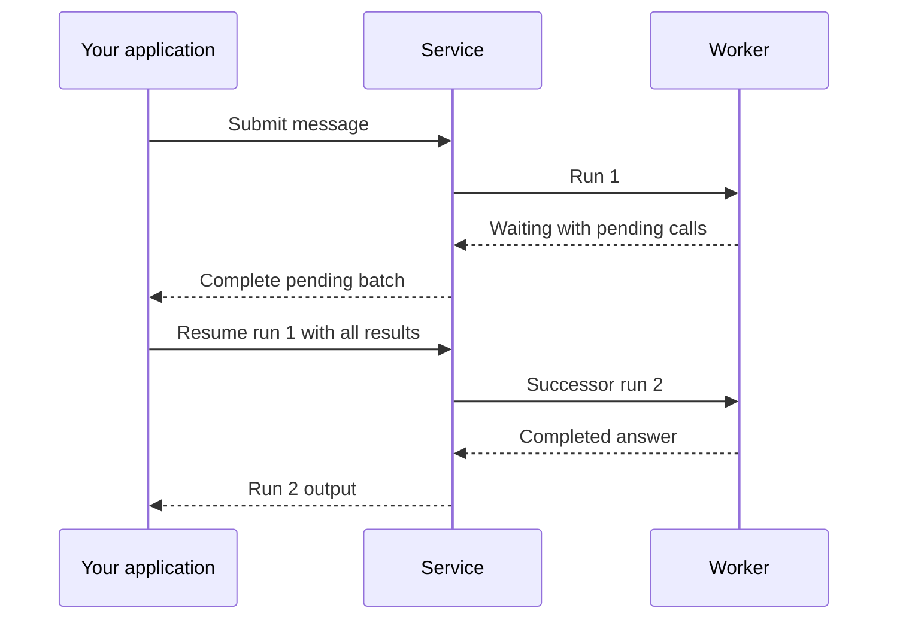

Start with one agent and one conversation. Save the agent's configuration, send a message, and follow the resulting run until it completes or asks for input. Send follow-ups to the same thread so they continue its history.

The main path is [create an agent](#agents) → [start a conversation](#start-a-conversation) → [read the result](#results) → [reply to a wait](#resume-a-waiting-run) or [send another message](#submit-a-message). For a complete shell walkthrough with credentials and response IDs, use [Connect an application](connect-application.md#direct-http-integration).

An **agent revision** stores configuration. A **thread** holds one advancing conversation history; a **session** groups related threads, including forks and asynchronous children. Each accepted advancement is a **run**. Workers execute a run through one or more **attempts**, allowing recovery without creating another run.

All API paths below start with `/api/v1`. Use a key for the intended [workspace](http.md#authentication). Reading needs `read`, running and stopping need `run`, and changing agents needs `write`; see [roles](identity.md#roles).

## Agents

1. Open **Agents → Create manually** in Console.
2. Choose a working workspace model and write instructions for the task.
3. Save the agent, then use **Try agent** to send a short test prompt.
4. Check the completed answer before adding tools, environments or delegation.

The API equivalent is `POST /agents` with a name and configuration. Replace `your-model-key` with a key from `GET /models`:

```json
{
  "name": "Support",
  "config": {"model": "your-model-key", "instructions": "Answer product questions precisely."}
}
```

Keep the returned `id` (`ap_…`) for submissions. Agent references use IDs; model references use keys.

Configuration changes create immutable numbered revisions. **Versions → Set as default** selects the revision used by later runs without a pin, including in existing conversations. An accepted run keeps its selected configuration. **Import YAML** in the **Create manually** menu and **Export agent** transfer configuration; match referenced resources in the destination workspace.

For API changes, `POST /agents/{agent_id}/revisions` takes `{config, note?, make_default?}` and the agent's `If-Match`. New revisions become default unless `make_default` is false. Submitting the current default's identical config returns that revision without creating another. Use `POST /agents/validate` to check a draft, or `POST /agents/{agent_id}/revisions/{revision_id}/set-default` to select a version. Metadata edits, duplication and archiving are listed in the [API reference](api-reference/index.md).

Archiving an agent blocks new runs; accepted runs finish. Built-in Agent Composer and Finding Agent allow model settings and supplemental instructions while protecting their other configuration. Their official instructions come from the current worker on each attempt. Duplicate a built-in agent when you need unrestricted configuration.

### Agent configuration

Add capabilities for a concrete task after the first model-only conversation works. The manual editor exposes configuration directly; [Agent Composer](agent-composer.md) helps build it through conversation.

#### Set approvals and automatic review

1. Expand a toolset under **Tools** and choose **Allow**, **Ask**, **Automatic review**, or **Deny** for its tools. Connections offer the same choices.
2. For automatic review, open **Configure review**, choose a review model, and set the risk threshold and action: deny or ask a person. Lower-risk calls proceed.
3. Use **Tool review rule** for a tool-specific policy. Advanced settings control shell review instructions, failure handling, timeouts and model parameters.
4. Select **Apply to draft**, then **Save changes**. Cancelling the panel discards its draft edits.

Review requires a model. Defaults deny extra-high risk and ask a person when review fails; review timeouts deny execution.

#### Configuration fields

Choose the setting that supplies the capability you need:

| Task                                 | Configuration                                                                                                         |
| ------------------------------------ | --------------------------------------------------------------------------------------------------------------------- |
| Select behavior and model            | `model`, `instructions`, `model_settings`, `model_characteristics`; see [Models](models.md)                           |
| Give the agent tools                 | `toolsets`, `connection_tools`, `tool_search`; see [Tools and connections](tools.md)                                  |
| Load reusable instructions           | `skills: [{skill_id, revision_id}]`; see [Skills](skills.md)                                                          |
| Ask the application or a person      | `client_tools`, `user_questions`; see [client tools](#client-tools-and-questions)                                     |
| Delegate work                        | `subagents`, `subagent_mode`; see [subagents](#subagents)                                                             |
| Review tool calls or interpret media | `reviewer`, `media_understanding`; see [media understanding](models.md#media-understanding)                           |
| Require structured output            | `output_spec`: one JSON Schema or 2–32 named `variants`; omission returns text                                        |
| Bound retries                        | `retries.tools` and `retries.output`, each 0–100                                                                      |
| Supply a working environment         | `default_environment_template_id`, `lazy_environment`; see [Environments](environments.md)                            |
| Retain knowledge                     | `memory`, `memory_mounts`; see [Memory](memory.md)                                                                    |
| Tune long-running work               | `background_compaction`, `execution`; see [compaction](#context-compaction) and [execution policy](#execution-policy) |
| Extend the runtime                   | `plugins`; see [Console plugins](#configure-plugins-in-console)                                                       |

Saving validates references against the workspace. Omitted skill and subagent revision IDs are pinned to their current defaults. Models, connections, providers and templates remain live resources resolved when used. `lazy_environment` defaults to true: instances prepare on first use. Setting it false prepares them before Harness starts; execution connections still open on first use.

### Context compaction

Service summarizes older conversation context as it grows. Synchronous compaction is the default. To generate summaries in the background, open **Advanced → Context compaction**, enable **Enable background compaction**, and save the revision:

```json
{"background_compaction": {"enabled": true, "blocking_threshold": 0.95}}
```

Ordinary threads can then continue while a summary is generated, using the latest model response's usage to select the mode. At the blocking threshold, the run waits for existing work or compacts synchronously if the compaction trigger is reached. A trigger at or above the blocking threshold leaves no asynchronous interval. Native token counting and explicit output reserves are not required for background progress. A ready summary can apply in this run or a later run of the same thread; disabling new background work still permits retained summaries to apply. Inline and asynchronous subagents compact synchronously.

Summary requests count toward the originating run's request budget, and their usage may arrive after that run ends. Interrupting a run leaves its background summary running. Archiving the thread retires it; forks do not inherit pending summaries.

Context recovery is enabled by default, independently of agent revision compaction settings. After a native context-window overflow, Harness first tries normal compaction. A successful summary lets the run continue with compacted history.

If ordinary execution and applicable compaction both overflow, Service permits one bounded, lossy history reconstruction per run, including worker takeover. It commits the reconstructed history and consumed allowance before dispatch. History files under the primary environment's `/workspace/.a13n/history/<thread-id>/` are best effort and last only as long as that environment. Unavailable storage or readers do not block reconstruction.

> [!WARNING]
> Every lossy reconstruction requires immediate root-cause investigation, even after success. Check compaction configuration and unbounded tool output first. Console retains the warning and outcome separately from the final answer.

### Tool permissions

Use permissions to decide what happens when the model calls a tool:

| Permission | Result                                                          |
| ---------- | --------------------------------------------------------------- |
| `allow`    | Execute the call.                                               |
| `ask`      | End the run waiting for approval.                               |
| `review`   | Let the configured reviewer policy allow, deny or ask a person. |
| `deny`     | Refuse the call.                                                |
| `inherit`  | Use the tool's default; built-in tools default to `allow`.      |

Set built-in and platform permissions at `toolsets.<toolset>.tools.<tool>.permission`. Connections use `connection_tools[].permission` with per-tool `permissions` overrides. Client tools accept `inherit`, `allow` or `deny` at `client_tools[].permission`; allowed client calls still need the application's result.

### Client tools and questions

Declare a client tool when your application owns the operation. For example, add this fragment to the agent's config:

```json
{
  "client_tools": [{
    "name": "open_ticket",
    "description": "Open a support ticket in the customer's CRM.",
    "parameters_json_schema": {
      "type": "object",
      "properties": {"title": {"type": "string"}},
      "required": ["title"]
    }
  }]
}
```

When called, the run ends `waiting` and exposes the call in `pending.calls`. Execute the operation in your application and [resume with its result](#resume-a-waiting-run).

Set `user_questions: true` to let the model use `ask_user_question`. Questions also appear in `pending.calls`. Answer the specific call through resume; a normal chat message stays in the inbox until the wait is resolved.

### Subagents

Configure `subagents` with workspace agent IDs. Each named edge can provide a description, revision pin, context-sharing choices and usage limits. Replace `ap_...` with a real agent ID in this fragment:

```json
{
  "subagent_mode": "async",
  "subagents": {
    "researcher": {
      "agent_id": "ap_...",
      "description": "Finds and summarizes sources.",
      "usage_limits": {"request_limit": 20},
      "environment": {"mode": "shared"}
    }
  }
}
```

**Inline** is the default: children execute inside the parent run and attempt. Their graph must not lead back to the delegating agent. Per-delegation limits can bound requests, tokens and tool calls.

**Async** creates child threads in the same session under the parent run's principal. The parent uses [delegation tools](../a13n-harness/delegation-and-codeact.md#asynchronous-children) to inspect, wait, steer, cancel or continue them. Child results enter the parent inbox and can steer its active run or start a later run. A child waiting for a person appears as `running` to these tools. Async edges apply only `usage_limits.request_limit`.

Async environments follow the edge: `shared` mounts the parent's environments, `dedicated` reserves one from `template_id`, and `none` mounts nothing. The child's own default environment template is unused. Deployment settings `worker.child_count` and `worker.child_depth` bound child count and nesting.

## Start a conversation

In Console, choose **Sessions → New session**, or **Try agent** on an agent's page. Through the API, `POST /threads` creates a thread and its first inbox message. Omit `session_id` to create a session too; supply it to add a thread to an existing session.

Send an `Idempotency-Key` unique to this logical submission. Keep that key and the same body for a lost-response retry. The [HTTP walkthrough](connect-application.md#direct-http-integration) shows how to save the receipt and extract IDs.

The response is `{thread, entry, run}`: `201` for the first submission, `200` for replay. Save the thread ID, its session ID and the entry ID even if `run` is null. Follow that entry's `assigned_run_id` when it becomes available. Assignment can precede incorporation; a completed run is the answer to this message only after the entry is `consumed` by that run.

New-thread requests can also set [environment mounts](environments.md#mount-environments-on-a-thread), [memory mounts](memory.md#mount-a-memory-on-a-thread), [caller headers](#caller-headers) and [imported history](#import-conversation-context). Add these when the conversation needs them.

To find previous work, list sessions or threads. `text_query` on `/sessions`, `/threads` and `/runs` matches all terms within one run's retained user and assistant text, including Chinese words and code identifiers. It excludes tools, reasoning, attachments and imported history. The index holds bounded excerpts rather than every original message; see `run_search` in [Settings reference](configuration-reference.md). Use session `q` for session or thread IDs. Session lists are ordered by recent activity.

### Import conversation context

To continue an external conversation, put completed history beside the new message in `POST /threads`. Replace the agent placeholder:

```json
{
  "agent_id": "ap_...",
  "message_history": [
    {"kind": "request", "parts": [{"part_kind": "user-prompt", "content": "We are planning a trip to Kyoto."}]},
    {"kind": "response", "parts": [{"part_kind": "text", "content": "How many days will you stay?"}]}
  ],
  "payload": {"content": [{"type": "text", "text": "Three days. Suggest an itinerary."}]}
}
```

`message_history` uses Pydantic AI message JSON, capped at 256 messages and 256 KiB of normalized JSON. It accepts user text, model text and closed tool-call/result exchanges. Every historical call needs a matching return by name and ID before the next response, user message or end of the import. Historical tools are context and do not execute.

Put instructions in the agent config and media in the current payload. Imports accept completed conversation content, not system instructions or suspended execution. Foreign application metadata and run/conversation IDs remain readable in the submitted JSON but are cleared before execution; imported usage does not become Service accounting.

The import initializes only this new thread. Follow-ups and forks continue its committed checkpoint. It creates no historical Service runs or display items, and existing thread history cannot be replaced. Python applications already using Pydantic AI can serialize with `ModelMessagesTypeAdapter.dump_json`; other clients can supply the JSON directly.

## Submit a message

Continue the conversation with `POST /threads/{thread_id}/inbox`. Send `agent_id`, `payload` and any run options with a new idempotency key. The response has the same receipt shape as thread creation.

Choose delivery deliberately:

- `steer` is the default. A compatible message joins the active run at a model boundary: same agent, no revision pin or the same revision, and matching options when supplied. Omitted options retain the active run's choices.
- `next_run` waits for a separate run. Use it when the message needs its own configuration or should follow the current task.

When the thread is idle and eligible, either mode can start a run. Queued messages advance in inbox order. A `waiting` run must be explicitly resumed first. After a failed or cancelled run, queued messages pause until a newly submitted message starts the next run; normal queue processing follows that run.

Pin `agent_revision_id` when a specific revision matters. Otherwise, a new run selects the agent's default at acceptance. An entry whose configuration can no longer run fails in place without blocking later entries. An archived workspace rejects queued work and revokes running authority at the worker's next authority check.

### Attached files

A payload holds 1–32 parts. Use text, an uploaded workspace asset, an HTTP(S) URL, or JSON:

```json
{"content": [{"type": "text", "text": "Summarize this report."}, {"type": "asset", "asset_id": "ast_..."}]}
```

Upload the file first and replace `ast_...` with its [asset ID](files-and-webhooks.md#assets). Service fetches URL parts under its [outbound policy](configuration.md#outbound-requests).

Service selects how to deliver each file:

1. Send supported images, audio, video or PDFs natively when the model declares the corresponding understanding capability.
2. Include supported text files up to 64 KiB as text. Without an environment, longer URL text is truncated to that prefix and marked as truncated.
3. Write other files to the primary `workspace` environment under `/workspace/.a13n/attachments/` and give the model the path. Tools then read or process the file.

If none applies, fix `environment_required` by providing an environment or a model that understands the media. URL suitability is checked after fetching; an unusable URL fails its entry. Materialized files belong to that environment, so replacing it or forking with fresh environments does not copy those files.

### Manage queued messages

Read `GET /threads/{thread_id}/inbox` or `GET /threads/{thread_id}/inbox/{entry_id}`. Entry states are `pending`, `assigned`, `consumed`, `failed` and `withdrawn`. `consumed` records incorporation into committed execution state; read the run separately for success or failure.

To change pending entries, use the thread's `If-Match`:

- `PATCH /threads/{thread_id}/inbox/{entry_id}` edits your own message's delivery, payload, revision pin or options.
- `DELETE /threads/{thread_id}/inbox/{entry_id}` withdraws it while retaining its idempotency identity.
- `PUT /threads/{thread_id}/inbox/order` with `{"entry_ids": [...]}` lists every pending entry in the desired order.

Callers with `run` can withdraw and reorder. Inbox count and byte limits return `429 rate_limited` when full. Console exposes **Queued messages** and sends messages typed during execution as steers.

### Per-run options

Use `options` for a one-run change. For example, this fragment sets a request budget and replaces instructions:

```json
{"options": {"max_usage": {"requests": 40}, "overrides": {"instructions": "Answer in German."}}}
```

`max_usage.requests` accepts 1–10,000; exceeding it fails the run with `usage_limit_exceeded`. `labels` tag the run. `overrides` is validated on submission and acceptance, then frozen. Most override fields replace their revision value; `toolsets` replaces each supplied toolset, while `retries` and each `subagents` edge merge supplied fields. A null subagent edge removes it.

Resume and automatic child-result continuation retain the previous run's options. Console's **Run options** sets choices for the next run. Use [execution policy](#execution-policy) for tool handoff and steering timing.

## Request context headers

Pass business metadata shared by model and MCP requests through the message body:

```json
{"options": {"context": {"headers": {"x-trace-id": "trace-123", "x-tenant-id": "acme"}}}}
```

Forwarding is enabled by default. Include only values intended for those providers and MCP servers. Values are readable run options; store secrets in provider or connection credentials. Inbound HTTP headers are not copied automatically. The map allows 32 case-insensitively unique names, printable ASCII values up to 4096 characters, and 8 KiB overall; authentication and transport names are reserved.

Recovery, resume and children retain the accepted context. New messages and forks start with their own context, empty when omitted. A steer can omit or repeat context; a different value queues for a later run. HTTP reads expose it, while MCP query projections remove it. Prompts, history and command environments receive no automatic copy.

Model request headers and per-connection `mcp_headers` override shared names; credentials and protected protocol headers remain authoritative. Forwarding requires both the deployment category switch and the target's `config.forward_context_headers`. Omitted target settings use `A13N_HARNESS_FORWARD_CONTEXT_HEADERS` (default true); MCP saves store the resolved value. Disable a category with `A13N_PROVIDERS__FORWARD_MODEL_CONTEXT_HEADERS=false` or `A13N_PROVIDERS__FORWARD_MCP_CONTEXT_HEADERS=false`. Fetch, browser and shell operations do not automatically forward these headers.

## Caller headers

Use thread-level `mcp_headers` when only a particular MCP connection needs non-secret context. Set it on thread creation or PATCH the thread with `If-Match`:

```json
{"mcp_headers": {"conn_...": {"x-tenant-id": "acme"}}}
```

Replace the placeholder with an enabled workspace MCP connection ID. The map permits 32 connections and 16 KiB total. Authentication and protocol names, including names used by the connection's own credentials, are refused. Each run freezes these headers at acceptance; forks and async children inherit them. Run views omit their values.

## Waits, approvals and questions

A run ends `waiting` when it needs an outside decision or result. Read both `pending.approvals` and `pending.calls`; `wait_reason` is `approval`, `call` or `multiple`. A question is a call, while a tool permission request is an approval.



### Resume a waiting run

1. Read the exact waiting run and its complete pending batch.
2. Collect decisions and results in your application. It owns partial answers, edits and reviewer coordination.
3. POST both result maps to `/runs/{run_id}/resume` with a new idempotency key for this reply batch.
4. Follow the successor run returned by the response. The original run stays `waiting` as historical evidence of that pause.

For a batch containing only approval `call_delete`, the complete response could be:

```json
{"approvals": {"call_delete": {"action": "deny", "reason": "Keep the file"}}, "calls": {}}
```

Use the actual pending IDs. Approval values are `{"action":"approve"}` or `{"action":"deny","reason":"..."}`. Call results are `{"status":"returned","value":...}` or `{"status":"failed","message":"..."}`. A failed call result gives the agent a tool failure to handle; it need not fail the successor run.

For a question named `call_question`, a free-text response is:

```json
{"approvals": {}, "calls": {"call_question": {"status": "returned", "value": {"response": "Up to 200 dollars per night."}}}}
```

Structured answers use `{"answers":{"Which color?":"blue"}}`, with arrays for multi-select answers. They must match that call's questions. To skip a question explicitly, return a failed call result. Console's **Continue without feedback** submits denials and failed results after confirmation.

Both maps must exactly cover their pending categories, even when one is empty. Missing results, unknown IDs or wrong categories reject the whole request and leave the wait unchanged. Only the idle thread's latest waiting run can be resumed; a stale request returns `409 conflict` with reason `not_idle_waiting_head`. Replay the same body and key after a lost response to retrieve the same successor (`200` instead of `201`).

To include clarification or an attachment, add `input` with the same content shape as a message payload. It supplements the required results. The model receives tool results first, then the user input. The complete resume body is capped at 256 KiB and accepted atomically without an extra inbox entry. Unusable input can fail the successor; inspect that run's outcome.

Normal inbox messages cannot close a wait. After resume, compatible steers may join the successor and `next_run` entries remain queued. If the successor fails, the next message continues from that failed run; the earlier wait is already resolved.

## Interrupt, fork and archive

Choose the operation by the history you want to keep:

| Goal                                        | Operation                                                         |
| ------------------------------------------- | ----------------------------------------------------------------- |
| Stop current work                           | `POST /runs/{run_id}/interrupt`, or Console **Stop**              |
| Explore another direction from an ended run | `POST /runs/{run_id}/fork` with a new message and idempotency key |
| Permanently close a thread                  | `POST /threads/{thread_id}/archive` with its `If-Match`           |

An unstarted run cancels immediately. A running run stops at a safe point and shows `cancel_requested_at` until then. Ended completed, waiting or failed runs cannot be interrupted; interrupting an already cancelled run returns it.

A fork creates a thread in the same session. Forking a wait denies approvals and supplies no-response results in the new branch; the original wait stays unchanged. Forks share source environment mounts unless `fresh_environments` is true. They copy memory mounts; `environments` and `memories` can add mounts. Use fresh environments when the branch needs separate filesystem state.

After failure or cancellation, continuation uses the last checkpoint, or the run's starting state if none was saved. Unfinished calls read as interrupted instead of executing again. If the history itself caused failure, fork an earlier run. Archiving withdraws pending messages, removes mounts and interrupts active work while preserving readable history.

## Execution policy

Set tool handoff and steering independently:

- `tools.mode: inline` waits for tool completion; `auto` can return a retained execution receipt after the foreground wait.
- `steering: boundary` applies guidance at a model boundary; `immediate` can preempt a foreground wait.

Service defaults to `auto`, a five-second foreground wait and `immediate`. This agent-config fragment makes those choices explicit:

```json
{"execution": {"tools": {"mode": "auto", "foreground_wait_seconds": 5}, "steering": "immediate"}}
```

Each leaf resolves **run override → thread override → selected agent revision → deployment default**. Use `config.execution` on the agent, `execution` on thread creation or PATCH, and `options.execution` on a message. Thread PATCH requires `If-Match`: omitted fields stay unchanged, null leaves inherit, and `{"execution":null}` clears the entire override.

A run freezes the effective policy at acceptance, including queued acceptance. Recovery, handoff, resume and automatic continuation keep it. Steers may omit or repeat matching leaves; a change returns `execution_policy_immutable`. Submit with `delivery: next_run` for a different policy. Earlier retained calls stay accessible even if the new run uses inline mode.

Console exposes **Execution policy** in agent configuration and **Session actions** for thread defaults. The new-session **Options** and idle composer's policy controls apply to one run; **Details → Execution policy** shows frozen values. Foreground wait accepts 0–300 seconds and controls observation, not an execution deadline.

### Command environment variables

Use `execution.environment` at the same three layers for non-secret command defaults:

```json
{"execution": {"environment": {"APP_MODE": "staging", "EMPTY": ""}}}
```

Each key resolves **command → run → thread → agent → frozen environment recipe**. Thread PATCH replaces a supplied map; null or `{}` clears that layer. Empty strings set empty values, and removing a key reveals lower defaults rather than unsetting it. Explicit command unsets follow provider support. Use consistent name spelling on Windows.

The run freezes its agent/thread/run overlay. Shell commands, background processes and their ordinary children receive it without changing global sandbox variables. Inline children share it; forks and independent child threads use their own agent and choices. Keep credentials in the appropriate secret store.

## Retained tool executions

With automatic handoff, a supported call can continue on its original worker after the model receives an `exec-*` receipt. Read that reference's result rather than starting the call again. A retained CodeAct invocation includes its nested calls. Later runs can use other workers; losing the owner marks unfinished work `lost` with uncertain effects, without automatic replay.

Open **Tool executions** from the Console session menu or run details. Use **Inspect** for metadata and **Read result** for a bounded result fragment. API operations are under `/threads/{thread_id}`:

| Endpoint                                      | Action                                                   |
| --------------------------------------------- | -------------------------------------------------------- |
| `GET /tool-executions`                        | List calls, optionally filtered by `run_id` or `active`. |
| `GET /tool-executions/{execution_id}`         | Inspect status.                                          |
| `GET /tool-executions/{execution_id}/result`  | Read with `offset`, `limit` and `version`.               |
| `POST /tool-executions/{execution_id}/cancel` | Request cancellation.                                    |

References belong to one exact thread. Agent result retrieval or first mailbox delivery starts the delivered-result retention window: one hour by default, bounded by 24 hours after completion. Console and HTTP inspection, including result reads, leave delivery and retention unchanged. Repeated reads do not extend retention; expired records return 404.

Cancellation acceptance is separate from completed cleanup. Stopping the originating run requests cancellation of its retained calls and suppresses late-result wakeups. Stopping a later run affects that run's calls, not older calls. Mounts stay in use until retained work and cleanup finish.

## Results

Read `GET /runs/{run_id}` and choose the next action from `status`:

| Status                | What to do                                                 |
| --------------------- | ---------------------------------------------------------- |
| `accepted`, `running` | Keep observing this run.                                   |
| `completed`           | Read `output`, text or JSON matching `output_spec`.        |
| `waiting`             | Read `pending` and submit a complete resume response.      |
| `failed`              | Inspect `failure.code` and `failure.message`.              |
| `cancelled`           | Inspect saved history before choosing a follow-up or fork. |

For submitted messages, first confirm which run consumed the inbox entry. An assigned entry can return to pending if it was not incorporated. A thread's latest run is not necessarily the answer to a particular message.

Use `/runs/{run_id}/items` for ordered display history. It returns recent items and `complete`; page backward with the first item's ordinal as `before`, or forward with `after`. Fields exceeding 32 KiB use `content_refs`; read saved content at `/runs/{run_id}/contents/{content_id}`. Each field retains at most 16 MiB, with `truncated` marking a saved prefix. Console's full/saved-content actions read these references.

For diagnosis, `/runs/{run_id}/agent` returns executed configuration, `/lineage` returns ancestors, and `/attempts` explains initial execution, recovery or worker handoff. `/threads/{thread_id}/runs` lists newest first. `current_run_id` identifies active work; `last_run_id` identifies the ended history from which continuation starts.

## Follow a session stream

Use `GET /sessions/{session_id}/stream` for live display across the session. It is an SSE stream that starts each connection from current state, without a reconnect cursor.

| Event       | Client action                                                                                                              |
| ----------- | -------------------------------------------------------------------------------------------------------------------------- |
| `thread`    | Replace the thread and named current/last runs.                                                                            |
| `items`     | Replace that run's items from ordinal `first` onward; keep earlier final items. Continue live display from `continuation`. |
| `delta`     | Apply provisional output to the run's display.                                                                             |
| `gap`       | Mark missing output and wait for the next `items` frame to repair it.                                                      |
| `app_ready` | Enable the identified [MCP Apps](tools.md#mcp-apps-for-embedding-applications).                                            |

An `items` frame with `complete: true` is the run's final display. Use the run's status for its outcome. On reconnect, discard unfinished displays and rebuild active runs from the new snapshot. Read `/runs/{run_id}/items` for runs that ended while disconnected. Ignore unknown event names.

Reconnect with randomized backoff capped at 30 seconds, respecting `Retry-After` for 429 or 503. Other 4xx refusals and invalid frames require correction rather than automatic retries. The stream is provisional; saved items are the durable display record. The frame schemas are exported in `proto/a13n-service/session-stream.schema.json`.

## Usage

Use `GET /usage?session_id=...` for complete model totals, and `GET /usage/runs?session_id=...&limit=50` for a paginated run breakdown. Totals cover every matching record, independently of which runs the UI has loaded. Both endpoints also filter by run, thread and ingestion time.

`/usage` returns `{models:[...]}`. `/usage/runs` returns `{items:[{run_id,thread_id,run_number,models}],next_cursor}`. Follow the cursor with unchanged filters until null. Runs are oldest first, with all model groups for each run kept together. `run_number` counts all runs in that thread, including those without usage.

Each model total records requests, token counts and cost from saved pricing. Cached input is included in input tokens. Unattributed model keys and wholly unpriced costs are null. `average_time_to_first_chunk_seconds` averages eligible completed streamed requests. `output_tokens_per_second` divides inclusive output tokens by summed full request duration for completed positive-duration requests, including non-streaming requests and time before the first chunk. Each metric is null without its eligible observations.

A run's `usage_at_seal` captures usage when it ended. Late reports still enter `/usage`; time filters select their ingestion time.

## Traces

Configure a [trace backend](configuration.md#logs-metrics-and-traces), then open **Traces** in Console to investigate a slow, expensive or failed execution. Each attempt exports Harness spans, including inline children. Without a backend, trace queries return `503 unavailable`.

1. Select a time range.
2. Filter by run/thread/session or root attributes.
3. Apply duration limits in seconds or cost limits in USD, then sort by **Duration**, **Cost** or **Started**.
4. Open a trace and inspect the relevant spans and evidence.

For example, minimum duration `60` and minimum cost `0.01`, sorted by descending cost, finds reported traces lasting at least a minute and costing at least $0.01. Bounds are inclusive. Trace cost sums reported span costs; missing cost is unknown, and trace totals are separate from Service run accounting.

Use `/traces/search` with explicit `started_after`, `started_before`, `order_by` and `direction`. Keep filters unchanged when following its keyset cursor. Searches have bounded collection and a 30-second deadline; narrow the range or add an ID filter when limits are exceeded. Results depend on backend sampling, ingestion and retention, and pagination does not freeze changing data. The [API reference](api-reference/index.md) lists trace, span and attempt endpoints.

## Find and improve execution issues

Use **Insights → Findings** to turn trace evidence into a reviewed improvement:

1. Choose **Analyze traces**, select rules and a time range/count, and optionally add **Requirements for this analysis**. For one ended trace, use **Analyze trace**.
2. Open the analysis run from **Analysis history**. Read its summary, evidence and selection limits.
3. Open a finding, select **Edit assessment**, choose confirmed, expected, insufficient or false positive, add a **Review note**, and **Save assessment**.
4. For a finding worth changing, choose **Review with Composer**, send the proposed message, inspect the recommendation and approve a configuration write when appropriate.

Analysis requires a trace query backend and uses the built-in Finding Agent's selected default version and model. Selection scans at most 100 roots and chooses at most 20 traces. Execution/recovery rules prioritize failed runs and error/fatal roots within that scan. Counts show selection and citations, not proof that every selected trace was fully analyzed. Treat even critical findings as diagnoses to review against their evidence.

Categories distinguish unclear requests, instruction issues, tool design, tool usage, tool execution, answer quality, context gaps, workflow issues and boundary violations. They describe the issue rather than prove its cause. A normal permission denial is not a boundary violation; an unsupported success claim is an answer-quality issue.

Saved assessments and notes inform later analyses of the same agent revision. Changing the assessment clears the old rationale; closing or reopening preserves saved feedback. Each accepted analysis keeps its original input, so edits affect new analyses. Feedback is bounded and helps compare diagnoses without merging stored findings.

Finding Agent reads only selected trace evidence and can submit findings; it does not repair or publish configuration. External producers can use `POST /findings` with a stable `source_key` unique to their workspace/principal. They own trace/span references; Service validates cited runs and agent revisions.

## Configure Plugins in Console

1. Open the agent's **Capabilities → Plugins** and select **Add plugin**.
2. Choose a deployment-enabled plugin, assign a unique instance name, and edit its settings in the form or JSON editor.
3. Save the agent to validate the draft and publish a revision. Saving validates configuration without executing the plugin.

Multiple instances can use the same plugin. Renaming or removing one updates tool-discovery references. Presets are read-only. If a plugin becomes unavailable, its saved JSON stays visible; restore the plugin or remove the instance before saving.

Administrators install packages and configure `plugins.keys` consistently on Control and workers. The Control catalog at `GET /plugins` lists enabled plugins; worker installation must match it.
