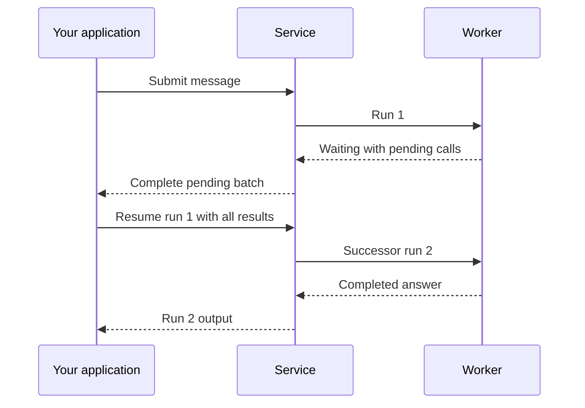

Start with one agent and one conversation. Save the agent's configuration, send a message, and follow the resulting run until it completes or asks for input. Send follow-ups to the same thread so they continue its history.

The main path is [create an agent](#agents) → [start a conversation](#start-a-conversation) → [read the result](stream-and-read-results.md#results) → [reply to a wait](#resume-a-waiting-run) or [send another message](#submit-a-message). For a complete shell walkthrough with credentials and response IDs, use [Connect an application](connect-application.md#direct-http-integration).

An **agent revision** stores configuration. A **thread** holds one advancing conversation history; a **session** groups related threads, including forks and asynchronous children. Each accepted advancement is a **run**. Workers execute a run through one or more **attempts**, allowing recovery without creating another run.

All API paths below start with `/api/v1`. Use a key for the intended [workspace](http.md#authentication). Reading needs `read`, running and stopping need `run`, and changing agents needs `write`; see [roles](identity.md#roles).

## Agents

1. Open **Agents → Create manually** in Console.
2. Choose a working workspace model and write instructions for the task.
3. Save the agent, then use **Try agent** to send a short test prompt.
4. Check the completed answer before adding tools, environments or delegation.

The API equivalent is `POST /agents` with a name and configuration. Replace `your-model-key` with a key from `GET /models`:

```json
{
  "name": "Support",
  "config": {"model": "your-model-key", "instructions": "Answer product questions precisely."}
}
```

Keep the returned `id` (`ap_…`) for submissions. Agent references use IDs; model references use keys.

Configuration changes create immutable numbered revisions. **Versions → Set as default** selects the revision used by later runs without a pin, including in existing conversations. An accepted run keeps its selected configuration. **Import YAML** in the **Create manually** menu and **Export agent** transfer configuration; match referenced resources in the destination workspace.

For API changes, `POST /agents/{agent_id}/revisions` takes `{config, note?, make_default?}` and the agent's `If-Match`. New revisions become default unless `make_default` is false. Submitting the current default's identical config returns that revision without creating another. Use `POST /agents/validate` to check a draft, or `POST /agents/{agent_id}/revisions/{revision_id}/set-default` to select a version. Metadata edits, duplication and archiving are listed in the [API reference](api-reference/index.md).

Archiving an agent blocks new runs; accepted runs finish. Built-in Agent Composer and Finding Agent allow model settings and supplemental instructions while protecting their other configuration. Their official instructions come from the current worker on each attempt. Duplicate a built-in agent when you need unrestricted configuration.

### Agent configuration

<span id="set-approvals-and-automatic-review"></span> <span id="configuration-fields"></span> <span id="context-compaction"></span> <span id="tool-permissions"></span> <span id="client-tools-and-questions"></span> <span id="subagents"></span>

- [Configure an agent](agent-configuration.md)

## Start a conversation

In Console, choose **Sessions → New session**, or **Try agent** on an agent's page. Through the API, `POST /threads` creates a thread and its first inbox message. Omit `session_id` to create a session too; supply it to add a thread to an existing session.

Send an `Idempotency-Key` unique to this logical submission. Keep that key and the same body for a lost-response retry. The [HTTP walkthrough](connect-application.md#direct-http-integration) shows how to save the receipt and extract IDs.

The response is `{thread, entry, run}`: `201` for the first submission, `200` for replay. Save the thread ID, its session ID and the entry ID even if `run` is null. Follow that entry's `assigned_run_id` when it becomes available. Assignment can precede incorporation; a completed run is the answer to this message only after the entry is `consumed` by that run.

New-thread requests can also set [environment mounts](environments.md#mount-environments-on-a-thread), [memory mounts](standalone-memory.md#mount-a-memory-on-a-thread), [caller headers](execution-options.md#caller-headers) and [imported history](execution-options.md#import-conversation-context). Add these when the conversation needs them.

To find previous work, list sessions or threads. `text_query` on `/sessions`, `/threads` and `/runs` matches all terms within one run's retained user and assistant text, including Chinese words and code identifiers. It excludes tools, reasoning, attachments and imported history. The index holds bounded excerpts rather than every original message; see `run_search` in [Settings reference](configuration-reference.md). Use session `q` for session or thread IDs. Session lists are ordered by recent activity.

### Import conversation context

- [Advanced execution options](execution-options.md)

## Submit a message

Continue the conversation with `POST /threads/{thread_id}/inbox`. Send `agent_id`, `payload` and any run options with a new idempotency key. The response has the same receipt shape as thread creation.

Choose delivery deliberately:

- `steer` is the default. A compatible message joins the active run at a model boundary: same agent, no revision pin or the same revision, and matching options when supplied. Omitted options retain the active run's choices.
- `next_run` waits for a separate run. Use it when the message needs its own configuration or should follow the current task.

When the thread is idle and eligible, either mode can start a run. Queued messages advance in inbox order. A `waiting` run must be explicitly resumed first. After a failed or cancelled run, queued messages pause until a newly submitted message starts the next run; normal queue processing follows that run.

Pin `agent_revision_id` when a specific revision matters. Otherwise, a new run selects the agent's default at acceptance. An entry whose configuration can no longer run fails in place without blocking later entries. An archived workspace rejects queued work and revokes running authority at the worker's next authority check.

### Attached files

A payload holds 1–32 parts. Use text, an uploaded workspace asset, an HTTP(S) URL, or JSON:

```json
{"content": [{"type": "text", "text": "Summarize this report."}, {"type": "asset", "asset_id": "ast_..."}]}
```

Upload the file first and replace `ast_...` with its [asset ID](files-and-webhooks.md#assets). Service fetches URL parts under its [outbound policy](configuration.md#outbound-requests).

Service selects how to deliver each file:

1. Send supported images, audio, video or PDFs natively when the model declares the corresponding understanding capability.
2. Include supported text files up to 64 KiB as text. Without an environment, longer URL text is truncated to that prefix and marked as truncated.
3. Write other files to the primary `workspace` environment under `/workspace/.a13n/attachments/` and give the model the path. Tools then read or process the file.

If none applies, fix `environment_required` by providing an environment or a model that understands the media. URL suitability is checked after fetching; an unusable URL fails its entry. Materialized files belong to that environment, so replacing it or forking with fresh environments does not copy those files.

### Manage queued messages

Read `GET /threads/{thread_id}/inbox` or `GET /threads/{thread_id}/inbox/{entry_id}`. Entry states are `pending`, `assigned`, `consumed`, `failed` and `withdrawn`. `consumed` records incorporation into committed execution state; read the run separately for success or failure.

To change pending entries, use the thread's `If-Match`:

- `PATCH /threads/{thread_id}/inbox/{entry_id}` edits your own message's delivery, payload, revision pin or options.
- `DELETE /threads/{thread_id}/inbox/{entry_id}` withdraws it while retaining its idempotency identity.
- `PUT /threads/{thread_id}/inbox/order` with `{"entry_ids": [...]}` lists every pending entry in the desired order.

Callers with `run` can withdraw and reorder. Inbox count and byte limits return `429 rate_limited` when full. Console exposes **Queued messages** and sends messages typed during execution as steers.

### Per-run options

Use `options` for a one-run change. For example, this fragment sets a request budget and replaces instructions:

```json
{"options": {"max_usage": {"requests": 40}, "overrides": {"instructions": "Answer in German."}}}
```

`max_usage.requests` accepts 1–10,000; exceeding it fails the run with `usage_limit_exceeded`. `labels` tag the run. `overrides` is validated on submission and acceptance, then frozen. Most override fields replace their revision value; `toolsets` replaces each supplied toolset, while `retries` merges supplied fields. `subagents` replaces the whole policy, including named and dynamic settings; a null override inherits it.

Resume and automatic child-result continuation retain the previous run's options. Console's **Run options** sets choices for the next run. Use [execution policy](execution-options.md#execution-policy) for tool handoff and steering timing.

## Request context headers

<span id="caller-headers"></span>

- [Advanced execution options](execution-options.md)

## Waits, approvals and questions

A run ends `waiting` when it needs an outside decision or result. Read both `pending.approvals` and `pending.calls`; `wait_reason` is `approval`, `call` or `multiple`. A question is a call, while a tool permission request is an approval.



### Resume a waiting run

1. Read the exact waiting run and its complete pending batch.
2. Collect decisions and results in your application. It owns partial answers, edits and reviewer coordination.
3. POST both result maps to `/runs/{run_id}/resume` with a new idempotency key for this reply batch.
4. Follow the successor run returned by the response. The original run stays `waiting` as historical evidence of that pause.

For a batch containing only approval `call_delete`, the complete response could be:

```json
{"approvals": {"call_delete": {"action": "deny", "reason": "Keep the file"}}, "calls": {}}
```

Use the actual pending IDs. Approval values are `{"action":"approve"}` or `{"action":"deny","reason":"..."}`. Call results are `{"status":"returned","value":...}` or `{"status":"failed","message":"..."}`. A failed call result gives the agent a tool failure to handle; it need not fail the successor run.

For a question named `call_question`, a free-text response is:

```json
{"approvals": {}, "calls": {"call_question": {"status": "returned", "value": {"response": "Up to 200 dollars per night."}}}}
```

Structured answers use `{"answers":{"Which color?":"blue"}}`, with arrays for multi-select answers. They must match that call's questions. To skip a question explicitly, return a failed call result. Console's **Continue without feedback** submits denials and failed results after confirmation.

Both maps must exactly cover their pending categories, even when one is empty. Missing results, unknown IDs or wrong categories reject the whole request and leave the wait unchanged. Only the idle thread's latest waiting run can be resumed; a stale request returns `409 conflict` with reason `not_idle_waiting_head`. Replay the same body and key after a lost response to retrieve the same successor (`200` instead of `201`).

To include clarification or an attachment, add `input` with the same content shape as a message payload. It supplements the required results. The model receives tool results first, then the user input. The complete resume body is capped at 256 KiB and accepted atomically without an extra inbox entry. Unusable input can fail the successor; inspect that run's outcome.

Normal inbox messages cannot close a wait. After resume, compatible steers may join the successor and `next_run` entries remain queued. If the successor fails, the next message continues from that failed run; the earlier wait is already resolved.

## Interrupt, fork and archive

Choose the operation by the history you want to keep:

| Goal                                        | Operation                                                         |
| ------------------------------------------- | ----------------------------------------------------------------- |
| Stop current work                           | `POST /runs/{run_id}/interrupt`, or Console **Stop**              |
| Explore another direction from an ended run | `POST /runs/{run_id}/fork` with a new message and idempotency key |
| Permanently close a thread                  | `POST /threads/{thread_id}/archive` with its `If-Match`           |

An unstarted run cancels immediately. A running run stops at a safe point and shows `cancel_requested_at` until then. Ended completed, waiting or failed runs cannot be interrupted; interrupting an already cancelled run returns it.

A fork creates a thread in the same session. Forking a wait denies approvals and supplies no-response results in the new branch; the original wait stays unchanged. Forks share source environment mounts unless `fresh_environments` is true. They copy memory mounts; `environments` and `memories` can add mounts. Use fresh environments when the branch needs separate filesystem state.

After failure or cancellation, continuation uses the last checkpoint, or the run's starting state if none was saved. Unfinished calls read as interrupted instead of executing again. If the history itself caused failure, fork an earlier run. Archiving withdraws pending messages, removes mounts and interrupts active work while preserving readable history.

## Execution policy

<span id="command-environment-variables"></span> <span id="retained-tool-executions"></span>

- [Advanced execution options](execution-options.md)

## Results

<span id="follow-a-session-stream"></span>

Read [results, saved history and reconnect behavior](stream-and-read-results.md).

## Usage

<span id="traces"></span> <span id="find-and-improve-execution-issues"></span> <span id="configure-plugins-in-console"></span>

- [Inspect runs and improve agents](inspect-runs.md)
- [Configure an agent](agent-configuration.md)
