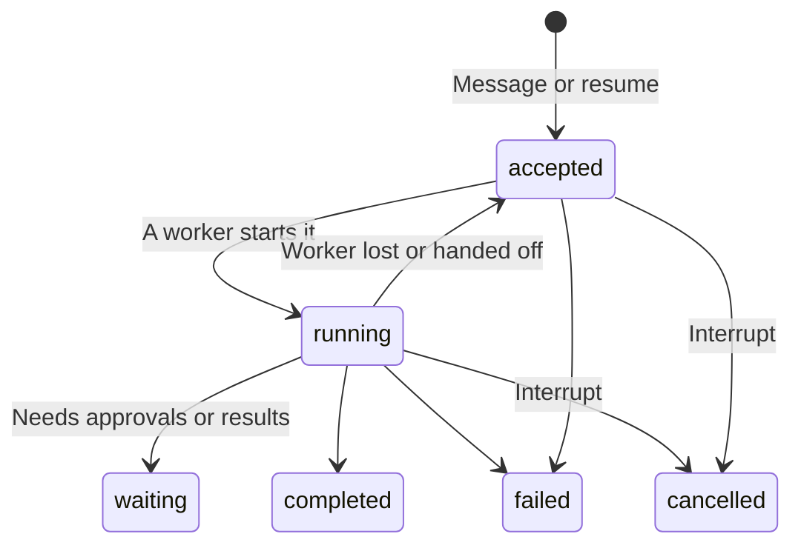
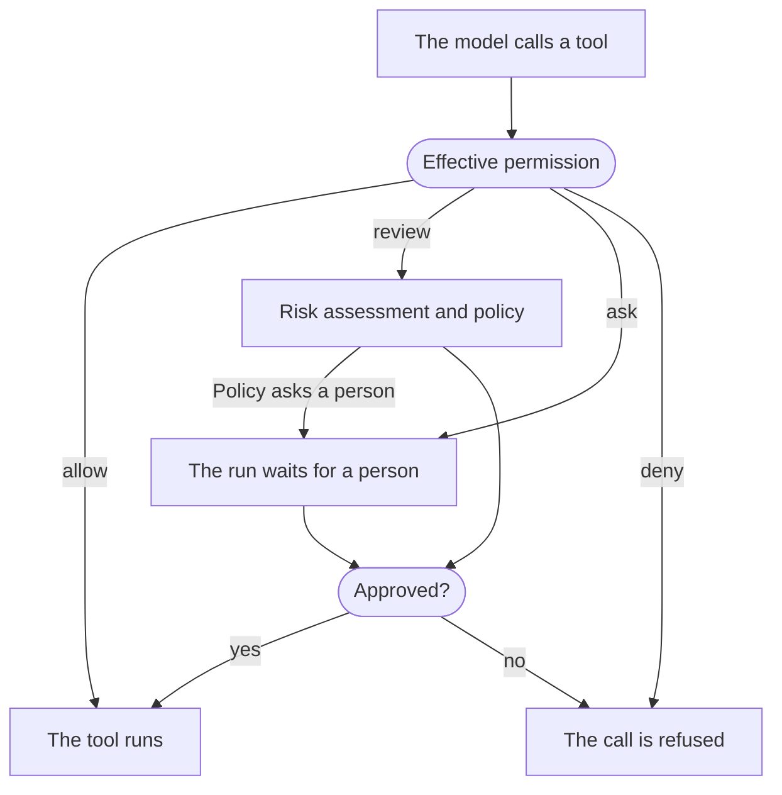
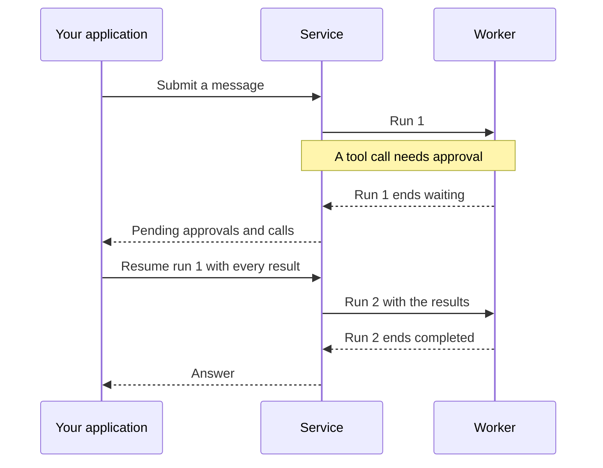

An **agent** is a named resource whose configuration (a model, instructions, tools and policies) is saved as immutable, numbered **revisions**. People and applications talk to agents in **sessions**. A session holds one or more **threads**, each an independently advancing history; messages you send go to the thread's **inbox**, and each accepted advancement of a thread is a **run**. A run executes on a worker as one or more **attempts** and ends `completed`, `waiting`, `failed` or `cancelled`.



All paths below are under `/api/v1` and act in the request's [workspace](http.md#workspace). Reading needs `read`; starting, steering, resuming and stopping runs needs `run`; changing agents needs `write`. See [Identity and access](identity.md#roles).

## Agents

In Console, open **Agents → Create manually**. Configuration changes create immutable revisions; **Versions** lists them and **Set as default** chooses the one that later runs without a pinned revision use, in new and existing conversations. **Import YAML** (in the **Create manually** menu) and **Export agent** copy an agent between workspaces, matching each referenced resource to one in the target workspace.

Through the API, replace `your-model-key` with a key from `GET /api/v1/models`:

```sh
curl -X POST "$A13N_URL/api/v1/agents" \
  -H "Authorization: Bearer $A13N_API_KEY" -H "Content-Type: application/json" \
  -d '{"name": "Support", "description": "Answers product questions",
       "config": {"model": "your-model-key", "instructions": "Be precise and cite sources.", "user_questions": true}}'
```

The response's `id` (`ap_…`) identifies the agent in paths and references; agents have no key.

- `POST …/agents/{agent_id}/revisions` with `{config, note?, make_default?}` and the agent's `If-Match` adds a revision; it becomes the default unless `make_default` is `false`. A `config` identical to the current default is a no-op: the call returns that revision again (`201`) without creating one, regardless of `make_default`. `POST …/revisions/{revision_id}/set-default` changes the default.
- `POST …/agents/validate` with `{config}` checks a configuration exactly as saving would, and answers `204`.
- `PATCH …/agents/{agent_id}` changes `name`, `description` and `labels`; `PUT …/avatar` sets an image. `POST …/duplicate` copies an agent, from its default or a chosen revision.
- `POST …/archive` stops new runs of the agent (`422 disabled`); runs already accepted finish. `POST …/unarchive` reverses it.
- Lists filter by `label`, `q` (name or description), `archived`, `source` (`custom` or `builtin`), and `skill_id` or `skill_revision_id`, which keep the agents with a revision pinning it.

The built-in [Agent Composer](agent-composer.md) and Finding Agent are agents with `source: "builtin"`, distinguished by `preset_kind`. Their entire configuration is read-only, including models and model settings. Preparation automatically selects a usable model and retains the current one while usable. Metadata, avatar, archiving and default-version changes are protected.

### Agent configuration

Use the manual editor to choose the model, instructions and capabilities. For conversational setup, use [Agent Composer](agent-composer.md).

#### Set approvals and automatic review

1. Expand a toolset under **Tools**, select the tools, and choose **Allow**, **Ask**, **Automatic review**, or **Deny**. Connection tools offer the same permissions.
2. For automatic review, select **Configure review**, choose a review model, and set the risk threshold and action at or above it: deny or ask for approval. Calls below the threshold proceed.
3. Use **Tool review rule** when one tool needs a different threshold or action. Advanced settings include shell instructions, failure handling, timeout, model parameters and selector rules.
4. Select **Apply to draft**, then **Save changes** to publish the new revision. Cancelling the panel discards its edits.

Review requires a model before saving. Defaults deny extra-high risk and ask a person when review fails. Review timeouts always deny execution.

#### Configuration fields

A revision's `config` holds:

| Field                             | Meaning                                                                                                                                                                                                                               |
| --------------------------------- | ------------------------------------------------------------------------------------------------------------------------------------------------------------------------------------------------------------------------------------- |
| `model`                           | The model's key. See [Models](models.md).                                                                                                                                                                                             |
| `model_settings`                  | Model-API-specific settings, such as reasoning effort.                                                                                                                                                                                |
| `model_characteristics`           | The context window and context-management thresholds.                                                                                                                                                                                 |
| `instructions`                    | The system instructions, up to 256 KiB.                                                                                                                                                                                               |
| `toolsets`                        | Built-in toolsets and each tool's enablement, configuration and permission. See [Tools and connections](tools.md#built-in-toolsets).                                                                                                  |
| `skills`                          | Skills and the revisions they pin, `[{skill_id, revision_id}]`. See [Skills](skills.md).                                                                                                                                              |
| `tool_search`                     | Fixed proxy discovery for selected local capabilities, connections, plugins and platform tools. See [Grouped tool discovery](tools.md#grouped-tool-discovery).                                                                        |
| `connection_tools`                | Connections and their tools. See [Use a connection in an agent](tools.md#use-a-connection-in-an-agent).                                                                                                                               |
| `client_tools`                    | Tools your application executes; see [client tools](#client-tools-and-questions).                                                                                                                                                     |
| `user_questions`                  | Offers the `ask_user_question` tool.                                                                                                                                                                                                  |
| `subagents`, `subagent_mode`      | Other agents this agent can delegate to; see [subagents](#subagents).                                                                                                                                                                 |
| `reviewer`                        | The model, by key, that decides calls whose permission is `review`.                                                                                                                                                                   |
| `media_understanding`             | Models, by key, that read images, video or audio for this agent; see [media understanding](models.md#media-understanding).                                                                                                            |
| `plugins`                         | Instances of Harness plugins the deployment installed (`plugins.keys`).                                                                                                                                                               |
| `output_spec`                     | Structured output: one JSON Schema, or 2–32 named `variants`. Without it the result is text.                                                                                                                                          |
| `retries`                         | How many times the model may retry failed tool calls (`tools`) and invalid output (`output`), 0–100 each.                                                                                                                             |
| `default_environment_template_id` | An [environment template](environments.md#templates) from which each new thread gets its own primary environment.                                                                                                                     |
| `lazy_environment`                | Defaults to `true`: create/start instances on first use. Set `false` to prepare instances before entering Harness; execution connections still open on first use; see [environments](environments.md#mount-environments-on-a-thread). |
| `memory`                          | [Memory Space defaults](memory.md#select-spaces): `enabled` and `spaces[{name, space_id, access}]`. New sessions snapshot omitted fields at first acceptance; explicit choices override them.                                         |
| `memory_mounts`                   | [Memories](memory.md#mount-a-memory-on-a-thread) each new thread mounts when its first run is accepted, `[{name, memory_id, access}]`.                                                                                                |

Saving validates the whole configuration against the workspace: every referenced model, skill, connection, provider and agent must exist and be usable by you, or saving fails with `invalid_argument` on that field, and skill and subagent references without a `revision_id` are pinned to the current default revision. A revision therefore keeps its configuration and its skill and subagent pins; the models, connections, providers and templates it names are live and are resolved again at each use.

### Tool permissions

Every built-in tool, connection tool and client tool has a permission:

| Permission | Effect                                                                                                                                                    |
| ---------- | --------------------------------------------------------------------------------------------------------------------------------------------------------- |
| `allow`    | The tool runs when the model calls it.                                                                                                                    |
| `ask`      | The run [waits](#waits-approvals-and-questions) for a person to approve or deny the call.                                                                 |
| `review`   | The `reviewer` assesses risk; its policy allows, denies or asks a person. Review failures default to asking a person; timeouts deny. Requires `reviewer`. |
| `deny`     | The call is refused.                                                                                                                                      |
| `inherit`  | The default: the tool's own default permission, which is `allow` for every built-in tool.                                                                 |



Set it per built-in tool in `toolsets.<toolset>.tools.<tool>.permission`, per connection in `connection_tools[].permission` with per-tool overrides in `permissions`, and per client tool in `client_tools[].permission` (`inherit`, `allow` or `deny`). [Platform tools](tools.md#platform-tools) are toolsets too, and use the same field.

### Client tools and questions

A client tool is declared in the revision and executed by your application:

```json
{
  "client_tools": [
    {
      "name": "open_ticket",
      "description": "Open a support ticket in the customer's CRM.",
      "parameters_json_schema": {"type": "object", "properties": {"title": {"type": "string"}}, "required": ["title"]}
    }
  ]
}
```

When the model calls it, the run ends `waiting` with the call in `pending.calls`. Your application performs it and [resumes](#resume-a-waiting-run) the run with the result.

With `user_questions: true`, the model can ask the user a question with `ask_user_question`. The run waits with an entry in `pending.calls`; answer that specific call through [resume](#resume-a-waiting-run). Ordinary messages stay in the inbox until the wait is explicitly resolved.

### Subagents

`subagents` names other agents of the workspace this agent can delegate to. Each edge sets the `agent_id`, optionally a pinned `revision_id` and a `description` for the model, `context` (whether the task, a history summary or selected history, and shared or isolated task state are passed), `usage_limits`, and, for async children, `environment`.

```json
{
  "subagent_mode": "async",
  "subagents": {
    "researcher": {"agent_id": "ap_...", "description": "Finds and summarizes sources.",
                   "usage_limits": {"request_limit": 20}, "environment": {"mode": "shared"}}
  }
}
```

- **Inline** (`subagent_mode: "inline"`, the default): a delegated agent runs inside the parent's run and attempt, as part of that run. Inline subagents may not lead back to the delegating agent, and the graph's depth and size are bounded. `usage_limits` bounds requests, tokens and tool calls of each delegation.
- **Async** (`subagent_mode: "async"`): each delegation starts a child thread in the same session, using the parent run's principal. The parent can check, wait for, steer, cancel and continue children with the Harness [delegation tools](../a13n-harness/delegation-and-codeact.md#asynchronous-children). A child's result arrives as a `child_result` inbox entry and either steers the active parent run or starts its next run; delivery retries when the inbox is full. The parent's delegation tools report a child run that waits for a person as `running`. For async edges, only `usage_limits.request_limit` applies.

An async child's environment follows its edge: `shared` (the default) mounts the parent run's environments, `dedicated` reserves a new one from `template_id`, and `none` mounts nothing. The child agent's own `default_environment_template_id` is not used. A run may start at most `worker.child_count` children, and children nest at most `worker.child_depth` levels.

## Start a conversation

`POST …/threads` creates a thread with its first message, and a new session unless you pass `session_id`. It requires an `Idempotency-Key`:

```sh
curl -X POST "$A13N_URL/api/v1/threads" \
  -H "Authorization: Bearer $A13N_API_KEY" -H "Content-Type: application/json" \
  -H "Idempotency-Key: 9f0c7c1e-2b1f-4a3e-8f53-5d7c0c1c9a10" \
  -d '{"agent_id": "ap_...",
       "payload": {"content": [{"type": "text", "text": "Summarize the attached report."},
                               {"type": "asset", "asset_id": "ast_..."}]},
       "options": {"labels": {"customer": "acme"}}}'
```

The response (`201`, or `200` for a replay) is `{thread, entry, run}`: the new thread, the inbox entry holding the message, and the run it started, or `null` when it could not start yet. The new thread also accepts:

- `message_history`: optional [imported conversation context](#import-conversation-context), used only to initialize this thread;
- `mcp_headers`: [caller headers](#caller-headers) for its MCP connections;
- `environments`: initial [mounts](environments.md#mount-environments-on-a-thread), `[{name, environment_id, working_directory?}]`;
- `memories`: initial [memory mounts](memory.md#mount-a-memory-on-a-thread), `[{name, memory_id, access}]`.

`POST …/sessions` creates an empty session to pass as `session_id`. `GET …/sessions` lists sessions with a `preview` of the latest run and filters by `q` (a session or thread ID), `agent_id`, `status`, `trigger`, `updated_after`, `updated_before` and `label`. `GET …/threads?session_id=…` lists a session's threads, and `PATCH` changes session and thread `labels`.

`GET …/sessions`, `GET …/threads` and `GET …/runs` also accept `text_query`, up to 1024 characters and 64 distinct terms. For example, `GET …/runs?text_query=南京%20request` finds Runs containing both terms in their retained user/assistant text. Session and Thread searches require all terms in the same Run. Chinese words and code identifiers are supported; existing filters, ordering and pagination still apply, and Session `q` remains ID lookup. Empty/punctuation-only queries match nothing.

Search covers accepted user text and committed assistant text, including intermediate responses. It excludes tools/results, reasoning, attachments, system text and inherited history. Default excerpts retain 8 KiB per user message and 16 KiB per assistant message; older intermediate messages may leave the index when its budget is reached. Original messages remain unchanged. Streaming text becomes searchable at a completed-message checkpoint or terminal display commit. Existing history is not backfilled. Search does not provide relevance ranking, phrases, highlighting or arbitrary substring matching. See the `run_search` section in [Settings reference](configuration-reference.md) for budgets.

Sessions list most recently updated first: a new run or a label edit moves a session to the top. A run's acceptance does not change a session's `ETag`, so a label edit's `If-Match` read before a later run still applies.

In Console, **Sessions → New session** starts a session; **Try agent** starts one from the agent's page.

### Import conversation context

To continue a conversation produced outside the Service, add `message_history` to the new-thread request alongside the current `payload`:

```json
{
  "agent_id": "ap_...",
  "message_history": [
    {"kind": "request", "parts": [{"part_kind": "user-prompt", "content": "We are planning a trip to Kyoto."}]},
    {"kind": "response", "parts": [{"part_kind": "text", "content": "How many days will you stay?"}]}
  ],
  "payload": {"content": [{"type": "text", "text": "Three days. Suggest an itinerary."}]}
}
```

These are Pydantic AI conversation messages, not text pasted into the current prompt. Request parts accept `user-prompt` text (also lists of strings or native `TextContent` objects) and `tool-return`; response parts accept `text` and `tool-call`. Historical tool calls use `tool_name`, `tool_call_id` and `args` (a JSON object, a JSON string encoding an object, or null); their returns use the same name and ID plus JSON `content` and optional `outcome` (`success` by default, or `failed`, `denied`, `interrupted`). Every call must have a matching return before another response, a new user prompt or the end of the import. Historical tools do not need to be installed and will not execute.

Import is limited to 256 messages and 256 KiB of normalized JSON. System instructions, media and suspended execution are not accepted. Use the agent configuration for instructions and the current payload for attachments. Native timestamps, provider fields and usage are accepted, but do not become Service accounting. Application metadata and the messages' `run_id` and `conversation_id` are retained for readback and cleared before initializing execution; they cannot claim Service input consumption or authority.

OpenAPI and generated clients represent this field as JSON objects rather than duplicating Pydantic AI's type hierarchy. Python users who already use Pydantic AI can serialize a completed text/tool history directly; the Service SDK does not need to depend on Pydantic AI:

```python
import json
from pydantic_ai.messages import ModelMessage, ModelMessagesTypeAdapter

def history_json(messages: list[ModelMessage]) -> list[dict]:
    return json.loads(ModelMessagesTypeAdapter.dump_json(messages))
```

Pass the resulting array as `message_history`. It must satisfy the import restrictions above; not every possible Pydantic AI history is importable. Thread readback retains your submitted JSON values, without inserting omitted timestamps or other native defaults. Repeating the same submitted request with the same idempotency key replays it.

The thread keeps the immutable import for readback, but it does not manufacture historical runs, display items, tool executions or usage. Follow-up messages continue the committed checkpoint without reimporting; forks inherit that checkpoint. You cannot replace history on an existing thread.

## Submit a message

`POST …/threads/{thread_id}/inbox` adds a message to a thread. It takes the same `agent_id`, `payload` and `options` as a new thread, requires an `Idempotency-Key`, and returns `{thread, entry, run}`.

A message's `payload.content` holds 1–32 parts:

| Part                                 | Content                                                                                                                                |
| ------------------------------------ | -------------------------------------------------------------------------------------------------------------------------------------- |
| `{"type": "text", "text": ...}`      | Up to 65,536 characters.                                                                                                               |
| `{"type": "asset", "asset_id": ...}` | A workspace [asset](files-and-webhooks.md#assets), read with the submitter's access.                                                   |
| `{"type": "url", "url": ...}`        | An HTTP(S) URL. The Service fetches it under its [outbound policy](configuration.md#outbound-requests); the model provider never does. |
| `{"type": "json", "value": ...}`     | Structured input, nested at most 32 levels.                                                                                            |

A refused URL fails its inbox entry. An unreachable URL or transient response can retry on another attempt, within the run's attempt budget.

`agent_revision_id` pins a revision; otherwise the run uses the agent's default revision at the time it starts. `delivery` chooses what happens while a run is active:

- `steer` (the default) joins the active run at its next model request when it names the same agent, with no revision pin or the run's own one. A steer that gives no `options` joins whatever options the run started with; one that gives `options` joins only when they match the run's. Otherwise it waits for a later run.
- `next_run` always waits for the next run.

When the thread is idle, either delivery starts a run at once (trigger `input`). Messages that waited start runs in inbox order when the thread becomes idle (trigger `queued`).

A thread accepts no new run while:

- a run is active;
- its last run is `waiting` on any pending item, including questions; resume that exact run first;
- its latest run `failed` or was `cancelled`: queued messages wait, and only a message you submit now starts a run. After that run, the inbox continues in order.

A message that cannot run, for example because its agent was archived or an override is no longer valid, fails in place with a `failure` and does not block the messages behind it.

Archiving a workspace stops its execution: a queued or newly submitted entry fails in place with `disabled`, and a run already executing fails with `authority_revoked` the next time its worker renews authority, within `worker.authority_seconds`.

### Attached files

An asset or a URL's content reaches the model in one of three ways:

- A JPEG, PNG, GIF or WebP image, a common audio or video format, or a PDF is sent to the model natively when the run's model declares that understanding (`image_understanding`, `audio_understanding`, `video_understanding` or `document_understanding` in its [characteristics](models.md)). Other formats, such as SVG, TIFF, Word or Excel files, are never sent natively, because providers differ on them.
- A text file of up to 64 KiB is included as text: any `text/*` type, such as plain text, Markdown or CSV, and JSON, XML, YAML or JavaScript. A URL's text is decoded with the charset it declares. When the run has no environment, a longer text from a URL is included cut to its first 64 KiB, and the model is told it was cut.
- Any other file, such as an archive, a PDF the model cannot read or a larger text file, is written into the run's primary environment (the `workspace` mount) under `/workspace/.a13n/attachments/`, with a name shortened to 200 bytes and cleaned of control characters and `/`. The model is told the file's path, name, media type and size and works on it with its file and shell tools. The same file attached again, in a later message or by a retried attempt, is written only once, unless the run changed the copy's size. The file lives only in that environment, so a thread that replaces its primary environment, or a fork with fresh environments, no longer has it.

When the run can take a file in none of these ways, the message is refused with `400 invalid_argument`, reason `environment_required`, the part's `field` (such as `content.1.asset_id`) and the file's `media_type`. Give the agent an [environment template](environments.md), mount an environment on the thread, or choose a model that understands the media. The same check applies when a queued message is edited, and again when its run starts. A URL's type is known only once it is fetched, so a non-text URL the run cannot read fails its entry then. A file the environment refuses to write fails its entry with `invalid_argument`; other steers carry on.

### Manage queued messages

`GET …/threads/{thread_id}/inbox` lists entries, and `GET …/inbox/{entry_id}` reads one, with their `status`: `pending` (queued), `assigned` to a run, `consumed`, `failed` or `withdrawn`. Changes to pending entries take the **thread's** `If-Match`:

- `PATCH …/inbox/{entry_id}` edits the `delivery`, `payload`, `agent_revision_id` (`null` unpins) or `options` of your own pending message.
- `DELETE …/inbox/{entry_id}` withdraws a pending entry. Its tombstone keeps the idempotency key.
- `PUT …/inbox/order` with `{"entry_ids": [...]}` reorders the pending entries; the list must name exactly the pending entries.

Anyone with `run` may withdraw and reorder. A thread holds at most `control.inbox_count` pending and assigned entries totalling `control.inbox_bytes`; beyond that, submissions answer `429 rate_limited`. Console shows these under **Queued messages**, and sends messages typed while a run is active as steering messages (`steer`).

### Per-run options

`options` applies to the run a message starts:

- `labels` become the run's labels, which `PATCH …/runs/{run_id}` can change later.
- `max_usage.requests` (1–10,000) limits the run's model requests; the run fails with `usage_limit_exceeded` when it needs more.
- `overrides` change the revision's configuration for this run only. `toolsets` replaces whole toolsets; `retries` and each `subagents` edge change only the fields they set, and a `null` edge removes it; `model`, `model_settings`, `model_characteristics`, `instructions`, `lazy_environment`, `skills`, `connection_tools`, `tool_search`, `client_tools`, `plugins`, `reviewer`, `media_understanding` and `output_spec` replace the revision's value. The result is validated like a saved configuration, when you submit and again when the run starts, and frozen into the run.

```json
{"options": {"max_usage": {"requests": 40},
             "overrides": {"model": "claude-opus-4-6", "instructions": "Answer in German."}}}
```

A resume or a child result continues with the options of the run it follows. In Console, **Run options** sets the model, an instructions override, media understanding, a pinned revision and other configuration for the next run.

## Caller headers

A thread can pass non-credential context, such as a tenant or conversation ID, to its MCP connections as HTTP headers. Set `mcp_headers` when creating the thread, or change it with `PATCH …/threads/{thread_id}` and the thread's `If-Match`:

```json
{"mcp_headers": {"conn_...": {"x-tenant-id": "acme"}}}
```

Each key must be an enabled MCP connection of the workspace. At most 32 connections and 16 KiB of names and values are allowed; `authorization`, transport and protocol headers, and names the connection's own authentication uses are refused. Each run freezes the thread's headers when it is accepted, and forks and async children inherit them. Run views do not show them.

## Waits, approvals and questions

A run that needs something from outside ends `waiting`. Its `pending.approvals` lists execution approvals and `pending.calls` lists external results, including user questions and custom human-operated tools. `wait_reason` summarizes these groups as `approval`, `call`, or `multiple`:

```json
{
  "status": "waiting",
  "wait_reason": "approval",
  "pending": {
    "approvals": [{"tool_call_id": "call_delete", "tool_name": "delete_file", "arguments": {"path": "report.txt"}, "presentation": null}],
    "calls": []
  }
}
```



### Resume a waiting run

Your application owns collecting and saving answers, allowing edits, coordinating reviewers, and deciding when to resume. Service accepts only the complete batch; it does not persist partial answers or decide when your approval workflow is finished.

Submit one complete batch naming the exact waiting run and every pending call ID:

```bash
curl -X POST "$A13N_URL/api/v1/runs/$RUN/resume" \
  -H "Authorization: Bearer $A13N_API_KEY" \
  -H "Idempotency-Key: resume-1" \
  -H "Content-Type: application/json" \
  -d '{"approvals": {"call_delete": {"action": "deny", "reason": "Keep the file"}}, "calls": {}}'
```

Approval values are `{ "action": "approve" }` or `{ "action": "deny", "reason": "..." }`. Call results are `{ "status": "returned", "value": ... }` or `{ "status": "failed", "message": "..." }`. Returned values can be any JSON; an explicit failure becomes a tool failure the agent can handle, not necessarily a failed run.

For a user question, a returned value contains structured answers or a free-text response:

```json
{
  "approvals": {},
  "calls": {
    "call_question": {
      "status": "returned",
      "value": {"response": "Up to 200 dollars per night."}
    }
  }
}
```

A structured value could be `{"answers": {"Which color?": "blue"}}`; multi-select answers use arrays. The Service checks it against that call's exact questions using the Harness validator. To intentionally skip the question, send `{"status": "failed", "message": "User chose not to answer"}` for that call.

Both result maps are required, and each must cover its pending group exactly. Missing results, unknown IDs and wrong categories reject the entire request without changing the wait. There are no default answers or partial submissions. In Console, review each item and submit the complete set; **Continue without feedback** explicitly submits denials and failed results after confirmation.

The response is the successor run (`201`, or `200` for an idempotent replay). Results are stored in its existing `resume` field, without another inbox message. Only the thread's last run can be resumed, while it waits and nothing else runs; stale requests receive `409 conflict` with reason `not_idle_waiting_head`. A successor that fails becomes the thread's history like any other run, so the wait is over: your next message continues from it, and calls it left without a result read as interrupted.

To accompany those results with a clarification or attachment, include optional `input` in the same resume request:

```json
{
  "approvals": {},
  "calls": {"call_lookup": {"status": "returned", "value": {"available": true}}},
  "input": {"content": [{"type": "text", "text": "Use the updated delivery address."}]}
}
```

`input` accepts the same parts as `payload`. The whole resume is accepted or rejected together and stored on the successor; no extra inbox entry is created. The model receives tool results before the accompanying user content. Recovery preserves that content without duplicating it. An asset must be usable in the workspace and readable by the inherited configuration. A URL or file that cannot be materialized fails the successor rather than silently dropping the clarification. The complete resume body is limited to 256 KiB.

The accompanying input does not replace any required result. Ordinary inbox messages remain separate and cannot close a wait. Queued messages retain their order; after resume, compatible steers can join the successor while `next_run` messages wait for a later run.

## Interrupt, fork and archive

- **Interrupt**: `POST …/runs/{run_id}/interrupt` cancels a run. A run that has not started is `cancelled` at once; a running run is asked to stop at its next safe point and shows `cancel_requested_at` until then. Interrupting a cancelled run returns it; a completed, waiting or failed run answers `409` (`run_completed`, ...). Console's **Stop** interrupts the active run.
- **Fork**: `POST …/runs/{run_id}/fork` starts a new thread in the same session whose first run continues from any ended run, with a new message (the same body as a submission) and an `Idempotency-Key`. A fork of a waiting run automatically denies approvals and marks other calls as having no response in the new branch before processing the new message. The original wait is unchanged. The fork shares the origin thread's mounted environments unless `fresh_environments` is `true`, and `environments` adds more. It copies the origin thread's memory mounts, and `memories` adds more. A fork of a failed or cancelled run continues from its last checkpoint, with its unfinished tool calls interrupted.
- **Archive**: `POST …/threads/{thread_id}/archive` with the thread's `If-Match` ends a thread permanently: pending messages are withdrawn, its mounts are removed, and an active run is interrupted. Its history stays readable.

Every ended run is the history its thread continues, whatever its outcome. After a failed or cancelled run, the next run starts from its last checkpoint, or from where the run started if it failed before one, and tool calls it left unfinished read as interrupted rather than running again. When the history itself caused the failure, for example a model provider rejecting it, fork an earlier run instead.

## Execution policy

Configure tool handoff and steering independently. `inline` waits for tools to finish; `auto` returns a receipt after the foreground wait. `boundary` applies guidance at the next model boundary; `immediate` lets guidance preempt the current foreground wait. Service defaults to `auto`, 5 seconds, and `immediate`.

Each field follows this precedence: **single run → thread → selected agent revision → deployment default**. Omitted or null values inherit. Set agent defaults in `config.execution` when creating an agent or publishing a revision:

```json
{
  "execution": {
    "tools": {"mode": "auto", "foreground_wait_seconds": 5},
    "steering": "immediate"
  }
}
```

For persistent thread overrides, set `execution` in `POST /threads`, or send this body to `PATCH /threads/{thread_id}` with the thread's `If-Match`:

```json
{"execution": {"tools": {"mode": "inline"}, "steering": "boundary"}}
```

PATCH preserves omitted fields. Use `{"execution":{"tools":{"mode":null}}}` to return only tool mode to inheritance, or `{"execution":null}` to clear all thread overrides. Inherited fields follow the agent selected for each new run.

For one run, submit a message with `options.execution`:

```json
{
  "kind": "message",
  "delivery": "next_run",
  "agent_id": "agt_example",
  "payload": {"content": [{"type": "text", "text": "Review this change"}]},
  "options": {"execution": {"tools": {"mode": "auto", "foreground_wait_seconds": 2}}}
}
```

The override affects that run only. Service freezes the effective policy when the queued message becomes a run. Recovery, handoff, resume and automatic continuations keep it. A steer may omit the policy or repeat matching fields; changing it returns `execution_policy_immutable`. Use `next_run` for a different policy. Earlier retained calls remain accessible even when a new run uses `inline`. Completion notifications always wait for a boundary.

In Console, open **Execution policy** in the agent configuration for defaults, or in **Session actions** for the current thread. The new-session **Options** dialog and the idle message composer's **Execution policy** control apply to one run. **Details → Execution policy** shows a run's frozen values.

The foreground wait accepts 0–300 seconds and is not an execution deadline. Its deployment fallback is `tool_executions.foreground_wait_seconds`; concurrency, retention and shutdown settings remain deployment-wide.

### Command environment variables

Use `config.execution.environment` on an Agent, `execution.environment` on a Thread, or `options.execution.environment` on one message. For example, `{"execution":{"environment":{"APP_MODE":"staging","EMPTY":""}}}` sets two defaults. Precedence per key is **command → Run → Thread → Agent → frozen Environment recipe**. These are readable configuration values, not secret storage; the same portable names and reserved-name rules as recipe variables apply. Use consistent spelling of names on Windows.

Thread PATCH replaces its entire supplied variable map; null or `{}` clears that layer and restores inheritance. An omitted map leaves it unchanged. An empty string sets an empty value; removing a key does not unset lower defaults. Supported explicit command unsets still remove inherited values.

The Run freezes its Agent/Thread/Run overlay at acceptance, including across recovery and resume. Shell commands, background processes and their ordinary children receive it. Concurrent Runs sharing a sandbox keep separate command environments; the sandbox's global variables and recipe stay unchanged. Inline subagents share their containing Run's defaults; forks and independent child Threads use their own Agent and choices. In Console, edit variables in the same **Execution policy** dialogs described above.

## Retained tool executions

With the default `auto` tool mode, supported tool calls use automatic handoff: after the foreground wait (5 seconds by default), the model receives an `exec-*` receipt and can continue while the same invocation runs on its original worker. A receipt is a reference, not a result. A whole CodeAct invocation and its nested calls stay together; later runs may execute on another worker. Owner loss marks unfinished work `lost`; Service never replays the invocation automatically.

Inspect these calls from **Tool executions** in the existing Console session menu or a run's details. Refresh updates status; **Inspect** opens metadata and **Read result** fetches a bounded fragment. Closing the inspector releases its local result text.

| Endpoint under `/api/v1/threads/{thread_id}`  | Purpose                                                                          |
| --------------------------------------------- | -------------------------------------------------------------------------------- |
| `GET /tool-executions`                        | Page through calls; filter by Service `run_id` or `active`.                      |
| `GET /tool-executions/{execution_id}`         | Inspect status without acknowledging delivery.                                   |
| `GET /tool-executions/{execution_id}/result`  | Read a result fragment using `offset`, `limit` and `version`.                    |
| `POST /tool-executions/{execution_id}/cancel` | Request cancellation; HTTP 202 is acceptance, not completed cleanup or rollback. |

References belong to the exact Thread. Result reads acknowledge delivery; the first acknowledgement starts the configured reread window (one hour by default), bounded by the maximum age (24 hours after completion by default). Repeated reads do not extend it. Expired records return 404. Status reads and receipts leave retention unchanged.

Completion hints follow ordinary inbox ordering and capacity rules. Stopping the originating run requests cancellation of its retained calls and prevents late results from restarting the conversation. Stopping a later run does not cancel earlier runs' calls. An Environment remains in use until the retained operation and its cleanup actually finish, even after cancellation is accepted.

## Results

Read `GET …/runs/{run_id}` and branch on `status`. A completed run has `output` (text or JSON matching `output_spec`); a waiting run has `pending`; a failed run has `failure {code, message}`. The [API reference](api-reference/index.md) lists the run's configuration, lineage, mounts and timestamps.

- `GET …/threads/{thread_id}/runs` lists a thread's runs, newest first. A thread's `last_run_id` is the run that ended last, whose history the next run continues, and `current_run_id` its active run.
- `GET …/runs/{run_id}/items` returns the run's display items (text and reasoning messages, tool calls and observations) in order, each with its `ordinal`, and `complete`. By default it returns the newest `limit` items (200 by default, at most 500); pass the first item's ordinal as `before` to read the items before it, or `after` to read on from an ordinal. Items of a run that ended while they were in progress read `interrupted`.
- Display fields larger than 32 KiB use separate objects, capped at 16 MiB of uncompressed UTF-8 per field. Larger values retain only a text prefix and set `truncated=true`; oversized JSON also becomes a text prefix. An Item’s `content_refs` maps field names to immutable references with `id`, saved `size_bytes`, `media_type`, `truncated` and a short `preview`. Read the saved value with `GET …/runs/{run_id}/contents/{content_id}` under the same workspace read permission. Console offers **Expand full content**, or **Expand saved content** with a truncation notice when capped. Discarded suffixes and legacy truncated records cannot be recovered this way. The cap does not alter agent execution state, and live deltas retain their existing size limits.
- `GET …/runs/{run_id}/agent` returns the agent revision the run executes and its configuration with the run's overrides applied.
- `GET …/runs/{run_id}/lineage` returns the run and its ancestors, nearest first, across forks.
- `GET …/runs/{run_id}/attempts` lists attempts with their `start_reason` (`initial`, `recovery` after a lost worker, `handoff` when a worker shuts down) and outcome. A run fails after `max_attempts` attempts that were not handoffs.

A failed run's `failure.code` names the cause, such as `usage_limit_exceeded`, `environment_unavailable`, a validation code, or `attempt_failed`.

## Follow a session stream

`GET …/sessions/{session_id}/stream` is a server-sent event stream of a session's threads and the live output of their active runs:

```sh
curl -N "$A13N_URL/api/v1/sessions/$SESSION/stream" -H "Authorization: Bearer $A13N_API_KEY"
```

| Event    | Data                                                        | Meaning                                                                                                                           |
| -------- | ----------------------------------------------------------- | --------------------------------------------------------------------------------------------------------------------------------- |
| `thread` | `{thread, current_run, last_run, entries}`                  | The current state of one thread: the thread, its active run, the run that ended last, and its pending and assigned inbox entries. |
| `items`  | `{thread_id, run_id, first, items, continuation, complete}` | The committed items of a run from ordinal `first` on. `complete` is `true` for the final items of a run that ended.               |
| `delta`  | `{thread_id, run_id, attempt, sequence, event, item}`       | One [AG-UI](https://docs.ag-ui.com) event of an active run, and the display item it changed (`{id, kind, state}` or `null`).      |
| `gap`    | `{thread_id, run_id}`                                       | Live output of the run was lost. The run sends no more deltas until its next `items` frame.                                       |

Every connection starts with the current state of the session: one `thread` frame per thread, oldest first, each followed by an `items` frame for its active run and the output that run already streamed. The stream has no cursor, so a reconnect sends no position. To render a session:

1. Open the stream.
2. On `thread`, replace your copy of the thread and of the runs it names.
3. On `items`, replace the items of the run from ordinal `first` on. Keep the items before `first`; they are final. Read earlier items with `GET …/runs/{run_id}/items?before=<first>` when you need them.
4. On `delta`, apply the event to the items of the run, continuing the display from the `continuation` of its last `items` frame.
5. On `gap`, show that output is missing. The next `items` frame of the run repairs its display.
6. When a run ends, its `thread` frame arrives first, then the final `items` of the run with `complete: true`.

When the connection ends, reconnect after a random delay that grows to at most 30 seconds, or after the `Retry-After` of a 429 or 503 response. Do not reconnect after any other 4xx response. On reconnect, discard the items you held for runs that had not ended: the new connection sends the items of every active run again. Read a run that ended while you were disconnected with `GET …/runs/{run_id}/items`. Ignore events you do not know.

The stream is provisional; the items of a run are the durable record. The Service sends a keep-alive comment every 15 seconds and ends the stream when your access to the workspace ends. Changes made by other clients reach the stream within `control.stream_refresh_seconds`. Live output has bounded retention; see [worker settings](configuration-reference.md#worker) for coalescing and retention limits. The frames' JSON Schema is `proto/a13n-service/session-stream.schema.json`.

## Usage

Every model request is recorded with its token counts and a snapshot of the model's pricing. `GET …/usage` sums the records per model, and the same way for each run:

```sh
curl "$A13N_URL/api/v1/usage?thread_id=$THREAD" -H "Authorization: Bearer $A13N_API_KEY"
```

```json
{"models": [{"model": "gpt-5.5", "requests": 12, "input_tokens": 48210, "output_tokens": 3104,
             "cache_read_tokens": 30112, "cache_write_tokens": 0, "cost": "0.0931",
             "average_time_to_first_chunk_seconds": 0.84, "output_tokens_per_second": 62.4}],
 "runs": [{"run_id": "run_…", "thread_id": "thread_…", "models": [{"model": "gpt-5.5", "requests": 3, …}]}, …]}
```

Each entry's `model` is a model key, or `null` for records attributed to no model. `runs` lists the matching runs that recorded usage, oldest first; their entries add up to `models`. Cached input (`cache_read_tokens`) is part of `input_tokens`. Streamed requests that completed also report `average_time_to_first_chunk_seconds`, the mean wait for the first streamed chunk, and `output_tokens_per_second` while generating after it; both are `null` when no such request was recorded. Filter by `run_id`, `thread_id`, `session_id`, and `ingested_after`/`ingested_before`. `cost` is `null` when no record of the model was priced. A run's `usage_at_seal` is its usage when it ended; reports that arrive later still count in `/usage`.

## Traces

With a trace backend configured (`telemetry.trace_backend`, see [logs, metrics and traces](configuration.md#logs-metrics-and-traces)), each attempt exports its Harness spans, and the workspace can query them. Console shows them under **Traces**.

- `GET …/runs/{run_id}/attempts/{attempt_id}/trace` lists an attempt's spans, including its inline subagents.
- `GET …/traces` lists root spans, one per attempt, filtered by `session_id`, `thread_id`, `run_id`, up to 8 `attribute=key:value` filters, and `started_after`/`started_before` (the last day by default, at most 31 days). A cursor is bound to these filters as given, including the window: changing `started_after` or `started_before` on the next page is `invalid_cursor`, and later pages keep the window the first page resolved.
- `GET …/traces/{trace_id}` returns a trace's root span, and `…/spans` its spans, each with name, kind, timing, status, model, usage, cost, input, output and attributes.
- `GET …/trace-backend` returns the backend `type` (`null` when none) and `queryable_since`.

Queries return only the workspace's spans. Without a backend they answer `503 unavailable`. How much content the spans hold depends on `telemetry.trace_content`. A Finding Agent analysis run reads only the traces its analysis selected, each by `trace_id`: its own requests cannot list traces or an attempt's spans, and each trace it reads is recorded as evidence it may cite.

In **Traces**, select the **Duration**, **Cost** or **Started** column to sort across the entire selected time range. Duration filters use seconds and cost filters use USD; minimum and maximum are inclusive and take effect when you select **Apply**. For example, select the last 24 hours, minimum duration `60` and minimum cost `0.01`, then sort cost descending to find traces lasting at least a minute with at least $0.01 in reported cost.

The API is `GET …/traces/search`, with explicit `started_after`, `started_before`, `order_by=started|duration|cost` and `direction=asc|desc`. Optional filters are `min_duration_seconds`, `max_duration_seconds`, `min_cost_usd` and `max_cost_usd`, alongside the existing ID and root-attribute selectors. Cost sums each span's own reported cost; unreported cost is not zero, and this total is not Service Run billing.

The configured backend executes each search without a result cache. Langfuse reads up to 5,000 matching root summaries, bounded to 8 MiB, on every request. When cost is only displayed, it selects the requested page before querying that page's costs. Cost sorting or filtering requires aggregate costs for all candidate traces before paging. This requires a Langfuse version supporting trace-ID and cost-category grouping in Metrics API v2. Logfire aggregates, filters, sorts and pages through SQL. Follow the returned keyset cursor with unchanged filters. It continues after the last sort value and trace/span IDs, so inserting or deleting earlier records does not shift the next page. Changes to sort values or filter membership can still cause repeats or omissions; pagination does not freeze the results. Searches have a 30-second deadline and fail explicitly on incomplete results or collection limits. Narrow the time range or add an ID filter when needed. Results remain subject to sampling, ingestion delay and retention.

## Find and improve execution issues

Open **Improve → Findings** to review diagnostic signals about Agent runs. Each finding includes a severity, human assessment, cited Agent version, trace/Run evidence, explanation and suggestion. A critical finding is still unconfirmed until you review it. The saved assessment and review note appear in reading mode. Select **Edit assessment**, choose confirmed, expected, insufficient, or false positive, optionally add a **Review note**, then select **Save assessment**. The outcome and note are saved together. Changing the outcome clears the previous rationale; Cancel restores saved values and returns to reading mode. Closing and reopening preserve the assessment and note, and the original diagnosis and evidence stay visible.

Filter findings by category, severity, assessment or open/closed state. Each finding uses one primary category for its central claim:

| Category             | Meaning                                                                                                           |
| -------------------- | ----------------------------------------------------------------------------------------------------------------- |
| `unclear_request`    | Missing or ambiguous user intent or constraints materially affected the task.                                     |
| `instruction_issue`  | Incorrect, conflicting or incomplete Agent instructions, with the instruction cited.                              |
| `tool_design`        | A defect in a tool contract, schema, description or behavior for valid input.                                     |
| `tool_usage`         | Incorrect tool selection, arguments or usage despite an adequate contract.                                        |
| `tool_execution`     | An evidenced runtime or dependency failure during a tool invocation.                                              |
| `answer_quality`     | An unsupported, misleading, materially incomplete or off-target final answer.                                     |
| `context_gap`        | Task intent is clear, but required information is missing, lost, stale or incorrectly retrieved.                  |
| `workflow_issue`     | A multistep process omits a required step, violates dependency order, loses a handoff result or ends prematurely. |
| `boundary_violation` | An evidenced violation of an explicit approval, authorization or task constraint.                                 |

Categories describe the issue, independently of the selected analysis rules, severity and your review. An unsupported success claim is an answer-quality issue even if a tool failure provides the evidence. Missing trace capture is a limitation; an expected permission denial or provider refusal is not a boundary violation. A recovered error alone need not be reported. Categories do not prove a root cause; uncertain causes stay in the explanation/limitations. Suggestions can recommend investigation when a fix is not yet verified.

Later analyses of the same agent version receive recent existing findings, including unreviewed and closed findings. Unreviewed findings describe prior diagnoses; reviewed findings also supply your judgment and note. Findings from other versions are excluded. The agent compares issues and evidence, cites an existing finding in its summary for an equivalent diagnosis, and explains material changes when reporting a new finding. This reduces duplicate diagnoses without guaranteeing complete deduplication or merging stored findings. Feedback is bounded and may be shortened; each accepted analysis retains the values it received, so editing a review affects new analyses rather than retries. Use the note to explain why a diagnosis is wrong or why an apparent error is expected. The agent treats feedback as context and may report new evidence that changes the judgment.

Choose **Analyze traces**, select built-in rules and a time range/count. No Agent selection is required; the scope covers workspace traces. Analysis automatically uses the built-in Finding Agent. Preparation automatically selects an available model and keeps the current model while it remains usable; its model and configuration are read-only. Analysis runs on demand through an ordinary Service Run. The deployment needs a configured trace query backend. Rules focus on execution failures, retries/recovery and answer quality; an error that recovered successfully is considered in context. From an ended trace, **Analyze trace** selects that one trace.

Selection scans at most 100 roots and selects at most 20 matching traces. Execution and recovery rules prioritize failed runs and roots marked error/fatal within this scan, preserving backend order among equally prioritized candidates. Errors visible only in child spans do not affect selection priority. Answer-only analysis keeps backend order. A priority signal is a reason to investigate, not proof of a problem. The **Analysis history** tab lists analysis scopes, Run status and creation time in a table. Open a row to see selected trace count, finding count, distinct evidence-cited trace count, selection limits and trace links. These counts do not establish how many traces were fully analyzed. Open the analysis Run from the dialog to read its final summary and limitations. No findings does not mean that all traces were reviewed or that the Agent is healthy.

For findings other than expected or false positive, **Review with Composer** opens a conversation naming the finding and cited version; Composer reads the evidence through its read-only platform queries. Send the proposed message, review Composer's change and approve the configuration write when appropriate. Nothing is automatically repaired or published. Experiments and datasets are not required.

Finding Agent enables only six `execution` [platform tools](tools.md#platform-tools), each allowed: it reads the selected traces, their spans and span content, the run's executed configuration and a finding, and its only write submits a finding. Its findings cite only selected traces that it read, and name its run as their source. Custom agents can select the same tools; their writes default to asking. External integrations can submit the same finding contract with `POST /api/v1/findings`, using a stable `source_key` unique to the submitting principal in the workspace. The producer is responsible for its trace/span references; the Service validates cited Runs and their Agent revision.
